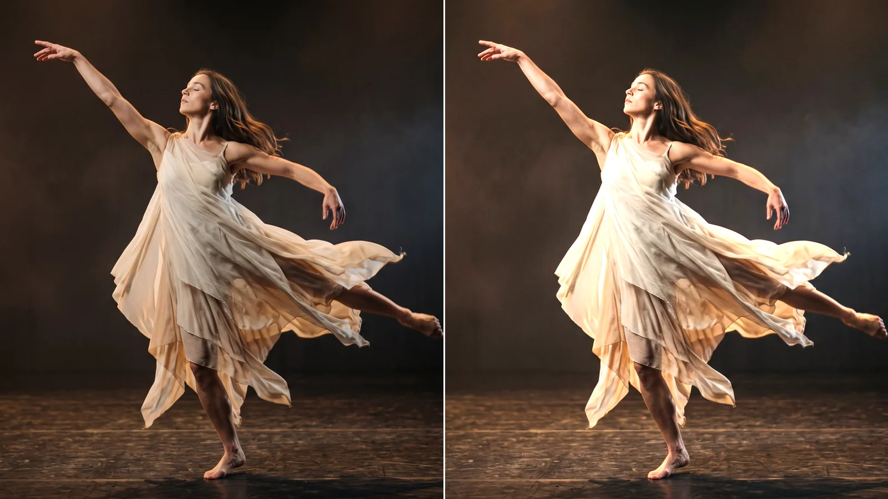
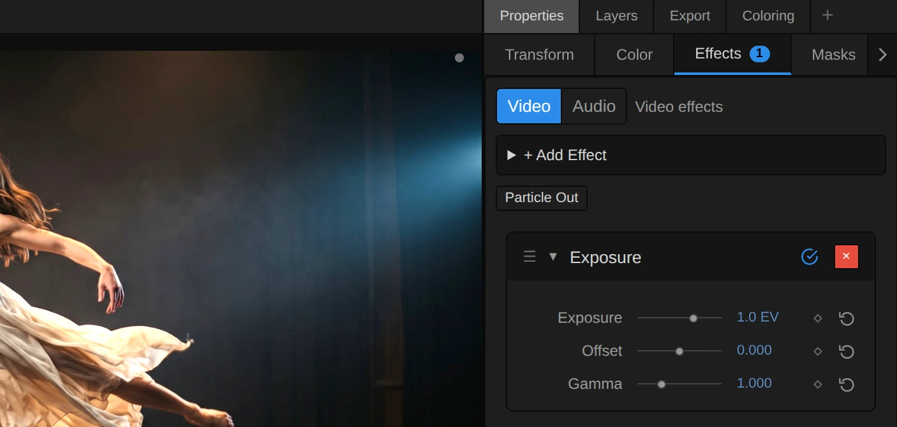
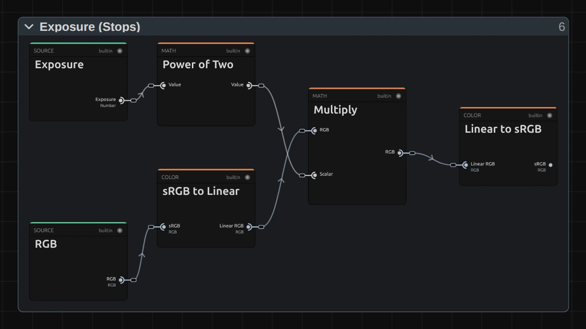

# Exposure

Changes the amount of light like a camera's exposure: +1 doubles it, −1 halves it. Bright areas
can burn out, just as in a camera.

Group: [Color & Tone](../Effects-Color.md) · [How to add an effect](../Effects.md#add-an-effect)

<figure class="docs-shot">

<figcaption>The same part of the frame. Left: original. Right: Exposure +1 EV.</figcaption>
</figure>

**Use it for:** under- or overexposed footage · matching shots filmed with different camera
settings · a fade that feels like light coming up.

- **Exposure** – in camera stops (EV). ±0.3 is a small correction, ±1 a clear change.
- **Offset** – lifts or lowers everything by the same amount.
- **Gamma** – above 1 opens up the mid-tones, below 1 makes them heavier.

**Tip:** keyframe Exposure from −3 EV to 0 for a fade-in that looks like a light being switched up,
not like a dissolve. To brighten without burning out the whites, use [Brightness](./brightness.md).

## Controls

<figure class="docs-shot docs-shot--float-right">

<svg class="docs-shot-overlay" viewBox="0 0 590 527" aria-hidden="true" focusable="false">
<defs><marker id="exposure-inspector-arrow" viewBox="0 0 10 10" refX="8" refY="5" markerWidth="5" markerHeight="5" orient="auto-start-reverse"><path d="M 0 0 L 10 5 L 0 10 Z" fill="#ffd54a" /></marker></defs>
<path class="docs-shot-arrow" d="M355 148 L355 64" marker-end="url(#exposure-inspector-arrow)" />
<circle class="docs-shot-number" cx="355" cy="148" r="18" /><text x="355" y="148" class="docs-shot-number-text">1</text>
<path class="docs-shot-arrow" d="M22 370 L49 370" marker-end="url(#exposure-inspector-arrow)" />
<circle class="docs-shot-number" cx="22" cy="370" r="18" /><text x="22" y="370" class="docs-shot-number-text">2</text>
<path class="docs-shot-arrow" d="M22 465 L49 465" marker-end="url(#exposure-inspector-arrow)" />
<circle class="docs-shot-number" cx="22" cy="465" r="18" /><text x="22" y="465" class="docs-shot-number-text">3</text>
<path class="docs-shot-arrow" d="M464 173 L464 257" marker-end="url(#exposure-inspector-arrow)" />
<circle class="docs-shot-number" cx="464" cy="173" r="18" /><text x="464" y="173" class="docs-shot-number-text">4</text>
</svg>

<figcaption>1 — Properties → Effects lists the effects of the selected clip. 2 — Exposure, in camera stops (the field shows EV). 3 — Gamma, for the mid-tones. 4 — Bypass, to compare with the original.</figcaption>
</figure>

<!-- generated:controls start -->
| Control | Range | Default |
|---|---|---|
| Exposure | −3 to 3 EV | 0 EV |
| Offset | −0.5 to 0.5 | 0 |
| Gamma | 0.2 to 3 | 1 |
<!-- generated:controls end -->

## Node setup

<figure class="docs-shot docs-shot--graph">

<svg class="docs-shot-overlay" viewBox="0 0 1017 572" aria-hidden="true" focusable="false">
<defs><marker id="exposure-stops-arrow" viewBox="0 0 10 10" refX="8" refY="5" markerWidth="5" markerHeight="5" orient="auto-start-reverse"><path d="M 0 0 L 10 5 L 0 10 Z" fill="#ffd54a" /></marker></defs>
<path class="docs-shot-arrow" d="M358 22 L358 68" marker-end="url(#exposure-stops-arrow)" />
<circle class="docs-shot-number" cx="358" cy="22" r="18" /><text x="358" y="22" class="docs-shot-number-text">1</text>
</svg>

<figcaption>Exposure (Stops). 1 — Power of Two turns stops into a light factor: +1 becomes ×2.</figcaption>
</figure>

Each control of the card is a node: the **Exposure** field (2 in the card above) is the **Exposure**
input here. Screen colours are stored brighter than the light they stand for. **sRGB to Linear**
turns them back into amounts of light, **Multiply** changes the light by the factor from **Power of
Two** (1), and **Linear to sRGB** turns the result back into screen colours. That is what makes
+1 EV look like twice the light.

**Remix:** for a twice as strong Exposure slider, put a **Multiply** with a **Value** of 2 between
the **Exposure** card and **Power of Two** (1).

## Technical details

- **Formula.** `2^EV` in linear light with the exact sRGB transfer, then Offset and Gamma on the
  screen colours.
- **Range.** The slider covers ±3 EV; in the number field you can type up to ±20 EV. Gamma renders
  0.2 to 10; at its floor the picture is very dark (x^5), and the inspector says so.
- **Highlights.** Each channel clips on its own, so a strong +EV can shift hues in the highlights.
- Shared colour notes: [Color & Tone](../Effects-Color.md#technical-details). Formulas:
  [Effect system](../Effect-System.md#editable-color-effect-graphs); blocks:
  [Node Catalog](../Node-Catalog.md).
