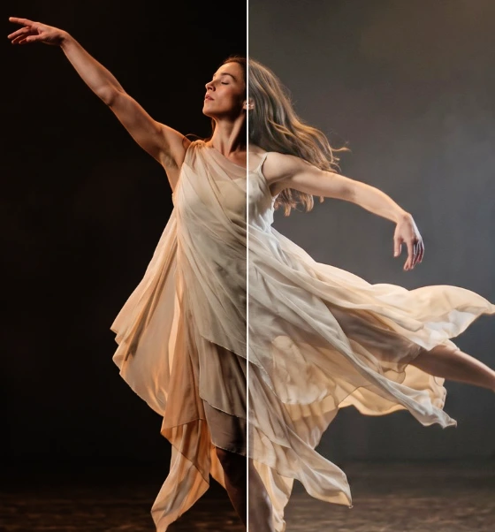
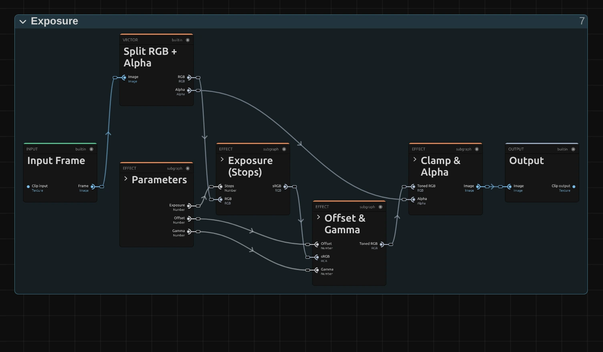
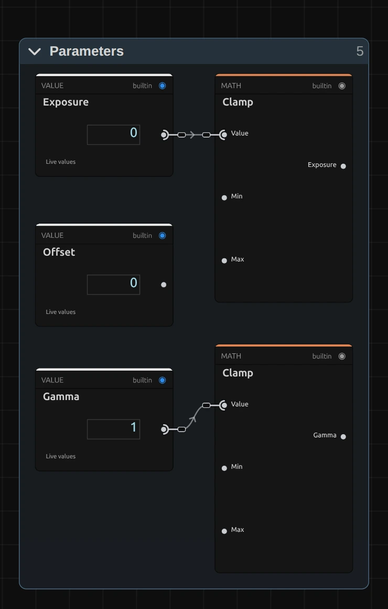
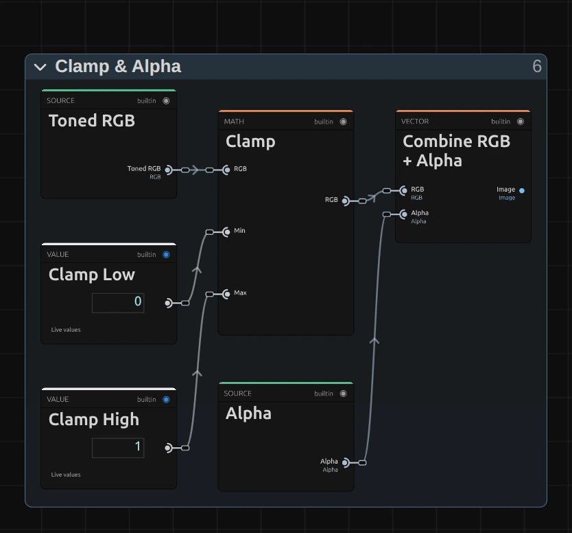

# Exposure

Changes the amount of light, like a camera's exposure: +1 doubles the light, −1 halves it. Bright areas can burn out to white, just as in a camera.

Group: [Color & Tone](../Effects-Color.md) · [How to add an effect](../Effects.md#add-an-effect)

<figure class="docs-shot docs-compare">

<figcaption>Left: original. Right: Exposure +1 EV, twice the light.</figcaption>
</figure>

**Use it for:** under- or overexposed footage · matching shots filmed with different camera settings · a light change that feels like the light itself, not a fade.

- **Exposure** – the light, in camera stops (EV).

**Tip:** keyframe **Exposure** from −3 EV up to 0 for a fade-in that looks like a light being switched up, not like a dissolve. To brighten without burning out the whites, use [Brightness](./brightness.md).

## Presets

<figure class="docs-shot docs-shot--detail">

<figcaption>The four presets on the dancer.</figcaption>
</figure>

Pick one in the **Preset** row of the effect card. It sets Exposure, Offset and Gamma in one undo step, and the row then shows its name until you change a value. A keyframed control keeps its keyframes, and the card says so.

**Half Stop Up** – half a stop more light. A slightly dark shot, corrected the way a camera would, with the shadows opening up as much as the rest.

**Overexposed** – one and a half stops more. Skin glows and the brightest parts of the costume burn out to white, like a camera set for a darker scene.

**One Stop Down** – half the light. For a shot that is too bright, or a stage after the light has dimmed.

**Milky Haze** – lifted blacks and open mid-tones (Offset 0.06, Gamma 1.25), like haze in front of the lens or a faded print. The light itself stays as it was.

## Controls

<figure class="docs-shot">

<svg class="docs-shot-overlay" viewBox="0 0 1017 468" aria-hidden="true" focusable="false">
<defs><marker id="exposure-inspector-arrow" viewBox="0 0 10 10" refX="8" refY="5" markerWidth="5" markerHeight="5" orient="auto-start-reverse"><path d="M 0 0 L 10 5 L 0 10 Z" fill="#ffd54a" /></marker></defs>
<path class="docs-shot-arrow" d="M565 282 L649 282" marker-end="url(#exposure-inspector-arrow)" />
<circle class="docs-shot-number" cx="565" cy="282" r="18" /><text x="565" y="282" class="docs-shot-number-text">1</text>
<path class="docs-shot-arrow" d="M542 344 L626 344" marker-end="url(#exposure-inspector-arrow)" />
<circle class="docs-shot-number" cx="542" cy="344" r="18" /><text x="542" y="344" class="docs-shot-number-text">2</text>
<path class="docs-shot-arrow" d="M569 382 L653 382" marker-end="url(#exposure-inspector-arrow)" />
<circle class="docs-shot-number" cx="569" cy="382" r="18" /><text x="569" y="382" class="docs-shot-number-text">3</text>
<path class="docs-shot-arrow" d="M554 419 L638 419" marker-end="url(#exposure-inspector-arrow)" />
<circle class="docs-shot-number" cx="554" cy="419" r="18" /><text x="554" y="419" class="docs-shot-number-text">4</text>
</svg>

<figcaption>Exposure with the Milky Haze preset. 1 — Preset: pick a starting point. 2 — Exposure: the light, in camera stops. 3 — Offset: lifts or lowers everything. 4 — Gamma: the mid-tones.</figcaption>
</figure>

**Preset** – one of the four starting points above; it sets all three controls.

<figure class="docs-shot docs-clip docs-shot--float-right">
<video src="../assets/effects/clips/exposure-exposure.mp4" poster="../assets/effects/clips/exposure-exposure.webp" width="720" height="540" autoplay muted loop playsinline preload="none" aria-label="The dancer turning on a dark stage with Exposure while it runs from −2 to +2 EV and back: first she is a dim figure in the dark, then the light comes up evenly over the whole stage until the haze glows and the brightest folds of her dress burn out to white; the current value is shown at the bottom left"></video>
<figcaption>Exposure from −2 to +2 EV and back.</figcaption>
</figure>

**Exposure** – the amount of light, in camera stops. Each stop doubles or halves the light, so shadows and highlights change together, as when you open or close a lens. ±0.3 is a small correction, ±1 a clear change, and from about +1.5 the brightest parts burn out to white; each colour channel clips on its own, so very bright colours can shift towards yellow or white. −3 to 3 EV, default 0 EV. In the number field you can type up to ±20 EV.

**Offset** – lifts or lowers every tone by the same amount, after the exposure. Up lays a pale veil over the blacks (haze, a faded print); down sinks the darkest tones into pure black. Small values are enough: 0.03–0.1. −0.5 to 0.5, default 0.

<figure class="docs-shot docs-shot--float-right">

<figcaption>Left half: Gamma 0.6. Right half: Gamma 1.6.</figcaption>
</figure>

**Gamma** – bends the mid-tones while black and white stay where they are. Above 1 they open up and the picture turns lighter and softer; below 1 they get heavier and the colours deeper. 0.8 or 1.25 is a clear change. 0.2 to 3, default 1. In the number field you can type up to 10; at the slider's floor of 0.2 the picture is very dark, and the inspector says so.

## Node setup

<figure class="docs-shot docs-shot--graph">

<svg class="docs-shot-overlay" viewBox="0 0 1017 594" aria-hidden="true" focusable="false">
<defs><marker id="exposure-arrow" viewBox="0 0 10 10" refX="8" refY="5" markerWidth="5" markerHeight="5" orient="auto-start-reverse"><path d="M 0 0 L 10 5 L 0 10 Z" fill="#ffd54a" /></marker></defs>
<path class="docs-shot-arrow" d="M264 507 L264 423" marker-end="url(#exposure-arrow)" />
<circle class="docs-shot-number" cx="264" cy="507" r="18" /><text x="264" y="507" class="docs-shot-number-text">1</text>
<path class="docs-shot-arrow" d="M427 151 L427 235" marker-end="url(#exposure-arrow)" />
<circle class="docs-shot-number" cx="427" cy="151" r="18" /><text x="427" y="151" class="docs-shot-number-text">2</text>
<path class="docs-shot-arrow" d="M589 572 L589 488" marker-end="url(#exposure-arrow)" />
<circle class="docs-shot-number" cx="589" cy="572" r="18" /><text x="589" y="572" class="docs-shot-number-text">3</text>
<path class="docs-shot-arrow" d="M752 151 L752 235" marker-end="url(#exposure-arrow)" />
<circle class="docs-shot-number" cx="752" cy="151" r="18" /><text x="752" y="151" class="docs-shot-number-text">4</text>
</svg>

<figcaption>Exposure opened in the Nodes tab (the Constants folder left out). 1 — Parameters: the three controls, kept within their ranges. 2 — Exposure (Stops): changes the light. 3 — Offset & Gamma: lifts the tones and bends the mid-tones. 4 — Clamp & Alpha: keeps the colour within 0 to 1 and puts the transparency back.</figcaption>
</figure>

Exposure works in four stages, one folder each in the Nodes tab: **Parameters** holds the three controls, **Exposure (Stops)** changes the light, **Offset & Gamma** shapes the tones on the screen colours, and **Clamp & Alpha** finishes. **Split RGB + Alpha** takes the transparency aside first. Every colour effect has this shape ([Color & Tone](../Effects-Color.md#the-shared-idea)). Click a folder's header to open it; the sections below show what is inside.

### Parameters

<figure class="docs-shot docs-shot--graph docs-shot--float-right">

<svg class="docs-shot-overlay" viewBox="0 0 590 983" aria-hidden="true" focusable="false">
<defs><marker id="exposure-parameters-arrow" viewBox="0 0 10 10" refX="8" refY="5" markerWidth="5" markerHeight="5" orient="auto-start-reverse"><path d="M 0 0 L 10 5 L 0 10 Z" fill="#ffd54a" /></marker></defs>
<path class="docs-shot-arrow" d="M432 22 L432 106" marker-end="url(#exposure-parameters-arrow)" />
<circle class="docs-shot-number" cx="432" cy="22" r="18" /><text x="432" y="22" class="docs-shot-number-text">1</text>
<path class="docs-shot-arrow" d="M432 961 L432 877" marker-end="url(#exposure-parameters-arrow)" />
<circle class="docs-shot-number" cx="432" cy="961" r="18" /><text x="432" y="961" class="docs-shot-number-text">2</text>
</svg>

<figcaption>Inside Parameters (the limits of the Clamps left out). 1 — Clamp: keeps Exposure between −20 and 20 EV. 2 — Clamp: keeps Gamma between 0.2 and 10.</figcaption>
</figure>

**Clamp** (1) – keeps Exposure between −20 and 20 EV, the values in **Exposure Render Min** and **Exposure Render Max**. A keyframe, a node or the AI agent may send more; the picture then uses the limit, and the card and the tool result say so. Beyond ±20 EV every pixel is black or white anyway.

**Clamp** (2) – keeps Gamma between 0.2 and 10. At 0 the curve would have no answer, so the floor keeps it at a very dark but valid picture.

**Offset** goes out as it is: any value has a clear result, at most a black or a white picture.

### Exposure (Stops)

<figure class="docs-shot docs-shot--graph">

<svg class="docs-shot-overlay" viewBox="0 0 1017 579" aria-hidden="true" focusable="false">
<defs><marker id="exposure-stops-arrow" viewBox="0 0 10 10" refX="8" refY="5" markerWidth="5" markerHeight="5" orient="auto-start-reverse"><path d="M 0 0 L 10 5 L 0 10 Z" fill="#ffd54a" /></marker></defs>
<path class="docs-shot-arrow" d="M357 556 L357 472" marker-end="url(#exposure-stops-arrow)" />
<circle class="docs-shot-number" cx="357" cy="556" r="18" /><text x="357" y="556" class="docs-shot-number-text">1</text>
<path class="docs-shot-arrow" d="M357 22 L357 102" marker-end="url(#exposure-stops-arrow)" />
<circle class="docs-shot-number" cx="357" cy="22" r="18" /><text x="357" y="22" class="docs-shot-number-text">2</text>
<path class="docs-shot-arrow" d="M621 97 L621 181" marker-end="url(#exposure-stops-arrow)" />
<circle class="docs-shot-number" cx="621" cy="97" r="18" /><text x="621" y="97" class="docs-shot-number-text">3</text>
<path class="docs-shot-arrow" d="M884 131 L884 215" marker-end="url(#exposure-stops-arrow)" />
<circle class="docs-shot-number" cx="884" cy="131" r="18" /><text x="884" y="131" class="docs-shot-number-text">4</text>
</svg>

<figcaption>Inside Exposure (Stops). 1 — sRGB to Linear: screen colours back to amounts of light. 2 — Power of Two: stops to a light factor. 3 — Multiply: changes the light. 4 — Linear to sRGB: back to screen colours.</figcaption>
</figure>

**sRGB to Linear** – screen colours are stored brighter than the light they stand for, so the dark tones get more of the 8-bit steps. This turns them back into amounts of light.

**Power of Two** – turns stops into a light factor: 0 is 1 (no change), +1 is 2, −1 is 0.5, +2 is 4.

**Multiply** – multiplies the light of every channel by that factor. This is the whole exposure: twice the light everywhere, as with an aperture one stop wider.

**Linear to sRGB** – turns the light back into screen colours. That is why +1 EV looks like twice the light and not like a flat brightening. Values above 1 still leave this block; Clamp & Alpha cuts them off at the end.

**Remix:** for a twice as strong Exposure slider, put a **Multiply** with a **Value** of 2 between the **Exposure** input and **Power of Two** (2).

### Offset & Gamma

<figure class="docs-shot docs-shot--graph">

<svg class="docs-shot-overlay" viewBox="0 0 1017 808" aria-hidden="true" focusable="false">
<defs><marker id="exposure-tone-arrow" viewBox="0 0 10 10" refX="8" refY="5" markerWidth="5" markerHeight="5" orient="auto-start-reverse"><path d="M 0 0 L 10 5 L 0 10 Z" fill="#ffd54a" /></marker></defs>
<path class="docs-shot-arrow" d="M509 141 L509 225" marker-end="url(#exposure-tone-arrow)" />
<circle class="docs-shot-number" cx="509" cy="141" r="18" /><text x="509" y="141" class="docs-shot-number-text">1</text>
<path class="docs-shot-arrow" d="M703 141 L703 225" marker-end="url(#exposure-tone-arrow)" />
<circle class="docs-shot-number" cx="703" cy="141" r="18" /><text x="703" y="141" class="docs-shot-number-text">2</text>
<path class="docs-shot-arrow" d="M509 674 L509 590" marker-end="url(#exposure-tone-arrow)" />
<circle class="docs-shot-number" cx="509" cy="674" r="18" /><text x="509" y="674" class="docs-shot-number-text">3</text>
<path class="docs-shot-arrow" d="M897 141 L897 225" marker-end="url(#exposure-tone-arrow)" />
<circle class="docs-shot-number" cx="897" cy="141" r="18" /><text x="897" y="141" class="docs-shot-number-text">4</text>
</svg>

<figcaption>Inside Offset & Gamma. 1 — Add: adds the Offset. 2 — Maximum: nothing below black. 3 — Reciprocal: turns Gamma into the exponent. 4 — Power: bends the mid-tones.</figcaption>
</figure>

**Add** – adds the Offset to each channel of the exposed screen colour.

**Maximum** – with **Tone Zero** (0): a negative Offset may push tones below black; this keeps them at black, so the Power after it always has a valid input.

**Reciprocal** – 1 divided by Gamma. Gamma 2 becomes the exponent 0.5.

**Power** – raises each channel to that exponent. 0 and 1 stay where they are, and only the tones in between move: an exponent below 1 lifts them, above 1 lowers them.

**Remix:** take **Reciprocal** out and wire **Gamma** straight into **Scalar to RGB**: the control then works the other way round, above 1 heavier and below 1 lighter, as in some grading tools.

### Clamp & Alpha

<figure class="docs-shot docs-shot--graph docs-shot--float-right">

<svg class="docs-shot-overlay" viewBox="0 0 590 549" aria-hidden="true" focusable="false">
<defs><marker id="exposure-finish-arrow" viewBox="0 0 10 10" refX="8" refY="5" markerWidth="5" markerHeight="5" orient="auto-start-reverse"><path d="M 0 0 L 10 5 L 0 10 Z" fill="#ffd54a" /></marker></defs>
<path class="docs-shot-arrow" d="M295 23 L295 107" marker-end="url(#exposure-finish-arrow)" />
<circle class="docs-shot-number" cx="295" cy="23" r="18" /><text x="295" y="23" class="docs-shot-number-text">1</text>
</svg>

<figcaption>Inside Clamp & Alpha. 1 — Clamp: keeps each channel between 0 and 1.</figcaption>
</figure>

**Clamp** – keeps each colour channel between **Clamp Low** (0) and **Clamp High** (1). This is where bright tones burn out to white: a channel that has gone past 1 stays at 1.

**Combine RGB + Alpha** then puts the original transparency back, untouched.

## Technical details

- **Formula.** `y = (linear⁻¹(linear(x) · 2^EV) + Offset)^(1/Gamma)` on each colour channel, with the exact sRGB transfer for `linear`; the result is limited to 0–1. At +1 EV a mid-grey of 0.5 becomes 0.69, at −1 EV 0.36.
- **Range.** The Exposure slider covers ±3 EV; typed values, keyframes and nodes render up to ±20 EV. Gamma renders 0.2 to 10, Offset as given. Beyond a limit the picture uses the limit, and the inspector and the tool result say so.
- **Highlights.** Each channel clips on its own, so a strong +EV can shift hues in the brightest areas towards yellow or white.
- **Transparency.** Only the colour is changed; the transparency passes through untouched.
- What all colour effects share (8-bit range, saved projects, adjustment layers): [Color & Tone](../Effect-System.md#color--tone-notes). Formulas: [Effect system](../Effect-System.md#editable-color-effect-graphs); blocks: [Node Catalog](../Node-Catalog.md) · [Styles and presets](../Effects.md#styles-and-presets).
