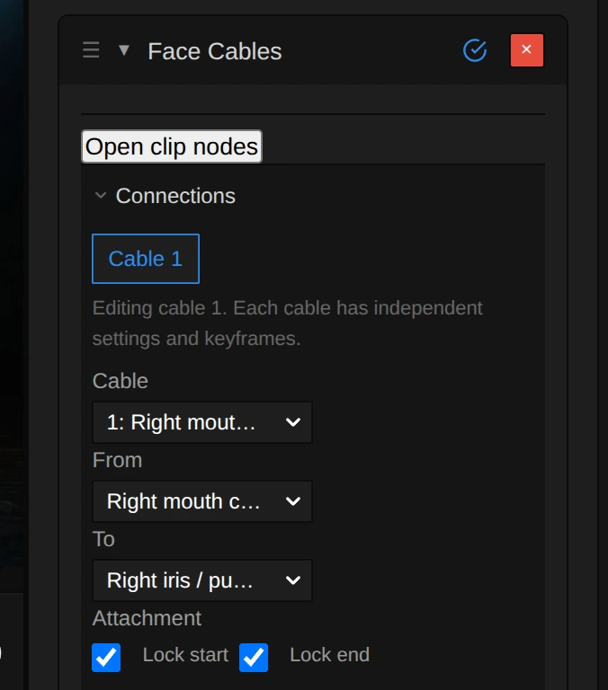

# Face Cables

Ropes that hang between points of a face and swing with gravity, wind and every head movement, like
cables plugged into the performer. Each effect holds 1 to 32 cables.

Group: [Tracking & Overlays](../Effects-Tracking.md) · [How to add an effect](../Effects.md#add-an-effect)

<figure class="docs-shot docs-shot--float-right">

<svg class="docs-shot-overlay" viewBox="0 0 590 670" aria-hidden="true" focusable="false">
<defs><marker id="face-cables-inspector-arrow" viewBox="0 0 10 10" refX="8" refY="5" markerWidth="5" markerHeight="5" orient="auto-start-reverse"><path d="M 0 0 L 10 5 L 0 10 Z" fill="#ffd54a" /></marker></defs>
<path class="docs-shot-arrow" d="M23 446 L83 446" marker-end="url(#face-cables-inspector-arrow)" />
<circle class="docs-shot-number" cx="23" cy="446" r="18" /><text x="23" y="446" class="docs-shot-number-text">1</text>
<path class="docs-shot-arrow" d="M23 599 L83 599" marker-end="url(#face-cables-inspector-arrow)" />
<circle class="docs-shot-number" cx="23" cy="599" r="18" /><text x="23" y="599" class="docs-shot-number-text">2</text>
</svg>

<figcaption>The top of the effect card. 1 — From and To, the two face points the cable hangs between. 2 — Attachment: a locked end stays on its point, an unlocked end falls freely.</figcaption>
</figure>

**Use it for:** cables or tubes attached to a face · threads that swing with a dancer's head · ropes
that fall away when an end is released.

1. Select the video clip and track the face: **Properties → Tracking → Track face**.
2. Add **Face Cables** (**+ Add Effect → Tracking & Overlays**).
3. Choose the two points of each cable in **From** and **To**; **Add cable** adds another one.
4. Click **Bake cables**. The bake computes the swinging once, so playback and the export show the same
   motion.

- **Length factor** – how much longer than the straight line the cable is: 1.05 is taut, 3 hangs low.
- **Gravity** and **Damping** – how far it sags and how quickly the swinging calms down.
- **Wind** – **Toward camera** pushes free cable towards the viewer (negative values: away),
  **Gusts** makes it uneven over time.
- **Style** – a shaded cable or a flat line; **Thickness** and **Color** change the look.

**Tip:** left and right always mean the performer's own left and right, not the screen's. Bake again
after you change the tracking, trim or timing of the clip; until then the old bake plays.

## Controls

The card's sections in order: Connections, Shared wind & face collision, Light & face shadows,
Physics, Wind and Appearance. The cable rows apply to the cable chosen in **Cable**.

<!-- generated:controls start -->
| Control | Range | Default |
|---|---|---|
| **Connections** | | |
| Cable | 1 to 32 cables (Add cable, Branch, Remove cable) | 1 cable |
| From | a face landmark or another cable’s midpoint | Right mouth corner |
| To | a face landmark | Right iris / pupil center |
| Attachment: Lock start, Lock end | on or off | on |
| **Shared wind & face collision** | | |
| Shared wind | on or off | off |
| Shared wind strength | 0 to 30 | 5 |
| Shared wind direction | −180 to 180 | 0 |
| Shared wind elevation | −90 to 90 | 0 |
| Shared wind gusts | 0 to 1 | 0.25 |
| Face collision | on or off | off |
| **Light & face shadows** | | |
| Scene depth | on or off | off |
| Scene depth strength | 0.1 to 2 | 1 |
| Face shadows | on or off | off |
| Light horizontal | −75 to 75 | −30 |
| Light vertical | −75 to 75 | −35 |
| Shadow strength | 0 to 1 | 0.65 |
| Shadow softness | 0 to 0.3 | 0.04 |
| **Physics** | | |
| Segments | 4 to 96 | 24 |
| Length factor | 1.05 to 3 | 1.6 |
| Stiffness | 0 to 1 | 0 |
| Gravity | 0 to 3 | 0.6 |
| Damping | 0.2 to 10 | 2.2 |
| Viscosity | 0 to 1 | 0 |
| **Wind** | | |
| Toward camera | −30 to 30 | 0 |
| Gusts | 0 to 1 | 0 |
| **Appearance** | | |
| Style | Shaded cable, Flat line | Shaded cable |
| Thickness | 1 to 20 | 6 |
| Color | a colour | `#ff873d` |
| Attachments: Show rings | on or off | on |
| **Bake** | | |
| Bake cables · Rebake physics | buttons | – |
<!-- generated:controls end -->

## Node setup

**Open clip nodes** shows the effect as a group on the clip's node canvas, with nested Tracking,
Surface & depth, Cable physics and Cable rendering groups. Node values and the card share the same
settings and keyframes. More: [Effect system: Face Cables nodes](../Effect-System.md#face-cables-nodes).

**Remix:** add a **Wind** node to the Cable physics group and drive its strength with an
**Oscillator**, for a breeze that comes and goes.

## Technical details

- The bake is stored with the project, so playback, scrubbing and the export use the same frames
  without running the physics again. Cancel keeps the previous bake.
- A cable has 4 to 96 segments (24 by default). A frame without a detected face hides the cable;
  when the face is found again the cable starts fresh.
- Works on 2D video clips without crop or 3D tilt; one bake covers up to 18,001 frames.

Go deeper: [Effect system: Face Cables](../Effect-System.md#face-cables) ·
[Landmark tracking effects](../Effect-System.md#landmark-tracking-effects)
