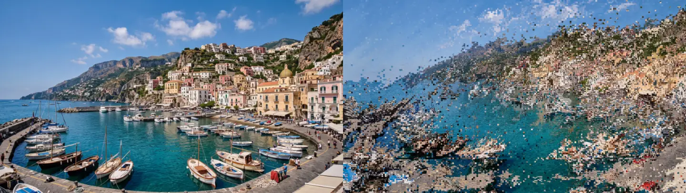

# Flow Mosh

The picture flows along its own contours in whole cells, like a datamosh: colours stream along the edges and in one drift direction, cells copy cells, some race ahead and leave copies behind, rows slip sideways. How far everything has flowed is **Progress**: 0 is the picture exactly, so keying Progress from 1 to 0 lets the picture flow back together.

Group: [Analog & Glitch](../Effects-Analog.md) · [How to add an effect](../Effects.md#add-an-effect)

<figure class="docs-shot docs-compare">

<figcaption>Left: the original. Right: Flow Mosh at its default settings (Progress 0.6).</figcaption>
</figure>

**Use it for:** a texture or pack shot that streams into place · datamosh transitions · liquid glitch stills.

**Animate it:** key **Progress** from 1 to 0 (ease out for a picture that settles slowly). Nothing in the effect moves on its own, so a held Progress is a still.

**Tip:** on artwork whose colours differ more in hue than in brightness (pink against green), set **Flow From** to **Red – Green**, so the flow follows the colour shapes.

## Presets

<figure class="docs-shot docs-shot--detail">

![The harbour town nine times, one preset each: Grid Cells with the town broken into small cells that drift up and to the right; Big Grid with larger square cells; Stream with the hills and water smeared smoothly into liquid shapes; Swirl with the picture pulled round a large whirl; Threads with the outlines pulled into long thin threads; Flow with the colour shapes streaming in soft swirls; Mosh with fine blocks scattered along the stream; Sorted Mosh with the mosh broken into short horizontal streaks sorted from dark to light; Storm with the picture broken into a dense confetti of chunky cells](../assets/effects/presets/flow-mosh.webp)

<figcaption>The nine presets on the harbour town, at Progress 0.6.</figcaption>
</figure>

Pick one in the **Preset** row of the effect card; Progress stays as it is. Sizes follow a design grid of 17.8 px cells at 1080p.

**Grid Cells** – everything moves in half-cell steps on the design grid: nothing gets finer than its cells.

**Big Grid** – the same in whole design cells.

**Stream** – a smooth stream without a grid, with tight turbulent eddies: the picture melts along its contours like paint.

**Swirl** – two counter-rotating vortices pull the picture round, the larger one left of the centre.

**Threads** – strong flow along the contours with many trails, pulling outlines into thin threads.

**Flow** – the softest stream: the colour shapes glide along the borders between pink and green (Flow From Red – Green) with gentle wide swirls.

**Mosh** – fine blocks off the grid, fast cells, jumps and slipped rows: a classic datamosh.

**Sorted Mosh** – the mosh with half of the pixel rows sorted by brightness in short runs.

**Storm** – wild turbulence, chunky fast cells and many jumps and slipped rows: the picture breaks into confetti.

## Controls

### Flow

**Progress** – how far the picture has flowed: from 0, unchanged, to 1, the full Distance. Jumps and Slices also grow with it. 0 to 1, default 0.6.

**Distance** – how far a cell travels at Progress 1. 0 to 1500 px, default 300 px.

**Flow From** – what the flow follows: the contours of the brightness, or of the colour between red and green. Brightness, Red – Green, default Brightness.

**Smoothness** – how much the picture is blurred before the flow is taken from it: small values follow fine detail, large ones only the big shapes. 2 to 200 px, default 30 px.

**Along Contours** – how strongly the flow runs along the contour lines where the picture has an edge. 0 to 2, default 1.

**Edge Pull** – how strong an edge must be to steer the flow: higher values let gentle gradients steer it too. 0 to 5, default 1.

**Drift** – how strongly flat areas flow in Drift Direction. 0 to 2, default 1.

**Drift Direction** – the main direction of the flow; contours flow the way that agrees with it. 0° flows to the right, 90° down. −180 to 180°, default −35°.

**Vortices** – adds two counter-rotating whirls, left of the centre and at the lower right, about a fifth of the frame wide. 0 to 2, default 0.

**Turbulence** – a swirl on top of the flow; it grows as Progress rises. 0 to 3, default 0.6.

**Swirl Size** – how big the swirls are. 4 to 600 px, default 60 px.

### Cells

**Cell Size** – the cells the picture moves in: each cell copies a whole cell, so nothing gets finer than the grid. 1 to 120 px, default 9 px.

**Offset X** – moves the cell grid sideways, to line it up with a grid in the picture. −60 to 60 px, default 0 px.

**Offset Y** – moves the cell grid up or down. −60 to 60 px, default 0 px.

**Snap** – Cells moves whole cells; Pixels lets every pixel follow its own path for a smooth stream. Cells, Pixels, default Cells.

### Glitch

**Particles** – the share of cells that travel faster than the rest. 0 to 1, default 0.15.

**Particle Speed** – how much further the fastest of them travel. 1 to 6×, default 2.5×.

**Trails** – the share of fast cells that copy from a random point of their path, leaving copies along the stream. 0 to 1, default 0.2.

**Jumps** – the share of cells that copy a cell up to 4 cells across and 2 along away. 0 to 1, default 0.08.

**Slices** – the share of cell rows that slip sideways by up to 10 cells. 0 to 1, default 0.06.

**Sort Rows** – the share of pixel rows that sort their colours by brightness in short runs (35 px at 1080p) after the mosh; it grows with Progress. 0 to 1, default 0.

### Mix

**Shape** – Keep holds the layer's outline still (where the flow would bring in transparency, the original stays); Move lets the outline flow too. Keep, Move, default Keep.

**Seed** – another pattern of fast cells, jumps, slices and swirls. 0 to 9999, default 0.

**Amount** – mixes the flowed result with the original. 0 to 1, default 1.

## Node setup

The effect is built from shared nodes; open it in the Nodes tab ([The node setup](../Effects.md#the-node-setup)). Four **Cache Image** nodes at a quarter of the frame hold the stream value (a 4 × 4 **Kernel Sum (Rect)** average), its two **Gaussian** blur passes (**Sequence Reduce**) and the flow field: the blurred value's gradient turned along its contours, blended with the drift direction, plus a curl of **Fractal Noise**. Each cell then reads that field ten times as it traces its path back, rounds the result to whole cells and copies the cell there with **Sample Image**; seeded **Random (Integer Hash)** nodes pick fast cells, jumps and slices. For Sort Rows a **Segment Sort** sorts the result in short row runs; at 0 a **Switch** folds it away when the effect is compiled.

**Remix:** connect a depth map or a matte instead of the stream value, so the picture flows around the subject.

## The full stack

Effect presets hold one effect each, so the textur look in full is three effects on one clip, in this order: **Flow Mosh** with the **Flow** preset (or the calmer **Stream**), then **Pixel Sort Bands** with **Fine + Wide**, then **Block Cloud** with **Brand Base** on top. Key **Progress** of all three from 1 to 0 over the same span, and the picture flows, unsorts and clears into the original together. Each effect is skipped at Progress 0, so the last frame is the original exactly.

## Technical details

- **Units.** Distance, Smoothness, Swirl Size, Cell Size and Offset X/Y are pixels of a 1080p frame and scale with the frame.
- **Stateless.** Every frame traces each cell's path back from scratch, ten steps per cell, through the flow field of the current frame. On footage the flow follows the moving picture; nothing builds up between frames.
- **Edges.** A path that leaves the frame reads the picture mirrored at the edge.
- **Progress 0.** At Progress 0 (or Amount 0) the renderer skips the effect, so the picture is exactly the input.
- **Values.** Values outside the rendered range render clamped; the card and agent tool results say so.

Effect pipelines: [Effect system](../Effect-System.md#pipelines-and-runtimes). Nodes: [Node Catalog](../Node-Catalog.md).
