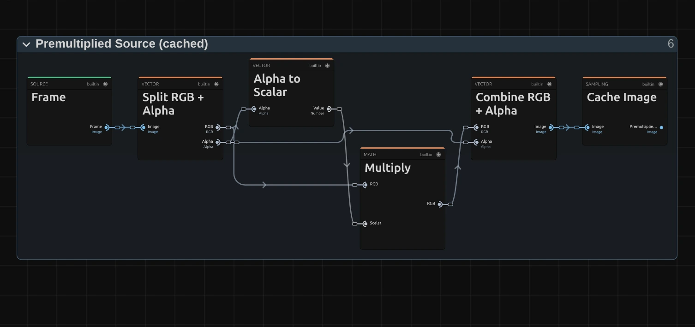
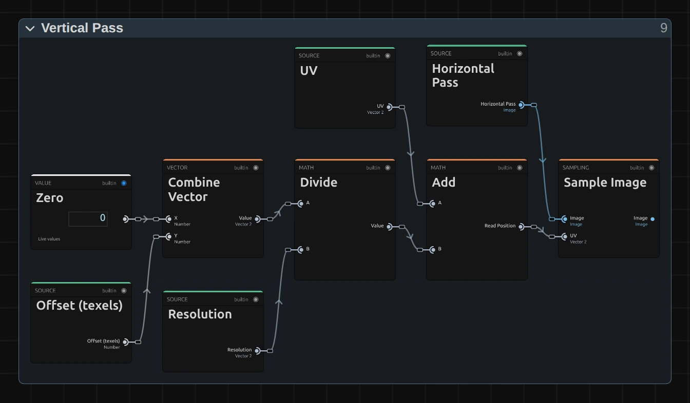
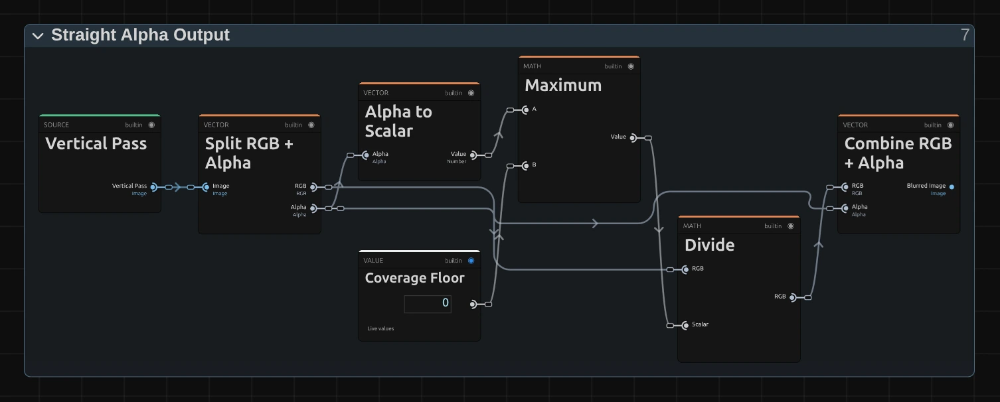

# Gaussian Blur

A smooth, even softening, like a lens out of focus. The standard choice for backgrounds, focus pulls and anything that should simply look soft.

Group: [Blur & Sharpen](../Effects-Blur.md) · [How to add an effect](../Effects.md#add-an-effect)

<figure class="docs-shot docs-compare docs-shot--float-left">

<figcaption>Left: original. Right: Radius 12.</figcaption>
</figure>

**Use it for:** a soft background behind titles · a focus pull on a cue · calming a busy projection.

- **Radius** – how soft the picture gets.

**Tip:** keyframe Radius from 0 up to 10 for a smooth focus pull. For a graphic, square softness use [Box Blur](./box-blur.md); the difference shows most on small lights: [Which one?](../Effects-Blur.md#which-one)

## Presets

<figure class="docs-shot docs-shot--detail">

<figcaption>The four presets on the neon signs of the night street.</figcaption>
</figure>

Pick one in the **Preset** row of the effect card. It sets Radius in one undo step, and the row shows its name until you change something. A Radius with keyframes keeps them, and the card says so.

**Soften** – Radius 3: takes the digital hardness off sharp footage, graphics or text, without looking blurred. Good on a second layer that should sit behind the first.

**Out of Focus** – Radius 10, the default: clearly out of focus, but shapes and faces stay recognisable. A background behind a title or a projection that should not compete with the stage.

**Far Background** – Radius 22: only the large forms and the lights are left, like a background far behind a sharp foreground.

**Wash of Light** – Radius 50: every light melts into a soft, round glow of colour. A quiet backdrop for text or the end point of a scene change.

## Controls

<figure class="docs-shot">

<svg class="docs-shot-overlay" viewBox="0 0 1017 421" aria-hidden="true" focusable="false">
<defs><marker id="gaussian-blur-inspector-arrow" viewBox="0 0 10 10" refX="8" refY="5" markerWidth="5" markerHeight="5" orient="auto-start-reverse"><path d="M 0 0 L 10 5 L 0 10 Z" fill="#ffd54a" /></marker></defs>
<path class="docs-shot-arrow" d="M565 282 L649 282" marker-end="url(#gaussian-blur-inspector-arrow)" />
<circle class="docs-shot-number" cx="565" cy="282" r="18" /><text x="565" y="282" class="docs-shot-number-text">1</text>
<path class="docs-shot-arrow" d="M561 344 L645 344" marker-end="url(#gaussian-blur-inspector-arrow)" />
<circle class="docs-shot-number" cx="561" cy="344" r="18" /><text x="561" y="344" class="docs-shot-number-text">2</text>
</svg>

<figcaption>Gaussian Blur at its default, which is also the Out of Focus preset. 1 — Preset: pick a starting point. 2 — Radius: how soft the picture gets.</figcaption>
</figure>

**Preset** – a starting point for Radius; see [Presets](#presets).

<figure class="docs-shot docs-shot--float-right">

<figcaption>The same street lamps at Radius 10. Left: Gaussian Blur. Right: Box Blur.</figcaption>
</figure>

**Radius** – how soft the picture gets. Every pixel becomes an average of its neighbours, the nearest counting most, so edges melt into each other and small lights turn into round glows, like a lens out of focus. It starts to show at about 1; 2–5 takes the edge off, 10 is clearly out of focus, around 20 only the large forms are left and 50 leaves soft patches of light and colour. It counts pixels of a 1080p picture, so a 4K export shows the same blur relative to the picture. Animated, it changes smoothly, and 0 leaves the picture untouched. 0 to 50 px, default 10 px.

## Node setup

<figure class="docs-shot docs-shot--graph">

<svg class="docs-shot-overlay" viewBox="0 0 1017 617" aria-hidden="true" focusable="false">
<defs><marker id="gaussian-blur-arrow" viewBox="0 0 10 10" refX="8" refY="5" markerWidth="5" markerHeight="5" orient="auto-start-reverse"><path d="M 0 0 L 10 5 L 0 10 Z" fill="#ffd54a" /></marker></defs>
<path class="docs-shot-arrow" d="M150 308 L234 308" marker-end="url(#gaussian-blur-arrow)" />
<circle class="docs-shot-number" cx="150" cy="308" r="18" /><text x="150" y="308" class="docs-shot-number-text">1</text>
<path class="docs-shot-arrow" d="M150 512 L234 512" marker-end="url(#gaussian-blur-arrow)" />
<circle class="docs-shot-number" cx="150" cy="512" r="18" /><text x="150" y="512" class="docs-shot-number-text">2</text>
<path class="docs-shot-arrow" d="M344 178 L428 178" marker-end="url(#gaussian-blur-arrow)" />
<circle class="docs-shot-number" cx="344" cy="178" r="18" /><text x="344" y="178" class="docs-shot-number-text">3</text>
<path class="docs-shot-arrow" d="M538 321 L622 321" marker-end="url(#gaussian-blur-arrow)" />
<circle class="docs-shot-number" cx="538" cy="321" r="18" /><text x="538" y="321" class="docs-shot-number-text">4</text>
<path class="docs-shot-arrow" d="M733 269 L817 269" marker-end="url(#gaussian-blur-arrow)" />
<circle class="docs-shot-number" cx="733" cy="269" r="18" /><text x="733" y="269" class="docs-shot-number-text">5</text>
</svg>

<figcaption>Gaussian Blur opened in the Nodes tab (Constants, Coordinates and the Output card left out). 1 — Radius & Tap Count: how wide the bell curve is. 2 — Premultiplied Source: the picture, ready to average. 3 — Horizontal Pass: blurs the rows. 4 — Vertical Pass: blurs the columns. 5 — Straight Alpha Output: back to a normal picture.</figcaption>
</figure>

Gaussian Blur works in five stages, one folder each in the Nodes tab: **Radius & Tap Count** turns Radius into the width of a bell curve and the number of reads, **Premultiplied Source** prepares the picture so transparent edges stay clean, **Horizontal Pass** blurs along the rows and **Vertical Pass** along the columns of that result, and **Straight Alpha Output** turns the result back into a normal picture. A bell curve across the rows followed by one down the columns is exactly the round blur of a lens, at a fraction of the reads. Click a folder's header to open it. [Box Blur](./box-blur.md#node-setup) has the same stages; only the weights inside the passes differ.

### Radius & Tap Count

<figure class="docs-shot docs-shot--graph">

![Inside the Radius & Tap Count folder: Resolution through Smallest Component, divided by Reference Height 1080, times Radius gives the radius in pixels; times Sigma Per Radius 0.5, at least Sigma Minimum by Maximum, gives the Sigma; times Reach Sigmas 3 gives the Reach; Reach times Half, rounded up by Ceiling and capped by Minimum with Pairs Limit 127 gives the Pairs; Reach divided by Pair Span Limit 254, at least one, gives the Stride; Pairs times Two plus one gives the Tap Count (the card One that both read is left out of the picture)](../assets/effects/graphs/gaussian-blur-radius-tap-count.webp)

<svg class="docs-shot-overlay" viewBox="0 0 1017 1017" aria-hidden="true" focusable="false">
<defs><marker id="gaussian-blur-radius-tap-count-arrow" viewBox="0 0 10 10" refX="8" refY="5" markerWidth="5" markerHeight="5" orient="auto-start-reverse"><path d="M 0 0 L 10 5 L 0 10 Z" fill="#ffd54a" /></marker></defs>
<path class="docs-shot-arrow" d="M273 99 L273 183" marker-end="url(#gaussian-blur-radius-tap-count-arrow)" />
<circle class="docs-shot-number" cx="273" cy="99" r="18" /><text x="273" y="99" class="docs-shot-number-text">1</text>
<path class="docs-shot-arrow" d="M902 99 L902 183" marker-end="url(#gaussian-blur-radius-tap-count-arrow)" />
<circle class="docs-shot-number" cx="902" cy="99" r="18" /><text x="902" y="99" class="docs-shot-number-text">2</text>
<path class="docs-shot-arrow" d="M115 434 L115 518" marker-end="url(#gaussian-blur-radius-tap-count-arrow)" />
<circle class="docs-shot-number" cx="115" cy="434" r="18" /><text x="115" y="434" class="docs-shot-number-text">3</text>
<path class="docs-shot-arrow" d="M587 678 L587 674" marker-end="url(#gaussian-blur-radius-tap-count-arrow)" />
<circle class="docs-shot-number" cx="587" cy="678" r="18" /><text x="587" y="678" class="docs-shot-number-text">4</text>
<path class="docs-shot-arrow" d="M902 758 L902 674" marker-end="url(#gaussian-blur-radius-tap-count-arrow)" />
<circle class="docs-shot-number" cx="902" cy="758" r="18" /><text x="902" y="758" class="docs-shot-number-text">5</text>
</svg>

<figcaption>Inside Radius & Tap Count, the folder that turns Radius into reads. The number cards are values from the Constants folder, shown where they plug in. 1 — Smallest Component: the shorter side of the frame. 2 — Maximum: the Sigma. 3 — Multiply: the Reach. 4 — Minimum: the pairs of reads. 5 — Add: the Tap Count.</figcaption>
</figure>

**Smallest Component** – the shorter side of the frame. Divided by 1080 it says how much larger or smaller this frame is than a 1080p one; the next Multiply turns Radius into pixels of this frame, so a 4K export, a portrait frame and a thumbnail show the same blur.

**Maximum** – the Sigma: half the radius in pixels, the width of the bell curve. It never goes below a tiny 0.0001, so Radius 0 cannot divide by zero; at that size the curve only covers the pixel itself and the picture stays exactly as it was.

**Multiply** – Sigma times 3: the Reach. Beyond three Sigma a neighbour counts less than 1 %, so the curve is cut there without a visible edge. At 1080p the blur therefore reaches about 1.5 × Radius pixels to each side.

**Minimum** – how many pairs of pixels each side reads: half the Reach, rounded up by Ceiling, but at most 127. Beside it, Divide and the lower Maximum give the stride: 1 up to a reach of 254 pixels, so every pixel is read; beyond that the reads spread out instead of cutting the curve short. Only a frame with a shorter side above about 3600 px reaches that at Radius 50.

**Add** – Pairs times Two plus One: the Tap Count, the pixel itself and both pixels of every pair.

### Premultiplied Source

<figure class="docs-shot docs-shot--graph">

<svg class="docs-shot-overlay" viewBox="0 0 1017 377" aria-hidden="true" focusable="false">
<defs><marker id="gaussian-blur-premultiplied-source-arrow" viewBox="0 0 10 10" refX="8" refY="5" markerWidth="5" markerHeight="5" orient="auto-start-reverse"><path d="M 0 0 L 10 5 L 0 10 Z" fill="#ffd54a" /></marker></defs>
<path class="docs-shot-arrow" d="M437 262 L521 262" marker-end="url(#gaussian-blur-premultiplied-source-arrow)" />
<circle class="docs-shot-number" cx="437" cy="262" r="18" /><text x="437" y="262" class="docs-shot-number-text">1</text>
<path class="docs-shot-arrow" d="M762 134 L846 134" marker-end="url(#gaussian-blur-premultiplied-source-arrow)" />
<circle class="docs-shot-number" cx="762" cy="134" r="18" /><text x="762" y="134" class="docs-shot-number-text">2</text>
</svg>

<figcaption>Inside Premultiplied Source (cached). 1 — Multiply: colour times transparency. 2 — Cache Image: keeps the prepared picture.</figcaption>
</figure>

**Multiply** – multiplies each pixel's colour by its alpha. A see-through pixel then adds almost nothing to the average, so the colour of its invisible part cannot leak into the blur as a dark rim around a cut-out figure or a title.

**Cache Image** – keeps the prepared picture in a 16-bit float texture for Horizontal Pass to read, so no precision is lost in dark areas.

### Horizontal Pass

<figure class="docs-shot docs-shot--graph">

<svg class="docs-shot-overlay" viewBox="0 0 1017 684" aria-hidden="true" focusable="false">
<defs><marker id="gaussian-blur-horizontal-pass-arrow" viewBox="0 0 10 10" refX="8" refY="5" markerWidth="5" markerHeight="5" orient="auto-start-reverse"><path d="M 0 0 L 10 5 L 0 10 Z" fill="#ffd54a" /></marker></defs>
<path class="docs-shot-arrow" d="M86 188 L170 188" marker-end="url(#gaussian-blur-horizontal-pass-arrow)" />
<circle class="docs-shot-number" cx="86" cy="188" r="18" /><text x="86" y="188" class="docs-shot-number-text">1</text>
<path class="docs-shot-arrow" d="M226 116 L310 116" marker-end="url(#gaussian-blur-horizontal-pass-arrow)" />
<circle class="docs-shot-number" cx="226" cy="116" r="18" /><text x="226" y="116" class="docs-shot-number-text">2</text>
<path class="docs-shot-arrow" d="M365 207 L449 207" marker-end="url(#gaussian-blur-horizontal-pass-arrow)" />
<circle class="docs-shot-number" cx="365" cy="207" r="18" /><text x="365" y="207" class="docs-shot-number-text">3</text>
<path class="docs-shot-arrow" d="M504 179 L588 179" marker-end="url(#gaussian-blur-horizontal-pass-arrow)" />
<circle class="docs-shot-number" cx="504" cy="179" r="18" /><text x="504" y="179" class="docs-shot-number-text">4</text>
<path class="docs-shot-arrow" d="M644 169 L728 169" marker-end="url(#gaussian-blur-horizontal-pass-arrow)" />
<circle class="docs-shot-number" cx="644" cy="169" r="18" /><text x="644" y="169" class="docs-shot-number-text">5</text>
</svg>

<figcaption>Inside Horizontal Pass, reduced to its recipe (the read position is left out). 1 — Pair Tap Offsets: where to read. 2 — Gaussian Falloff: the weight of a neighbour. 3 — Merge Pair Weights: two pixels in one read. 4 — Sequence Reduce: adds up the reads. 5 — Normalize by Weight: turns the sum into an average.</figcaption>
</figure>

**Pair Tap Offsets** – lists the reads along the row: the pixel itself and, for every pair, the distance of its near and far pixel. It holds a small node setup of its own; its › opens it.

**Gaussian Falloff** – the bell curve itself: how much a pixel at that distance counts, 1 at the centre and fading smoothly with distance; Sigma sets how wide. There is one for the near and one for the far pixel of each pair. This is the only place where Gaussian Blur differs from Box Blur.

**Merge Pair Weights** – folds each pair into one read at the point between its two pixels where their weights balance. The graphics card blends the two pixels there for free, so one read covers two and the result is exact.

**Sequence Reduce** – reads the Premultiplied Source at every position (**Sample Image**) and adds up the reads, each times its weight.

**Normalize by Weight** – divides that sum by the sum of all weights, so the average keeps the picture's brightness, and **Cache Image** keeps the blurred rows for the vertical pass.

### Vertical Pass

<figure class="docs-shot docs-shot--graph">

<svg class="docs-shot-overlay" viewBox="0 0 1017 595" aria-hidden="true" focusable="false">
<defs><marker id="gaussian-blur-vertical-pass-arrow" viewBox="0 0 10 10" refX="8" refY="5" markerWidth="5" markerHeight="5" orient="auto-start-reverse"><path d="M 0 0 L 10 5 L 0 10 Z" fill="#ffd54a" /></marker></defs>
<path class="docs-shot-arrow" d="M150 308 L234 308" marker-end="url(#gaussian-blur-vertical-pass-arrow)" />
<circle class="docs-shot-number" cx="150" cy="308" r="18" /><text x="150" y="308" class="docs-shot-number-text">1</text>
<path class="docs-shot-arrow" d="M733 308 L817 308" marker-end="url(#gaussian-blur-vertical-pass-arrow)" />
<circle class="docs-shot-number" cx="733" cy="308" r="18" /><text x="733" y="308" class="docs-shot-number-text">2</text>
</svg>

<figcaption>Inside Vertical Pass, the read position. 1 — Combine Vector: the offset points up and down. 2 — Sample Image: reads the blurred rows.</figcaption>
</figure>

Vertical Pass holds the same recipe as Horizontal Pass, with two differences:

**Combine Vector** – puts the offset into the second, vertical place (the first is Zero), so the reads go up and down a column instead of along a row.

**Sample Image** – reads the cached result of Horizontal Pass instead of the source. A bell curve along the rows followed by one down the columns gives a perfectly round blur.

**Remix:** for a blur that stretches sideways, like a lens with a horizontal smear, open **Vertical Pass**, **Multiply** Sigma by a **Value** of 0.3 and plug the result into the Sigma input of both **Gaussian Falloff** nodes there. The rows stay as soft as before, the columns get sharper.

### Straight Alpha Output

<figure class="docs-shot docs-shot--graph">

<svg class="docs-shot-overlay" viewBox="0 0 1017 409" aria-hidden="true" focusable="false">
<defs><marker id="gaussian-blur-straight-alpha-arrow" viewBox="0 0 10 10" refX="8" refY="5" markerWidth="5" markerHeight="5" orient="auto-start-reverse"><path d="M 0 0 L 10 5 L 0 10 Z" fill="#ffd54a" /></marker></defs>
<path class="docs-shot-arrow" d="M437 132 L521 132" marker-end="url(#gaussian-blur-straight-alpha-arrow)" />
<circle class="docs-shot-number" cx="437" cy="132" r="18" /><text x="437" y="132" class="docs-shot-number-text">1</text>
<path class="docs-shot-arrow" d="M599 294 L683 294" marker-end="url(#gaussian-blur-straight-alpha-arrow)" />
<circle class="docs-shot-number" cx="599" cy="294" r="18" /><text x="599" y="294" class="docs-shot-number-text">2</text>
<path class="docs-shot-arrow" d="M762 177 L846 177" marker-end="url(#gaussian-blur-straight-alpha-arrow)" />
<circle class="docs-shot-number" cx="762" cy="177" r="18" /><text x="762" y="177" class="docs-shot-number-text">3</text>
</svg>

<figcaption>Inside Straight Alpha Output. 1 — Maximum: never divide by zero. 2 — Divide: the colour back to full strength. 3 — Combine RGB + Alpha: the finished picture.</figcaption>
</figure>

**Maximum** – the blurred alpha, but never below the Coverage Floor, a tiny 0.000001 (the card rounds it to 0). Fully transparent pixels then stay black and transparent instead of turning into errors.

**Divide** – divides the blurred colour by the blurred alpha: the reverse of the Multiply in Premultiplied Source, so half-transparent edges get their real colour back.

**Combine RGB + Alpha** – joins colour and alpha into the finished picture that leaves the effect.

## Technical details

- **Size.** Radius counts pixels of a frame whose shorter side is 1080: preview quality, a 4K export, a portrait frame and the thumbnails all show the same blur relative to the picture.
- **Kernel.** A bell curve with Sigma = Radius / 2, cut at 3 Sigma. A horizontal pass into a 16-bit float cache, then a vertical pass: about 1.5 × Radius + 1 reads per pass at 1080p, two pixels per read. Up to 127 reads per side; beyond that (Radius 50 on a frame whose shorter side is above about 3600 px) the reads spread out, and the card and the tool result say so.
- **Small radii.** Below about Radius 0.7 the curve is so narrow that the change stays under one step of an 8-bit picture; from 1 on it shows.
- **Edges.** At the frame edge the outermost pixels repeat, so a large Radius does not darken the border. Transparent edges fade without a dark rim, and the preview and the export match.
- **Zero.** An unedited Gaussian Blur at Radius 0 is skipped, so the picture passes through exactly.
- **Software preview.** Where the editor falls back to its software preview, Gaussian Blur uses a canvas blur of the same width, close to the GPU preview and the export.
- **Saved projects.** They render with this kernel. Compared with the kernel of versions before the blur rebuild, small radii blur a little more and large radii about 20 % less at the same Radius; the old Samples value is kept in the project but no longer changes anything. A Gaussian Blur whose node setup you edited keeps its own recipe.
- **More:** [Blur & Sharpen notes](../Effect-System.md#blur--sharpen-notes) · [Editable blur kernels](../Effect-System.md#editable-blur-kernels) · [Node Catalog](../Node-Catalog.md) · [Styles and presets](../Effects.md#styles-and-presets).
