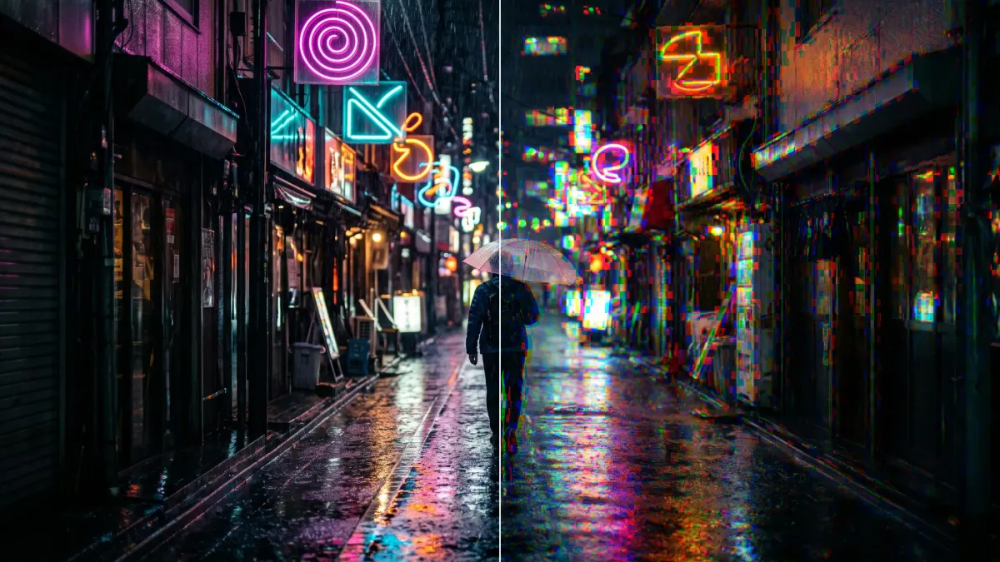

# Glass Dispersion

Splits the colours in small cells, as if seen through rippled glass. Red and blue slide apart in each cell and pulse over time. Marked *Experimental*: start with low values.

Group: [Lens & Distort](../Effects-Distort.md) · [How to add an effect](../Effects.md#add-an-effect)

<figure class="docs-shot">

<figcaption>Left: original. Right: default settings (Cell Size 14 px, Dispersion 0.3).</figcaption>
</figure>

**Use it for:** a prism-like shimmer on lights and neon · a disturbed, nervous picture · colour noise for a glitch transition.

- **Cell Size** – how large the cells are, in pixels.
- **Dispersion** – how far red and blue slide apart in each cell.
- **Pulse Speed** – how fast the split pulses; 0 holds it still.

**Experimental:** cells are sized in pixels of the output, so the look changes with the resolution, and each cell splits the colours its own way, so strong Dispersion reads as blocks of RGB noise.

## Controls

<!-- generated:controls start -->
| Control | Range | Default |
|---|---|---|
| **Pattern** | | |
| Cell Size (px) | 4 to 80 | 14 |
| **Style** | | |
| Dispersion | 0 to 1 | 0.3 |
| **Motion** | | |
| Pulse Speed | 0 to 5 | 1 |
<!-- generated:controls end -->

## Node setup

Glass Dispersion is one look of the pattern engine: its card has a **Style** menu that switches to other looks with the same controls, such as [Glitch Grid](./glitch-grid.md) ([Styles and presets](../Effects.md#styles-and-presets)). Its own graph gives every cell a random direction, reads red a little forward and blue a little backward along it (Dispersion × the **Value** 0.025, pulsing between 0.6 and 1), and keeps green and the coverage where they are.

**Remix:** for a steady split without pulsing, select the **Value** 0.4 (Pulse Range) and set it to 0.

## Technical details

- **Units.** Cell Size is in pixels of the rendered frame (at least 4). At Dispersion 1 red and blue move by up to 2.5 % of the frame each, in opposite directions.
- **Time.** The pulse follows timeline time, so the preview, scrubbing and the export match.
- **Experimental.** The effect list adds "(Experimental)"; the inspector and agent tool results give the reason above. Values below a control's floor are reported, not silently raised.

Implementation note (shared with Wave Lines and Crystal Glass): [Effect system: Wave Lines](../Effect-System.md#wave-lines). Nodes: [Node Catalog](../Node-Catalog.md).
