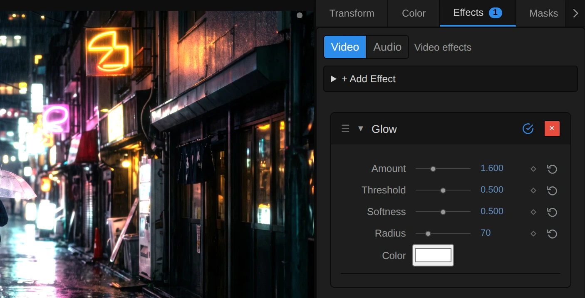

# Glow

Makes the bright parts of the picture shine with a soft halo, like light blooming in a lens. Good
for neon, stage lights, candles and dreamy scenes.

Group: [Light & Stylize](../Effects-Stylize.md) · [How to add an effect](../Effects.md#add-an-effect)

<figure class="docs-shot">

<figcaption>Left: original. Right: the default values (Amount 2.5, Threshold 0.95, Radius 80).</figcaption>
</figure>

**Use it for:** neon and practical lights · a dreamy, soft-focus scene · titles that glow on a
transparent layer.

- **Threshold** – which parts glow. At the default 0.95 only lamps, neon and other lights close to
  white glow, so a daylight sky stays calm. Lower it and more of the picture glows.
- **Radius** – how far the light spreads: 20 is a tight halo, 80 a soft glow, 150 and more a wide
  haze.
- **Amount** – how bright the glow is. It is screened on, so it never clips hard; very strong
  settings still wash towards white.
- **Color** – tints the glow, for example warm orange for candle light.

**Tip:** Softness decides how far below Threshold light starts to join in; keep it at 0.5 for a
natural look.

## Controls

<figure class="docs-shot">

<svg class="docs-shot-overlay" viewBox="0 0 1017 519" aria-hidden="true" focusable="false">
<defs><marker id="glow-inspector-arrow" viewBox="0 0 10 10" refX="8" refY="5" markerWidth="5" markerHeight="5" orient="auto-start-reverse"><path d="M 0 0 L 10 5 L 0 10 Z" fill="#ffd54a" /></marker></defs>
<path class="docs-shot-arrow" d="M555 293 L639 293" marker-end="url(#glow-inspector-arrow)" />
<circle class="docs-shot-number" cx="555" cy="293" r="18" /><text x="555" y="293" class="docs-shot-number-text">1</text>
<path class="docs-shot-arrow" d="M538 331 L622 331" marker-end="url(#glow-inspector-arrow)" />
<circle class="docs-shot-number" cx="538" cy="331" r="18" /><text x="538" y="331" class="docs-shot-number-text">2</text>
<path class="docs-shot-arrow" d="M561 406 L645 406" marker-end="url(#glow-inspector-arrow)" />
<circle class="docs-shot-number" cx="561" cy="406" r="18" /><text x="561" y="406" class="docs-shot-number-text">3</text>
</svg>

<figcaption>A Glow on the night street. 1 — Amount: how bright. 2 — Threshold: what glows. 3 — Radius: how far it spreads.</figcaption>
</figure>

<!-- generated:controls start -->
| Control | Range | Default |
|---|---|---|
| Amount | 0 to 5 | 2.5 |
| Threshold | 0 to 1 | 0.95 |
| Softness | 0 to 1 | 0.5 |
| Radius | 0 to 300 | 80 |
| Color | a colour | `#ffffff` |

The effect card also has controls of its own that this table does not list.
<!-- generated:controls end -->

## Node setup

<figure class="docs-shot docs-shot--float-right">

<figcaption>The last step of Glow: the room left to white shrinks by exp(−Glow), so the glow brightens the picture but never pushes it past white.</figcaption>
</figure>

**Bright Pass** keeps the light of the brightest pixels: from a little below Threshold it lets more
and more of a pixel's light through, all of it at white. **Pyramid: Halve the Light** then shrinks
that light ten times, each copy half the size of the last (a **Cache Image** with its
**Resolution** set to 1/2, 1/4 …), so every copy is softer and reaches further. **Pyramid: Add
Levels Back Up** adds the copies together; Radius decides how many join. **Glow Resolve & Alpha**
tints the result, scales it and screens it onto the picture: faint glows add their light, bright
parts have less room left, so nothing passes white.

**Remix:** to see the glow alone, on black, open **Glow Resolve & Alpha** and plug a **Value** of 0
into the Scalar input of the **Multiply** fed by **Source Color**, in place of **Source Alpha**: the
Room becomes 1 everywhere. Handy for judging the glow's shape and colour; to check what Threshold
picks, look at the output of **Bright Pass** instead.

## Technical details

- **Units.** Radius is in pixels of a 1080p frame and scales with the rendered size, so preview,
  export and 4K match.
- **Bright pass.** A smoothstep on the brightest channel, from Threshold − Softness ×
  min(Threshold, 1 − Threshold) up to white, premultiplied.
- **Pyramid.** Ten half-size Cache Image levels (`[1 3 3 1]` down, 3 × 3 tent up). A level joins as
  Radius grows from half its reach to its reach, levels finer than 3 px fade out, and level 0 (the
  bright pass itself) carries what a smaller render cannot resolve, so previews match the export.
  21 small passes and about 1.7 frames of `rgba16float` cache at any Radius.
- **Screen.** `1 − (1 − picture) × exp(−glow)`: no hard clipping, but very strong settings still
  approach white.
- **Transparency.** Alpha grows into the halo, so titles on transparent layers glow outside their
  letters: [Glow on transparent and 3D layers](../Effect-System.md#glow-on-transparent-and-3d-layers).
- **Warnings.** A Radius past the largest level (about 1536 at 1080p) and a Threshold at or above
  white are reported.
- **Saved projects.** A Glow saved before 2026-10-21 keeps its earlier ring look; its card offers
  **Use the new Glow (resets its values)**, which also removes its keyframes, in one undo step. Rings
  and Samples/Ring are read only by those earlier graphs.
- **Software preview.** The worker software renderer builds the bloom pyramid on the CPU, slowly at
  large sizes.
- Shared notes: [Light & Stylize](../Effect-System.md#light--stylize-notes). Formulas:
  [Effect system](../Effect-System.md#editable-blur-kernels); blocks:
  [Node Catalog](../Node-Catalog.md).
