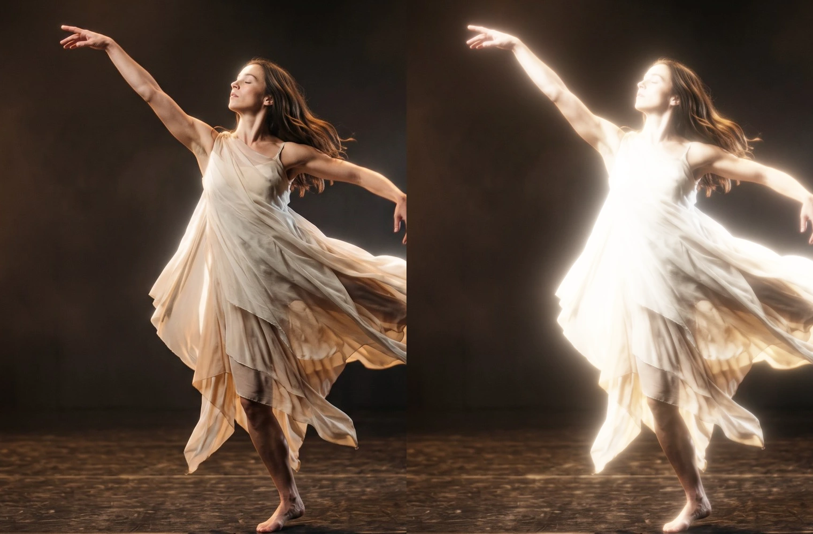

# Glow

Makes the bright parts of the picture shine with a soft halo, like light blooming in a lens. Good for neon, stage lights, candles and dreamy scenes.

Group: [Light & Stylize](../Effects-Stylize.md) · [How to add an effect](../Effects.md#add-an-effect)

<figure class="docs-shot docs-compare docs-shot--float-left">

<figcaption>Left: original. Right: the default values (Amount 2.5, Threshold 0.95, Radius 80 px).</figcaption>
</figure>

**Use it for:** neon and practical lights · a dreamy, soft-focus scene · titles that glow on a transparent layer.

- **Threshold** – which parts glow: at the default only lamps, neon and other lights close to white.
- **Radius** – how far the light spreads, from a tight halo to a wide haze.
- **Amount** – how bright the halo is.

**Tip:** lower **Threshold** to about 0.6 and a bright costume starts to shine on its own, without any lamp in the picture.

## Presets

<figure class="docs-shot docs-shot--detail">

<figcaption>The four presets on neon signs in the rain.</figcaption>
</figure>

Pick one in the **Preset** row of the effect card. It sets all five controls in one undo step, and the row shows its name until you change something. A control with keyframes keeps them, and the card says so.

**Tight Halo** – a small, crisp halo that hugs the lamps, neon and brightest highlights. The picture stays sharp; only the lights get a little air around them.

**Neon Bloom** – lights bloom strongly, as through a lens on a rainy night. The classic look for neon signs, practicals and headlights.

**Dream Glow** – the Threshold drops so far that bright skin and costumes join in: the whole figure shines in a soft, wide haze. For memories, dreams and slow scenes.

**Moonlight** – a cool blue halo, like moonlight or a cold follow spot. It turns warm lights cold around their edges without regrading the picture.

## Controls

<figure class="docs-shot">

<svg class="docs-shot-overlay" viewBox="0 0 1017 568" aria-hidden="true" focusable="false">
<defs><marker id="glow-inspector-arrow" viewBox="0 0 10 10" refX="8" refY="5" markerWidth="5" markerHeight="5" orient="auto-start-reverse"><path d="M 0 0 L 10 5 L 0 10 Z" fill="#ffd54a" /></marker></defs>
<path class="docs-shot-arrow" d="M565 282 L649 282" marker-end="url(#glow-inspector-arrow)" />
<circle class="docs-shot-number" cx="565" cy="282" r="18" /><text x="565" y="282" class="docs-shot-number-text">1</text>
<path class="docs-shot-arrow" d="M555 344 L639 344" marker-end="url(#glow-inspector-arrow)" />
<circle class="docs-shot-number" cx="555" cy="344" r="18" /><text x="555" y="344" class="docs-shot-number-text">2</text>
<path class="docs-shot-arrow" d="M538 382 L622 382" marker-end="url(#glow-inspector-arrow)" />
<circle class="docs-shot-number" cx="538" cy="382" r="18" /><text x="538" y="382" class="docs-shot-number-text">3</text>
<path class="docs-shot-arrow" d="M548 419 L632 419" marker-end="url(#glow-inspector-arrow)" />
<circle class="docs-shot-number" cx="548" cy="419" r="18" /><text x="548" y="419" class="docs-shot-number-text">4</text>
<path class="docs-shot-arrow" d="M561 457 L645 457" marker-end="url(#glow-inspector-arrow)" />
<circle class="docs-shot-number" cx="561" cy="457" r="18" /><text x="561" y="457" class="docs-shot-number-text">5</text>
<path class="docs-shot-arrow" d="M574 494 L658 494" marker-end="url(#glow-inspector-arrow)" />
<circle class="docs-shot-number" cx="574" cy="494" r="18" /><text x="574" y="494" class="docs-shot-number-text">6</text>
</svg>

<figcaption>Glow with the Neon Bloom preset. 1 — Preset: pick a starting point. 2 — Amount: how bright. 3 — Threshold: what glows. 4 — Softness: how gently light joins in. 5 — Radius: how far it spreads. 6 — Color: the tint of the halo.</figcaption>
</figure>

**Preset** – a starting point for all five controls; see [Presets](#presets).

**Amount** – how bright the halo is. 1 is a gentle bloom, 2.5 a clear glow, 4 and more a strong one. The glow is screened on, so it brightens without hard clipping, but very high values still wash the lights and their surroundings towards white. 0 adds no glow at all. 0 to 5, default 2.5.

<figure class="docs-shot docs-compare docs-shot--float-right" data-before="Threshold 0.95" data-after="Threshold 0.55">

<figcaption>Left: Threshold 0.95, the default. Right: Threshold 0.55.</figcaption>
</figure>

**Threshold** – which parts glow, judged by each pixel's brightest colour channel, so saturated neon counts as bright. At the default 0.95 only lamps, neon and highlights close to white glow, and a daylight sky stays calm. Around 0.7 bright skin and light costumes start to shine; below 0.5 most of the picture glows and it turns hazy. At 1 only light brighter than white (HDR footage) glows, and the card says so. 0 to 1, default 0.95.

**Softness** – how gently light below Threshold joins in. At 0 the glow starts sharply at Threshold; higher values let it fade in from a little below. How far below depends on Threshold: at the default 0.95 even Softness 1 only reaches down to 0.9, while at Threshold 0.5 it reaches all the way to black, so the whole picture glows a little. Leave it at 0.5 for a natural look. 0 to 1, default 0.5.

**Radius** – how far the light spreads. 10–20 px is a tight halo that hugs the light, 80 px a soft glow, 150 px and more a wide haze that fills the dark around a lamp. It counts pixels of a 1080p picture, so the preview, a 4K export and a portrait frame show the same glow, and it changes smoothly when animated. At 0 the lights only brighten without spreading. 0 to 300 px, default 80 px.

**Color** – tints the halo: white keeps each light's own colour, warm orange gives candle light, a pale blue moonlight. A light that is already white stays white at its centre; the tint shows in the glow around it. Color cannot be keyframed; for a change of tint on a cue, stack two Glows with different colours and keyframe their Amounts. The swatch takes a colour, default `#ffffff` (white).

## Node setup

<figure class="docs-shot docs-shot--graph">

<svg class="docs-shot-overlay" viewBox="0 0 1017 1229" aria-hidden="true" focusable="false">
<defs><marker id="glow-arrow" viewBox="0 0 10 10" refX="8" refY="5" markerWidth="5" markerHeight="5" orient="auto-start-reverse"><path d="M 0 0 L 10 5 L 0 10 Z" fill="#ffd54a" /></marker></defs>
<path class="docs-shot-arrow" d="M313 927 L313 843" marker-end="url(#glow-arrow)" />
<circle class="docs-shot-number" cx="313" cy="927" r="18" /><text x="313" y="927" class="docs-shot-number-text">1</text>
<path class="docs-shot-arrow" d="M313 254 L313 338" marker-end="url(#glow-arrow)" />
<circle class="docs-shot-number" cx="313" cy="254" r="18" /><text x="313" y="254" class="docs-shot-number-text">2</text>
<path class="docs-shot-arrow" d="M672 242 L588 242" marker-end="url(#glow-arrow)" />
<circle class="docs-shot-number" cx="672" cy="242" r="18" /><text x="672" y="242" class="docs-shot-number-text">3</text>
<path class="docs-shot-arrow" d="M867 956 L783 956" marker-end="url(#glow-arrow)" />
<circle class="docs-shot-number" cx="867" cy="956" r="18" /><text x="867" y="956" class="docs-shot-number-text">4</text>
<path class="docs-shot-arrow" d="M897 254 L897 338" marker-end="url(#glow-arrow)" />
<circle class="docs-shot-number" cx="897" cy="254" r="18" /><text x="897" y="254" class="docs-shot-number-text">5</text>
</svg>

<figcaption>Glow opened in the Nodes tab (Constants, Coordinates and the Output card left out). 1 — Bright Pass: the light that glows. 2 — Tap Kernel & Level Weight: how much each level counts. 3 — Pyramid Down: ten ever smaller copies. 4 — Pyramid Up: the copies added back together. 5 — Glow Resolve & Alpha: the halo screened onto the picture.</figcaption>
</figure>

Glow works like light in a lens. **Bright Pass** keeps only the light of the brightest pixels. **Pyramid Down** shrinks that light ten times, each copy half the size of the last, so every copy is softer and reaches further. **Pyramid Up** adds the copies back together, each as much as **Tap Kernel & Level Weight** says for the Radius you set. **Glow Resolve & Alpha** tints that halo, scales it by Amount and screens it onto the picture. Shrinking and adding back costs the same at any Radius, so a wide haze is as fast as a tight halo. Click a folder's header to open it.

### Bright Pass (ramp to white)

<figure class="docs-shot docs-shot--graph">

<svg class="docs-shot-overlay" viewBox="0 0 1017 636" aria-hidden="true" focusable="false">
<defs><marker id="glow-bright-pass-arrow" viewBox="0 0 10 10" refX="8" refY="5" markerWidth="5" markerHeight="5" orient="auto-start-reverse"><path d="M 0 0 L 10 5 L 0 10 Z" fill="#ffd54a" /></marker></defs>
<path class="docs-shot-arrow" d="M230 614 L230 530" marker-end="url(#glow-bright-pass-arrow)" />
<circle class="docs-shot-number" cx="230" cy="614" r="18" /><text x="230" y="614" class="docs-shot-number-text">1</text>
<path class="docs-shot-arrow" d="M369 187 L369 271" marker-end="url(#glow-bright-pass-arrow)" />
<circle class="docs-shot-number" cx="369" cy="187" r="18" /><text x="369" y="187" class="docs-shot-number-text">2</text>
<path class="docs-shot-arrow" d="M648 136 L648 220" marker-end="url(#glow-bright-pass-arrow)" />
<circle class="docs-shot-number" cx="648" cy="136" r="18" /><text x="648" y="136" class="docs-shot-number-text">3</text>
<path class="docs-shot-arrow" d="M926 187 L926 271" marker-end="url(#glow-bright-pass-arrow)" />
<circle class="docs-shot-number" cx="926" cy="187" r="18" /><text x="926" y="187" class="docs-shot-number-text">4</text>
</svg>

<figcaption>Inside Bright Pass, reduced to its recipe (how Ramp Start and Ramp End are worked out is left out). 1 — Largest Component: the brightest channel. 2 — Smoothstep: how much of the pixel glows. 3 — Multiply: the light that glows. 4 — Cache Image: keeps it for the pyramid.</figcaption>
</figure>

**Largest Component** – the brightest of a pixel's red, green and blue. Using the brightest channel instead of the overall brightness lets a saturated pink or cyan neon glow as strongly as a white lamp.

**Smoothstep** – the share of the pixel's light that glows: none below the Ramp Start, all of it at white, with a smooth curve between. The Ramp Start is Threshold minus Softness times the headroom (the smaller of Threshold and 1 − Threshold), worked out by the **Subtract** to its left; that is why Softness reaches further at middle Thresholds.

**Multiply** – the pixel's colour times that share (and times its transparency, in the Multiply before it): the light that will glow, in its own colour. Everything else is black.

**Cache Image** – keeps the Bright Light as a full-size picture, the starting point of the pyramid and of the finest part of the glow.

**Remix:** for a glow that only answers to white light and leaves coloured neon dark, replace **Largest Component** with a **Luminance** node: saturated colours then count as darker than they look.

### Tap Kernel & Level Weight

<figure class="docs-shot docs-shot--graph">

<svg class="docs-shot-overlay" viewBox="0 0 1017 836" aria-hidden="true" focusable="false">
<defs><marker id="glow-level-weight-arrow" viewBox="0 0 10 10" refX="8" refY="5" markerWidth="5" markerHeight="5" orient="auto-start-reverse"><path d="M 0 0 L 10 5 L 0 10 Z" fill="#ffd54a" /></marker></defs>
<path class="docs-shot-arrow" d="M369 78 L369 162" marker-end="url(#glow-level-weight-arrow)" />
<circle class="docs-shot-number" cx="369" cy="78" r="18" /><text x="369" y="78" class="docs-shot-number-text">1</text>
<path class="docs-shot-arrow" d="M787 78 L787 162" marker-end="url(#glow-level-weight-arrow)" />
<circle class="docs-shot-number" cx="787" cy="78" r="18" /><text x="787" y="78" class="docs-shot-number-text">2</text>
<path class="docs-shot-arrow" d="M926 387 L926 303" marker-end="url(#glow-level-weight-arrow)" />
<circle class="docs-shot-number" cx="926" cy="387" r="18" /><text x="926" y="387" class="docs-shot-number-text">3</text>
</svg>

<figcaption>Inside Tap Kernel & Level Weight, the level weight (the 3 × 3 tap weights are left out). The number cards are values from the Constants folder, shown where they plug in. 1 — Natural Logarithm: Radius in octaves. 2 — Smoothstep: a level joins in. 3 — Multiply: the Level Weight.</figcaption>
</figure>

This folder serves every pass of the pyramid. It holds the 3 × 3 tap weights (1-2-1 across and down) and where to read them, and it decides how much each level counts. It runs inside each pass at that pass's own size, so the same cards give every level its own answer.

**Natural Logarithm** – compares Radius with the reach of the level being worked on (Reference Height 1620 is 1080 pixels times the one and a half pixels a level reaches) and turns the ratio into octaves with Ln2: 0 when Radius matches the level's reach, −1 at half of it.

**Smoothstep** – lets a level join smoothly while Radius grows from half its reach to its full reach. That is why an animated Radius widens the glow without steps.

**Multiply** – the radius weight times the Fine Fade, which fades out levels finer than about 3 px of a 1080p frame. A 4K export then uses the same levels as the 1080p preview and looks the same.

**Remix:** for a tighter, brighter halo at the same Radius, put a **Power** node with an exponent of 2 between the **Smoothstep** and the **Multiply**: every level that is still joining counts less, so the wide levels hold back until Radius is well past their reach.

### Pyramid Down (halve the light)

<figure class="docs-shot docs-shot--graph">

<svg class="docs-shot-overlay" viewBox="0 0 1017 583" aria-hidden="true" focusable="false">
<defs><marker id="glow-pyramid-down-arrow" viewBox="0 0 10 10" refX="8" refY="5" markerWidth="5" markerHeight="5" orient="auto-start-reverse"><path d="M 0 0 L 10 5 L 0 10 Z" fill="#ffd54a" /></marker></defs>
<path class="docs-shot-arrow" d="M509 354 L509 270" marker-end="url(#glow-pyramid-down-arrow)" />
<circle class="docs-shot-number" cx="509" cy="354" r="18" /><text x="509" y="354" class="docs-shot-number-text">1</text>
<path class="docs-shot-arrow" d="M703 302 L703 218" marker-end="url(#glow-pyramid-down-arrow)" />
<circle class="docs-shot-number" cx="703" cy="302" r="18" /><text x="703" y="302" class="docs-shot-number-text">2</text>
<path class="docs-shot-arrow" d="M897 276 L897 192" marker-end="url(#glow-pyramid-down-arrow)" />
<circle class="docs-shot-number" cx="897" cy="276" r="18" /><text x="897" y="276" class="docs-shot-number-text">3</text>
</svg>

<figcaption>Inside Pyramid Down, the first of its ten levels; the other nine repeat it. 1 — Kernel Sum (Rect): 3 × 3 reads. 2 — Normalize by Weight: their average. 3 — Cache Image: a picture half the size.</figcaption>
</figure>

**Kernel Sum (Rect)** – reads the light at 3 × 3 places around each pixel of the smaller picture (**Sample Image** reads them, one pixel of the larger picture apart) and adds them up with the tap weights. Together with the smooth reads this is a gentle 1-3-3-1 filter, so the copies do not flicker or show steps.

**Normalize by Weight** – divides the sum by the summed weights: the average light of that patch, as bright as before.

**Cache Image** – keeps the result at half the size of the one before (its Resolution is 1/2, 1/4 … 1/1024 of the frame). Each level is a softer copy that, when it is enlarged again, spreads twice as far as the one before.

### Pyramid Up (add levels back)

<figure class="docs-shot docs-shot--graph">

<svg class="docs-shot-overlay" viewBox="0 0 1017 592" aria-hidden="true" focusable="false">
<defs><marker id="glow-pyramid-up-arrow" viewBox="0 0 10 10" refX="8" refY="5" markerWidth="5" markerHeight="5" orient="auto-start-reverse"><path d="M 0 0 L 10 5 L 0 10 Z" fill="#ffd54a" /></marker></defs>
<path class="docs-shot-arrow" d="M326 382 L326 298" marker-end="url(#glow-pyramid-up-arrow)" />
<circle class="docs-shot-number" cx="326" cy="382" r="18" /><text x="326" y="382" class="docs-shot-number-text">1</text>
<path class="docs-shot-arrow" d="M569 403 L569 319" marker-end="url(#glow-pyramid-up-arrow)" />
<circle class="docs-shot-number" cx="569" cy="403" r="18" /><text x="569" y="403" class="docs-shot-number-text">2</text>
<path class="docs-shot-arrow" d="M813 230 L813 146" marker-end="url(#glow-pyramid-up-arrow)" />
<circle class="docs-shot-number" cx="813" cy="230" r="18" /><text x="813" y="230" class="docs-shot-number-text">3</text>
<path class="docs-shot-arrow" d="M935 214 L935 130" marker-end="url(#glow-pyramid-up-arrow)" />
<circle class="docs-shot-number" cx="935" cy="214" r="18" /><text x="935" y="214" class="docs-shot-number-text">4</text>
</svg>

<figcaption>Inside Pyramid Up, its last step (level 1); the steps for levels 9 to 2 repeat it. 1 — Sample Image: this level's own light. 2 — Multiply: by its Level Weight. 3 — Combine RGB + Alpha: light and weight together. 4 — Cache Image: all levels so far.</figcaption>
</figure>

Pyramid Up climbs back from the smallest level. Each step enlarges the sum of the smaller levels with a 3 × 3 tent (the top row: **Kernel Sum (Rect)** and Normalize by Weight), which makes it smooth and round, and adds the level of its own size.

**Sample Image** – reads this level's own light from Pyramid Down.

**Multiply** – scales that light by the Level Weight, so a level outside the Radius adds nothing; **Add** joins it to the enlarged smaller levels.

**Combine RGB + Alpha** – stores the light in the colour and the sum of the weights so far in the alpha. The weights travel up with the light, so the last folder knows how many levels joined.

**Cache Image** – keeps the result at the size of this level, for the next step up; after level 1 it holds every level the Radius asks for.

### Glow Resolve & Alpha

<figure class="docs-shot docs-shot--graph">

<svg class="docs-shot-overlay" viewBox="0 0 1017 1068" aria-hidden="true" focusable="false">
<defs><marker id="glow-resolve-arrow" viewBox="0 0 10 10" refX="8" refY="5" markerWidth="5" markerHeight="5" orient="auto-start-reverse"><path d="M 0 0 L 10 5 L 0 10 Z" fill="#ffd54a" /></marker></defs>
<path class="docs-shot-arrow" d="M322 435 L322 351" marker-end="url(#glow-resolve-arrow)" />
<circle class="docs-shot-number" cx="322" cy="435" r="18" /><text x="322" y="435" class="docs-shot-number-text">1</text>
<path class="docs-shot-arrow" d="M509 132 L509 216" marker-end="url(#glow-resolve-arrow)" />
<circle class="docs-shot-number" cx="509" cy="132" r="18" /><text x="509" y="132" class="docs-shot-number-text">2</text>
<path class="docs-shot-arrow" d="M322 1046 L322 962" marker-end="url(#glow-resolve-arrow)" />
<circle class="docs-shot-number" cx="322" cy="1046" r="18" /><text x="322" y="1046" class="docs-shot-number-text">3</text>
<path class="docs-shot-arrow" d="M695 1046 L695 962" marker-end="url(#glow-resolve-arrow)" />
<circle class="docs-shot-number" cx="695" cy="1046" r="18" /><text x="695" y="1046" class="docs-shot-number-text">4</text>
</svg>

<figcaption>Inside Glow Resolve & Alpha, reduced to its recipe (level 0 and the transparency are left out). 1 — Square Root: how many levels joined. 2 — Divide: the Glow Light. 3 — Power: exp(−Glow). 4 — Subtract: the picture screened with the glow.</figcaption>
</figure>

First this folder enlarges the added levels once more and adds level 0, the Bright Light itself, which carries the finest part of the glow (and, in a smaller preview, the levels it cannot show). Then:

**Square Root** – of the summed weights of every level that joined. A wide Radius adds many levels; dividing by the square root lets the halo grow wider without flooding the frame with light.

**Divide** – the light sum divided by that root: the Glow Light. Two Multiply cards then tint it with **Color** and scale it by **Amount**.

**Power** – e to the power of minus the glow: 1 where there is no glow, falling towards 0 where the glow is strong.

**Subtract** – 1 minus the room left to white times that falloff: the picture screened with the glow. Faint glows add their light, bright areas have less room left, and nothing passes white. The cards after it (left out here) let the alpha grow into the halo, so a title on a transparent layer glows outside its letters.

**Remix:** to see the glow alone, on black, plug a **Value** of 0 into the Scalar input of the **Multiply** that makes the Premultiplied Source (fed by Source Color), in place of Source Alpha: the Room becomes 1 everywhere. Handy for judging the halo's shape and colour.

## Technical details

- **Units.** Radius is in pixels of a 1080p frame and scales with the rendered size, so preview, export and 4K match.
- **Bright pass.** A smoothstep on the brightest channel, from Threshold − Softness × min(Threshold, 1 − Threshold) up to white, premultiplied.
- **Pyramid.** Ten half-size Cache Image levels (`[1 3 3 1]` down, 3 × 3 tent up). A level joins as Radius grows from half its reach to its reach, levels finer than 3 px fade out, and level 0 (the bright pass itself) carries what a smaller render cannot resolve, so previews match the export. 21 small passes and about 1.7 frames of `rgba16float` cache at any Radius.
- **Screen.** `1 − (1 − picture) × exp(−glow)`: no hard clipping, but very strong settings still approach white.
- **Transparency.** Alpha grows into the halo, so titles on transparent layers glow outside their letters: [Glow on transparent and 3D layers](../Effect-System.md#glow-on-transparent-and-3d-layers).
- **Warnings.** A Radius past the largest level (about 1536 px at 1080p) and a Threshold at or above white are reported in the card and the tool result.
- **Saved projects.** A Glow saved before 2026-10-21 keeps its earlier ring look; its card offers **Use the new Glow (resets its values)**, which also removes its keyframes, in one undo step. Rings and Samples/Ring are read only by those earlier graphs. A Glow saved since then may still hold one unused card from the top of Pyramid Up; it changes nothing in the picture.
- **Software preview.** The worker software renderer builds the bloom pyramid on the CPU, slowly at large sizes.
- **More:** [Light & Stylize notes](../Effect-System.md#light--stylize-notes) · [Editable blur kernels](../Effect-System.md#editable-blur-kernels) · [Node Catalog](../Node-Catalog.md) · [Styles and presets](../Effects.md#styles-and-presets).
