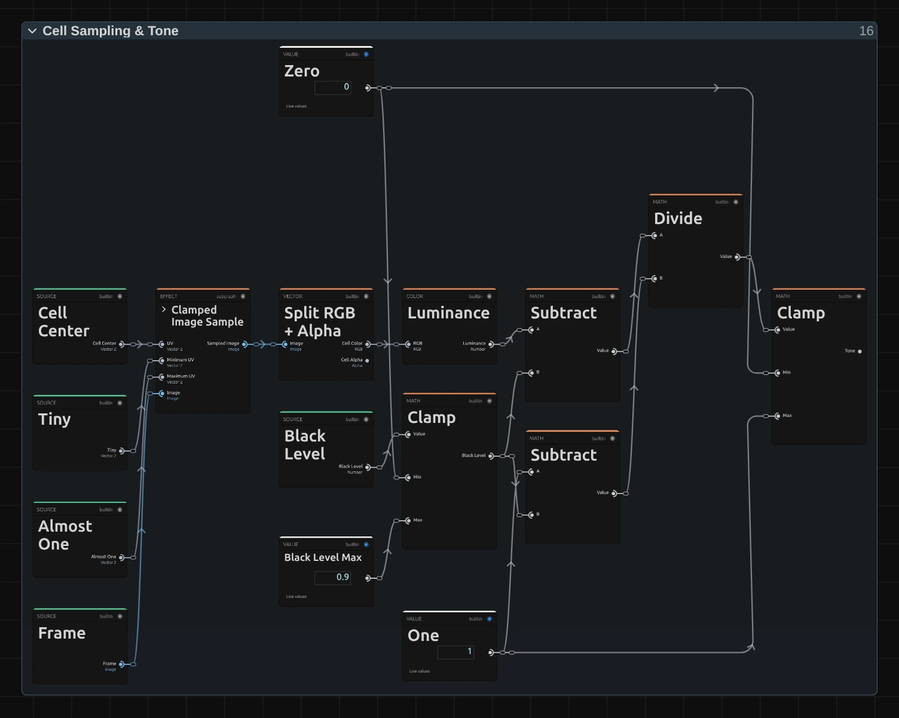
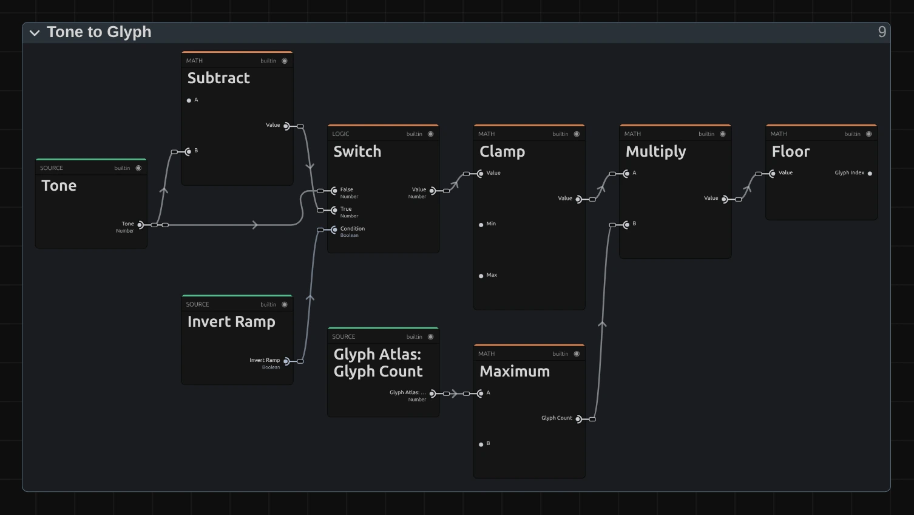

# Glyph Matrix

Rebuilds the picture from characters that keep rolling on to their neighbours, in diagonal waves. For screens, data and thinking machines: the figure stays readable, the text never stands still.

Group: [Text & Glyph](../Effects-Glyph.md) · [How to add an effect](../Effects.md#add-an-effect)

<figure class="docs-shot docs-clip docs-compare">
<video src="../assets/effects/clips/glyph-matrix.mp4" poster="../assets/effects/clips/glyph-matrix.webp" width="1200" height="584" autoplay muted loop playsinline preload="none" aria-label="The dancer turning on a dark stage, original left and with Glyph Matrix right: she is rebuilt from small letters and signs in a grid, dense ones in her bright dress and faint dots and strokes on the dark stage, and every character keeps ticking on to its neighbours in the ramp, so the picture shimmers in diagonal waves"></video>
<figcaption>Left: original. Right: Glyph Matrix at its default settings.</figcaption>
</figure>

**Use it for:** a computer, a control room or a data stream on stage · a figure made of living text · a picture that dissolves into code on a cue.

- **Cell Size** – how big the characters are.
- **Roll** – how far they roll: a soft shimmer or whole waves of the alphabet.
- **Speed** – how fast they tick on.

**Tip:** keyframe **Roll** from 0 to 1 to let a calm character picture break into rolling waves of text, and back to 0 to let it settle.

## Presets

<figure class="docs-shot docs-clip">
<video src="../assets/effects/clips/glyph-matrix-presets.mp4" poster="../assets/effects/clips/glyph-matrix-presets.webp" width="962" height="1010" autoplay muted loop playsinline preload="none" aria-label="The dancer four times in a grid, moving in sync, each with one preset: Data Wave top left with diagonal staircases of bars sweeping across her, Shade Shimmer top right with fine dotted shading blocks, Ice Code bottom left with white letters on a deep blue field, Split-Flap bottom right with large letters running through the alphabet"></video>
<figcaption>The four presets on the moving dancer, in sync.</figcaption>
</figure>

Pick one in the **Preset** row of the effect card. It sets all controls at once, in one undo step, and the row then shows its name until you change something. A control with keyframes keeps them, and the card says so.

**Data Wave** – bars that roll through the whole ramp: diagonal staircases sweep across the picture, and the figure shows in their colours. Graphic and restless; strong on large surfaces and with electronic music.

**Shade Shimmer** – small cells of shading blocks that shimmer among their neighbours. The figure stays easy to read while its surface boils softly, like an old monitor.

**Ice Code** – white letters on a deep blue field, rolling through half the ramp. Cool and technical: a control room, a data stream, a mind at work.

**Split-Flap** – large letters that run through the alphabet, like the departure board of a station. The picture shows in the colour of the cells. For travel, waiting and announcements.

## Controls

<figure class="docs-shot">

<svg class="docs-shot-overlay" viewBox="0 0 1017 1247" aria-hidden="true" focusable="false">
<defs><marker id="glyph-matrix-inspector-arrow" viewBox="0 0 10 10" refX="8" refY="5" markerWidth="5" markerHeight="5" orient="auto-start-reverse"><path d="M 0 0 L 10 5 L 0 10 Z" fill="#ffd54a" /></marker></defs>
<path class="docs-shot-arrow" d="M565 319 L649 319" marker-end="url(#glyph-matrix-inspector-arrow)" />
<circle class="docs-shot-number" cx="565" cy="319" r="18" /><text x="565" y="319" class="docs-shot-number-text">1</text>
<path class="docs-shot-arrow" d="M583 425 L667 425" marker-end="url(#glyph-matrix-inspector-arrow)" />
<circle class="docs-shot-number" cx="583" cy="425" r="18" /><text x="583" y="425" class="docs-shot-number-text">2</text>
<path class="docs-shot-arrow" d="M559 578 L643 578" marker-end="url(#glyph-matrix-inspector-arrow)" />
<circle class="docs-shot-number" cx="559" cy="578" r="18" /><text x="559" y="578" class="docs-shot-number-text">3</text>
<path class="docs-shot-arrow" d="M605 731 L689 731" marker-end="url(#glyph-matrix-inspector-arrow)" />
<circle class="docs-shot-number" cx="605" cy="731" r="18" /><text x="605" y="731" class="docs-shot-number-text">4</text>
<path class="docs-shot-arrow" d="M622 1188 L706 1188" marker-end="url(#glyph-matrix-inspector-arrow)" />
<circle class="docs-shot-number" cx="622" cy="1188" r="18" /><text x="622" y="1188" class="docs-shot-number-text">5</text>
</svg>

<figcaption>Glyph Matrix with the Data Wave preset. 1 — Preset: pick a starting point. 2 — Cell Size. 3 — Background. 4 — Ramp: the characters, here Bars. 5 — Roll: how far they roll through the ramp.</figcaption>
</figure>

**Style** – switches to another look of the same engine and keeps your values and keyframes, for example [Symbol Matrix](./symbol-matrix.md), [Matrix Rain](./matrix.md) or [Retro Matrix](./retro-matrix.md).

### Grid

<figure class="docs-shot docs-clip docs-shot--float-right">
<video src="../assets/effects/clips/glyph-matrix-cell-size.mp4" poster="../assets/effects/clips/glyph-matrix-cell-size.webp" width="720" height="700" autoplay muted loop playsinline preload="none" aria-label="The dancer with Glyph Matrix while Cell Size runs from 8 to 40 px and back: fine rolling print grows into a few large letters and shrinks again; the current value is shown at the bottom left"></video>
<figcaption>Cell Size from 8 to 40 px and back.</figcaption>
</figure>

**Cell Size** – how big one character is. 8–10 gives fine print that shimmers like a screen full of data, 14 small but clear characters, 24 and more large letters that read on a projection; at 72 the frame holds only 15 rows of large signs. It counts pixels of a 1080p picture, so the preview, the thumbnails and a 4K export show the same grid. 4 to 72 px, default 14 px.

### Style

<figure class="docs-shot docs-clip docs-shot--float-right">
<video src="../assets/effects/clips/glyph-matrix-amount.mp4" poster="../assets/effects/clips/glyph-matrix-amount.webp" width="720" height="700" autoplay muted loop playsinline preload="none" aria-label="The dancer with Glyph Matrix while Amount runs from 0 to 1 and back: the plain picture fades into rolling characters and back; the current value is shown at the bottom left"></video>
<figcaption>Amount from 0 to 1 and back.</figcaption>
</figure>

**Amount** – how much of the effect you see. At 0 the original picture, unchanged; in between, the rolling characters fade in over it. Keyframe it to let a picture turn into code on a cue. 0 to 1, default 1.

<figure class="docs-shot docs-clip docs-shot--float-right">
<video src="../assets/effects/clips/glyph-matrix-background.mp4" poster="../assets/effects/clips/glyph-matrix-background.webp" width="720" height="700" autoplay muted loop playsinline preload="none" aria-label="The dancer with Glyph Matrix while Background runs from 0 to 1 and back: the characters stand on black, then the picture's colour fills the cells until the letters vanish into a coloured mosaic, and back; the current value is shown at the bottom left"></video>
<figcaption>Background from 0 to 1 and back.</figcaption>
</figure>

**Background** – how much of the picture fills each cell behind its character. At 0 the characters stand on a near-black ground, like a terminal; 0.2–0.4 lets the picture glow through, so the figure stays readable; towards 1 the cells take the full colour and the characters disappear into a mosaic. 0 to 1, default 0.3.

**Invert Ramp** – swaps the ends of the ramp: dark parts get the dense characters and bright parts the light ones, like a negative typed on paper. The colours stay. The higher Roll, the less it shows, because every cell runs through more of the ramp anyway. Either on or off, default off.

### Glyphs

**Ramp** – the row of characters the picture is built from, from the darkest to the brightest part, and the order in which they roll. **Detailed** uses about seventy letters and signs, so neighbours look alike and the figure keeps its shading; **Standard** (`.:-=+*#%@` after a space) rolls in coarser steps; **Blocks** turns the roll into shimmering dots; **Bars** into bars that rise and fall; **Binary** flips between 0 and 1; **Numeric** and **Symbols** roll through digits or dots, crosses and stars. In the menu: Standard, Detailed, Blocks, Bars, Binary and 2 more, default Detailed.

**Custom Ramp** – your own characters, from dark to bright, instead of the Ramp; they roll in the order you type them. An alphabet after a space (` ABCDEFGHIJKLMNOPQRSTUVWXYZ`) runs like a split-flap board. A single character holds still, since there is nothing to roll to. Spaces at the end are ignored, and a ramp longer than 256 characters is thinned to 256, spread from its first to its last (the card says so). Clear it to use the Ramp again. Any text, default empty.

**Font** – the lettering. **Monospace** draws the even signs of a terminal; **Serif** and **Sans Serif** give rounder, bookish letters, each narrowed to fit its cell. Monospace, Serif, Sans Serif, default Monospace.

**Weight** – how heavy the strokes are. Heavier letters carry more colour, so the picture gets brighter. How many steps you see depends on the font: the built-in monospace font of many systems only has regular (up to 500) and bold (600 and more). It is not keyframeable. 200 to 900, default 600.

### Color

**Color Source** – where the colour of the characters comes from. **Source** takes the colour of the picture under each cell; **Duotone** colours them between **Dark** for the dark parts and **Light** for the bright parts, for a single-colour screen. Source, Duotone, default Source.

**Dark** – the colour of the darkest characters in Duotone; the ground behind them is a deep shade of it. Ignored with Source. Pick a colour, default `#081018`.

**Light** – the colour of the brightest characters in Duotone. Ignored with Source. Pick a colour, default `#e8fff5`.

### Motion

<figure class="docs-shot docs-clip docs-shot--float-right">
<video src="../assets/effects/clips/glyph-matrix-speed.mp4" poster="../assets/effects/clips/glyph-matrix-speed.webp" width="720" height="700" autoplay muted loop playsinline preload="none" aria-label="The dancer with Glyph Matrix at three speeds, about two seconds each: at Speed 0 the characters change only where she moves, at 1 they tick on steadily, at 3 they flicker; the speed is shown at the bottom left"></video>
<figcaption>Speed 0, 1 and 3, about two seconds each.</figcaption>
</figure>

**Speed** – how fast the characters tick on. At 1 each cell steps to its next character six times a second, and the waves travel left by six cells a second; at 0 the roll stops and characters change only where the picture changes; 3 and more flickers. It follows the playhead, so a paused picture stands still and the export matches the preview; a keyframed Speed speeds up smoothly. 0 to 5, default 1.

<figure class="docs-shot docs-clip docs-shot--float-right">
<video src="../assets/effects/clips/glyph-matrix-roll.mp4" poster="../assets/effects/clips/glyph-matrix-roll.webp" width="720" height="700" autoplay muted loop playsinline preload="none" aria-label="The dancer with Glyph Matrix while Roll runs from 0 to 1 and back: at 0 each cell holds the character of its brightness, then the characters roll through more and more of the ramp until diagonal waves of letters sweep across her, and settle again; the current value is shown at the bottom left"></video>
<figcaption>Roll from 0 to 1 and back.</figcaption>
</figure>

**Roll** – how much of the ramp each character rolls through, around the character of its own brightness. At 0 every cell holds still, like [ASCII](./ascii.md); 0.2 lets it tick through its nearest neighbours, so the picture stays clear and shimmers; from about 0.5 the characters stop following the picture, and at 1 they run through the whole ramp: the ramp itself sweeps across the frame in diagonal stripes. Any value above 0 moves at least two characters, so short ramps such as Binary roll too. 0 to 1, default 0.2.

## Node setup

<figure class="docs-shot docs-shot--graph">

![The Glyph Matrix graph in seven stages: Parameters feed Cell Grid (Cell Size), which passes the cell number to Glyph Offset, the cell centre to Cell Sampling & Tone and the position in the cell to Atlas Alpha; Tone to Glyph turns the tone into the cell's own character, Glyph Offset (Speed) works out how far it has rolled, Roll Window (Roll) keeps the roll inside a part of the ramp and passes the glyph index to Atlas Alpha; Ink & Appearance takes the colours, Background, Amount, the cell colour and the glyph coverage and draws the picture](../assets/effects/graphs/glyph-matrix.webp)

<svg class="docs-shot-overlay" viewBox="0 0 1017 868" aria-hidden="true" focusable="false">
<defs><marker id="glyph-matrix-arrow" viewBox="0 0 10 10" refX="8" refY="5" markerWidth="5" markerHeight="5" orient="auto-start-reverse"><path d="M 0 0 L 10 5 L 0 10 Z" fill="#ffd54a" /></marker></defs>
<path class="docs-shot-arrow" d="M230 265 L230 181" marker-end="url(#glyph-matrix-arrow)" />
<circle class="docs-shot-number" cx="230" cy="265" r="18" /><text x="230" y="265" class="docs-shot-number-text">1</text>
<path class="docs-shot-arrow" d="M369 846 L369 762" marker-end="url(#glyph-matrix-arrow)" />
<circle class="docs-shot-number" cx="369" cy="846" r="18" /><text x="369" y="846" class="docs-shot-number-text">2</text>
<path class="docs-shot-arrow" d="M508 241 L508 325" marker-end="url(#glyph-matrix-arrow)" />
<circle class="docs-shot-number" cx="508" cy="241" r="18" /><text x="508" y="241" class="docs-shot-number-text">3</text>
<path class="docs-shot-arrow" d="M508 755 L508 671" marker-end="url(#glyph-matrix-arrow)" />
<circle class="docs-shot-number" cx="508" cy="755" r="18" /><text x="508" y="755" class="docs-shot-number-text">4</text>
<path class="docs-shot-arrow" d="M648 111 L648 195" marker-end="url(#glyph-matrix-arrow)" />
<circle class="docs-shot-number" cx="648" cy="111" r="18" /><text x="648" y="111" class="docs-shot-number-text">5</text>
<path class="docs-shot-arrow" d="M787 241 L787 325" marker-end="url(#glyph-matrix-arrow)" />
<circle class="docs-shot-number" cx="787" cy="241" r="18" /><text x="787" y="241" class="docs-shot-number-text">6</text>
<path class="docs-shot-arrow" d="M926 739 L926 655" marker-end="url(#glyph-matrix-arrow)" />
<circle class="docs-shot-number" cx="926" cy="739" r="18" /><text x="926" y="739" class="docs-shot-number-text">7</text>
</svg>

<figcaption>Glyph Matrix opened in the Nodes tab (input frame and output left out). 1 — Cell Grid: which cell a pixel lies in. 2 — Cell Sampling & Tone: the colour and brightness of the cell. 3 — Tone to Glyph: the character of that brightness. 4 — Glyph Offset: how far the cell has rolled on. 5 — Roll Window: the part of the ramp it rolls through. 6 — Atlas Alpha: where the character covers the cell. 7 — Ink & Appearance: colours and ground.</figcaption>
</figure>

Glyph Matrix works in seven stages, one folder each in the Nodes tab: **Cell Grid** cuts the frame into square cells, **Cell Sampling & Tone** reads the colour and brightness in the middle of each cell, **Tone to Glyph** picks the character of that brightness, **Glyph Offset** works out how far each cell has rolled on right now, **Roll Window** keeps that roll inside a part of the ramp around the cell's own character, **Atlas Alpha** looks up where the character covers the cell, and **Ink & Appearance** colours the character and its ground. Click a folder's header to open it. Glyph Offset and Roll Window make it move; the other five work as in [ASCII](./ascii.md#node-setup). Glyph Matrix is one look of the glyph engine that the [Text & Glyph](../Effects-Glyph.md#the-shared-idea) looks share; its **Style** menu switches between them.

### Cell Grid

<figure class="docs-shot docs-shot--graph">

<svg class="docs-shot-overlay" viewBox="0 0 1017 582" aria-hidden="true" focusable="false">
<defs><marker id="ascii-cell-grid-arrow" viewBox="0 0 10 10" refX="8" refY="5" markerWidth="5" markerHeight="5" orient="auto-start-reverse"><path d="M 0 0 L 10 5 L 0 10 Z" fill="#ffd54a" /></marker></defs>
<path class="docs-shot-arrow" d="M154 23 L154 107" marker-end="url(#ascii-cell-grid-arrow)" />
<circle class="docs-shot-number" cx="154" cy="23" r="18" /><text x="154" y="23" class="docs-shot-number-text">1</text>
<path class="docs-shot-arrow" d="M418 58 L418 142" marker-end="url(#ascii-cell-grid-arrow)" />
<circle class="docs-shot-number" cx="418" cy="58" r="18" /><text x="418" y="58" class="docs-shot-number-text">2</text>
<path class="docs-shot-arrow" d="M769 58 L769 142" marker-end="url(#ascii-cell-grid-arrow)" />
<circle class="docs-shot-number" cx="769" cy="58" r="18" /><text x="769" y="58" class="docs-shot-number-text">3</text>
<path class="docs-shot-arrow" d="M769 529 L769 445" marker-end="url(#ascii-cell-grid-arrow)" />
<circle class="docs-shot-number" cx="769" cy="529" r="18" /><text x="769" y="529" class="docs-shot-number-text">4</text>
<path class="docs-shot-arrow" d="M945 81 L945 165" marker-end="url(#ascii-cell-grid-arrow)" />
<circle class="docs-shot-number" cx="945" cy="81" r="18" /><text x="945" y="81" class="docs-shot-number-text">5</text>
</svg>

<figcaption>Inside Cell Grid (Cell Size). The number cards are values from the Constants folder, shown where they plug in. 1 — Smallest Component: the shorter side of the frame. 2 — Maximum: the cell size in pixels. 3 — Floor: the cell number. 4 — Fraction: the place inside the cell. 5 — Divide: the cell centre.</figcaption>
</figure>

**Smallest Component** – the shorter side of the frame; divided by 1080 it scales Cell Size, so a 4K export, a portrait frame and a thumbnail show the same grid.

**Maximum** – the cell size in pixels of this frame, never smaller than 2.

**Floor** – which cell the pixel lies in. Glyph Offset uses this cell number to place the cell on the wave.

**Fraction** – where the pixel lies inside its cell, from 0 to 1; Atlas Alpha draws the character with it.

**Divide** – the middle of the cell, where the whole cell reads the picture.

### Cell Sampling & Tone

<figure class="docs-shot docs-shot--float-right">

<svg class="docs-shot-overlay" viewBox="0 0 590 565" aria-hidden="true" focusable="false">
<defs><marker id="ascii-cell-sampling-arrow" viewBox="0 0 10 10" refX="8" refY="5" markerWidth="5" markerHeight="5" orient="auto-start-reverse"><path d="M 0 0 L 10 5 L 0 10 Z" fill="#ffd54a" /></marker></defs>
<path class="docs-shot-arrow" d="M227 316 L227 232" marker-end="url(#ascii-cell-sampling-arrow)" />
<circle class="docs-shot-number" cx="227" cy="316" r="18" /><text x="227" y="316" class="docs-shot-number-text">1</text>
<path class="docs-shot-arrow" d="M363 22 L363 81" marker-end="url(#ascii-cell-sampling-arrow)" />
<circle class="docs-shot-number" cx="363" cy="22" r="18" /><text x="363" y="22" class="docs-shot-number-text">2</text>
<path class="docs-shot-arrow" d="M500 261 L500 177" marker-end="url(#ascii-cell-sampling-arrow)" />
<circle class="docs-shot-number" cx="500" cy="261" r="18" /><text x="500" y="261" class="docs-shot-number-text">3</text>
</svg>

<figcaption>Inside Cell Sampling & Tone. 1 — Clamped Image Sample: reads the picture at the cell centre. 2 — Split RGB + Alpha: colour and transparency. 3 — Luminance: the brightness.</figcaption>
</figure>

**Clamped Image Sample** – reads the input picture at the cell centre, never outside the frame.

**Split RGB + Alpha** – the cell's colour, which becomes the ink, and its transparency.

**Luminance** – the brightness of the cell, weighted the way the eye sees it. It picks the character.

### Tone to Glyph

<figure class="docs-shot docs-shot--graph">

<svg class="docs-shot-overlay" viewBox="0 0 1017 573" aria-hidden="true" focusable="false">
<defs><marker id="ascii-tone-to-glyph-arrow" viewBox="0 0 10 10" refX="8" refY="5" markerWidth="5" markerHeight="5" orient="auto-start-reverse"><path d="M 0 0 L 10 5 L 0 10 Z" fill="#ffd54a" /></marker></defs>
<path class="docs-shot-arrow" d="M264 296 L264 212" marker-end="url(#ascii-tone-to-glyph-arrow)" />
<circle class="docs-shot-number" cx="264" cy="296" r="18" /><text x="264" y="296" class="docs-shot-number-text">1</text>
<path class="docs-shot-arrow" d="M427 48 L427 132" marker-end="url(#ascii-tone-to-glyph-arrow)" />
<circle class="docs-shot-number" cx="427" cy="48" r="18" /><text x="427" y="48" class="docs-shot-number-text">2</text>
<path class="docs-shot-arrow" d="M589 48 L589 132" marker-end="url(#ascii-tone-to-glyph-arrow)" />
<circle class="docs-shot-number" cx="589" cy="48" r="18" /><text x="589" y="48" class="docs-shot-number-text">3</text>
<path class="docs-shot-arrow" d="M752 48 L752 132" marker-end="url(#ascii-tone-to-glyph-arrow)" />
<circle class="docs-shot-number" cx="752" cy="48" r="18" /><text x="752" y="48" class="docs-shot-number-text">4</text>
<path class="docs-shot-arrow" d="M914 335 L914 251" marker-end="url(#ascii-tone-to-glyph-arrow)" />
<circle class="docs-shot-number" cx="914" cy="335" r="18" /><text x="914" y="335" class="docs-shot-number-text">5</text>
</svg>

<figcaption>Inside Tone to Glyph (Invert Ramp). 1 — Subtract: the inverted tone. 2 — Switch: plain or inverted. 3 — Clamp: keeps the tone inside the ramp. 4 — Multiply: spreads it over the ramp. 5 — Floor: the Tone Glyph, the cell's own character.</figcaption>
</figure>

**Subtract** – one minus the tone, for Invert Ramp.

**Switch** – the tone as it is, or inverted when **Invert Ramp** is on.

**Clamp** – keeps the tone just under 1, so the brightest cells get the last character and never one past it.

**Multiply** – spreads the tone over the number of characters in the ramp.

**Floor** – the number of the cell's own character: the Tone Glyph that Roll Window rolls around.

### Glyph Offset

<figure class="docs-shot docs-shot--graph">

<svg class="docs-shot-overlay" viewBox="0 0 1017 663" aria-hidden="true" focusable="false">
<defs><marker id="glyph-matrix-glyph-offset-arrow" viewBox="0 0 10 10" refX="8" refY="5" markerWidth="5" markerHeight="5" orient="auto-start-reverse"><path d="M 0 0 L 10 5 L 0 10 Z" fill="#ffd54a" /></marker></defs>
<path class="docs-shot-arrow" d="M369 157 L369 241" marker-end="url(#glyph-matrix-glyph-offset-arrow)" />
<circle class="docs-shot-number" cx="369" cy="157" r="18" /><text x="369" y="157" class="docs-shot-number-text">1</text>
<path class="docs-shot-arrow" d="M508 157 L508 241" marker-end="url(#glyph-matrix-glyph-offset-arrow)" />
<circle class="docs-shot-number" cx="508" cy="157" r="18" /><text x="508" y="157" class="docs-shot-number-text">2</text>
<path class="docs-shot-arrow" d="M648 626 L648 542" marker-end="url(#glyph-matrix-glyph-offset-arrow)" />
<circle class="docs-shot-number" cx="648" cy="626" r="18" /><text x="648" y="626" class="docs-shot-number-text">3</text>
<path class="docs-shot-arrow" d="M787 157 L787 241" marker-end="url(#glyph-matrix-glyph-offset-arrow)" />
<circle class="docs-shot-number" cx="787" cy="157" r="18" /><text x="787" y="157" class="docs-shot-number-text">4</text>
<path class="docs-shot-arrow" d="M926 429 L926 345" marker-end="url(#glyph-matrix-glyph-offset-arrow)" />
<circle class="docs-shot-number" cx="926" cy="429" r="18" /><text x="926" y="429" class="docs-shot-number-text">5</text>
</svg>

<figcaption>Inside Glyph Offset (Speed). The number cards are values from the Constants folder, shown where they plug in; cards are named by their outputs where they have one. 1 — Clock: the playhead time × Speed. 2 — Ticks: six steps a second. 3 — Multiply: the row's share. 4 — Sweep: the diagonal wave. 5 — Floor: the glyph offset.</figcaption>
</figure>

**Clock** – how far the clock has run: Seconds × Speed (the Multiply above it), or Speed Travel, the distance a keyframed Speed has covered, when Speed has keyframes (Greater Than checks for that). So a Speed ramp speeds the roll up smoothly instead of making it race.

**Ticks** – the clock times Index Time Scale 6: how many steps a character has rolled on by now, six a second at Speed 1.

**Multiply** – the cell's row (Split Vector splits the cell number into column and row) times Index Y Scale 0.35.

**Sweep** – Ticks plus the column plus a third of the row (Add): neighbouring cells are one step apart, rows a third of a step, so equal steps line up in steep diagonal waves that travel left as the ticks grow.

**Floor** – drops the fraction: the Glyph Offset, a whole number of steps.

**Remix:** open the **Constants** folder and set the value **0.35** (the Index Y Scale card above) to **1**: the waves tilt to 45°. At **0** they stand upright and scroll sideways like a ticker.

### Roll Window

<figure class="docs-shot docs-shot--graph">

<svg class="docs-shot-overlay" viewBox="0 0 1017 603" aria-hidden="true" focusable="false">
<defs><marker id="glyph-matrix-roll-window-arrow" viewBox="0 0 10 10" refX="8" refY="5" markerWidth="5" markerHeight="5" orient="auto-start-reverse"><path d="M 0 0 L 10 5 L 0 10 Z" fill="#ffd54a" /></marker></defs>
<path class="docs-shot-arrow" d="M400 48 L400 132" marker-end="url(#glyph-matrix-roll-window-arrow)" />
<circle class="docs-shot-number" cx="400" cy="48" r="18" /><text x="400" y="48" class="docs-shot-number-text">1</text>
<path class="docs-shot-arrow" d="M509 48 L509 132" marker-end="url(#glyph-matrix-roll-window-arrow)" />
<circle class="docs-shot-number" cx="509" cy="48" r="18" /><text x="509" y="48" class="docs-shot-number-text">2</text>
<path class="docs-shot-arrow" d="M725 299 L725 215" marker-end="url(#glyph-matrix-roll-window-arrow)" />
<circle class="docs-shot-number" cx="725" cy="299" r="18" /><text x="725" y="299" class="docs-shot-number-text">3</text>
<path class="docs-shot-arrow" d="M941 394 L941 310" marker-end="url(#glyph-matrix-roll-window-arrow)" />
<circle class="docs-shot-number" cx="941" cy="394" r="18" /><text x="941" y="394" class="docs-shot-number-text">4</text>
</svg>

<figcaption>Inside Roll Window (Roll), the size of the window. 1 — Ceiling: the neighbours a cell rolls through. 2 — Window: how many characters. 3 — Floor: half the window. 4 — Window Start: where the window begins in the ramp.</figcaption>
</figure>

**Ceiling** – Roll times the ramp's length minus one (Subtract, Multiply), rounded up: how many neighbours a cell rolls through. Any Roll above 0 gives at least one.

**Window** – that number plus the cell's own character (Add): from 1 at Roll 0 to the whole ramp at Roll 1.

**Floor** – half the window, as a whole number (Multiply by Half first): how far the window reaches below the cell's own character.

**Window Start** – the Tone Glyph minus that half, kept between 0 and the ramp's length minus the window (Clamp). The window never hangs over an end of the ramp: the brightest cells roll among the densest characters and never fall back to empty ones.

<figure class="docs-shot docs-shot--graph">

<svg class="docs-shot-overlay" viewBox="0 0 1017 875" aria-hidden="true" focusable="false">
<defs><marker id="glyph-matrix-roll-step-arrow" viewBox="0 0 10 10" refX="8" refY="5" markerWidth="5" markerHeight="5" orient="auto-start-reverse"><path d="M 0 0 L 10 5 L 0 10 Z" fill="#ffd54a" /></marker></defs>
<path class="docs-shot-arrow" d="M292 320 L292 404" marker-end="url(#glyph-matrix-roll-step-arrow)" />
<circle class="docs-shot-number" cx="292" cy="320" r="18" /><text x="292" y="320" class="docs-shot-number-text">1</text>
<path class="docs-shot-arrow" d="M617 320 L617 404" marker-end="url(#glyph-matrix-roll-step-arrow)" />
<circle class="docs-shot-number" cx="617" cy="320" r="18" /><text x="617" y="320" class="docs-shot-number-text">2</text>
<path class="docs-shot-arrow" d="M833 852 L833 768" marker-end="url(#glyph-matrix-roll-step-arrow)" />
<circle class="docs-shot-number" cx="833" cy="852" r="18" /><text x="833" y="852" class="docs-shot-number-text">3</text>
<path class="docs-shot-arrow" d="M941 600 L941 516" marker-end="url(#glyph-matrix-roll-step-arrow)" />
<circle class="docs-shot-number" cx="941" cy="600" r="18" /><text x="941" y="600" class="docs-shot-number-text">4</text>
</svg>

<figcaption>Inside Roll Window, the roll. 1 — Step: how far the cell has rolled from the window's start. 2 — Divide: how many windows that is. 3 — Place in Window: where it is in the window now. 4 — Glyph Index: the character it shows.</figcaption>
</figure>

**Step** – the cell's own place in its window plus the Glyph Offset (Subtract, then Add): how far it has rolled from its window's start.

**Divide** – the step divided by the window (half a step added first, so the division never lands just below a whole number); Floor counts the whole windows rolled through.

**Place in Window** – the step minus those whole windows (Multiply, Subtract): the cell runs through its window again and again.

**Glyph Index** – Window Start plus the place in the window (Add): the character the cell shows now. At Roll 1 the window is the whole ramp and starts at 0, so this is the cell's own character plus the Glyph Offset, wrapped round the ramp.

### Atlas Alpha

<figure class="docs-shot docs-shot--graph">

<svg class="docs-shot-overlay" viewBox="0 0 1017 1448" aria-hidden="true" focusable="false">
<defs><marker id="ascii-atlas-alpha-arrow" viewBox="0 0 10 10" refX="8" refY="5" markerWidth="5" markerHeight="5" orient="auto-start-reverse"><path d="M 0 0 L 10 5 L 0 10 Z" fill="#ffd54a" /></marker></defs>
<path class="docs-shot-arrow" d="M422 161 L422 245" marker-end="url(#ascii-atlas-alpha-arrow)" />
<circle class="docs-shot-number" cx="422" cy="161" r="18" /><text x="422" y="161" class="docs-shot-number-text">1</text>
<path class="docs-shot-arrow" d="M727 299 L727 215" marker-end="url(#ascii-atlas-alpha-arrow)" />
<circle class="docs-shot-number" cx="727" cy="299" r="18" /><text x="727" y="299" class="docs-shot-number-text">2</text>
<path class="docs-shot-arrow" d="M995 498 L943 498" marker-end="url(#ascii-atlas-alpha-arrow)" />
<circle class="docs-shot-number" cx="995" cy="498" r="18" /><text x="995" y="498" class="docs-shot-number-text">3</text>
<path class="docs-shot-arrow" d="M422 1091 L422 1175" marker-end="url(#ascii-atlas-alpha-arrow)" />
<circle class="docs-shot-number" cx="422" cy="1091" r="18" /><text x="422" y="1091" class="docs-shot-number-text">4</text>
<path class="docs-shot-arrow" d="M727 1426 L727 1342" marker-end="url(#ascii-atlas-alpha-arrow)" />
<circle class="docs-shot-number" cx="727" cy="1426" r="18" /><text x="727" y="1426" class="docs-shot-number-text">5</text>
</svg>

<figcaption>Inside Atlas Alpha. The atlas is a sheet of all characters of the ramp, drawn in the chosen Font and Weight. 1 — Floor: the row of the character on the sheet. 2 — Subtract: its column. 3 — Clamp: keeps the read inside the character's square. 4 — Sample Image: reads the sheet. 5 — Split Vector: the coverage.</figcaption>
</figure>

**Floor** – the row of the character on the atlas, a sheet of all characters of the ramp drawn in the chosen Font and Weight.

**Subtract** – its column on the sheet.

**Clamp** – keeps the read inside the character's own square on the sheet.

**Sample Image** – reads the sheet at the character's square plus the place inside the cell.

**Split Vector** – the Glyph Coverage: 1 inside the strokes of the character, 0 around them.

### Ink & Appearance

<figure class="docs-shot docs-shot--graph">

<svg class="docs-shot-overlay" viewBox="0 0 1017 2571" aria-hidden="true" focusable="false">
<defs><marker id="ascii-ink-and-appearance-arrow" viewBox="0 0 10 10" refX="8" refY="5" markerWidth="5" markerHeight="5" orient="auto-start-reverse"><path d="M 0 0 L 10 5 L 0 10 Z" fill="#ffd54a" /></marker></defs>
<path class="docs-shot-arrow" d="M993 967 L909 967" marker-end="url(#ascii-ink-and-appearance-arrow)" />
<circle class="docs-shot-number" cx="993" cy="967" r="18" /><text x="993" y="967" class="docs-shot-number-text">1</text>
<path class="docs-shot-arrow" d="M793 263 L793 347" marker-end="url(#ascii-ink-and-appearance-arrow)" />
<circle class="docs-shot-number" cx="793" cy="263" r="18" /><text x="793" y="263" class="docs-shot-number-text">2</text>
<path class="docs-shot-arrow" d="M220 1504 L220 1588" marker-end="url(#ascii-ink-and-appearance-arrow)" />
<circle class="docs-shot-number" cx="220" cy="1504" r="18" /><text x="220" y="1504" class="docs-shot-number-text">3</text>
<path class="docs-shot-arrow" d="M507 1695 L507 1741" marker-end="url(#ascii-ink-and-appearance-arrow)" />
<circle class="docs-shot-number" cx="507" cy="1695" r="18" /><text x="507" y="1695" class="docs-shot-number-text">4</text>
<path class="docs-shot-arrow" d="M793 1657 L793 1741" marker-end="url(#ascii-ink-and-appearance-arrow)" />
<circle class="docs-shot-number" cx="793" cy="1657" r="18" /><text x="793" y="1657" class="docs-shot-number-text">5</text>
</svg>

<figcaption>Inside Ink & Appearance (Color Source, Dark, Light, Background, Amount). Each Mix is named by its output. 1 — Ink: the character colour. 2 — Dark Ground: the dark cell. 3 — Ground: lifted by Background. 4 — Glyph Cell: the character on its ground. 5 — Faded Color: Amount.</figcaption>
</figure>

**Ink** – the colour of the character: the cell colour with Source, between Dark and Light with Duotone.

**Dark Ground** – the cell behind it as classic character art has it: the cell colour × 0.08, or Dark × 0.15 with Duotone.

**Ground** – the dark ground lifted towards the ink by **Background**.

**Glyph Cell** – the ink on its ground, by the glyph coverage.

**Faded Color** – the untouched picture faded towards the glyph cell by **Amount**, pixel by pixel, transparency included.

## Technical details

- **Size.** Cell Size counts pixels of a frame whose shorter side is 1080: a 4K export, a portrait frame, a lower Preview Quality and the thumbnails show the same grid. A cell is never smaller than 2 pixels of the frame; below 2 px Cell Size renders as 2, and the card says so.
- **Time.** The roll follows the timeline time: scrubbing, playback and export give the same frame for the same moment, and a paused picture needs no extra rendering. With keyframes on Speed the roll moves by the distance Speed has travelled, so it never jumps.
- **Roll.** The window holds 1 + Roll × (ramp − 1) characters, rounded up, around the cell's own one and kept inside the ramp. A Roll outside 0 to 1 renders as 0 or 1, and the card and the tools say so. The other moving Text & Glyph looks have Roll too; they start at 1, their look before Roll existed.
- **Transparency.** Each cell takes the transparency of its centre, so a cut-out figure keeps its outline in whole cells. Amount fades the transparency back to the original's, pixel by pixel.
- **Saved projects.** A Glyph Matrix stores its node setup and keeps its look; a setup saved before Roll existed has no Roll row in its card. Effects saved before Roll and without a stored setup load with Roll 1, the full-ramp sweep they had, and those saved before Background existed with Background 0.
- **More:** [Effect system](../Effect-System.md#glyph-cell-and-compute-effects) · [Node Catalog](../Node-Catalog.md) · [Styles and presets](../Effects.md#styles-and-presets).
