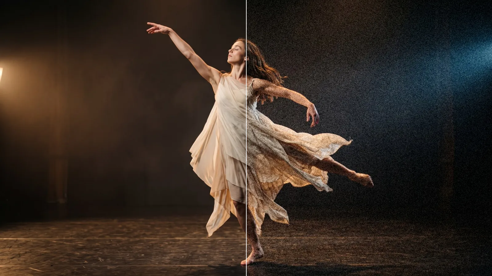
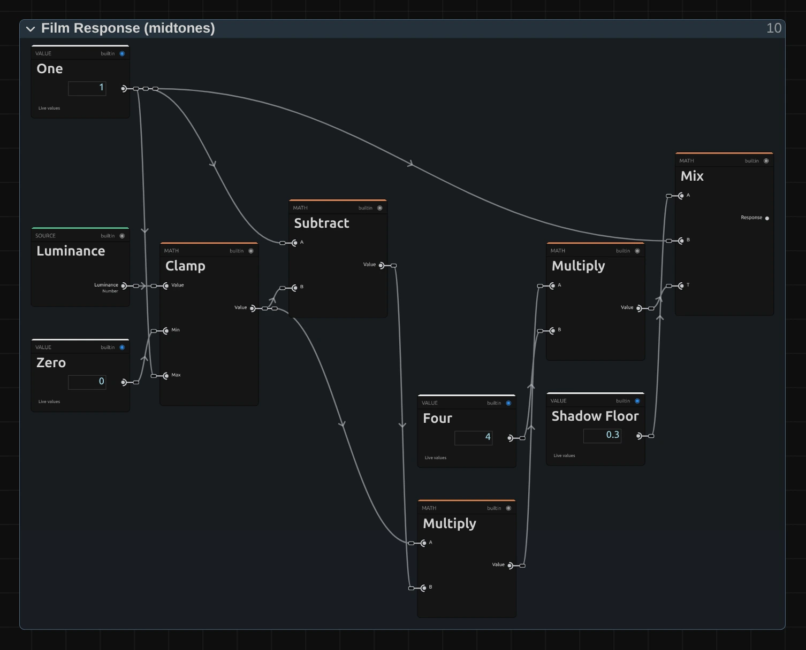

# Film Grain

Adds the fine, living texture of film. The grain changes on every frame, is strongest in the
mid-tones and keeps its size at any resolution.

Group: [Analog & Glitch](../Effects-Analog.md) · [How to add an effect](../Effects.md#add-an-effect)

<figure class="docs-shot">

<figcaption>Left: original. Right: Amount 0.22, Size 1.5.</figcaption>
</figure>

**Use it for:** a filmic texture on clean digital footage · blending shots from different cameras ·
hiding banding in dark gradients.

- **Amount** – how strong: 0.1 is subtle, 0.3 a heavy, grainy look.
- **Size** – 1 is fine like 35 mm film, 2–3 coarse like 16 mm, 5 big, soft clumps.
- **Speed** – 1 gives new grain on every frame, 0 freezes it.
- **Color** – 0 is black-and-white grain, 1 lets every colour channel have its own grain.

**Tip:** change **Seed** to give two layers with the same settings different grain, so stacked clips
do not share one pattern.

## Controls

<!-- generated:controls start -->
| Control | Range | Default |
|---|---|---|
| Amount | 0 to 0.5 | 0.1 |
| Size | 0.5 to 5 | 1 |
| Speed | 0 to 1 | 1 |
| Color | 0 to 1 | 0 |
| Seed | 0 to 65535 | 0 |

The effect card also has controls of its own that this table does not list.
<!-- generated:controls end -->

## Node setup

<figure class="docs-shot docs-shot--graph">

<figcaption>Film Response: 4 · brightness · (1 − brightness) is 1 in the midtones and 0 in black and white; Mix lifts it to Shadow Floor.</figcaption>
</figure>

The grain itself comes from **Random (Cell)** nodes in the **Smooth Noise** folder: one random value
per grain cell, blended smoothly between neighbouring cells. Three such layers, their grids turned
by 0°, 30° and 60°, add up so no grid direction shows, even with coarse grain. **Film Response** then
decides how much grain each pixel gets, from its brightness: all of it in the mid-tones and 0.3 of
it (**Shadow Floor**) in pure black and white, as on film.

**Remix:** select **Shadow Floor** and set its value to 1 in the node inspector for grain that is
equally strong everywhere, like digital sensor noise; 0 keeps black and white completely clean.

## Technical details

- **Units.** Size is in pixels of a 1080p frame and scales with the rendered size, so preview,
  export and 4K match.
- **Noise.** Three layers of value noise from **Random (Cell)** (an integer PCG hash, identical on
  every GPU and in software). A new pattern every `round(time × 60 × Speed)`, its offset hashed from
  that whole number and Seed (exact for 77 hours at 60 patterns a second). The grain averages to
  zero, so the picture never pumps; its standard deviation is 0.35 × Amount in the mid-tones.
- **Color** blends the shared grain towards one grain per channel. Speed above 1 changes nothing
  more and is reported.
- **Saved projects.** A Film Grain saved before 2026-10-21 keeps its earlier noise (Color has no
  effect on it); its card offers **Use the new Film Grain**.
- Shared notes on stylize recipes: [Light & Stylize](../Effects-Stylize.md#technical-details).
  Formulas: [Effect system](../Effect-System.md#editable-color-effect-graphs); blocks:
  [Node Catalog](../Node-Catalog.md).
