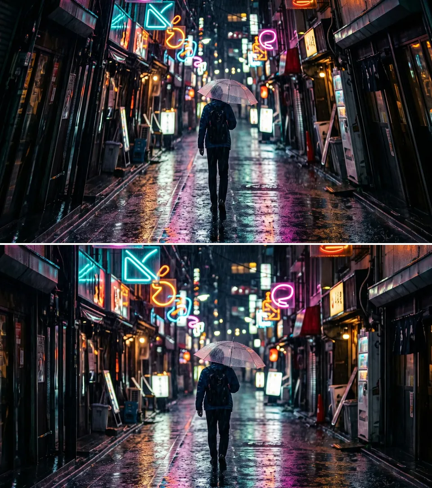

# Guided Perspective

Straightens buildings and walls that lean because the camera was tilted, from lines you draw in the
Preview.

Group: [Lens & Distort](../Effects-Distort.md) · [How to add an effect](../Effects.md#add-an-effect)

<figure class="docs-shot">

<figcaption>Top: the street with a simulated upward camera tilt. Bottom: corrected by Guided Perspective.</figcaption>
</figure>

**Use it for:** upright buildings in architecture photos · a stage set or a wall photographed from
below · a keystone fix for a slanted photo of a poster or a screen.

On a still photo (an image clip), choose **Edit guides** in the effect card and draw lines along
edges that should be **Vertical** (or **Horizontal**), at least two per direction, then **Apply**.
Guides can be drawn on still photos only.

- **Strength** – 100 is the full correction; lower values keep some of the lean, and lines stay
  straight.
- **Scale** – enlarges the result to crop the empty borders.

**Tip:** add it directly after [Lens Correction](./lens-correction.md) and draw guides along long
edges far apart.

## Controls

<!-- generated:controls start -->
| Control | Range | Default |
|---|---|---|
| Scale | 50 to 300 | 100 |
| Strength | 0 to 100 | 100 |
<!-- generated:controls end -->

## Node setup

Guided Perspective is a fixed shader with its own controls: it has no node graph to open.

## Technical details

- **Guides.** Up to eight guides per direction; all lines of a direction are combined into one
  vanishing point. Drag a guide or its end handles to refine it, right-click to remove it. Short,
  duplicate or unstable guide pairs are rejected with an explanation.
- **Correction.** The guides give a perspective transform that fits the whole photo at one scale.
  Strength blends that transform towards the original, so lines stay straight at any value. A
  degenerate result gives a transparent frame and a warning instead of broken pixels.
- **Order.** The guide photo includes earlier Lens Correction effects but no other geometry effects,
  so put Guided Perspective directly after Lens Correction. It cannot remove curved lens distortion
  or straighten several walls that face different ways.
- Borders the picture no longer covers stay transparent; guides and the correction are saved in the
  project and apply in the export.

More: [Effect system: Guided Perspective](../Effect-System.md#guided-perspective).
