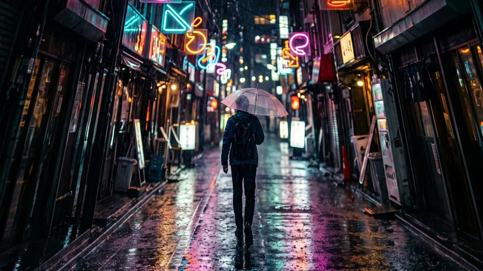

# Guided Perspective

Straightens walls and buildings that lean because the camera was tilted, from lines you draw on the photo.

Group: [Lens & Distort](../Effects-Distort.md) · [How to add an effect](../Effects.md#add-an-effect)

<figure class="docs-shot docs-compare docs-shot--float-left">

<figcaption>Left: a photo taken with the camera tilted up. Right: corrected by two vertical guides along the house edges (shown under Controls), with the Fill Frame preset.</figcaption>
</figure>

**Use it for:** upright walls and buildings in architecture photos · a stage set or a portal photographed from the stalls · a keystone fix for a slanted photo of a poster, a screen or a projection surface.

- **Guides** – the lines you draw along edges that should be vertical or horizontal.
- **Framing** – shows the whole photo or fills the frame.
- **Strength** – how much of the lean goes away.

**Tip:** put [Lens Correction](./lens-correction.md) first, so lines that bow are straight before you draw. Draw the guides along long edges far apart, one near each side of the photo.

## Presets

<figure class="docs-shot docs-shot--detail">

<figcaption>The four presets on the same two guides. Blue: the empty edges Whole Photo leaves.</figcaption>
</figure>

Pick one in the **Preset** row of the effect card. It sets Framing, Strength and Scale at once, in one undo step, and keeps the guides you drew, so draw them first and then try the presets. Without guides there is nothing to correct: a preset then only puts Scale back to 100 %.

**Whole Photo** – the full correction, and every pixel of the photo stays visible. The straightened photo becomes a trapezoid with empty, transparent corners; fill them with [AI Edge Fill](./ai-edge-fill.md) or a background track.

**Fill Frame** – the full correction, enlarged just enough that no empty corner is left. The usual choice for a photo that has to fill the frame.

**Natural Lean** – Strength 80 with Fill frame. A tall building that is made fully upright can look as if it widens towards the top; a trace of the lean keeps it natural, as architecture photographers often do.

**Soft Correction** – Strength 50 with Fill frame: halfway between the photo and upright. For a strong tilt where the full correction would stretch the top too much, or when the lean is part of the picture.

## Controls

<figure class="docs-shot">

<svg class="docs-shot-overlay" viewBox="0 0 1017 577" aria-hidden="true" focusable="false">
<defs><marker id="guided-perspective-inspector-arrow" viewBox="0 0 10 10" refX="8" refY="5" markerWidth="5" markerHeight="5" orient="auto-start-reverse"><path d="M 0 0 L 10 5 L 0 10 Z" fill="#ffd54a" /></marker></defs>
<path class="docs-shot-arrow" d="M568 282 L649 282" marker-end="url(#guided-perspective-inspector-arrow)" />
<circle class="docs-shot-number" cx="568" cy="282" r="18" /><text x="568" y="282" class="docs-shot-number-text">1</text>
<path class="docs-shot-arrow" d="M568 377 L654 377" marker-end="url(#guided-perspective-inspector-arrow)" />
<circle class="docs-shot-number" cx="568" cy="377" r="18" /><text x="568" y="377" class="docs-shot-number-text">2</text>
<path class="docs-shot-arrow" d="M569 442 L646 442" marker-end="url(#guided-perspective-inspector-arrow)" />
<circle class="docs-shot-number" cx="569" cy="442" r="18" /><text x="569" y="442" class="docs-shot-number-text">3</text>
<path class="docs-shot-arrow" d="M602 480 L644 480" marker-end="url(#guided-perspective-inspector-arrow)" />
<circle class="docs-shot-number" cx="602" cy="480" r="18" /><text x="602" y="480" class="docs-shot-number-text">4</text>
<path class="docs-shot-arrow" d="M568 517 L666 517" marker-end="url(#guided-perspective-inspector-arrow)" />
<circle class="docs-shot-number" cx="568" cy="517" r="18" /><text x="568" y="517" class="docs-shot-number-text">5</text>
</svg>

<figcaption>Guided Perspective with two guides and the Fill Frame preset. 1 — Preset: pick a starting point. 2 — Guides: draw the lines in the Preview. 3 — Framing: whole photo or fill the frame. 4 — Strength: how much of the lean is removed. 5 — Scale: zooms in or out.</figcaption>
</figure>

**Preset** – a starting point for Framing, Strength and Scale; see [Presets](#presets).

### Perspective

<figure class="docs-shot">

<svg class="docs-shot-overlay" viewBox="0 0 1920 1080" aria-hidden="true" focusable="false">
<line x1="417" y1="130" x2="278" y2="929" style="stroke:#48b8ff;stroke-width:6;stroke-linecap:round" />
<line x1="1514" y1="130" x2="1655" y2="929" style="stroke:#48b8ff;stroke-width:6;stroke-linecap:round" />
<circle cx="417" cy="130" r="13" style="fill:#48b8ff;stroke:#151515;stroke-width:4" /><circle cx="278" cy="929" r="13" style="fill:#48b8ff;stroke:#151515;stroke-width:4" />
<circle cx="1514" cy="130" r="13" style="fill:#48b8ff;stroke:#151515;stroke-width:4" /><circle cx="1655" cy="929" r="13" style="fill:#48b8ff;stroke:#151515;stroke-width:4" />
</svg>

<figcaption>The tilted photo with the two vertical guides of all pictures on this page, drawn along the left and the right house edge as the guide editor shows them.</figcaption>
</figure>

**Guides** – the lines that tell the effect what should be straight: edges in the photo that should stand upright or lie level. You draw them in the Preview with **Edit guides**; the reset arrow of the row removes them. 2 to 8 lines per direction (Edit guides, Reset), default none.

Drawing guides:

1. Choose **Edit guides**. The Preview shows the photo after Lens Correction, and the playback bar gets **Vertical**, **Horizontal**, **Apply**, **Cancel** and **Clear guides**.
2. Pick a direction and drag along an edge that should be straight: a house corner, a door frame, the side of a portal.
3. Drag a second line along another edge of the same direction, far away from the first. More lines even out small drawing errors.
4. Refine a line by dragging it or its end points; right-click removes it, the wheel or a pinch zooms.
5. **Apply** keeps the guides as one undo step. **Cancel** or Esc leaves everything as it was.

Use edges of one wall or one direction only: lines from walls that face different ways cannot all become straight.

**Framing** – what happens to the edges the correction moves. **Whole photo** shrinks the corrected photo until all of it fits in the frame, so nothing is cropped and the corners stay transparent. **Fill frame** enlarges it just enough that it covers the whole frame: the photo loses a little at its edges and leaves no empty corners. Fill frame follows Strength, so a weaker correction is enlarged less, also while Strength is keyframed. A correction so strong that it would have to be enlarged more than 20× keeps Whole photo framing, and the card says so. Whole photo or Fill frame, default Whole photo.

**Strength** – how much of the lean is removed. 100 makes the guides exactly upright, lower values keep part of the lean, and 0 is the photo as it was. Lines stay straight at every value. 75–90 often looks more natural on tall buildings than 100; animate it from 0 to 100 to let a building straighten up. 0 to 100 %, default 100 %.

**Scale** – zooms the corrected picture in or out around the middle of the frame, on top of the Framing. Above 100 crops further, below 100 shows transparent edges around the picture. 50 to 300 %, default 100 %.

## Node setup

Guided Perspective is one fixed shader with its own card: it has no node graph to open. When you apply the guides, the editor finds the point where each set of lines would meet (their vanishing point) and works out the perspective change that sends that point to infinity, so the lines become parallel. For every pixel of the result the shader looks up where that point lies in the tilted photo; Strength blends this change towards no change, and Framing and Scale set the size.

## Technical details

- **Guides.** Positions are stored as fractions of the photo with the effect; all lines of one direction are combined into one vanishing point by a least-squares fit. Short, duplicate or unstable guides are rejected in the guide editor with an explanation.
- **Correction.** One perspective transform (homography) per effect, stored with the guides. Strength blends that transform towards no change, so lines stay straight at every value. Fill frame finds the smallest enlargement at which all four frame corners lie inside the corrected photo.
- **Edges.** Areas the photo does not cover are transparent, with a one-pixel soft edge along the slanted borders. Cut-outs in the photo keep their transparency.
- **Reset and video.** The reset arrow of the Guides row also removes a correction that a tool set without guides. Until guides are drawn, the card reminds you to put Lens Correction first when none comes before this effect. Guides can be drawn on still photos only; the card says so on a video clip.
- **Order.** The guide editor shows earlier Lens Correction effects, but no other effects; put Guided Perspective directly after Lens Correction and before every look. It cannot remove curved lens distortion: that is Lens Correction's work.
- **Saved projects.** Projects keep their look: Framing starts on Whole photo, the behaviour before Fill frame existed. Guides and the correction are saved with the effect and applied in the export.
- **More:** [Effect system: Guided Perspective](../Effect-System.md#guided-perspective) · [Lens Correction](./lens-correction.md) · [AI Edge Fill](./ai-edge-fill.md).
