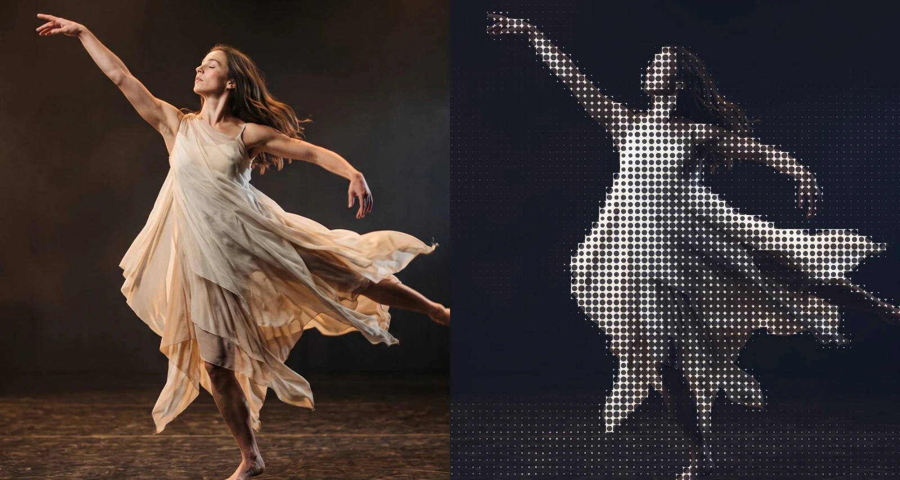
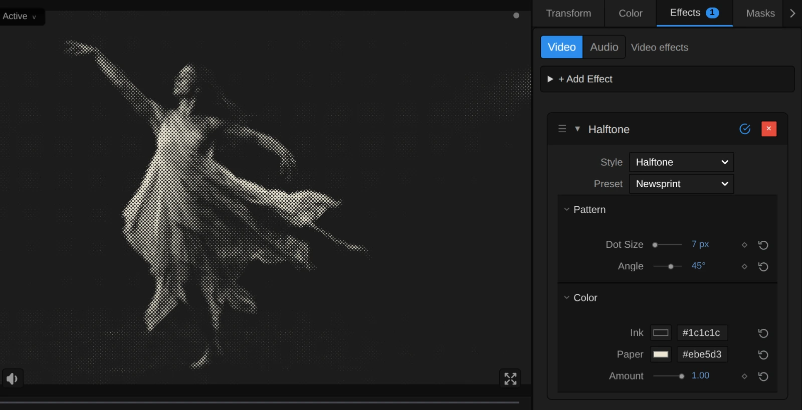
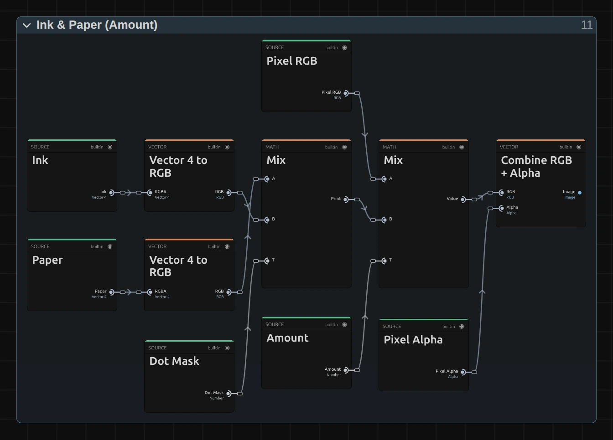

# Halftone

Prints the picture as a grid of round dots that grow in the dark parts, like a newspaper photo or a pop-art poster.

Group: [Print & Halftone](../Effects-Print.md) · [How to add an effect](../Effects.md#add-an-effect)

<figure class="docs-shot docs-compare docs-shot--float-left">

<figcaption>Left: original. Right: Halftone at its default settings.</figcaption>
</figure>

**Use it for:** a printed, archival feel for a memory or a document scene · comic and pop-art looks · a graphic dot pattern on a gauze in which the figure still reads.

- **Dot Size** – how large the dots are.
- **Angle** – how the grid of dots is turned.
- **Ink** and **Paper** – the two colours of the print.
- **Amount** – how much of the print covers the picture.

**Tip:** keyframe **Amount** from 0 to 1 to let a scene turn into print on a cue, or **Dot Size** from 6 to 40 px so the picture breaks up into ever larger dots.

## Presets

<figure class="docs-shot docs-shot--detail">

<figcaption>The five presets on the dancer.</figcaption>
</figure>

Pick one in the **Preset** row of the effect card. It sets all controls at once, in one undo step, and the row then shows its name until you change something. A control with keyframes keeps them, and the card says so.

**Newsprint** – small black dots at 45° on greyish newsprint: a press photo from a daily paper. Good for archive material, a past event or a letter read aloud.

**Pop Art** – large navy dots on yellow paper, like a comic panel or a pop-art print. Loud and graphic; strong for a title or a dream.

**Cyanotype** – Prussian blue on pale paper, with a slightly turned screen: an old sun print or blueprint. Calm and cool.

**Big Dots** – very large upright dots, black on white: the figure becomes a picture of circles that still reads from the back row. Made for large projection surfaces.

**Magazine** – a fine screen over the picture's own colours, like a printed magazine page. The quietest preset: the picture stays, the print shows close up.

## Controls

<figure class="docs-shot">

<svg class="docs-shot-overlay" viewBox="0 0 1017 712" aria-hidden="true" focusable="false">
<defs><marker id="halftone-inspector-arrow" viewBox="0 0 10 10" refX="8" refY="5" markerWidth="5" markerHeight="5" orient="auto-start-reverse"><path d="M 0 0 L 10 5 L 0 10 Z" fill="#ffd54a" /></marker></defs>
<path class="docs-shot-arrow" d="M565 319 L649 319" marker-end="url(#halftone-inspector-arrow)" />
<circle class="docs-shot-number" cx="565" cy="319" r="18" /><text x="565" y="319" class="docs-shot-number-text">1</text>
<path class="docs-shot-arrow" d="M586 425 L670 425" marker-end="url(#halftone-inspector-arrow)" />
<circle class="docs-shot-number" cx="586" cy="425" r="18" /><text x="586" y="425" class="docs-shot-number-text">2</text>
<path class="docs-shot-arrow" d="M607 462 L691 462" marker-end="url(#halftone-inspector-arrow)" />
<circle class="docs-shot-number" cx="607" cy="462" r="18" /><text x="607" y="462" class="docs-shot-number-text">3</text>
<path class="docs-shot-arrow" d="M628 578 L712 578" marker-end="url(#halftone-inspector-arrow)" />
<circle class="docs-shot-number" cx="628" cy="578" r="18" /><text x="628" y="578" class="docs-shot-number-text">4</text>
<path class="docs-shot-arrow" d="M592 653 L676 653" marker-end="url(#halftone-inspector-arrow)" />
<circle class="docs-shot-number" cx="592" cy="653" r="18" /><text x="592" y="653" class="docs-shot-number-text">5</text>
</svg>

<figcaption>Halftone with the Newsprint preset. 1 — Preset: pick a starting point. 2 — Dot Size. 3 — Angle: 45° turns the screen like a newspaper's. 4 — Ink. 5 — Amount.</figcaption>
</figure>

**Style** – switches to another look of the same engine and keeps your values and keyframes, for example [Riso](./riso.md), [Paper Print](./paper-print.md) or [Crosshatch](./crosshatch.md).

### Pattern

**Dot Size** – how far apart the dots sit, and so how large the largest dot gets. 4–8 px gives a fine press screen that reads as a photo from a few metres away, 14 a clear pattern of dots, 30 and more turns a figure into a graphic of large circles. Every cell of the grid prints one round dot, so detail smaller than a cell disappears. It counts pixels of a 1080p picture, so a 4K export shows the same dots as the preview, only sharper. 2 to 80 px, default 14 px.

**Angle** – how the grid of dots is turned, counter-clockwise. 0° gives straight rows and columns, 45° the diagonal screen of black-and-white newspapers, 15° or 75° looks like one ink of a colour print. The dots stay round at every angle. The grid looks the same every 90°, so 45° and −45° match. −180 to 180°, default 0°.

### Color

**Ink** – the colour of the dots. Dark inks read best; deep blue, red or brown tint the whole print. With an ink lighter than the paper, the print turns into a negative. It takes a colour, default `#111827`.

**Paper** – the colour between the dots, which fills the light parts of the picture. A warm off-white looks like real paper, a bright yellow or pink like a pop poster. It takes a colour, default `#f8fafc`.

**Amount** – how much of the print covers the picture. At 1 there are only ink and paper; 0.5 lays the dots over the picture's own colours, like a magazine page; 0 switches the print off. Keyframe it to fade between picture and print. 0 to 1, default 0.75.

## Node setup

<figure class="docs-shot docs-shot--graph">

<svg class="docs-shot-overlay" viewBox="0 0 1017 745" aria-hidden="true" focusable="false">
<defs><marker id="halftone-arrow" viewBox="0 0 10 10" refX="8" refY="5" markerWidth="5" markerHeight="5" orient="auto-start-reverse"><path d="M 0 0 L 10 5 L 0 10 Z" fill="#ffd54a" /></marker></defs>
<path class="docs-shot-arrow" d="M314 432 L314 348" marker-end="url(#halftone-arrow)" />
<circle class="docs-shot-number" cx="314" cy="432" r="18" /><text x="314" y="432" class="docs-shot-number-text">1</text>
<path class="docs-shot-arrow" d="M509 359 L509 443" marker-end="url(#halftone-arrow)" />
<circle class="docs-shot-number" cx="509" cy="359" r="18" /><text x="509" y="359" class="docs-shot-number-text">2</text>
<path class="docs-shot-arrow" d="M703 458 L703 374" marker-end="url(#halftone-arrow)" />
<circle class="docs-shot-number" cx="703" cy="458" r="18" /><text x="703" y="458" class="docs-shot-number-text">3</text>
<path class="docs-shot-arrow" d="M897 626 L897 542" marker-end="url(#halftone-arrow)" />
<circle class="docs-shot-number" cx="897" cy="626" r="18" /><text x="897" y="626" class="docs-shot-number-text">4</text>
</svg>

<figcaption>Halftone opened in the Nodes tab (input frame and output left out). 1 — Screen: the turned grid of cells. 2 — Cell Tone: how light each cell is. 3 — Dot: the round dot of that cell. 4 — Ink & Paper: the print, mixed with the picture.</figcaption>
</figure>

Halftone works in four stages, one folder each in the Nodes tab: **Screen** turns the grid by Angle and cuts the frame into cells of Dot Size, **Cell Tone** measures how light each cell is, **Dot** draws the round dot that covers just that much of its cell, and **Ink & Paper** colours it and mixes it with the picture by Amount. Click a folder's header to open it; the sections below show what is inside. Halftone is one look of the pattern engine that the [Print & Halftone](../Effects-Print.md) looks share; its **Style** menu switches between them.

### Screen

<figure class="docs-shot docs-shot--graph">

<svg class="docs-shot-overlay" viewBox="0 0 1017 857" aria-hidden="true" focusable="false">
<defs><marker id="halftone-screen-arrow" viewBox="0 0 10 10" refX="8" refY="5" markerWidth="5" markerHeight="5" orient="auto-start-reverse"><path d="M 0 0 L 10 5 L 0 10 Z" fill="#ffd54a" /></marker></defs>
<path class="docs-shot-arrow" d="M369 204 L369 288" marker-end="url(#halftone-screen-arrow)" />
<circle class="docs-shot-number" cx="369" cy="204" r="18" /><text x="369" y="204" class="docs-shot-number-text">1</text>
<path class="docs-shot-arrow" d="M369 673 L369 589" marker-end="url(#halftone-screen-arrow)" />
<circle class="docs-shot-number" cx="369" cy="673" r="18" /><text x="369" y="673" class="docs-shot-number-text">2</text>
<path class="docs-shot-arrow" d="M787 204 L787 288" marker-end="url(#halftone-screen-arrow)" />
<circle class="docs-shot-number" cx="787" cy="204" r="18" /><text x="787" y="204" class="docs-shot-number-text">3</text>
<path class="docs-shot-arrow" d="M369 91 L369 175" marker-end="url(#halftone-screen-arrow)" />
<circle class="docs-shot-number" cx="369" cy="91" r="18" /><text x="369" y="91" class="docs-shot-number-text">4</text>
</svg>

<figcaption>Inside Screen (Dot Size, Angle). The number cards are values from the Constants folder, shown where they plug in. 1 — Rotate UV: turns the grid by Angle. 2 — Maximum: the dot size in pixels. 3 — Fraction: where the pixel sits in its cell. 4 — Half Pixel: how soft a dot's edge is.</figcaption>
</figure>

**Rotate UV** – turns every pixel's position around the middle of the frame by Angle (Subtract moves the middle to 0, Add moves it back). It turns pixels, not the frame's 0–1 coordinates, so the cells stay square on a wide frame and the dots stay round.

**Maximum** – the dot size in pixels of this frame: Dot Size times the frame's scale (Multiply), and never less than one pixel (the card with the 1).

**Fraction** – Divide cuts the turned position into cells of that size; Fraction keeps what is after the point: where the pixel sits inside its cell, from 0 to 1. Subtract takes Half off, so the middle of the cell is 0.

**Half Pixel** – 0.5, divided by the dot size in pixels: half a pixel, measured in cells. The Dot stage softens every dot's edge by that much on each side, so an edge is one pixel soft at any Dot Size: large dots stay crisp and small ones do not shimmer.

**Remix:** open the **Constants** folder and set **Half Pixel** from **0.5** to **4**: every dot edge now fades over eight pixels, and the print looks like a soft, out-of-focus screen.

### Cell Tone

<figure class="docs-shot docs-shot--graph">

<svg class="docs-shot-overlay" viewBox="0 0 1017 1347" aria-hidden="true" focusable="false">
<defs><marker id="halftone-cell-tone-arrow" viewBox="0 0 10 10" refX="8" refY="5" markerWidth="5" markerHeight="5" orient="auto-start-reverse"><path d="M 0 0 L 10 5 L 0 10 Z" fill="#ffd54a" /></marker></defs>
<path class="docs-shot-arrow" d="M322 162 L322 246" marker-end="url(#halftone-cell-tone-arrow)" />
<circle class="docs-shot-number" cx="322" cy="162" r="18" /><text x="322" y="162" class="docs-shot-number-text">1</text>
<path class="docs-shot-arrow" d="M880 563 L880 479" marker-end="url(#halftone-cell-tone-arrow)" />
<circle class="docs-shot-number" cx="880" cy="563" r="18" /><text x="880" y="563" class="docs-shot-number-text">2</text>
<path class="docs-shot-arrow" d="M508 936 L508 1020" marker-end="url(#halftone-cell-tone-arrow)" />
<circle class="docs-shot-number" cx="508" cy="936" r="18" /><text x="508" y="936" class="docs-shot-number-text">3</text>
<path class="docs-shot-arrow" d="M322 697 L322 613" marker-end="url(#halftone-cell-tone-arrow)" />
<circle class="docs-shot-number" cx="322" cy="697" r="18" /><text x="322" y="697" class="docs-shot-number-text">4</text>
</svg>

<figcaption>Inside Cell Tone, with one of its four reading points. 1 — Rotate UV: turns the cell's middle back into the picture. 2 — Subtract: one reading point. 3 — sRGB to Linear: light as it adds up. 4 — Divide: the light of the cell.</figcaption>
</figure>

**Rotate UV** – Floor and Add find the middle of the pixel's cell, Multiply turns it into pixels, and Rotate UV turns it back by minus Angle into the picture; Add and Divide by Resolution give the place to read.

**Subtract** – one of four reading points, a quarter cell from the middle along the cell's diagonals (Quarter Diagonal). The other three points, in the folder, are built the same way.

**sRGB to Linear** – turns the colour read there into light as it adds up on a screen, and Luminance takes its brightness. Multiply weights it with the point's alpha, so a transparent point does not count.

**Divide** – the light of all four points divided by their alpha: the cell's average light. The pixel's own light joins in at 5 %, so a cell whose points all lie outside a cut-out figure still has a tone. Every pixel of a cell reads the same value, which is why each cell prints one clean dot.

### Dot

<figure class="docs-shot docs-shot--graph">

<svg class="docs-shot-overlay" viewBox="0 0 1017 784" aria-hidden="true" focusable="false">
<defs><marker id="halftone-dot-arrow" viewBox="0 0 10 10" refX="8" refY="5" markerWidth="5" markerHeight="5" orient="auto-start-reverse"><path d="M 0 0 L 10 5 L 0 10 Z" fill="#ffd54a" /></marker></defs>
<path class="docs-shot-arrow" d="M204 500 L204 416" marker-end="url(#halftone-dot-arrow)" />
<circle class="docs-shot-number" cx="204" cy="500" r="18" /><text x="204" y="500" class="docs-shot-number-text">1</text>
<path class="docs-shot-arrow" d="M691 165 L691 249" marker-end="url(#halftone-dot-arrow)" />
<circle class="docs-shot-number" cx="691" cy="165" r="18" /><text x="691" y="165" class="docs-shot-number-text">2</text>
<path class="docs-shot-arrow" d="M691 686 L691 602" marker-end="url(#halftone-dot-arrow)" />
<circle class="docs-shot-number" cx="691" cy="686" r="18" /><text x="691" y="686" class="docs-shot-number-text">3</text>
<path class="docs-shot-arrow" d="M813 165 L813 249" marker-end="url(#halftone-dot-arrow)" />
<circle class="docs-shot-number" cx="813" cy="165" r="18" /><text x="813" y="165" class="docs-shot-number-text">4</text>
<path class="docs-shot-arrow" d="M204 683 L204 599" marker-end="url(#halftone-dot-arrow)" />
<circle class="docs-shot-number" cx="204" cy="683" r="18" /><text x="204" y="683" class="docs-shot-number-text">5</text>
</svg>

<figcaption>Inside Dot. 1 — Clamp: the share of ink. 2 — Square Root: the radius while the dots stand apart. 3 — Subtract: the radius once they touch. 4 — Switch: picks one. 5 — Smoothstep: the dot's soft edge.</figcaption>
</figure>

**Clamp** – one minus the cell's light, kept between 0 and 1: the share of the cell that should be ink. White needs none, black all of it.

**Square Root** – a round dot with the radius √(share ÷ π) covers exactly that share of its cell (Inverse Pi, 0.3183). That holds until neighbouring dots touch, at a share of π ÷ 4 (Touch Share, 0.7854).

**Subtract** – once the dots touch, only the paper at the cell's corners is left: Cell Corner 0.7071 minus Corner Reach 0.4471 × √(1 − share). At a share of 1 the radius reaches the corners and the cell is solid ink.

**Switch** – takes the first radius below the Touch Share and the second above it (Greater Than decides). Add then shifts it by up to half an edge (Edge Shift), so pure white leaves no speck and pure black no gap.

**Smoothstep** – compares each pixel's distance from the middle of its cell with the radius, softened by half an edge on each side: 1 inside the dot, 0 outside, one soft pixel between. Subtract from One turns that into the Dot Mask.

### Ink & Paper

<figure class="docs-shot docs-shot--graph">

<svg class="docs-shot-overlay" viewBox="0 0 1017 731" aria-hidden="true" focusable="false">
<defs><marker id="halftone-ink-paper-arrow" viewBox="0 0 10 10" refX="8" refY="5" markerWidth="5" markerHeight="5" orient="auto-start-reverse"><path d="M 0 0 L 10 5 L 0 10 Z" fill="#ffd54a" /></marker></defs>
<path class="docs-shot-arrow" d="M509 569 L509 485" marker-end="url(#halftone-ink-paper-arrow)" />
<circle class="docs-shot-number" cx="509" cy="569" r="18" /><text x="509" y="569" class="docs-shot-number-text">1</text>
<path class="docs-shot-arrow" d="M703 141 L703 225" marker-end="url(#halftone-ink-paper-arrow)" />
<circle class="docs-shot-number" cx="703" cy="141" r="18" /><text x="703" y="141" class="docs-shot-number-text">2</text>
<path class="docs-shot-arrow" d="M897 467 L897 383" marker-end="url(#halftone-ink-paper-arrow)" />
<circle class="docs-shot-number" cx="897" cy="467" r="18" /><text x="897" y="467" class="docs-shot-number-text">3</text>
</svg>

<figcaption>Inside Ink & Paper (Amount). 1 — Print: ink on paper. 2 — Over the Picture: the print by Amount. 3 — Combine RGB + Alpha: the transparency back on.</figcaption>
</figure>

**Print** – the first Mix: Paper where the Dot Mask is 0, Ink where it is 1 (Vector 4 to RGB takes each colour's RGB).

**Over the Picture** – the second Mix lays the print over the pixel's own colour by Amount: 0 keeps the picture, 1 shows only the print.

**Combine RGB + Alpha** – puts the pixel's own transparency back on, so a cut-out figure keeps clean edges and empty areas stay empty.

## Technical details

- **Size.** Dot Size counts pixels of a frame whose shorter side is 1080: a 4K export, a portrait 1080 × 1920 frame, a lower Preview Quality and the thumbnails show the same dots. A cell is never smaller than one pixel of the frame; on a frame that small the card says so.
- **Tone.** Each cell's light is averaged in linear light over four points, and its dot covers exactly that share of the cell (to about 1 %). Seen from a distance, ink and paper mix back to the picture's brightness; black prints solid, white stays clean paper.
- **Edges.** Dot edges are one output pixel soft at every Dot Size. A 4K export is sharper than the preview, not different.
- **Transparency.** The print keeps each pixel's own alpha, and transparent reading points do not count towards a cell's tone, so a cut-out figure gets no dark rim.
- **Time.** Halftone does not move by itself: a paused picture needs no extra rendering. On moving footage the grid stays in place and the dots grow and shrink with the picture.
- **Saved projects.** A Halftone saved with an earlier node setup keeps it and its look: dots that follow the picture inside each cell, softer edges at large sizes, and dots stretched into ovals when Angle is not 0° on a wide frame. Add the effect again for the round dots described here.
- **More:** [Effect system](../Effect-System.md#two-tone-pattern-engine) · [Node Catalog](../Node-Catalog.md) · [Styles and presets](../Effects.md#styles-and-presets).
