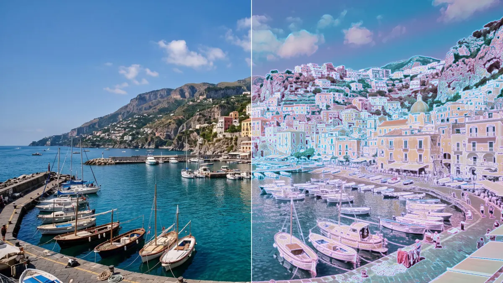
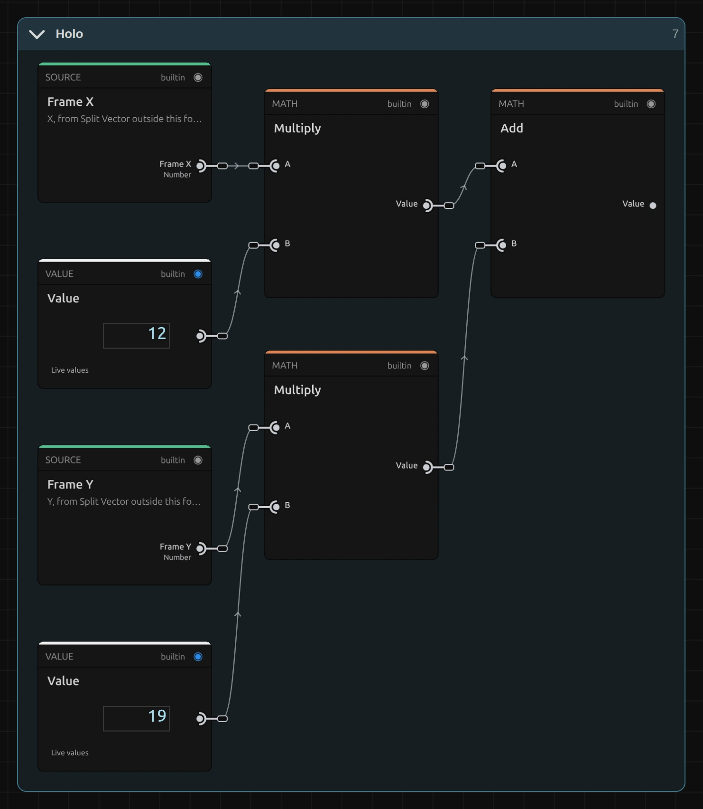

# Holo

Lays a holographic foil over the picture: rainbow bands that bend with its tones. The bands run between two colours and light up along outlines; elsewhere black stays black.

Group: [Lens & Distort](../Effects-Distort.md) · [How to add an effect](../Effects.md#add-an-effect)

<figure class="docs-shot">

<figcaption>Left: original. Right: Amount 1 (Stripes 0.6, the default colours); the bands drift over time.</figcaption>
</figure>

**Use it for:** a sci-fi hologram · an iridescent, otherworldly costume or set · a shimmering title background.

- **Amount** – from the original (0) to the full foil (1).
- **Stripes** – from an even tint (0) to full rainbow bands (1).
- **Spectrum A** and **Spectrum B** – the two colours of the foil (cyan and pink by default).
- **Speed** – how fast the bands drift; 0 holds them still.

**Tip:** on a performer in front of a dark stage, the darkness stays dark and only the body and its outlines take on the foil. For a full hologram look, raise Amount to 1.

## Controls

<!-- generated:controls start -->
| Control | Range | Default |
|---|---|---|
| **Style** | | |
| Amount | 0 to 1 | 0.35 |
| Stripes | 0 to 1 | 0.6 |
| **Color** | | |
| Spectrum A | a colour | `#22d3ee` |
| Spectrum B | a colour | `#f472b6` |
| **Motion** | | |
| Speed | 0 to 5 | 1 |
<!-- generated:controls end -->

## Node setup

<figure class="docs-shot docs-shot--float-right">

<figcaption>The band position: 12 bands across, 19 down.</figcaption>
</figure>

Holo is one flat node graph. The band position comes from the frame position: X × 12 plus Y × 19, so the bands run diagonally. Time × Speed lets them drift, and the brightness of the pixel bends them; a **Mix** between Spectrum A and B then colours each band. Outlines come from four reads 2 px apart (at 1080 lines). How to open it: [The node setup](../Effects.md#the-node-setup).

**Remix:** for vertical stripes, select the **Value** of 19 and set it to 0; for horizontal bands, set the 12 to 0 instead. Larger numbers make narrower bands.

## Technical details

- **Bands.** The band phase is 12 × X + 19 × Y (frame widths and heights) plus 2 × time × Speed plus 4 × brightness, bent once more by a slow sine. The band colours are pushed 1.6 × away from their own grey, so the foil reads iridescent, not milky.
- **Blacks.** The even sheen is weighted by smoothstep(0.02, 0.35, brightness), so true blacks stay black. Outlines compare brightness ±0.2 % of the frame height apart.
- **Values.** Amount 0 leaves every pixel unchanged. Values outside a control's range are clamped and reported. The bands follow timeline time, so the preview, scrubbing and the export match.
- **Saved projects.** A Holo saved before the 2026-10 rebuild keeps its earlier look and has no Stripes control; add the effect again for the current version.

More about effect graphs: [Effect system](../Effect-System.md). Nodes: [Node Catalog](../Node-Catalog.md).
