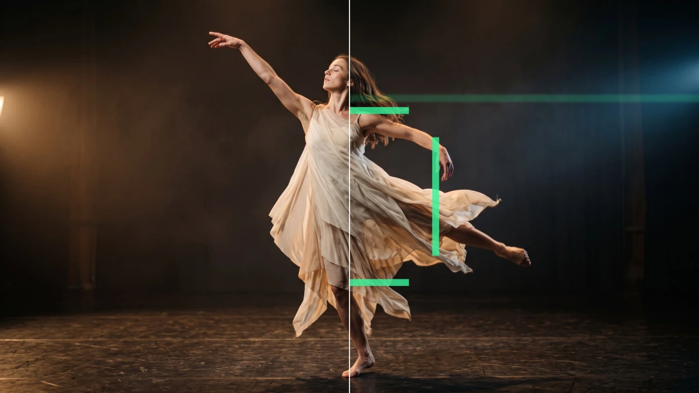

# HUD Tracker

<!-- effect-docs: basic page sha=67968806273f, written by scripts/effect-docs.mjs. Delete this line to write the page by hand (template B in Documentation-Site.md). -->

Overlays a sci-fi HUD with a corner-bracket target box around the tracked subject, landmark dots and a sweeping scan line in the Overlay color.

Group: [Tracking & Overlays](../Effects-Tracking.md) · [How to add an effect](../Effects.md#add-an-effect)

<figure class="docs-shot">

<figcaption>Left: the original. Right: HUD Tracker at its default settings, one frame of its movement.</figcaption>
</figure>

*A short page made from the editor’s effect catalog: what the effect does and its controls. Tips and its node setup will follow.*

## Controls

<!-- generated:controls start -->
| Control | Range | Default |
|---|---|---|
| **Mix** | | |
| Amount | 0 to 1 | 0.8 |
| **Color** | | |
| Overlay | a colour | `#36f59a` |
| **Motion** | | |
| Speed | 0 to 5 | 1 |
<!-- generated:controls end -->

**Styles:** the **Style** menu in the effect card switches to another look of the same engine. Controls you changed keep their values and keyframes when the new look has the same control, also under another name; the others start at the new look's defaults. Looks of Tracking & Overlays: [CCTV](./cctv.md), [Rain Reveal](./rain-reveal.md), [Stardust](./stardust.md), [Tracked Scene](./tracked-scene.md).

## Technical details

HUD Tracker is one look of the tracking overlay engine; its looks share one node setup. It keeps moving while the playhead stands still. How effects are stored, rendered and exported: [Effect system](../Effect-System.md). Its building blocks: [Node Catalog](../Node-Catalog.md).

Go deeper: [Effect system: landmark tracking effects](../Effect-System.md#landmark-tracking-effects)
