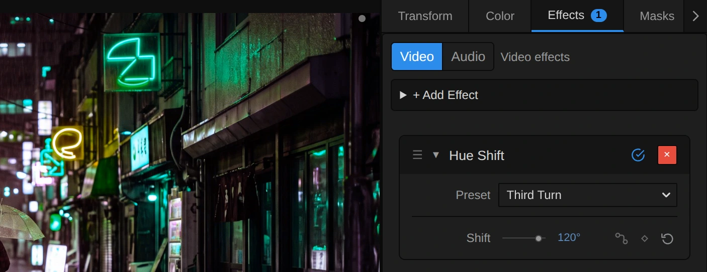
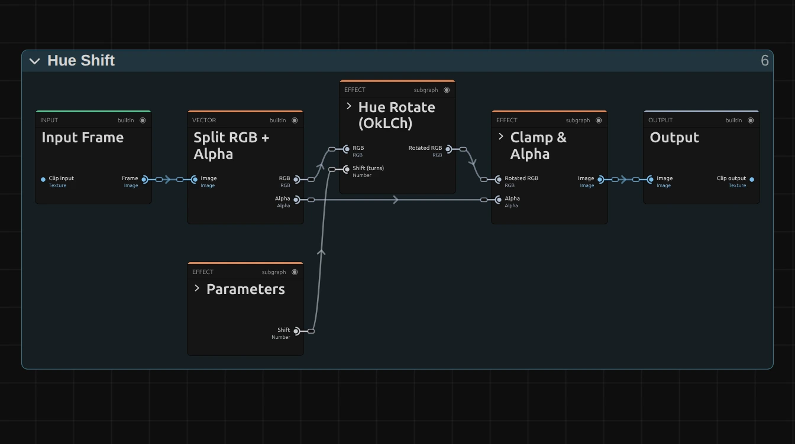
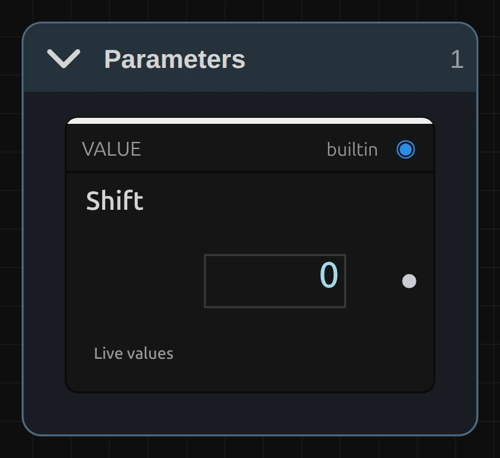
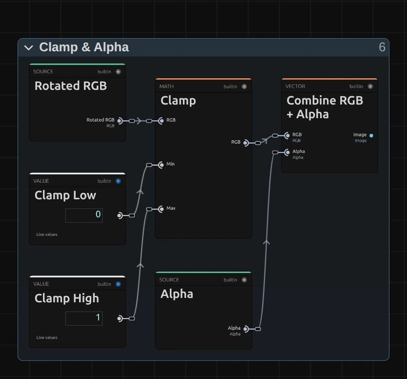

# Hue Shift

Turns every colour around the colour wheel, so orange can become green and pink yellow. Each colour keeps its brightness and its strength, so even a running colour cycle does not flicker.

Group: [Color & Tone](../Effects-Color.md) · [How to add an effect](../Effects.md#add-an-effect)

<figure class="docs-shot docs-compare">

<figcaption>Left: original. Right: Shift 120° (the Third Turn preset).</figcaption>
</figure>

**Use it for:** surreal or dream-like colours · a slow colour cycle on light and neon · a costume or a set piece in another colour, when it stands alone in the picture.

- **Shift** – how far every colour turns round the colour wheel.

**Tip:** for a colour cycle, keyframe **Shift** from 0° to 360°. Since 360° looks exactly like 0°, a looped clip cycles without a jump.

## Presets

<figure class="docs-shot docs-shot--detail">

<figcaption>The four presets on the harbour town.</figcaption>
</figure>

Pick one in the **Preset** row of the effect card. It sets Shift in one undo step, and the row then shows its name until you change the value. A keyframed Shift keeps its keyframes, and the card says so.

**Nudge** – a small step back round the wheel (340°). Orange light turns rosier, a blue sky and the sea lean towards turquoise. Close enough to the original to pass for real light, for a scene that should feel slightly off.

**Third Turn** – a third of the way round (120°): red turns towards green, green towards blue and blue towards red. Neon and stage light take on colours they never had.

**Opposite** – half the way round (180°): every colour becomes its opposite. Warm stage light turns a cold blue, a blue sky orange. Skin turns blue as well, so it suits a dream or a nightmare more than a portrait.

**Two Thirds** – two thirds of the way round (240°), the other third: red turns towards blue, blue towards green.

## Controls

<figure class="docs-shot">

<svg class="docs-shot-overlay" viewBox="0 0 1017 421" aria-hidden="true" focusable="false">
<defs><marker id="hue-shift-inspector-arrow" viewBox="0 0 10 10" refX="8" refY="5" markerWidth="5" markerHeight="5" orient="auto-start-reverse"><path d="M 0 0 L 10 5 L 0 10 Z" fill="#ffd54a" /></marker></defs>
<path class="docs-shot-arrow" d="M565 282 L649 282" marker-end="url(#hue-shift-inspector-arrow)" />
<circle class="docs-shot-number" cx="565" cy="282" r="18" /><text x="565" y="282" class="docs-shot-number-text">1</text>
<path class="docs-shot-arrow" d="M581 344 L665 344" marker-end="url(#hue-shift-inspector-arrow)" />
<circle class="docs-shot-number" cx="581" cy="344" r="18" /><text x="581" y="344" class="docs-shot-number-text">2</text>
</svg>

<figcaption>Hue Shift with the Third Turn preset. 1 — Preset: pick a starting point. 2 — Shift: how far round the colour wheel.</figcaption>
</figure>

**Preset** – one of the four starting points above; it sets Shift.

<figure class="docs-shot docs-clip docs-shot--float-right">
<video src="../assets/effects/clips/hue-shift-shift.mp4" poster="../assets/effects/clips/hue-shift-shift.webp" width="720" height="540" autoplay muted loop playsinline preload="none" aria-label="The dancer turning on a dark stage while Shift runs once round the colour wheel and back: the warm orange light, her skin and the dress turn yellow, then green, cyan and blue at half a turn, then violet and pink, and back again, while the brightness of every part stays the same; the current value in turns is shown at the bottom left"></video>
<figcaption>Shift from 0 to 1 turn (360°) and back.</figcaption>
</figure>

**Shift** – how far every colour turns round the colour wheel. Going up, red turns orange, then yellow, green, cyan, blue, violet and back to red. 10–30° changes the mood but still looks like real light; 120° and 240° give each colour another one; 180° gives the opposite colours. Greys, black and white have no colour, so they stay as they are, and each colour keeps its brightness and its strength. 0 to 360°, default 0°. 360° looks the same as 0°, so the slider has no end where the picture would stop changing. A keyframe, a node or the AI agent may send a value past a full turn (stored in turns, so 1.25 is 450°): it simply goes round again and looks like 90°.

## Node setup

<figure class="docs-shot docs-shot--graph">

<svg class="docs-shot-overlay" viewBox="0 0 1017 569" aria-hidden="true" focusable="false">
<defs><marker id="hue-shift-arrow" viewBox="0 0 10 10" refX="8" refY="5" markerWidth="5" markerHeight="5" orient="auto-start-reverse"><path d="M 0 0 L 10 5 L 0 10 Z" fill="#ffd54a" /></marker></defs>
<path class="docs-shot-arrow" d="M314 546 L314 462" marker-end="url(#hue-shift-arrow)" />
<circle class="docs-shot-number" cx="314" cy="546" r="18" /><text x="314" y="546" class="docs-shot-number-text">1</text>
<path class="docs-shot-arrow" d="M509 22 L509 96" marker-end="url(#hue-shift-arrow)" />
<circle class="docs-shot-number" cx="509" cy="22" r="18" /><text x="509" y="22" class="docs-shot-number-text">2</text>
<path class="docs-shot-arrow" d="M703 51 L703 135" marker-end="url(#hue-shift-arrow)" />
<circle class="docs-shot-number" cx="703" cy="51" r="18" /><text x="703" y="51" class="docs-shot-number-text">3</text>
</svg>

<figcaption>Hue Shift opened in the Nodes tab (the Constants folder left out). 1 — Parameters: the Shift control. 2 — Hue Rotate (OkLCh): turns the hue and leaves lightness and colour strength alone. 3 — Clamp & Alpha: keeps the colour within 0 to 1 and puts the transparency back.</figcaption>
</figure>

Hue Shift works in three stages ([Color & Tone](../Effects-Color.md#the-shared-idea) shows the shape all colour effects share): **Parameters** holds the control, the block **Hue Rotate (OkLCh)** does the work, and **Clamp & Alpha** finishes. **Split RGB + Alpha** takes the transparency aside first. Click a folder's header to open it; the sections below show what is inside. The same block is in **right-click → Reusable Nodes**.

### Parameters

<figure class="docs-shot docs-shot--graph docs-shot--float-right">

<figcaption>Inside Parameters: the Shift card alone.</figcaption>
</figure>

**Shift** – the control's value, in turns (0.5 is 180°). It has no Clamp: every value has a clear result, because the hue wraps round the wheel further on. So a long keyframed spin never stops at a limit.

### Hue Rotate (OkLCh)

<figure class="docs-shot docs-shot--graph">

<svg class="docs-shot-overlay" viewBox="0 0 1017 540" aria-hidden="true" focusable="false">
<defs><marker id="hue-shift-rotate-arrow" viewBox="0 0 10 10" refX="8" refY="5" markerWidth="5" markerHeight="5" orient="auto-start-reverse"><path d="M 0 0 L 10 5 L 0 10 Z" fill="#ffd54a" /></marker></defs>
<path class="docs-shot-arrow" d="M284 22 L284 86" marker-end="url(#hue-shift-rotate-arrow)" />
<circle class="docs-shot-number" cx="284" cy="22" r="18" /><text x="284" y="22" class="docs-shot-number-text">1</text>
<path class="docs-shot-arrow" d="M492 22 L492 86" marker-end="url(#hue-shift-rotate-arrow)" />
<circle class="docs-shot-number" cx="492" cy="22" r="18" /><text x="492" y="22" class="docs-shot-number-text">2</text>
<path class="docs-shot-arrow" d="M284 223 L284 307" marker-end="url(#hue-shift-rotate-arrow)" />
<circle class="docs-shot-number" cx="284" cy="223" r="18" /><text x="284" y="223" class="docs-shot-number-text">3</text>
<path class="docs-shot-arrow" d="M492 246 L492 330" marker-end="url(#hue-shift-rotate-arrow)" />
<circle class="docs-shot-number" cx="492" cy="246" r="18" /><text x="492" y="246" class="docs-shot-number-text">4</text>
<path class="docs-shot-arrow" d="M700 225 L700 309" marker-end="url(#hue-shift-rotate-arrow)" />
<circle class="docs-shot-number" cx="700" cy="225" r="18" /><text x="700" y="225" class="docs-shot-number-text">5</text>
<path class="docs-shot-arrow" d="M908 248 L908 332" marker-end="url(#hue-shift-rotate-arrow)" />
<circle class="docs-shot-number" cx="908" cy="248" r="18" /><text x="908" y="248" class="docs-shot-number-text">6</text>
</svg>

<figcaption>Inside Hue Rotate (OkLCh) (the Shift comes in as a stub). 1 — RGB to OkLCh: colour as lightness, strength and hue. 2 — Split Vector: the three apart. 3 — Add: adds the Shift to the hue. 4 — Fraction: wraps the hue round the wheel. 5 — Combine Vector: the three together again. 6 — OkLCh to RGB: back to screen colours.</figcaption>
</figure>

**RGB to OkLCh** – describes every colour as lightness, colour strength (chroma) and hue, in a colour space made to match how we see. A yellow and a blue of the same lightness there also look equally bright, which is why a turned colour does not suddenly glow or go dull.

**Split Vector** – takes the three apart. Lightness and Chroma go straight on to **Combine Vector**, untouched; only the Hue takes the detour below.

**Add** – adds the Shift to the hue. Both are in turns, so 0.25 moves every colour a quarter of the way round.

**Fraction** – keeps only the part after the decimal point, so the hue wraps round the wheel: 1.1 turns becomes 0.1. This is why Shift never needs a limit.

**Combine Vector** – puts Lightness, Chroma and the new Hue back together.

**OkLCh to RGB** – turns the result back into screen colours. Some turned colours cannot be shown on a screen at their old strength (a deep blue turned into yellow); they come out past the screen's range and are cut off in the next folder.

**Remix:** for richer colours without any shift in hue, put a **Multiply** with a **Value** of 1.3 on the cable from **Chroma** of **Split Vector** into the **Chroma** input of **Combine Vector**. Colours the screen cannot show are cut off at the end, so stay below about 1.5.

### Clamp & Alpha

<figure class="docs-shot docs-shot--graph docs-shot--float-right">

<svg class="docs-shot-overlay" viewBox="0 0 590 549" aria-hidden="true" focusable="false">
<defs><marker id="hue-shift-finish-arrow" viewBox="0 0 10 10" refX="8" refY="5" markerWidth="5" markerHeight="5" orient="auto-start-reverse"><path d="M 0 0 L 10 5 L 0 10 Z" fill="#ffd54a" /></marker></defs>
<path class="docs-shot-arrow" d="M295 23 L295 107" marker-end="url(#hue-shift-finish-arrow)" />
<circle class="docs-shot-number" cx="295" cy="23" r="18" /><text x="295" y="23" class="docs-shot-number-text">1</text>
</svg>

<figcaption>Inside Clamp & Alpha. 1 — Clamp: keeps each channel between 0 and 1.</figcaption>
</figure>

**Clamp** – keeps each colour channel between 0 and 1 (its Clamp Low and Clamp High cards). A turned colour the screen cannot show at full strength stops here, at its nearest screen colour.

**Combine RGB + Alpha** then puts the original transparency back, untouched.

## Technical details

- **Colour space.** The rotation happens in OkLCh (Björn Ottosson's Oklab in polar form): lightness and chroma stay exactly, only the hue angle moves. Colours that leave the screen's range are clamped per channel (no gamut mapping), so a very saturated colour turned into a hue the screen shows less strongly may shift slightly in hue and brightness.
- **Units.** Shift is stored in turns: 0.25 is 90°. Keyframes and agent tools use turns; the inspector shows degrees. Values past 0 to 1 wrap round, there is no limit to report.
- **Transparency.** Only the colour is changed; the transparency passes through untouched.
- What all colour effects share (8-bit range, saved projects, adjustment layers): [Color & Tone](../Effect-System.md#color--tone-notes). Formulas: [Effect system](../Effect-System.md#editable-color-effect-graphs); blocks: [Node Catalog](../Node-Catalog.md) · [Styles and presets](../Effects.md#styles-and-presets).
