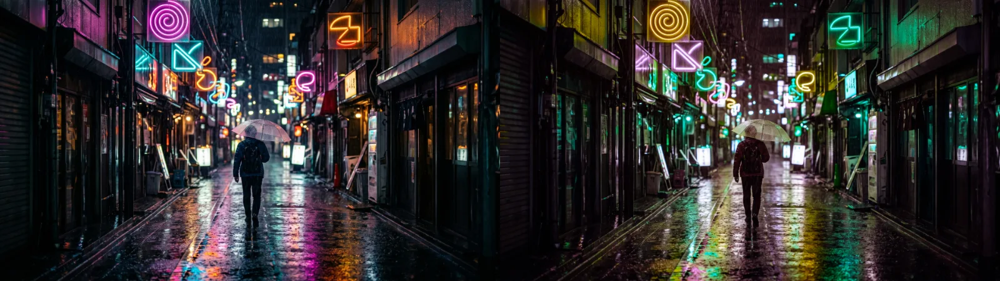
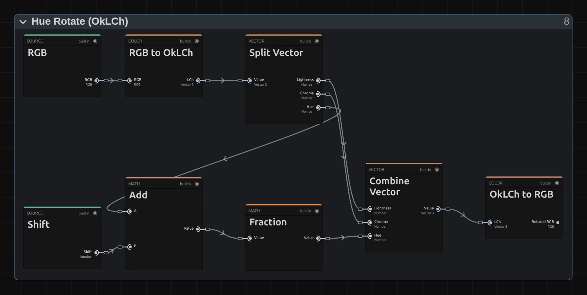

# Hue Shift

Turns every colour around the colour wheel, so orange can become green and pink yellow. Each colour
keeps its brightness and strength, so an animated shift does not flicker in brightness.

Group: [Color & Tone](../Effects-Color.md) · [How to add an effect](../Effects.md#add-an-effect)

<figure class="docs-shot">

<figcaption>Left: original. Right: Shift 120°.</figcaption>
</figure>

**Use it for:** surreal or dream-like colours · a slow colour cycle on light and neon · changing
the colour of a costume or a set piece that stands alone.

- **Shift** – in degrees, 0–360°. 180° gives the opposite colours; 360° is back to the original.

**Tip:** keyframe Shift from 0° to 360° for a smooth colour cycle.

## Controls

<!-- generated:controls start -->
| Control | Range | Default |
|---|---|---|
| Shift | 0 to 360° | 0° |
<!-- generated:controls end -->

## Node setup

<figure class="docs-shot docs-shot--graph">

<svg class="docs-shot-overlay" viewBox="0 0 1017 512" aria-hidden="true" focusable="false">
<defs><marker id="hue-shift-rotate-arrow" viewBox="0 0 10 10" refX="8" refY="5" markerWidth="5" markerHeight="5" orient="auto-start-reverse"><path d="M 0 0 L 10 5 L 0 10 Z" fill="#ffd54a" /></marker></defs>
<path class="docs-shot-arrow" d="M492 22 L492 54" marker-end="url(#hue-shift-rotate-arrow)" />
<circle class="docs-shot-number" cx="492" cy="22" r="18" /><text x="492" y="22" class="docs-shot-number-text">1</text>
<path class="docs-shot-arrow" d="M700 193 L700 277" marker-end="url(#hue-shift-rotate-arrow)" />
<circle class="docs-shot-number" cx="700" cy="193" r="18" /><text x="700" y="193" class="docs-shot-number-text">2</text>
</svg>

<figcaption>Hue Rotate (OkLCh). 1 — Split Vector gives Lightness, Chroma (colour strength) and Hue. 2 — Combine Vector puts them back together.</figcaption>
</figure>

**RGB to OkLCh** describes every colour as lightness, colour strength (chroma) and hue, in a colour
space made to match how we see. Only the hue is changed: **Add** adds the Shift and **Fraction**
wraps it around the colour wheel. Lightness and chroma go straight from **Split Vector** (1) to
**Combine Vector** (2), so the brightness cannot change.

**Remix:** for richer colours without any shift in hue, put a **Multiply** with a **Value** of 1.3
on the cable from **Chroma** of (1) into the **Chroma** input of (2). Colours the screen cannot show
are cut off at the end, so stay below about 1.5.

## Technical details

- **Colour space.** The rotation happens in OkLCh; colours that leave the screen's range are
  clamped per channel (no gamut mapping).
- **Units.** Shift is stored in turns: 0.25 is 90°. Keyframes and agent tools use turns; only the
  inspector shows degrees.
- Shared colour notes: [Color & Tone](../Effects-Color.md#technical-details). Formulas:
  [Effect system](../Effect-System.md#editable-color-effect-graphs); blocks:
  [Node Catalog](../Node-Catalog.md).
