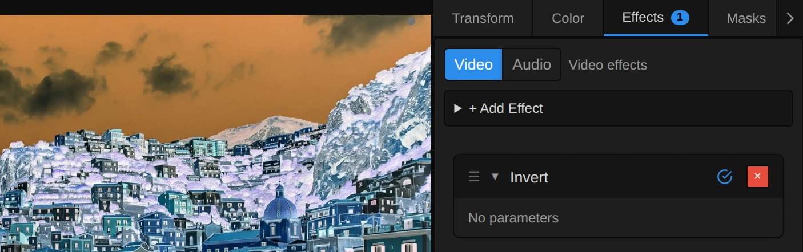
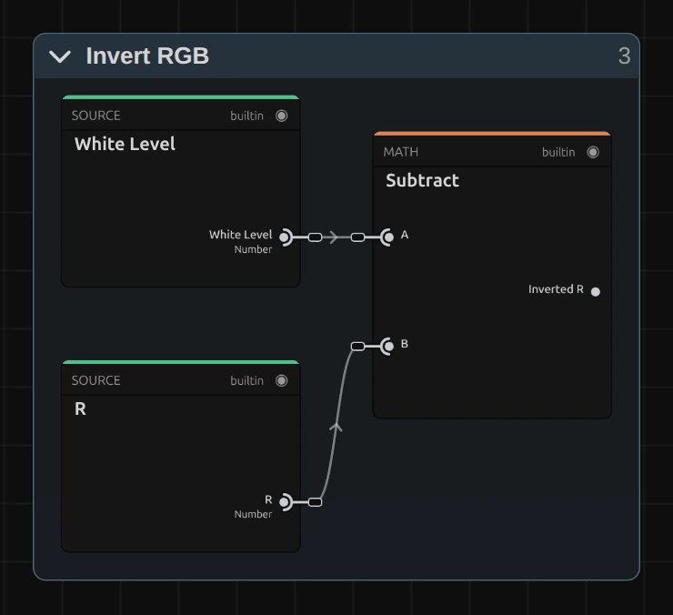
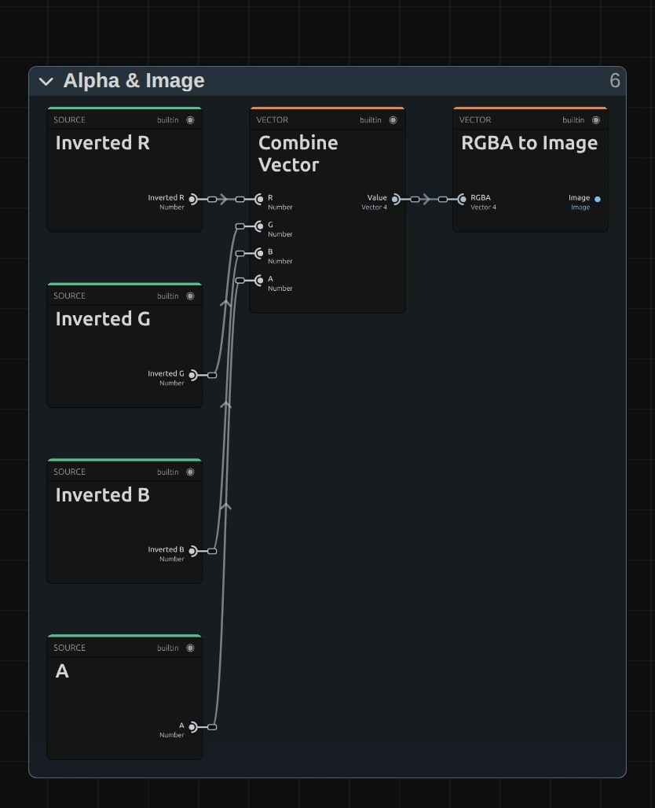

# Invert

Turns the picture into its negative: dark becomes light, light becomes dark, and every colour becomes its opposite. Transparent areas stay transparent. Invert has no controls.

Group: [Color & Tone](../Effects-Color.md) · [How to add an effect](../Effects.md#add-an-effect)

<figure class="docs-shot docs-compare">

<figcaption>Left: original. Right: Invert.</figcaption>
</figure>

**Use it for:** a photo-negative or X-ray look · a flash frame on a hit in the music · a dark stage turned into a bright, ghostly one.

**Tip:** for light and dark swapped but colours roughly as they were, put [Hue Shift](./hue-shift.md) at 180° (the Half Turn preset) after Invert. Skin and warm light come back close to their own colour; strong colours land within about 20° of where they were.

## Controls

<figure class="docs-shot">

<svg class="docs-shot-overlay" viewBox="0 0 1017 319" aria-hidden="true" focusable="false">
<defs><marker id="invert-inspector-arrow" viewBox="0 0 10 10" refX="8" refY="5" markerWidth="5" markerHeight="5" orient="auto-start-reverse"><path d="M 0 0 L 10 5 L 0 10 Z" fill="#ffd54a" /></marker></defs>
<path class="docs-shot-arrow" d="M811 224 L895 224" marker-end="url(#invert-inspector-arrow)" />
<circle class="docs-shot-number" cx="811" cy="224" r="18" /><text x="811" y="224" class="docs-shot-number-text">1</text>
</svg>

<figcaption>Invert has no controls. 1 — Switch: turns Invert off and on, to compare with the original.</figcaption>
</figure>

Invert has no controls and no presets: a negative is either on or off, so the card shows "No parameters". The switch in its title bar (1 in the picture) turns Invert off and on without removing it, to compare with the original. For a flash on a beat, split the clip and add Invert only to the short piece, or put it on an adjustment layer above just those frames.

## Node setup

<figure class="docs-shot docs-shot--graph">

<svg class="docs-shot-overlay" viewBox="0 0 1017 427" aria-hidden="true" focusable="false">
<defs><marker id="invert-arrow" viewBox="0 0 10 10" refX="8" refY="5" markerWidth="5" markerHeight="5" orient="auto-start-reverse"><path d="M 0 0 L 10 5 L 0 10 Z" fill="#ffd54a" /></marker></defs>
<path class="docs-shot-arrow" d="M427 22 L427 83" marker-end="url(#invert-arrow)" />
<circle class="docs-shot-number" cx="427" cy="22" r="18" /><text x="427" y="22" class="docs-shot-number-text">1</text>
<path class="docs-shot-arrow" d="M589 99 L589 183" marker-end="url(#invert-arrow)" />
<circle class="docs-shot-number" cx="589" cy="99" r="18" /><text x="589" y="99" class="docs-shot-number-text">2</text>
<path class="docs-shot-arrow" d="M752 132 L752 216" marker-end="url(#invert-arrow)" />
<circle class="docs-shot-number" cx="752" cy="132" r="18" /><text x="752" y="132" class="docs-shot-number-text">3</text>
</svg>

<figcaption>Invert opened in the Nodes tab. 1 — White Level: the 1 every channel is taken away from. 2 — Invert RGB: one Subtract per colour channel. 3 — Alpha & Image: the inverted colour and the untouched transparency back into one picture.</figcaption>
</figure>

**Image to RGBA** and **Split Vector** take the picture apart into its red, green, blue and alpha channels, each from 0 to 1. The **White Level**, a **Value** card at 1, goes into **Invert RGB** together with R, G and B; **Alpha & Image** puts the result back together with the untouched A. Click a folder's header to open it; the sections below show what is inside.

### Invert RGB

<figure class="docs-shot docs-shot--graph docs-shot--float-right">

<svg class="docs-shot-overlay" viewBox="0 0 590 539" aria-hidden="true" focusable="false">
<defs><marker id="invert-rgb-arrow" viewBox="0 0 10 10" refX="8" refY="5" markerWidth="5" markerHeight="5" orient="auto-start-reverse"><path d="M 0 0 L 10 5 L 0 10 Z" fill="#ffd54a" /></marker></defs>
<path class="docs-shot-arrow" d="M432 25 L432 109" marker-end="url(#invert-rgb-arrow)" />
<circle class="docs-shot-number" cx="432" cy="25" r="18" /><text x="432" y="25" class="docs-shot-number-text">1</text>
</svg>

<figcaption>Inside Invert RGB, the red channel (G and B look the same). 1 — Subtract: White Level minus the channel.</figcaption>
</figure>

**Subtract** – takes each colour channel away from the White Level: 1 − R, 1 − G, 1 − B. Black (0) becomes white (1), white becomes black, and a middle grey (0.5) stays where it is. A colour turns into its opposite, because every channel that was strong becomes weak: orange (much red, little blue) turns into a light blue. The folder has three of these cards, one per channel; only the channel differs.

**Remix:** select the **Value** card (the White Level) and set it to 0.8. The negative gets darker, and everything that was brighter than 0.8 before turns black instead of dark. At 1.2 the negative gets lighter and the deep shadows of the original burn out to white.

### Alpha & Image

<figure class="docs-shot docs-shot--graph docs-shot--float-right">

<svg class="docs-shot-overlay" viewBox="0 0 590 728" aria-hidden="true" focusable="false">
<defs><marker id="invert-finish-arrow" viewBox="0 0 10 10" refX="8" refY="5" markerWidth="5" markerHeight="5" orient="auto-start-reverse"><path d="M 0 0 L 10 5 L 0 10 Z" fill="#ffd54a" /></marker></defs>
<path class="docs-shot-arrow" d="M295 22 L295 90" marker-end="url(#invert-finish-arrow)" />
<circle class="docs-shot-number" cx="295" cy="22" r="18" /><text x="295" y="22" class="docs-shot-number-text">1</text>
<path class="docs-shot-arrow" d="M478 22 L478 90" marker-end="url(#invert-finish-arrow)" />
<circle class="docs-shot-number" cx="478" cy="22" r="18" /><text x="478" y="22" class="docs-shot-number-text">2</text>
</svg>

<figcaption>Inside Alpha & Image. 1 — Combine Vector: the three inverted channels and the original alpha together. 2 — RGBA to Image: back into a picture.</figcaption>
</figure>

**Combine Vector** – joins Inverted R, G and B with the original **A**, which comes straight from Split Vector. That is why a transparent area stays transparent instead of turning into a white one.

**RGBA to Image** – turns the four numbers back into the picture that goes to **Output**.

This folder has no Clamp: 1 − x of a value between 0 and 1 stays between 0 and 1. With a White Level other than 1 (the Remix above), values below 0 or above 1 are cut off when the frame is stored.

## Technical details

- **Formula.** Per channel `1 − x` on the screen colours (sRGB, not linear light), alpha untouched. Applied twice, Invert gives back the original exactly.
- **Transparency.** Effects work on straight (not premultiplied) colour, so a half-transparent edge keeps its alpha and gets the inverted colour.
- **Adjustment layers.** On an adjustment layer Invert turns everything below it into a negative.
- **Folder names.** A saved graph that already has its folders keeps them (an older one: Color Processing and Clamp & Alpha); only the names differ, the picture is the same. A newly added Invert opens with the folders above, and a graph you had already edited keeps its own.
- What all colour effects share (8-bit range, saved projects, adjustment layers): [Color & Tone](../Effect-System.md#color--tone-notes); blocks: [Node Catalog](../Node-Catalog.md).
