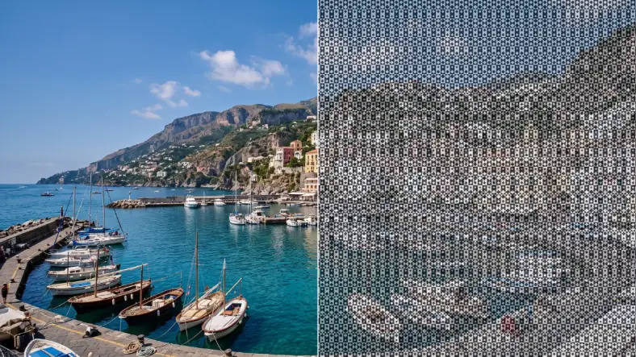

# Kilim Carpet

<!-- effect-docs: basic page sha=d2cf9111b51a, written by scripts/effect-docs.mjs. Delete this line to write the page by hand (template B in Documentation-Site.md). -->

Overlays a woven diamond-and-stripe carpet pattern in two colors, shaded by image brightness; Scale sets the motif size.

Group: [Textile & Craft](../Effects-Textile.md) · [How to add an effect](../Effects.md#add-an-effect)

<figure class="docs-shot">

<figcaption>Left: the original. Right: Kilim Carpet at its default settings.</figcaption>
</figure>

*A short page made from the editor’s effect catalog: what the effect does and its controls. Tips and its node setup will follow.*

## Controls

<!-- generated:controls start -->
| Control | Range | Default |
|---|---|---|
| **Pattern** | | |
| Scale | 2 to 80 | 14 |
| **Style** | | |
| Amount | 0 to 1 | 0.75 |
| **Color** | | |
| Ink | a colour | `#111827` |
| Paper | a colour | `#f8fafc` |
<!-- generated:controls end -->

**Styles:** the **Style** menu in the effect card switches to another look of the same engine and keeps the shared values and keyframes: [Embroidery](./embroidery.md), [Cross Stitch](./cross-stitch.md), and 25 more looks from other groups.

## Technical details

Kilim Carpet is one look of the pattern engine; its looks share one node setup. How effects are stored, rendered and exported: [Effect system](../Effect-System.md). Its building blocks: [Node Catalog](../Node-Catalog.md).
