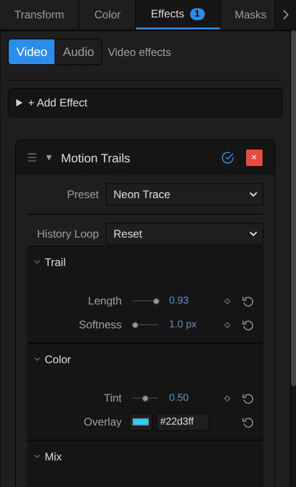

# Motion Trails

Leaves fading light streaks behind everything that moves, like a dancer turning under a spotlight. The streaks can take on a colour of their own.

Group: [Keying & Time](../Effects-Keying-Time.md) · [How to add an effect](../Effects.md#add-an-effect)

<figure class="docs-shot docs-clip docs-compare docs-shot--float-left">
<video src="../assets/effects/clips/kinetic-trace.mp4" poster="../assets/effects/clips/kinetic-trace.webp" width="960" height="462" autoplay muted loop playsinline preload="none" aria-label="The dancer turning on a dark stage, original left and with Motion Trails right: her arms, hair and skirt leave pale streaks that fade within about a second as she turns"></video>
<figcaption>Left: original. Right: Motion Trails at its default settings, the Light Trails preset.</figcaption>
</figure>

**Use it for:** streaks behind a dancer's arms and skirt · light painting with a performer · a coloured wake behind every movement.

- **Length** – how long the streaks last.
- **Tint** – how much they take on the Overlay colour.
- **Amount** – how strongly the effect shows.

**Tip:** the streaks are light over dark: they show on a dark stage and disappear in front of a bright wall. Lower the clip's background with a colour correction before Motion Trails when the trails get lost.

## Presets

<figure class="docs-shot docs-clip">
<video src="../assets/effects/clips/kinetic-trace-presets.mp4" poster="../assets/effects/clips/kinetic-trace-presets.webp" width="960" height="730" autoplay muted loop playsinline preload="none" aria-label="The dancer five times in a grid, moving in sync, each with one preset: Light Trails with short pale streaks, Long Streaks with longer fading streaks, Neon Trace with cyan trails, Embers with orange trails, Afterimage with a long pale golden haze of earlier poses"></video>
<figcaption>The five presets on the moving dancer, in sync.</figcaption>
</figure>

Pick one in the **Preset** row of the effect card. It sets Length, Tint, Overlay and Amount in one undo step, and the row shows its name until you change one of them. History Loop goes back to Reset.

**Light Trails** – short pale streaks that fade within about a second. The default; good for most dance.

**Long Streaks** – the same streaks, but they hang in the air for two to three seconds: a turn leaves a fan of arms and skirts behind.

**Neon Trace** – the streaks turn cyan as they fade, like a neon sign switched off. Strong on dark costumes and for clubby, electronic music.

**Embers** – warm orange streaks that glow out slowly, like sparks from a fire.

**Afterimage** – a long, pale golden haze of every pose of the last seconds. The performer seems to paint the stage with her body; best for slow, wide movements.

## Controls

<figure class="docs-shot">

<svg class="docs-shot-overlay" viewBox="0 0 1017 768" aria-hidden="true" focusable="false">
<defs><marker id="kinetic-trace-inspector-arrow" viewBox="0 0 10 10" refX="8" refY="5" markerWidth="5" markerHeight="5" orient="auto-start-reverse"><path d="M 0 0 L 10 5 L 0 10 Z" fill="#ffd54a" /></marker></defs>
<path class="docs-shot-arrow" d="M565 306 L649 306" marker-end="url(#kinetic-trace-inspector-arrow)" />
<circle class="docs-shot-number" cx="565" cy="306" r="18" /><text x="565" y="306" class="docs-shot-number-text">1</text>
<path class="docs-shot-arrow" d="M598 474 L682 474" marker-end="url(#kinetic-trace-inspector-arrow)" />
<circle class="docs-shot-number" cx="598" cy="474" r="18" /><text x="598" y="474" class="docs-shot-number-text">2</text>
<path class="docs-shot-arrow" d="M623 590 L707 590" marker-end="url(#kinetic-trace-inspector-arrow)" />
<circle class="docs-shot-number" cx="623" cy="590" r="18" /><text x="623" y="590" class="docs-shot-number-text">3</text>
<path class="docs-shot-arrow" d="M592 627 L676 627" marker-end="url(#kinetic-trace-inspector-arrow)" />
<circle class="docs-shot-number" cx="592" cy="627" r="18" /><text x="592" y="627" class="docs-shot-number-text">4</text>
<path class="docs-shot-arrow" d="M592 743 L676 743" marker-end="url(#kinetic-trace-inspector-arrow)" />
<circle class="docs-shot-number" cx="592" cy="743" r="18" /><text x="592" y="743" class="docs-shot-number-text">5</text>
</svg>

<figcaption>Motion Trails with the Neon Trace preset. 1 — Preset: pick a starting point. 2 — Length: how long the trail lasts. 3 — Tint: how strongly the trail takes on the Overlay colour. 4 — Overlay: the trail's colour. 5 — Amount: how strongly the effect shows.</figcaption>
</figure>

Motion Trails builds every frame on its own last picture, so the trails grow while the clip plays. Jumping to another time starts them again from nothing.

### Trail

<figure class="docs-shot docs-clip docs-shot--float-right">
<video src="../assets/effects/clips/kinetic-trace-length.mp4" poster="../assets/effects/clips/kinetic-trace-length.webp" width="720" height="692" autoplay muted loop playsinline preload="none" aria-label="The dancer with Motion Trails while Length runs from 0.5 to 0.98 and back: at 0.5 only a short smear follows her hands, at 0.98 long pale streaks of arms and skirt hang in the air before they fade; the current value is shown at the bottom left"></video>
<figcaption>Length from 0.5 to 0.98 and back.</figcaption>
</figure>

**Length** – how long the streaks last: the share of the trail each new frame keeps. At 24 frames per second 0.5 leaves only a short smear, 0.9 fades within about a second, 0.96 within two to three seconds and 0.985 lingers for about six. At 1 nothing fades: everything light the clip has shown stays, a light painting that fills up over time. The trail fades per frame, so at 50 frames per second the same Length gives half as long a trail in seconds. Keyframe it to let the trails grow on a cue. 0 to 1, default 0.9.

### Color

<figure class="docs-shot docs-clip docs-shot--float-right">
<video src="../assets/effects/clips/kinetic-trace-tint.mp4" poster="../assets/effects/clips/kinetic-trace-tint.webp" width="720" height="692" autoplay muted loop playsinline preload="none" aria-label="The dancer with Motion Trails while Tint runs from 0 to 1 and back: the pale streaks behind her turn green, first at their old ends, then completely, and back to pale; the current value is shown at the bottom left"></video>
<figcaption>Tint from 0 to 1 and back, with the default green Overlay.</figcaption>
</figure>

**Tint** – how strongly the streaks take on the Overlay colour. It colours only the trail, where it is lighter than the picture now, never the performer or the stage themselves. The colouring repeats every frame, so at 0.2–0.5 the fresh streaks stay close to the original and the older ends turn to the colour; at 1 the whole trail is the colour. The streaks keep their brightness. 0 to 1, default 0.

**Overlay** – the colour of the trail. It acts once Tint is above 0; at Tint 0 a changed colour only colours the glow around a tracked subject (see Technical details), and the card says so. a colour, default `#36f59a`.

### Mix

<figure class="docs-shot docs-clip docs-shot--float-right">
<video src="../assets/effects/clips/kinetic-trace-amount.mp4" poster="../assets/effects/clips/kinetic-trace-amount.webp" width="720" height="692" autoplay muted loop playsinline preload="none" aria-label="The dancer with Motion Trails while Amount runs from 0 to 1 and back: at 0 she is alone, then faint short streaks appear that grow brighter and longer up to 1, and fade again; the current value is shown at the bottom left"></video>
<figcaption>Amount from 0 to 1 and back.</figcaption>
</figure>

**Amount** – how strongly the effect shows, from the plain clip at 0 to the full trails at 1. Because every frame builds on the mixed picture, a lower Amount also shortens the trail: below Length the trail fades as if Length were set to Amount, and the card says so. Animate it from 0 to let the trails fade in. 0 to 1, default 1.

### General

**History Loop** – what happens to the trails when looped playback jumps back to the loop start. **Reset** starts them again from nothing, so every pass looks the same. **Continuous** carries them across the jump: the end of the loop still trails into its start. Reset, Continuous, default Reset.

## Node setup

Motion Trails is one GPU pass, not a node setup: it has no inside to open in the Nodes tab. Its trail is a feedback loop: each frame reads the effect's own last picture, keeps Length of it and lets the clip through wherever that is lighter.

**Remix:** for an organic, breathing trail, keyframe **Length** from 0.85 at the quiet moments to 0.97 on the big movements, and put a **Gaussian Blur** of 2–4 after Motion Trails: the streaks melt into soft light.

## Technical details

- **Trail.** Every frame keeps Length ÷ Amount of the effect's last output (at most 1), so the visible trail keeps Length per frame; it takes each channel's lighter value of the trail and the clip. Tint mixes in the trail recoloured to the Overlay colour at the same brightness, chosen by brightness instead of per channel: a per-channel lighter value of two different colours is brighter than either, so a tinted trail over the stage used to feed on itself and never faded. The fading is per frame, not per second.
- **Transparency.** The trail is computed premultiplied, so over transparent areas (after a key) it fades with its alpha instead of turning dark.
- **Values.** Length, Tint and Amount outside 0 to 1 render at the nearest limit, a value that is not a number at its default, and an Overlay that is not a `#rrggbb` colour as `#36f59a`; the card and tool results say so, as they do for a Length above Amount and a changed Overlay at Tint 0.
- **Tracking.** After **Track Landmarks** in Properties → Effects (hands, face and pose of the clip), the trails drift with the tracked movement and a faint Overlay glow surrounds the tracked subject; with the clip's motion analysis they drift with its mean motion. Without tracking data the trails stay in place and there is no glow. Up to version 3.2.7 that glow sat as a fixed disc in the middle of the frame when the clip had no tracking: a bug, now gone.
- **Saved projects.** A Motion Trails saved before Length and Tint existed keeps its trail exactly: it renders as before, where each frame kept 0.9 of the mixed output (the card shows Length 0.72, the visible share at the old default Amount 0.8), without Tint. Only the centre disc of untracked clips is gone. New effects start at Amount 1. Its old Speed control was retired earlier and is still ignored. The presets are not stored in projects.
- **More:** [Effect system: landmark tracking effects](../Effect-System.md#landmark-tracking-effects) · [Effect system](../Effect-System.md) · [Styles and presets](../Effects.md#styles-and-presets).
