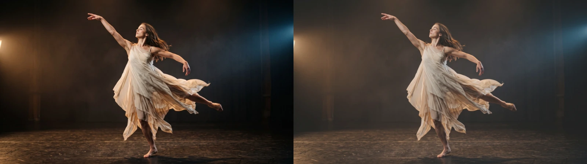
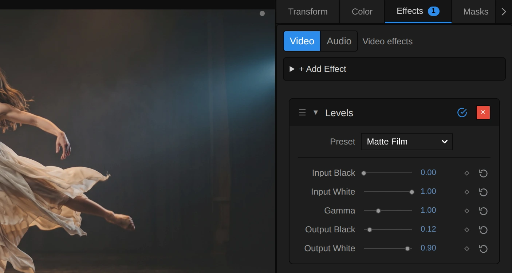
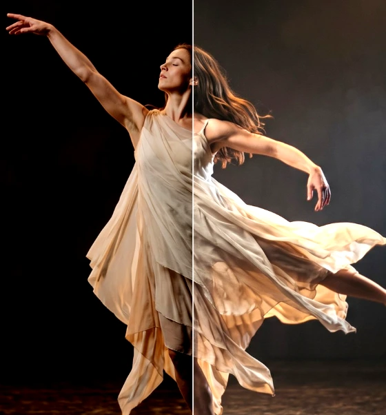
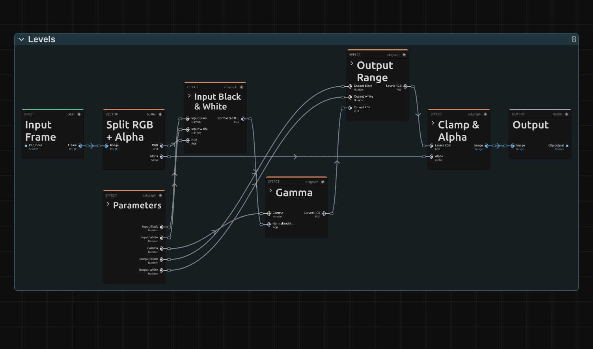
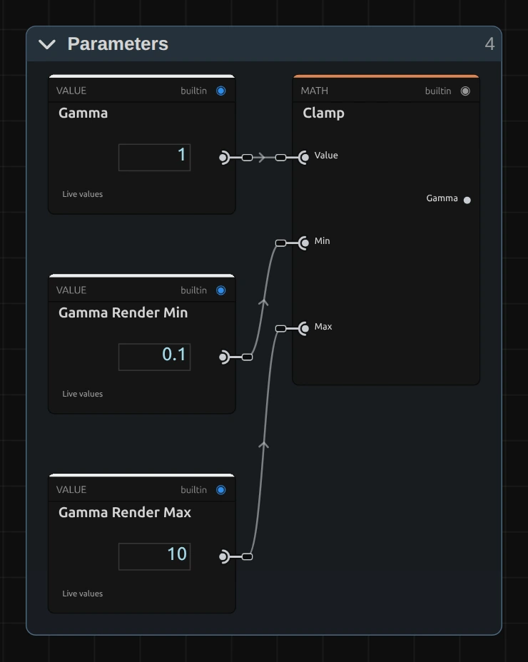
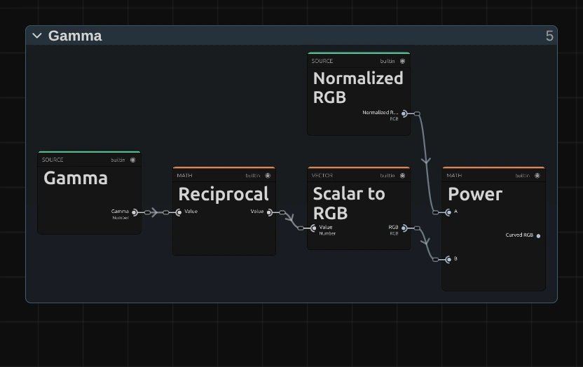
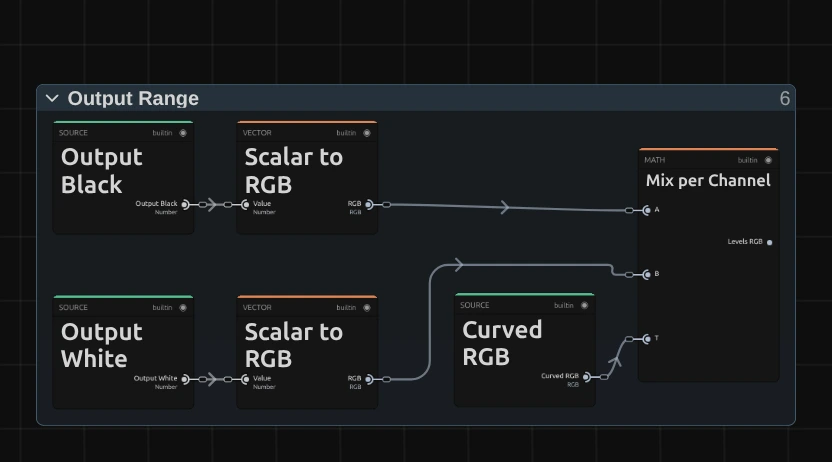
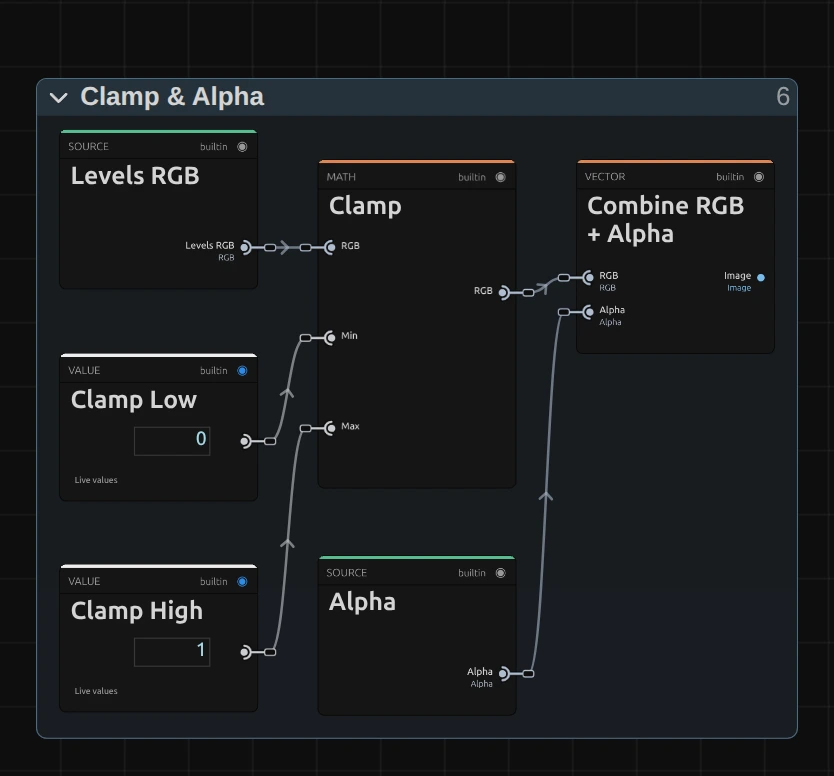

# Levels

Chooses which tone becomes black, which becomes white and how bright the middle is. The classic Levels from photo editing.

Group: [Color & Tone](../Effects-Color.md) · [How to add an effect](../Effects.md#add-an-effect)

<figure class="docs-shot docs-compare">

<figcaption>Left: original. Right: Output Black 0.12, Output White 0.9 (the Matte Film preset).</figcaption>
</figure>

**Use it for:** clean black and white points · a matte, faded film look · matching the tonal range of two shots.

- **Input Black / Input White** – which tones become black and white.
- **Gamma** – the mid-tones.
- **Output Black / Output White** – how dark black and how bright white may be.

**Tip:** for video projected on a dark stage, raise **Input Black** to about 0.05. The grey noise in the dark parts of the video becomes true black, so the projector sends as little light as it can there and the edge of the picture disappears into the stage.

## Presets

<figure class="docs-shot docs-shot--detail">

<figcaption>The four presets on the harbour town, which has real blacks and whites.</figcaption>
</figure>

Pick one in the **Preset** row of the effect card. It sets all five controls in one undo step, and the row then shows its name until you change a value. A keyframed control keeps its keyframes, and the card says so.

**Clean Points** – the darkest and the brightest 6 % of the tones become pure black and pure white (Input Black 0.06, Input White 0.94). The picture gets firmer without a new look: a good first step for slightly grey footage.

**Open Mids** – lighter mid-tones (Gamma 1.4) while black and white stay where they are. The picture turns light and airy; on a stage the haze and the skin open up while the dark stays dark.

**Deep Mids** – heavier mid-tones on a slightly deeper black (Input Black 0.04, Gamma 0.6). A darker, denser mood without losing the highlights.

**Matte Film** – black is lifted to a dark grey and white is held below white (Output Black 0.12, Output White 0.9), like a matte film print. Nothing on the picture is pure black or pure white any more; unlike Open Mids, the shadows turn grey while the mid-tones stay where they were.

## Controls

<figure class="docs-shot">

<svg class="docs-shot-overlay" viewBox="0 0 1017 433" aria-hidden="true" focusable="false">
<defs><marker id="levels-inspector-arrow" viewBox="0 0 10 10" refX="8" refY="5" markerWidth="5" markerHeight="5" orient="auto-start-reverse"><path d="M 0 0 L 10 5 L 0 10 Z" fill="#ffd54a" /></marker></defs>
<path class="docs-shot-arrow" d="M639 224 L723 224" marker-end="url(#levels-inspector-arrow)" />
<circle class="docs-shot-number" cx="639" cy="224" r="18" /><text x="639" y="224" class="docs-shot-number-text">1</text>
<path class="docs-shot-arrow" d="M610 274 L694 274" marker-end="url(#levels-inspector-arrow)" />
<circle class="docs-shot-number" cx="610" cy="274" r="18" /><text x="610" y="274" class="docs-shot-number-text">2</text>
<path class="docs-shot-arrow" d="M609 304 L693 304" marker-end="url(#levels-inspector-arrow)" />
<circle class="docs-shot-number" cx="609" cy="304" r="18" /><text x="609" y="304" class="docs-shot-number-text">3</text>
<path class="docs-shot-arrow" d="M630 334 L714 334" marker-end="url(#levels-inspector-arrow)" />
<circle class="docs-shot-number" cx="630" cy="334" r="18" /><text x="630" y="334" class="docs-shot-number-text">4</text>
<path class="docs-shot-arrow" d="M600 364 L684 364" marker-end="url(#levels-inspector-arrow)" />
<circle class="docs-shot-number" cx="600" cy="364" r="18" /><text x="600" y="364" class="docs-shot-number-text">5</text>
<path class="docs-shot-arrow" d="M598 394 L682 394" marker-end="url(#levels-inspector-arrow)" />
<circle class="docs-shot-number" cx="598" cy="394" r="18" /><text x="598" y="394" class="docs-shot-number-text">6</text>
</svg>

<figcaption>Levels with the Matte Film preset. 1 — Preset: pick a starting point. 2 — Input Black: what becomes black. 3 — Input White: what becomes white. 4 — Gamma: the mid-tones. 5 — Output Black: how dark black is. 6 — Output White: how bright white is.</figcaption>
</figure>

**Preset** – one of the four starting points above; it sets all five controls.

<figure class="docs-shot docs-shot--float-right">

<figcaption>Left half: Input Black 0.2. Right half: Input White 0.7.</figcaption>
</figure>

**Input Black** – every tone at or below this value becomes black, and the tones above it spread out down to black. Raising it deepens the shadows and adds contrast; 0.03–0.1 cleans up a grey black, 0.2 already swallows the haze. 0 to 1, default 0.

**Input White** – every tone at or above this value becomes white, and the tones below it spread out up to white. Lowering it brightens the picture and adds contrast; from about 0.8 the brightest parts of the costume burn out. Each colour channel is cut on its own, so strongly coloured light can shift towards yellow or white. 0 to 1, default 1.

Equal Input Black and Input White make a hard cut on each colour channel, a posterised look in up to eight colours; for a clean black-and-white cut use [Threshold](./threshold.md). Input Black above Input White turns the picture into its negative.

<figure class="docs-shot docs-clip docs-shot--float-right">
<video src="../assets/effects/clips/levels-gamma.mp4" poster="../assets/effects/clips/levels-gamma.webp" width="720" height="540" autoplay muted loop playsinline preload="none" aria-label="The dancer turning on a dark stage with Levels while Gamma runs from 0.5 to 2 and back: first the haze and her skin are heavy and dark, then the mid-tones open into a light, soft grey, while pure black and the white of the dress stay where they are; the current value is shown at the bottom left"></video>
<figcaption>Gamma from 0.5 to 2 and back.</figcaption>
</figure>

**Gamma** – bends the mid-tones between the two input points while black and white stay where they are. Above 1 they open up and the picture turns lighter and softer; below 1 they get heavier and the colours deeper. 0.8 or 1.25 is a clear change, 2 a pale, milky picture. 0.1 to 3, default 1. In the number field you can type up to 10; at the slider's floor of 0.1 the picture is almost black, and the inspector says so.

**Output Black** – how dark black may be. Raising it lifts the whole picture from below, and black becomes a grey: the matte look of the picture at the top. 0.05–0.15 is a soft, filmic lift. 0 to 1, default 0.

**Output White** – how bright white may be. Lowering it dims the brightest parts first and gives a softer, duller picture; 0.85–0.95 takes the edge off hard highlights. Output Black above Output White turns the picture into its negative. 0 to 1, default 1.

## Node setup

<figure class="docs-shot docs-shot--graph">

<svg class="docs-shot-overlay" viewBox="0 0 1017 599" aria-hidden="true" focusable="false">
<defs><marker id="levels-arrow" viewBox="0 0 10 10" refX="8" refY="5" markerWidth="5" markerHeight="5" orient="auto-start-reverse"><path d="M 0 0 L 10 5 L 0 10 Z" fill="#ffd54a" /></marker></defs>
<path class="docs-shot-arrow" d="M230 576 L230 492" marker-end="url(#levels-arrow)" />
<circle class="docs-shot-number" cx="230" cy="576" r="18" /><text x="230" y="576" class="docs-shot-number-text">1</text>
<path class="docs-shot-arrow" d="M369 50 L369 134" marker-end="url(#levels-arrow)" />
<circle class="docs-shot-number" cx="369" cy="50" r="18" /><text x="369" y="50" class="docs-shot-number-text">2</text>
<path class="docs-shot-arrow" d="M508 497 L508 413" marker-end="url(#levels-arrow)" />
<circle class="docs-shot-number" cx="508" cy="497" r="18" /><text x="508" y="497" class="docs-shot-number-text">3</text>
<path class="docs-shot-arrow" d="M648 22 L648 79" marker-end="url(#levels-arrow)" />
<circle class="docs-shot-number" cx="648" cy="22" r="18" /><text x="648" y="22" class="docs-shot-number-text">4</text>
<path class="docs-shot-arrow" d="M787 381 L787 297" marker-end="url(#levels-arrow)" />
<circle class="docs-shot-number" cx="787" cy="381" r="18" /><text x="787" y="381" class="docs-shot-number-text">5</text>
</svg>

<figcaption>Levels opened in the Nodes tab (the Constants folder left out). 1 — Parameters: the five controls, Gamma kept within its range. 2 — Input Black & White: stretches the tones between the two input points to the full range. 3 — Gamma: bends the mid-tones. 4 — Output Range: places the result between Output Black and Output White. 5 — Clamp & Alpha: keeps the colour within 0 to 1 and puts the transparency back.</figcaption>
</figure>

Levels works in five stages, one folder each in the Nodes tab: **Parameters** holds the five controls, **Input Black & White** stretches the tones, **Gamma** bends the middle, **Output Range** sets the final black and white, and **Clamp & Alpha** finishes. **Split RGB + Alpha** takes the transparency aside first. Every colour effect has this shape ([Color & Tone](../Effects-Color.md#the-shared-idea)). Click a folder's header to open it; the sections below show what is inside.

### Parameters

<figure class="docs-shot docs-shot--graph docs-shot--float-right">

<svg class="docs-shot-overlay" viewBox="0 0 590 740" aria-hidden="true" focusable="false">
<defs><marker id="levels-parameters-arrow" viewBox="0 0 10 10" refX="8" refY="5" markerWidth="5" markerHeight="5" orient="auto-start-reverse"><path d="M 0 0 L 10 5 L 0 10 Z" fill="#ffd54a" /></marker></defs>
<path class="docs-shot-arrow" d="M432 521 L432 437" marker-end="url(#levels-parameters-arrow)" />
<circle class="docs-shot-number" cx="432" cy="521" r="18" /><text x="432" y="521" class="docs-shot-number-text">1</text>
</svg>

<figcaption>Inside Parameters (the four other controls go out directly). 1 — Clamp: keeps Gamma between 0.1 and 10.</figcaption>
</figure>

**Clamp** – keeps Gamma between 0.1 and 10, the values in **Gamma Render Min** and **Gamma Render Max**. At 0 the curve would have no answer, so the floor keeps it at an almost black but valid picture. A keyframe, a node or the AI agent may send more; the picture then uses the limit, and the card and the tool result say so.

**Input Black**, **Input White**, **Output Black** and **Output White** go out as they are: any value a node or the AI agent sends has a clear result. An Input Black below 0 lifts the blacks a little, and an output point beyond 0 or 1 is cut at black or white at the end.

### Input Black & White

<figure class="docs-shot docs-shot--graph">

<svg class="docs-shot-overlay" viewBox="0 0 1017 776" aria-hidden="true" focusable="false">
<defs><marker id="levels-remap-arrow" viewBox="0 0 10 10" refX="8" refY="5" markerWidth="5" markerHeight="5" orient="auto-start-reverse"><path d="M 0 0 L 10 5 L 0 10 Z" fill="#ffd54a" /></marker></defs>
<path class="docs-shot-arrow" d="M509 141 L509 225" marker-end="url(#levels-remap-arrow)" />
<circle class="docs-shot-number" cx="509" cy="141" r="18" /><text x="509" y="141" class="docs-shot-number-text">1</text>
<path class="docs-shot-arrow" d="M703 141 L703 225" marker-end="url(#levels-remap-arrow)" />
<circle class="docs-shot-number" cx="703" cy="141" r="18" /><text x="703" y="141" class="docs-shot-number-text">2</text>
<path class="docs-shot-arrow" d="M897 141 L897 225" marker-end="url(#levels-remap-arrow)" />
<circle class="docs-shot-number" cx="897" cy="141" r="18" /><text x="897" y="141" class="docs-shot-number-text">3</text>
</svg>

<figcaption>Inside Input Black & White (the cards that compute the Input Range left out). 1 — Subtract: Input Black becomes 0. 2 — Divide: Input White becomes 1. 3 — Clamp: everything outside is cut off.</figcaption>
</figure>

**Subtract** – takes Input Black away from each colour channel, so that tone lands at 0.

**Divide** – divides by the **Input Range**, Input White minus Input Black, so Input White lands at 1 and the tones between spread over the whole range. The range is computed by small cards left out of the picture (Subtract, Absolute, Maximum, Greater Than, Switch): they keep it at least 0.0001 away from zero, so equal input points give a hard cut instead of a division by zero, and keep its sign, so swapped points give a negative.

**Clamp** – with **Remap Clamp Low** (0) and **Remap Clamp High** (1): tones below Input Black stay black and tones above Input White stay white. The result is the **Normalized RGB**.

### Gamma

<figure class="docs-shot docs-shot--graph docs-shot--float-right">

<svg class="docs-shot-overlay" viewBox="0 0 590 372" aria-hidden="true" focusable="false">
<defs><marker id="levels-gamma-arrow" viewBox="0 0 10 10" refX="8" refY="5" markerWidth="5" markerHeight="5" orient="auto-start-reverse"><path d="M 0 0 L 10 5 L 0 10 Z" fill="#ffd54a" /></marker></defs>
<path class="docs-shot-arrow" d="M227 349 L227 265" marker-end="url(#levels-gamma-arrow)" />
<circle class="docs-shot-number" cx="227" cy="349" r="18" /><text x="227" y="349" class="docs-shot-number-text">1</text>
<path class="docs-shot-arrow" d="M500 79 L500 163" marker-end="url(#levels-gamma-arrow)" />
<circle class="docs-shot-number" cx="500" cy="79" r="18" /><text x="500" y="79" class="docs-shot-number-text">2</text>
</svg>

<figcaption>Inside Gamma. 1 — Reciprocal: turns Gamma into the exponent. 2 — Power: bends the mid-tones.</figcaption>
</figure>

**Reciprocal** – 1 divided by Gamma. Gamma 2 becomes the exponent 0.5.

**Power** – raises each channel of the Normalized RGB to that exponent. 0 and 1 stay where they are, and only the tones in between move: an exponent below 1 lifts them, above 1 lowers them.

**Remix:** take **Reciprocal** out and wire **Gamma** straight into **Scalar to RGB**: the control then works the other way round, above 1 heavier and below 1 lighter, as in some grading tools.

### Output Range

<figure class="docs-shot docs-shot--graph docs-shot--float-right">

<svg class="docs-shot-overlay" viewBox="0 0 590 328" aria-hidden="true" focusable="false">
<defs><marker id="levels-output-arrow" viewBox="0 0 10 10" refX="8" refY="5" markerWidth="5" markerHeight="5" orient="auto-start-reverse"><path d="M 0 0 L 10 5 L 0 10 Z" fill="#ffd54a" /></marker></defs>
<path class="docs-shot-arrow" d="M503 22 L503 99" marker-end="url(#levels-output-arrow)" />
<circle class="docs-shot-number" cx="503" cy="22" r="18" /><text x="503" y="22" class="docs-shot-number-text">1</text>
</svg>

<figcaption>Inside Output Range. 1 — Mix per Channel: from Output Black to Output White.</figcaption>
</figure>

**Mix per Channel** – blends from **A** (Output Black) to **B** (Output White) by **T**, the Curved RGB, on each channel: a tone of 0 becomes Output Black, 1 becomes Output White, and everything in between keeps its place on the way.

**Remix:** swap the two cables into **A** and **B**: the picture turns into its negative, with the same black and white points.

### Clamp & Alpha

<figure class="docs-shot docs-shot--graph docs-shot--float-right">

<svg class="docs-shot-overlay" viewBox="0 0 590 549" aria-hidden="true" focusable="false">
<defs><marker id="levels-finish-arrow" viewBox="0 0 10 10" refX="8" refY="5" markerWidth="5" markerHeight="5" orient="auto-start-reverse"><path d="M 0 0 L 10 5 L 0 10 Z" fill="#ffd54a" /></marker></defs>
<path class="docs-shot-arrow" d="M295 23 L295 107" marker-end="url(#levels-finish-arrow)" />
<circle class="docs-shot-number" cx="295" cy="23" r="18" /><text x="295" y="23" class="docs-shot-number-text">1</text>
</svg>

<figcaption>Inside Clamp & Alpha. 1 — Clamp: keeps each channel between 0 and 1.</figcaption>
</figure>

**Clamp** – keeps each colour channel between **Clamp Low** (0) and **Clamp High** (1), for output points set beyond black or white.

**Combine RGB + Alpha** then puts the original transparency back, untouched.

## Technical details

- **Formula.** `y = OutBlack + (OutWhite − OutBlack) · clamp((x − InBlack) / (InWhite − InBlack), 0, 1)^(1/Gamma)` on each colour channel; the result is limited to 0–1. At Gamma 2 a mid-grey of 0.5 becomes 0.71; with the Matte Film preset black becomes 0.12, white 0.9 and mid-grey 0.51.
- **Range.** Gamma renders 0.1 to 10; beyond that the picture uses the limit, and the inspector and the tool result say so. The four points render as given.
- **Special cases.** Equal input points give a hard cut per channel, swapped input or output points a negative. All channels share the same points; there is no per-channel mode.
- **Transparency.** Only the colour is changed; the transparency passes through untouched.
- **Saved projects** look the same as before; only the folders in the Nodes tab changed (the colour cards of Input Black and the output points now sit inside their stages).
- What all colour effects share (8-bit range, saved projects, adjustment layers): [Color & Tone](../Effect-System.md#color--tone-notes). Formulas: [Effect system](../Effect-System.md#editable-color-effect-graphs); blocks: [Node Catalog](../Node-Catalog.md) · [Styles and presets](../Effects.md#styles-and-presets).
