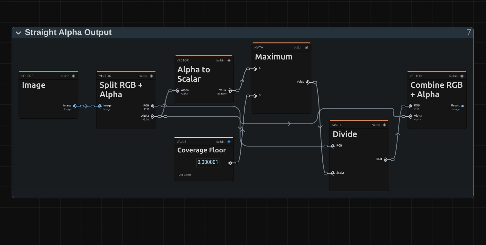

# Mirror

Reflects one half of the picture onto the other for perfect symmetry, with a seamless mirror line. For reflections in water, doubled figures and symmetric emblems.

Group: [Lens & Distort](../Effects-Distort.md) · [How to add an effect](../Effects.md#add-an-effect)

<figure class="docs-shot docs-compare">

<figcaption>Left: original. Right: Mirror at its defaults, Left / Right on.</figcaption>
</figure>

**Use it for:** a calm reflection in water · a symmetric face, body or building · a dancer facing herself · an emblem made from any picture.

- **Left / Right** and **Top / Bottom** – which mirror lines are on.
- **Keep** – which side is kept and copied.
- **Center X / Center Y** and **Angle** – move and turn the mirror lines.

**Tip:** on a landscape, turn on only **Top / Bottom** and move **Center Y** onto the horizon: the land then lies in still water.

## Presets

<figure class="docs-shot docs-shot--detail">

<figcaption>The four presets on the harbour.</figcaption>
</figure>

Pick one in the **Preset** row of the effect card. It sets all controls at once, in one undo step, and the row then shows its name until you change something. A control with keyframes keeps them, and the card says so. Each preset also sets **Angle**: three level the line, Diagonal Fold turns it to 45°. **Center X / Center Y** go back to the middle of the frame and **Frame Edges** to **Mirror**: move the line onto your subject after the preset.

**Still Lake** – only **Top / Bottom**, keeping the top: the upper half lies upside down below it, as in still water. Move **Center Y** onto the horizon or the shoreline.

**Folded City** – only **Top / Bottom**, keeping the bottom: the ground folds up into the sky and closes over the picture, as in a dream where the street bends upwards.

**Diagonal Fold** – only **Left / Right**, with **Angle** at 45°: the line is turned, so the picture folds along a slant and the town meets its own mirror image at a tilted seam. The only preset that turns the line.

**Four Way** – both lines, keeping the top-left quarter: the quarter appears four times around the centre, like an emblem or a coat of arms.

## Controls

<figure class="docs-shot">

<svg class="docs-shot-overlay" viewBox="0 0 1017 619" aria-hidden="true" focusable="false">
<defs><marker id="mirror-inspector-arrow" viewBox="0 0 10 10" refX="8" refY="5" markerWidth="5" markerHeight="5" orient="auto-start-reverse"><path d="M 0 0 L 10 5 L 0 10 Z" fill="#ffd54a" /></marker></defs>
<path class="docs-shot-arrow" d="M565 282 L649 282" marker-end="url(#mirror-inspector-arrow)" />
<circle class="docs-shot-number" cx="565" cy="282" r="18" /><text x="565" y="282" class="docs-shot-number-text">1</text>
<path class="docs-shot-arrow" d="M531 344 L615 344" marker-end="url(#mirror-inspector-arrow)" />
<circle class="docs-shot-number" cx="531" cy="344" r="18" /><text x="531" y="344" class="docs-shot-number-text">2</text>
<path class="docs-shot-arrow" d="M518 382 L602 382" marker-end="url(#mirror-inspector-arrow)" />
<circle class="docs-shot-number" cx="518" cy="382" r="18" /><text x="518" y="382" class="docs-shot-number-text">3</text>
<path class="docs-shot-arrow" d="M575 419 L659 419" marker-end="url(#mirror-inspector-arrow)" />
<circle class="docs-shot-number" cx="575" cy="419" r="18" /><text x="575" y="419" class="docs-shot-number-text">4</text>
<path class="docs-shot-arrow" d="M571 532 L655 532" marker-end="url(#mirror-inspector-arrow)" />
<circle class="docs-shot-number" cx="571" cy="532" r="18" /><text x="571" y="532" class="docs-shot-number-text">5</text>
</svg>

<figcaption>Mirror with the Still Lake preset. 1 — Preset: pick a starting point. 2 — Left / Right: mirror across the upright line. 3 — Top / Bottom: mirror across the level line. 4 — Keep: which side is copied. 5 — Angle: turns the lines.</figcaption>
</figure>

**Preset** – a starting point for the mirror lines, the kept side and Angle; see [Presets](#presets).

**Left / Right** – mirrors across the upright line through the centre: one half appears again, flipped, on the other side. With **Top / Bottom** also on, one quarter fills all four. With both off the picture passes through unchanged, and the card says so. A switch: on or off, default on.

**Top / Bottom** – mirrors across the level line through the centre: the top half appears again, upside down, at the bottom (or the other way round with **Keep**). A switch: on or off, default off.

**Keep** – which side is kept and copied over the other. **Left / Top** keeps the left half and the top half, **Right / Bottom** the right and the bottom. The sides turn with **Angle**: at 90° Left / Right keeps the top. Left / Top, Right / Bottom, default Left / Top.

**Center X** – where the upright line sits across the picture: 0 is the left edge, 1 the right edge. Off the middle, the kept side is larger or smaller than the other; when it is the smaller one, its reflection runs out of picture and **Frame Edges** fills the rest. 0 to 1, default 0.5.

**Center Y** – where the level line sits from top to bottom: 0 is the top edge, 1 the bottom edge. Put it on a horizon for a reflection in water. 0 to 1, default 0.5.

**Angle** – turns both mirror lines around the centre, as an angle on screen. 45° gives a diagonal reflection; at 90° the two lines swap places, and at ±180° the kept sides swap. Keyframe it for a reflection that turns. −180 to 180°, default 0°; a typed or keyframed angle may go further and goes round again.

**Frame Edges** – what fills in where the reflection reads from beyond the frame, which happens when the line is off the middle or turned. **Mirror** reflects the picture again at the edge, so the picture keeps going; **Clamp** repeats the outermost pixels into streaks; **Transparent** leaves those places empty, so the layer below shows through. Mirror, Clamp, Transparent, default Mirror.

## Node setup

<figure class="docs-shot docs-shot--graph">

<svg class="docs-shot-overlay" viewBox="0 0 1017 870" aria-hidden="true" focusable="false">
<defs><marker id="mirror-arrow" viewBox="0 0 10 10" refX="8" refY="5" markerWidth="5" markerHeight="5" orient="auto-start-reverse"><path d="M 0 0 L 10 5 L 0 10 Z" fill="#ffd54a" /></marker></defs>
<path class="docs-shot-arrow" d="M314 45 L314 129" marker-end="url(#mirror-arrow)" />
<circle class="docs-shot-number" cx="314" cy="45" r="18" /><text x="314" y="45" class="docs-shot-number-text">1</text>
<path class="docs-shot-arrow" d="M509 226 L509 310" marker-end="url(#mirror-arrow)" />
<circle class="docs-shot-number" cx="509" cy="226" r="18" /><text x="509" y="226" class="docs-shot-number-text">2</text>
<path class="docs-shot-arrow" d="M509 847 L509 763" marker-end="url(#mirror-arrow)" />
<circle class="docs-shot-number" cx="509" cy="847" r="18" /><text x="509" y="847" class="docs-shot-number-text">3</text>
<path class="docs-shot-arrow" d="M703 22 L703 96" marker-end="url(#mirror-arrow)" />
<circle class="docs-shot-number" cx="703" cy="22" r="18" /><text x="703" y="22" class="docs-shot-number-text">4</text>
<path class="docs-shot-arrow" d="M897 226 L897 310" marker-end="url(#mirror-arrow)" />
<circle class="docs-shot-number" cx="897" cy="226" r="18" /><text x="897" y="226" class="docs-shot-number-text">5</text>
</svg>

<figcaption>Mirror opened in the Nodes tab (Constants, Coordinates and the Output card left out). 1 — Centre: where a pixel sits. 2 — Mirror Lines: folds it onto the kept side. 3 — Premultiplied Source: the picture, ready to read. 4 — Frame Edges & Read: reads the picture there. 5 — Straight Alpha Output: back to a normal picture.</figcaption>
</figure>

Mirror does not paint anything: it moves where each pixel reads, like every effect in its group ([the shared idea](../Effects-Distort.md#the-shared-idea)). **Centre** works out where a pixel sits from the crossing of the mirror lines, **Mirror Lines** folds that place onto the kept side, **Frame Edges & Read** reads the picture there, from the **Premultiplied Source** prepared once per frame, and **Straight Alpha Output** turns the result back into a normal picture. Click a folder's header to open it; the sections below show what is inside.

### Centre

<figure class="docs-shot docs-shot--graph">

<svg class="docs-shot-overlay" viewBox="0 0 1017 1056" aria-hidden="true" focusable="false">
<defs><marker id="mirror-centre-arrow" viewBox="0 0 10 10" refX="8" refY="5" markerWidth="5" markerHeight="5" orient="auto-start-reverse"><path d="M 0 0 L 10 5 L 0 10 Z" fill="#ffd54a" /></marker></defs>
<path class="docs-shot-arrow" d="M509 632 L509 716" marker-end="url(#mirror-centre-arrow)" />
<circle class="docs-shot-number" cx="509" cy="632" r="18" /><text x="509" y="632" class="docs-shot-number-text">1</text>
<path class="docs-shot-arrow" d="M509 22 L509 96" marker-end="url(#mirror-centre-arrow)" />
<circle class="docs-shot-number" cx="509" cy="22" r="18" /><text x="509" y="22" class="docs-shot-number-text">2</text>
<path class="docs-shot-arrow" d="M703 408 L703 492" marker-end="url(#mirror-centre-arrow)" />
<circle class="docs-shot-number" cx="703" cy="408" r="18" /><text x="703" y="408" class="docs-shot-number-text">3</text>
<path class="docs-shot-arrow" d="M897 408 L897 492" marker-end="url(#mirror-centre-arrow)" />
<circle class="docs-shot-number" cx="897" cy="408" r="18" /><text x="897" y="408" class="docs-shot-number-text">4</text>
</svg>

<figcaption>Inside Centre. 1 — Combine Vector: the Centre. 2 — Minimum: the shorter side. 3 — Divide: the Shape Scale. 4 — Multiply: the Offset.</figcaption>
</figure>

**Combine Vector** – joins **Center X** and **Center Y** into the Centre, where the mirror lines cross.

**Minimum** – the shorter side of the frame in pixels, from the width and height that Split Vector takes out of the resolution.

**Divide** – the resolution divided by the shorter side: the Shape Scale. It measures both directions in the same unit, so **Angle** is a true angle on screen on a wide or a tall frame.

**Multiply** – the Offset: the pixel's place (UV) minus the Centre, times the Shape Scale. It says how far and in which direction the pixel lies from the crossing of the lines.

### Mirror Lines

<figure class="docs-shot docs-shot--graph">

<svg class="docs-shot-overlay" viewBox="0 0 1017 495" aria-hidden="true" focusable="false">
<defs><marker id="mirror-lines-arrow" viewBox="0 0 10 10" refX="8" refY="5" markerWidth="5" markerHeight="5" orient="auto-start-reverse"><path d="M 0 0 L 10 5 L 0 10 Z" fill="#ffd54a" /></marker></defs>
<path class="docs-shot-arrow" d="M204 60 L204 144" marker-end="url(#mirror-lines-arrow)" />
<circle class="docs-shot-number" cx="204" cy="60" r="18" /><text x="204" y="60" class="docs-shot-number-text">1</text>
<path class="docs-shot-arrow" d="M448 468 L448 384" marker-end="url(#mirror-lines-arrow)" />
<circle class="docs-shot-number" cx="448" cy="468" r="18" /><text x="448" y="468" class="docs-shot-number-text">2</text>
<path class="docs-shot-arrow" d="M448 28 L448 112" marker-end="url(#mirror-lines-arrow)" />
<circle class="docs-shot-number" cx="448" cy="28" r="18" /><text x="448" y="28" class="docs-shot-number-text">3</text>
<path class="docs-shot-arrow" d="M691 60 L691 144" marker-end="url(#mirror-lines-arrow)" />
<circle class="docs-shot-number" cx="691" cy="60" r="18" /><text x="691" y="60" class="docs-shot-number-text">4</text>
<path class="docs-shot-arrow" d="M935 60 L935 144" marker-end="url(#mirror-lines-arrow)" />
<circle class="docs-shot-number" cx="935" cy="60" r="18" /><text x="935" y="60" class="docs-shot-number-text">5</text>
</svg>

<figcaption>The left-right strand of Mirror Lines; the top-bottom strand works the same way on Y. 1 — Rotate UV: stands the line upright. 2 — Switch: the kept side. 3 — Absolute: the fold. 4 — Switch: Left / Right on or off. 5 — Rotate UV: turns the result back.</figcaption>
</figure>

**Rotate UV** – turns the Offset by −Angle, so in the turned frame the mirror lines are upright and level again. Split Vector then takes the Turned Offset apart into X and Y.

**Switch** – the Kept Side: −1 for **Left / Top** and +1 for **Right / Bottom**, picked by comparing **Keep** with Half.

**Absolute** – the whole trick: it turns −0.3 and +0.3 into the same 0.3, so a pixel and its mirror image read the same spot. The Multiply next to it gives the result the sign of the kept side, so both read from that side.

**Switch** – uses the mirrored X while **Left / Right** is on and the raw X while it is off. Combine Vector joins it with the Y of the top-bottom strand into the Reflected Offset.

**Rotate UV** – turns the Reflected Offset back by Angle. Divide by the Shape Scale and Add the Centre (not shown) then give the Read Position.

**Remix:** for a hall of mirrors, add a **Mirror Repeat** node between **Absolute** and the Multiply, and feed its Period from a **Value** of 0.5. The picture next to the line now reflects back and forth in strips a quarter of the picture height wide.

### Premultiplied Source

<figure class="docs-shot docs-shot--graph">

<svg class="docs-shot-overlay" viewBox="0 0 1017 478" aria-hidden="true" focusable="false">
<defs><marker id="mirror-premultiplied-source-arrow" viewBox="0 0 10 10" refX="8" refY="5" markerWidth="5" markerHeight="5" orient="auto-start-reverse"><path d="M 0 0 L 10 5 L 0 10 Z" fill="#ffd54a" /></marker></defs>
<path class="docs-shot-arrow" d="M589 455 L589 371" marker-end="url(#mirror-premultiplied-source-arrow)" />
<circle class="docs-shot-number" cx="589" cy="455" r="18" /><text x="589" y="455" class="docs-shot-number-text">1</text>
<path class="docs-shot-arrow" d="M914 22 L914 106" marker-end="url(#mirror-premultiplied-source-arrow)" />
<circle class="docs-shot-number" cx="914" cy="22" r="18" /><text x="914" y="22" class="docs-shot-number-text">2</text>
</svg>

<figcaption>Inside Premultiplied Source (cached). 1 — Multiply: colour times transparency. 2 — Cache Image: keeps the prepared picture.</figcaption>
</figure>

**Multiply** – multiplies every pixel's colour by its transparency. When the read later blends two neighbouring pixels, a transparent one then adds no colour, so a cut-out figure keeps clean edges at the mirror line instead of a dark rim.

**Cache Image** – keeps the prepared picture, so it is made once per frame, not once per pixel.

### Frame Edges & Read

<figure class="docs-shot docs-shot--graph">

<svg class="docs-shot-overlay" viewBox="0 0 1017 1031" aria-hidden="true" focusable="false">
<defs><marker id="mirror-frame-edges-arrow" viewBox="0 0 10 10" refX="8" refY="5" markerWidth="5" markerHeight="5" orient="auto-start-reverse"><path d="M 0 0 L 10 5 L 0 10 Z" fill="#ffd54a" /></marker></defs>
<path class="docs-shot-arrow" d="M314 928 L314 844" marker-end="url(#mirror-frame-edges-arrow)" />
<circle class="docs-shot-number" cx="314" cy="928" r="18" /><text x="314" y="928" class="docs-shot-number-text">1</text>
<path class="docs-shot-arrow" d="M314 145 L314 229" marker-end="url(#mirror-frame-edges-arrow)" />
<circle class="docs-shot-number" cx="314" cy="145" r="18" /><text x="314" y="145" class="docs-shot-number-text">2</text>
<path class="docs-shot-arrow" d="M509 203 L509 229" marker-end="url(#mirror-frame-edges-arrow)" />
<circle class="docs-shot-number" cx="509" cy="203" r="18" /><text x="509" y="203" class="docs-shot-number-text">3</text>
<path class="docs-shot-arrow" d="M703 145 L703 229" marker-end="url(#mirror-frame-edges-arrow)" />
<circle class="docs-shot-number" cx="703" cy="145" r="18" /><text x="703" y="145" class="docs-shot-number-text">4</text>
<path class="docs-shot-arrow" d="M897 145 L897 229" marker-end="url(#mirror-frame-edges-arrow)" />
<circle class="docs-shot-number" cx="897" cy="145" r="18" /><text x="897" y="145" class="docs-shot-number-text">5</text>
</svg>

<figcaption>Inside Frame Edges & Read, reduced to its recipe (how Edge Coverage and Is Transparent are worked out is left out). 1 — Mirror Repeat: reflects at the edge. 2 — Clamp: stops at the edge. 3 — Switch: picks one by Frame Edges. 4 — Sample Image: reads the picture. 5 — Multiply: empties the places beyond the edge.</figcaption>
</figure>

**Mirror Repeat** – folds a Read Position beyond the frame back in, as in a mirror: the **Mirror** choice.

**Clamp** – holds the Read Position between Zero and One, so it stops at the outermost pixel: the **Clamp** choice, and the base of **Transparent**.

**Switch** – picks the mirrored or the clamped position. Greater Than compares Frame Edges with 0.5: Mirror is the only choice below it.

**Sample Image** – reads the Premultiplied Source at that position, blending the four nearest pixels.

**Multiply** – scales the read by One, or for **Transparent** by Edge Coverage, which falls from 1 to 0 within one pixel of the frame edge. Places that read from beyond the frame turn empty with a soft edge.

### Straight Alpha Output

<figure class="docs-shot docs-shot--graph">

<svg class="docs-shot-overlay" viewBox="0 0 1017 515" aria-hidden="true" focusable="false">
<defs><marker id="mirror-straight-alpha-arrow" viewBox="0 0 10 10" refX="8" refY="5" markerWidth="5" markerHeight="5" orient="auto-start-reverse"><path d="M 0 0 L 10 5 L 0 10 Z" fill="#ffd54a" /></marker></defs>
<path class="docs-shot-arrow" d="M589 22 L589 83" marker-end="url(#mirror-straight-alpha-arrow)" />
<circle class="docs-shot-number" cx="589" cy="22" r="18" /><text x="589" y="22" class="docs-shot-number-text">1</text>
<path class="docs-shot-arrow" d="M752 491 L752 407" marker-end="url(#mirror-straight-alpha-arrow)" />
<circle class="docs-shot-number" cx="752" cy="491" r="18" /><text x="752" y="491" class="docs-shot-number-text">2</text>
<path class="docs-shot-arrow" d="M914 59 L914 143" marker-end="url(#mirror-straight-alpha-arrow)" />
<circle class="docs-shot-number" cx="914" cy="59" r="18" /><text x="914" y="59" class="docs-shot-number-text">3</text>
</svg>

<figcaption>Inside Straight Alpha Output. 1 — Maximum: never divide by zero. 2 — Divide: the colour back to full strength. 3 — Combine RGB + Alpha: the finished picture.</figcaption>
</figure>

**Maximum** – keeps the transparency above a tiny Coverage Floor, so a fully transparent pixel never divides by zero.

**Divide** – divides the colour by the transparency again: the step back from the Premultiplied Source, so half-transparent edges keep their real colour.

**Combine RGB + Alpha** – joins colour and transparency into the finished picture that goes on to the next effect.

## Technical details

- **Fold.** Offsets are measured in units of the shorter frame side, so Angle is an on-screen angle on any frame. Each line that is on keeps one side in the turned frame, so the reflection is continuous at the line: no gap and no doubled row.
- **Units.** Angle is stored in radians and shown in degrees; keyframe lanes, MIDI and tools use radians. Center X and Center Y are shares of the frame, so a 4K export, a portrait frame and the thumbnails show the same reflection.
- **Off.** With Left / Right and Top / Bottom both off, the picture passes through unchanged and the card says so. An unknown Keep value from a tool reads as Left / Top and is reported.
- **Transparency.** The picture is read premultiplied, so cut-out figures keep clean edges; the preview and the export match. Mirror does not move with time: a still frame stays still.
- **Saved projects** keep their look; diagonal mirror lines point exactly along the on-screen angle.
- **More:** [Effect system: Lens & Distort](../Effect-System.md#lens--distort-notes) · [Editable mirror, split and pixel graphs](../Effect-System.md#editable-mirror-split-and-pixel-graphs) · [Mirror Repeat in the Node Catalog](../Node-Catalog.md#composed-coordinate-nodes) · [Styles and presets](../Effects.md#styles-and-presets).
