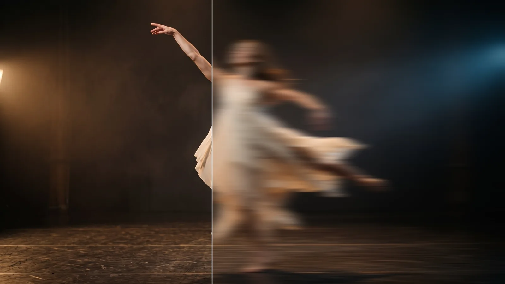
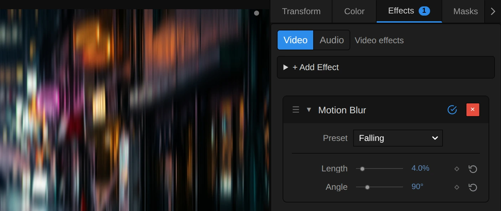

# Motion Blur

Smears the picture in one direction, as if the camera or the subject moved fast while the shutter was open.

Group: [Blur & Sharpen](../Effects-Blur.md) · [How to add an effect](../Effects.md#add-an-effect)

<figure class="docs-shot docs-compare docs-shot--float-left">

<figcaption>Left: original. Right: Length 2%.</figcaption>
</figure>

**Use it for:** a sense of speed · a whip pan between two shots · streaking lights and flowing fabric.

- **Length** – how far the streak reaches.
- **Angle** – which way it points.

**Tip:** keep Length small on faces (1–2%); long streaks work best on lights, fabric and scene changes. For streaks that fly out from a point use [Zoom Blur](./zoom-blur.md).

## Presets

<figure class="docs-shot docs-shot--detail">

<figcaption>The four presets on the dancer.</figcaption>
</figure>

Pick one in the **Preset** row of the effect card. It sets Length and Angle in one undo step, and the row shows its name until you change something. A control with keyframes keeps them, and the card says so.

**Quick Move** – Length 1.5%, Angle 0°: a short sideways move. The figure gets the feel of speed, the face stays recognisable.

**Leap** – Length 3.5%, Angle 340°: a jump caught rising to one side. The slight tilt reads as an upward movement rather than a camera pan.

**Falling** – Length 4%, Angle 90°: streaks straight up and down, for falling, rain or something dropped from the flies.

**Whip Pan** – Length 15%, Angle 0°: the camera tears sideways and only colour and light are left. Keyframe Length up to it and back for a cut between two shots.

## Controls

<figure class="docs-shot">

<svg class="docs-shot-overlay" viewBox="0 0 1017 431" aria-hidden="true" focusable="false">
<defs><marker id="motion-blur-inspector-arrow" viewBox="0 0 10 10" refX="8" refY="5" markerWidth="5" markerHeight="5" orient="auto-start-reverse"><path d="M 0 0 L 10 5 L 0 10 Z" fill="#ffd54a" /></marker></defs>
<path class="docs-shot-arrow" d="M565 282 L649 282" marker-end="url(#motion-blur-inspector-arrow)" />
<circle class="docs-shot-number" cx="565" cy="282" r="18" /><text x="565" y="282" class="docs-shot-number-text">1</text>
<path class="docs-shot-arrow" d="M562 344 L646 344" marker-end="url(#motion-blur-inspector-arrow)" />
<circle class="docs-shot-number" cx="562" cy="344" r="18" /><text x="562" y="344" class="docs-shot-number-text">2</text>
<path class="docs-shot-arrow" d="M571 382 L655 382" marker-end="url(#motion-blur-inspector-arrow)" />
<circle class="docs-shot-number" cx="571" cy="382" r="18" /><text x="571" y="382" class="docs-shot-number-text">3</text>
</svg>

<figcaption>Motion Blur with the Falling preset. 1 — Preset: pick a starting point. 2 — Length: how far the streak reaches. 3 — Angle: which way it points.</figcaption>
</figure>

**Preset** – a starting point for Length and Angle; see [Presets](#presets).

**Length** – how far the streak reaches to each side of every pixel, as a share of the picture: of its width for a horizontal streak, of its height for a vertical one. The middle of the streak counts most and its ends fade out, so edges smear softly instead of showing ghost copies. 0.5–1% takes the edge off a movement, 1–3% is a quick move with faces still readable, the default 5% (about 96 px to each side in a 1080p frame) a fast one, 10% leaves only shapes and from 20% on only bands of colour remain. Because it counts in shares of the frame, a 4K export shows the same streak as the preview. Animated it changes smoothly, and 0 leaves the picture untouched. 0 to 30%, default 5%.

**Angle** – which way the streak points: 0° is horizontal, 90° vertical, 45° diagonal. The streak runs to both sides, so 180° looks the same as 0°. Turning it also changes the length: Length counts the width for horizontal and the height for vertical streaks, so in a 16:9 frame a vertical streak is only a bit more than half as long as a horizontal one at the same Length. 0 to 360°, default 0°.

## Node setup

<figure class="docs-shot docs-shot--graph">

<svg class="docs-shot-overlay" viewBox="0 0 1017 550" aria-hidden="true" focusable="false">
<defs><marker id="motion-blur-arrow" viewBox="0 0 10 10" refX="8" refY="5" markerWidth="5" markerHeight="5" orient="auto-start-reverse"><path d="M 0 0 L 10 5 L 0 10 Z" fill="#ffd54a" /></marker></defs>
<path class="docs-shot-arrow" d="M264 43 L264 127" marker-end="url(#motion-blur-arrow)" />
<circle class="docs-shot-number" cx="264" cy="43" r="18" /><text x="264" y="43" class="docs-shot-number-text">1</text>
<path class="docs-shot-arrow" d="M274 459 L358 459" marker-end="url(#motion-blur-arrow)" />
<circle class="docs-shot-number" cx="274" cy="459" r="18" /><text x="274" y="459" class="docs-shot-number-text">2</text>
<path class="docs-shot-arrow" d="M274 321 L358 321" marker-end="url(#motion-blur-arrow)" />
<circle class="docs-shot-number" cx="274" cy="321" r="18" /><text x="274" y="321" class="docs-shot-number-text">3</text>
<path class="docs-shot-arrow" d="M437 129 L521 129" marker-end="url(#motion-blur-arrow)" />
<circle class="docs-shot-number" cx="437" cy="129" r="18" /><text x="437" y="129" class="docs-shot-number-text">4</text>
<path class="docs-shot-arrow" d="M599 226 L683 226" marker-end="url(#motion-blur-arrow)" />
<circle class="docs-shot-number" cx="599" cy="226" r="18" /><text x="599" y="226" class="docs-shot-number-text">5</text>
<path class="docs-shot-arrow" d="M914 323 L914 239" marker-end="url(#motion-blur-arrow)" />
<circle class="docs-shot-number" cx="914" cy="323" r="18" /><text x="914" y="323" class="docs-shot-number-text">6</text>
</svg>

<figcaption>Motion Blur opened in the Nodes tab (Constants, Coordinates and the Output card left out). 1 — Blur Range: where the streak starts and how long it is. 2 — Tap Counts & Box Length: how to cut it into pieces. 3 — Premultiplied Source: the picture, ready to average. 4 — Stage A: averages one short piece. 5 — Stage B: adds up the pieces along the streak. 6 — Straight Alpha Output: back to a normal picture.</figcaption>
</figure>

Motion Blur works in six stages, one folder each in the Nodes tab. **Blur Range** turns Length and Angle into a line in pixels, and **Tap Counts & Box Length** cuts that line into short pieces. **Premultiplied Source** prepares the picture so transparent edges stay clean. **Stage A** averages one short piece around every pixel and caches it, **Stage B** reads that cache once per piece along the whole line, and **Straight Alpha Output** turns the result back into a normal picture. Two stages make a long streak cost dozens of reads instead of hundreds. Click a folder's header to open it. [Zoom Blur](./zoom-blur.md) and [Radial Blur](./radial-blur.md) have the same stages; only the path of the streak differs.

### Blur Range

<figure class="docs-shot docs-shot--graph">

<svg class="docs-shot-overlay" viewBox="0 0 1017 486" aria-hidden="true" focusable="false">
<defs><marker id="motion-blur-blur-range-arrow" viewBox="0 0 10 10" refX="8" refY="5" markerWidth="5" markerHeight="5" orient="auto-start-reverse"><path d="M 0 0 L 10 5 L 0 10 Z" fill="#ffd54a" /></marker></defs>
<path class="docs-shot-arrow" d="M508 421 L508 337" marker-end="url(#motion-blur-blur-range-arrow)" />
<circle class="docs-shot-number" cx="508" cy="421" r="18" /><text x="508" y="421" class="docs-shot-number-text">1</text>
<path class="docs-shot-arrow" d="M230 22 L230 79" marker-end="url(#motion-blur-blur-range-arrow)" />
<circle class="docs-shot-number" cx="230" cy="22" r="18" /><text x="230" y="22" class="docs-shot-number-text">2</text>
<path class="docs-shot-arrow" d="M508 22 L508 79" marker-end="url(#motion-blur-blur-range-arrow)" />
<circle class="docs-shot-number" cx="508" cy="22" r="18" /><text x="508" y="22" class="docs-shot-number-text">3</text>
<path class="docs-shot-arrow" d="M644 310 L728 310" marker-end="url(#motion-blur-blur-range-arrow)" />
<circle class="docs-shot-number" cx="644" cy="310" r="18" /><text x="644" y="310" class="docs-shot-number-text">4</text>
<path class="docs-shot-arrow" d="M926 22 L926 79" marker-end="url(#motion-blur-blur-range-arrow)" />
<circle class="docs-shot-number" cx="926" cy="22" r="18" /><text x="926" y="22" class="docs-shot-number-text">5</text>
</svg>

<figcaption>Inside Blur Range (Length, Angle). 1 — Maximum: never below 0. 2 — Direction from Angle: the direction on screen. 3 — Length: pixels per unit of Length. 4 — Subtract: where the streak starts. 5 — Absolute: how long it is.</figcaption>
</figure>

**Maximum** – keeps Length at 0 or above. A negative Length, which a keyframe overshoot or a tool can produce, leaves the picture unchanged, and the card and the tool result say so.

**Direction from Angle** – turns Angle into a direction on screen, one pixel long: (cos, sin) of the angle.

**Length** – the length of that direction stretched by the frame size: the frame width for a horizontal, the height for a vertical direction. Times Length (the next Multiply) this is the Half Length, how far the streak reaches to each side in pixels.

**Subtract** – Zero minus the Half Length: the streak starts that far behind the pixel and, twice as long (the Range Length), ends as far ahead of it.

**Absolute** – the Range Length without its sign: the whole streak in pixels, which Tap Counts & Box Length divides up.

### Tap Counts & Box Length

<figure class="docs-shot docs-shot--graph">

<svg class="docs-shot-overlay" viewBox="0 0 1017 666" aria-hidden="true" focusable="false">
<defs><marker id="motion-blur-tap-counts-arrow" viewBox="0 0 10 10" refX="8" refY="5" markerWidth="5" markerHeight="5" orient="auto-start-reverse"><path d="M 0 0 L 10 5 L 0 10 Z" fill="#ffd54a" /></marker></defs>
<path class="docs-shot-arrow" d="M427 162 L427 246" marker-end="url(#motion-blur-tap-counts-arrow)" />
<circle class="docs-shot-number" cx="427" cy="162" r="18" /><text x="427" y="162" class="docs-shot-number-text">1</text>
<path class="docs-shot-arrow" d="M589 548 L589 464" marker-end="url(#motion-blur-tap-counts-arrow)" />
<circle class="docs-shot-number" cx="589" cy="548" r="18" /><text x="589" y="548" class="docs-shot-number-text">2</text>
<path class="docs-shot-arrow" d="M762 327 L846 327" marker-end="url(#motion-blur-tap-counts-arrow)" />
<circle class="docs-shot-number" cx="762" cy="327" r="18" /><text x="762" y="327" class="docs-shot-number-text">3</text>
</svg>

<figcaption>Inside Tap Counts & Box Length. 1 — Square Root: the balance of both stages. 2 — Clamp: how many pieces. 3 — Maximum: how long one piece is.</figcaption>
</figure>

**Square Root** – the square root of twice the streak length. Cutting the streak into that many pieces gives both stages about the same work: a 192 px streak (the default in a 1080p frame) becomes about 20 pieces of about 10 px, so a pixel reads about 30 times instead of 192.

**Clamp** – keeps that between 1 and 64 without rounding it: the Coarse Taps, the number of pieces Stage B reads. It is rarely a whole number; the last piece then counts only with the share of it that fits (Stage B), so the pieces grow smoothly with Length instead of jumping by one.

**Maximum** – the streak divided by the number of pieces: the Box Length, how long one piece is. It never reaches 0, so a zero streak cannot divide by zero.

### Premultiplied Source

<figure class="docs-shot docs-shot--graph">

<svg class="docs-shot-overlay" viewBox="0 0 1017 377" aria-hidden="true" focusable="false">
<defs><marker id="motion-blur-premultiplied-source-arrow" viewBox="0 0 10 10" refX="8" refY="5" markerWidth="5" markerHeight="5" orient="auto-start-reverse"><path d="M 0 0 L 10 5 L 0 10 Z" fill="#ffd54a" /></marker></defs>
<path class="docs-shot-arrow" d="M437 262 L521 262" marker-end="url(#motion-blur-premultiplied-source-arrow)" />
<circle class="docs-shot-number" cx="437" cy="262" r="18" /><text x="437" y="262" class="docs-shot-number-text">1</text>
<path class="docs-shot-arrow" d="M762 134 L846 134" marker-end="url(#motion-blur-premultiplied-source-arrow)" />
<circle class="docs-shot-number" cx="762" cy="134" r="18" /><text x="762" y="134" class="docs-shot-number-text">2</text>
</svg>

<figcaption>Inside Premultiplied Source (cached). 1 — Multiply: colour times transparency. 2 — Cache Image: keeps the prepared picture.</figcaption>
</figure>

**Multiply** – multiplies each pixel's colour by its alpha. A see-through pixel then adds almost nothing to the average, so the colour of its invisible part cannot smear into the streak as a dark rim around a cut-out figure or a title.

**Cache Image** – keeps the prepared picture in a 16-bit float texture for Stage A to read, so no precision is lost in dark areas.

### Stage A: Short Box

<figure class="docs-shot docs-shot--graph">

![Inside the Stage A folder, reduced to its recipe: Half Box (px) divided by Cell (px) gives the half box in cells; minus the Ring and clamped between 0 and 1 it is the share of that ring's cell the piece covers, at least a tiny floor by Maximum the Fine Weight; Fine Taps sets how many reads; the Read position goes through Mirror Repeat into Sample Image, which reads the Premultiplied Source; Sequence Reduce adds up the weighted reads, Normalize by Weight turns the sum into an average and Cache Image keeps the Short Boxes](../assets/effects/graphs/motion-blur-stage-a.webp)

<svg class="docs-shot-overlay" viewBox="0 0 1017 569" aria-hidden="true" focusable="false">
<defs><marker id="motion-blur-stage-a-arrow" viewBox="0 0 10 10" refX="8" refY="5" markerWidth="5" markerHeight="5" orient="auto-start-reverse"><path d="M 0 0 L 10 5 L 0 10 Z" fill="#ffd54a" /></marker></defs>
<path class="docs-shot-arrow" d="M204 64 L204 148" marker-end="url(#motion-blur-stage-a-arrow)" />
<circle class="docs-shot-number" cx="204" cy="64" r="18" /><text x="204" y="64" class="docs-shot-number-text">1</text>
<path class="docs-shot-arrow" d="M448 148 L448 148" marker-end="url(#motion-blur-stage-a-arrow)" />
<circle class="docs-shot-number" cx="448" cy="148" r="18" /><text x="448" y="148" class="docs-shot-number-text">2</text>
<path class="docs-shot-arrow" d="M448 502 L448 418" marker-end="url(#motion-blur-stage-a-arrow)" />
<circle class="docs-shot-number" cx="448" cy="502" r="18" /><text x="448" y="502" class="docs-shot-number-text">3</text>
<path class="docs-shot-arrow" d="M691 351 L691 267" marker-end="url(#motion-blur-stage-a-arrow)" />
<circle class="docs-shot-number" cx="691" cy="351" r="18" /><text x="691" y="351" class="docs-shot-number-text">4</text>
<path class="docs-shot-arrow" d="M935 319 L935 235" marker-end="url(#motion-blur-stage-a-arrow)" />
<circle class="docs-shot-number" cx="935" cy="319" r="18" /><text x="935" y="319" class="docs-shot-number-text">5</text>
</svg>

<figcaption>Inside Stage A, reduced to its recipe (how the read position is worked out is left out, and so are the fixed values). 1 — Divide: the half piece in cells. 2 — Clamp: how much of a cell counts. 3 — Mirror Repeat: mirrors at the frame edge. 4 — Sequence Reduce: adds up the reads. 5 — Cache Image: keeps the short pieces.</figcaption>
</figure>

**Divide** – half the Box Length in cells of one pixel: how far the piece reaches to each side of this pixel. Only a piece longer than 256 px gets cells wider than a pixel (Cell), so a pixel never reads more than 256 times here. The number of reads (Fine Taps) is twice the rings needed to reach the end of the piece.

**Clamp** – the reads sit one pixel apart, in pairs from the pixel outward, each in the middle of its one-pixel cell. A cell the piece covers only partly counts with that share, and its read moves to the middle of the covered part; Maximum keeps every weight just above 0. So the piece grows smoothly with Length: a new pair enters with weight 0 and grows in, and even a piece shorter than a pixel blurs a little instead of leaving the picture unchanged.

**Mirror Repeat** – where a read falls outside the frame, it is mirrored back in. The streak at the frame edge therefore continues the picture instead of fading to black or repeating the last pixel as a hard line.

**Sequence Reduce** – reads the Premultiplied Source at every position along the piece (**Sample Image**) and adds up the reads, each times its weight; Normalize by Weight divides by the summed weight, so the sum becomes an average.

**Cache Image** – keeps, for every pixel, the average of the short piece around it: the Short Boxes that Stage B reads.

### Stage B: Coarse Taps

<figure class="docs-shot docs-shot--graph">

<svg class="docs-shot-overlay" viewBox="0 0 1017 1241" aria-hidden="true" focusable="false">
<defs><marker id="motion-blur-stage-b-arrow" viewBox="0 0 10 10" refX="8" refY="5" markerWidth="5" markerHeight="5" orient="auto-start-reverse"><path d="M 0 0 L 10 5 L 0 10 Z" fill="#ffd54a" /></marker></defs>
<path class="docs-shot-arrow" d="M320 23 L320 107" marker-end="url(#motion-blur-stage-b-arrow)" />
<circle class="docs-shot-number" cx="320" cy="23" r="18" /><text x="320" y="23" class="docs-shot-number-text">1</text>
<path class="docs-shot-arrow" d="M320 649 L320 671" marker-end="url(#motion-blur-stage-b-arrow)" />
<circle class="docs-shot-number" cx="320" cy="649" r="18" /><text x="320" y="649" class="docs-shot-number-text">2</text>
<path class="docs-shot-arrow" d="M508 587 L508 671" marker-end="url(#motion-blur-stage-b-arrow)" />
<circle class="docs-shot-number" cx="508" cy="587" r="18" /><text x="508" y="587" class="docs-shot-number-text">3</text>
<path class="docs-shot-arrow" d="M320 816 L320 838" marker-end="url(#motion-blur-stage-b-arrow)" />
<circle class="docs-shot-number" cx="320" cy="816" r="18" /><text x="320" y="816" class="docs-shot-number-text">4</text>
<path class="docs-shot-arrow" d="M695 587 L695 671" marker-end="url(#motion-blur-stage-b-arrow)" />
<circle class="docs-shot-number" cx="695" cy="587" r="18" /><text x="695" y="587" class="docs-shot-number-text">5</text>
</svg>

<figcaption>Inside Stage B, reduced to its recipe (how the read position is worked out is left out). 1 — Divide: where along the streak. 2 — Exponential: the soft taper. 3 — Multiply: the weight of a read. 4 — Mirror Repeat: mirrors at the frame edge. 5 — Sequence Reduce: adds up the pieces.</figcaption>
</figure>

**Divide** – how far along the streak a piece lies, from 0 at its start to 1 at its end (Position t).

**Exponential** – the taper: exp(−2 · (2t − 1)²), 1 in the middle of the streak and about 0.14 at both ends. The white value cards Two, One and Taper Gain shape it. Because the ends fade, a moving edge melts away instead of stopping at a hard line.

**Multiply** – the taper times the Box Weight: the Tap Weight of a read. In Motion Blur every piece is whole, so the Box Weight is 1; it matters in [Radial Blur](./radial-blur.md), whose streaks have a different length at every pixel and whose last piece counts only its covered share.

**Mirror Repeat** – as in Stage A, mirrors reads outside the frame back in, so both stages agree at the edge.

**Sequence Reduce** – reads one cached short piece per tap (**Sample Image** on the Short Boxes), adds them up with their Tap Weights, and Normalize by Weight divides by the summed weight, so the streak keeps the picture's brightness.

**Remix:** for an even streak without the fade, open **Stage B**, unplug **Exponential** from input A of the **Multiply** and plug a **Value** of 1 into A. Leave input B alone: it carries the Box Weight. Or select **Taper Gain** and set its value from −2 to −6 in the node inspector: the ends fade sooner and the streak looks shorter and harder.

### Straight Alpha Output

<figure class="docs-shot docs-shot--graph">

<svg class="docs-shot-overlay" viewBox="0 0 1017 409" aria-hidden="true" focusable="false">
<defs><marker id="motion-blur-straight-alpha-arrow" viewBox="0 0 10 10" refX="8" refY="5" markerWidth="5" markerHeight="5" orient="auto-start-reverse"><path d="M 0 0 L 10 5 L 0 10 Z" fill="#ffd54a" /></marker></defs>
<path class="docs-shot-arrow" d="M437 132 L521 132" marker-end="url(#motion-blur-straight-alpha-arrow)" />
<circle class="docs-shot-number" cx="437" cy="132" r="18" /><text x="437" y="132" class="docs-shot-number-text">1</text>
<path class="docs-shot-arrow" d="M599 294 L683 294" marker-end="url(#motion-blur-straight-alpha-arrow)" />
<circle class="docs-shot-number" cx="599" cy="294" r="18" /><text x="599" y="294" class="docs-shot-number-text">2</text>
<path class="docs-shot-arrow" d="M762 177 L846 177" marker-end="url(#motion-blur-straight-alpha-arrow)" />
<circle class="docs-shot-number" cx="762" cy="177" r="18" /><text x="762" y="177" class="docs-shot-number-text">3</text>
</svg>

<figcaption>Inside Straight Alpha Output. 1 — Maximum: never divide by zero. 2 — Divide: the colour back to full strength. 3 — Combine RGB + Alpha: the finished picture.</figcaption>
</figure>

**Maximum** – the averaged alpha, but never below the Coverage Floor, a tiny 0.000001 (the card rounds it to 0). Fully transparent pixels then stay black and transparent instead of turning into errors.

**Divide** – divides the averaged colour by the averaged alpha: the reverse of the Multiply in Premultiplied Source, so half-transparent streaks get their real colour back.

**Combine RGB + Alpha** – joins colour and alpha into the finished picture that leaves the effect.

## Technical details

- **Units.** The streak reaches Length × |(cos × width, sin × height)| pixels to each side: a share of the frame width for horizontal and of the height for vertical streaks, so saved projects and the Film Roll transition keep their streaks on every aspect ratio. Angle is the exact on-screen direction; it is stored in radians (0–6.28) for tools and keyframes, and the card shows degrees. Length is stored as a share (0–0.3), and the card shows percent.
- **Two stages.** About 2 × √(2 × streak length in pixels) reads per pixel: Stage B reads up to 64 pieces, Stage A up to 256 pixels per piece. Neither count is rounded to a whole read: the last piece and the outermost reads count with the share of them that fits, so the blur changes smoothly when the amount is animated. A streak beyond 64 × 256 pixels (only on very large frames) reads its pieces further apart, and the card and the tool result say so.
- **Edges.** At the frame edge the picture is mirrored. Transparent edges smear without a dark rim, and the preview and the export match.
- **Below 0 and zero.** A negative Length leaves the picture unchanged, as in earlier versions, and the card and the tool result say so. An unedited Motion Blur at Length 0 is skipped, so the picture passes through exactly.
- **Software preview.** Where the editor falls back to its software preview, Motion Blur reads the same path in one stage of up to 64 one-pixel steps, blended between pixels, so an animated amount changes smoothly there too. Streaks longer than 64 px spread their reads and can look stepped; the `SoftwareBlur` log says so.
- **Saved projects.** They keep their look, with one fix: every Motion Blur without an edited node setup renders with the current recipe, also in projects saved with version 3.2.7 (that recipe jumped a little where an animated amount added a read, and left a streak under about a pixel unchanged). Still pictures differ by less than half a level on average, up to about 10–30 levels on thin high-contrast lines. The old Samples value is kept in the project but no longer changes anything. A Motion Blur whose node setup you edited keeps its own recipe.
- **More:** [Blur & Sharpen notes](../Effect-System.md#blur--sharpen-notes) · [Editable blur kernels](../Effect-System.md#editable-blur-kernels) · [Node Catalog](../Node-Catalog.md) · [Styles and presets](../Effects.md#styles-and-presets).
