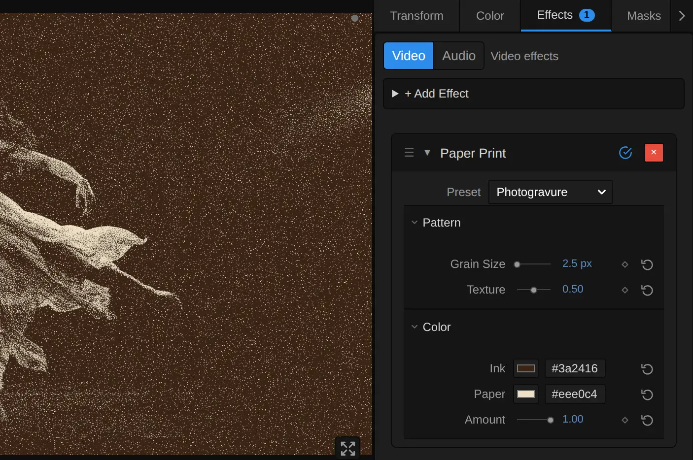
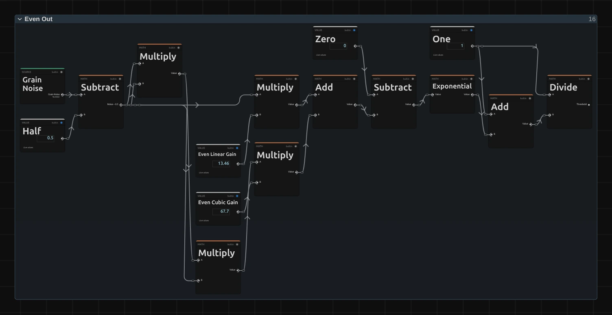
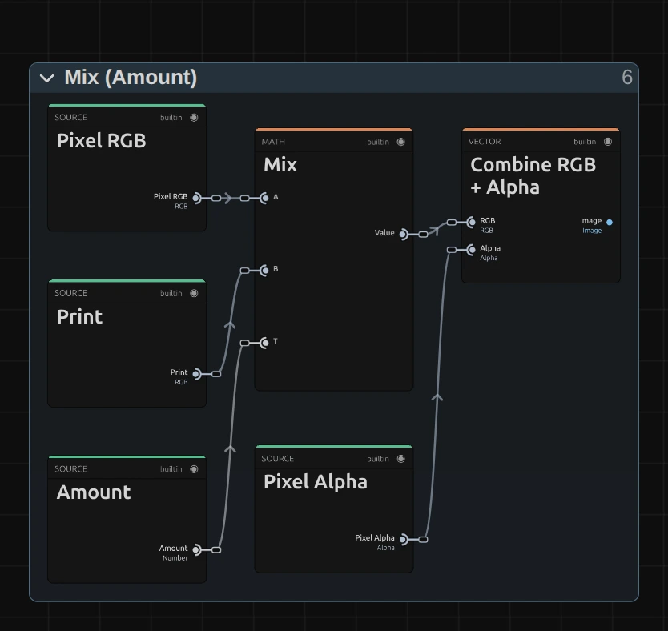

# Paper Print

Prints the picture in one ink on paper, made of a fine grain, like an old mezzotint or a photo in a book. For memories, archives and letters on stage, and one-colour posters.

Group: [Print & Halftone](../Effects-Print.md) · [How to add an effect](../Effects.md#add-an-effect)

<figure class="docs-shot docs-compare docs-shot--float-left">

<figcaption>Left: original. Right: Paper Print at its default settings, at full size.</figcaption>
</figure>

**Use it for:** an old photograph or a memory · archives, letters and documents on a projection · a poster in one colour.

- **Grain Size** – how coarse the grain is.
- **Texture** – how much of the paper shows through the ink.
- **Ink** – the colour that prints.
- **Paper** – the colour it prints on.

**Tip:** pick a light **Ink** on a dark **Paper** (the Blueprint preset) and only the light parts of the picture are printed: a dark stage stays clean paper around the lit figure. For dots in a regular grid use [Halftone](./halftone.md); for two inks, [Riso](./riso.md).

## Presets

<figure class="docs-shot docs-shot--detail">

<figcaption>The four presets on the whole figure.</figcaption>
</figure>

Pick one in the **Preset** row of the effect card. It sets all controls at once, in one undo step, and the row then shows its name until you change something. A control with keyframes keeps them, and the card says so.

**Photogravure** – a fine grain in brown-black on warm, smooth paper, like an old photogravure in a book. The quietest preset: the stage stays an even brown and from a few metres away the figure reads as a soft sepia photo.

**Mezzotint** – warm black on cream with a clearly visible grain, like the velvety grain of a mezzotint. Made for portraits and memories.

**Blueprint** – white ink on deep blue paper. The light parts of the picture are printed, so a dark stage turns into clean blue around the lit figure.

**Red Poster** – signal red on off-white with a medium grain on smooth paper, like a screen-printed poster. Loud and graphic: the figure stands out of the red as a clean, grainy silhouette.

## Controls

<figure class="docs-shot">

<svg class="docs-shot-overlay" viewBox="0 0 1017 493" aria-hidden="true" focusable="false">
<defs><marker id="paper-print-inspector-arrow" viewBox="0 0 10 10" refX="8" refY="5" markerWidth="5" markerHeight="5" orient="auto-start-reverse"><path d="M 0 0 L 10 5 L 0 10 Z" fill="#ffd54a" /></marker></defs>
<path class="docs-shot-arrow" d="M663 206 L747 206" marker-end="url(#paper-print-inspector-arrow)" />
<circle class="docs-shot-number" cx="663" cy="206" r="18" /><text x="663" y="206" class="docs-shot-number-text">1</text>
<path class="docs-shot-arrow" d="M667 283 L751 283" marker-end="url(#paper-print-inspector-arrow)" />
<circle class="docs-shot-number" cx="667" cy="283" r="18" /><text x="667" y="283" class="docs-shot-number-text">2</text>
<path class="docs-shot-arrow" d="M684 310 L768 310" marker-end="url(#paper-print-inspector-arrow)" />
<circle class="docs-shot-number" cx="684" cy="310" r="18" /><text x="684" y="310" class="docs-shot-number-text">3</text>
<path class="docs-shot-arrow" d="M709 395 L793 395" marker-end="url(#paper-print-inspector-arrow)" />
<circle class="docs-shot-number" cx="709" cy="395" r="18" /><text x="709" y="395" class="docs-shot-number-text">4</text>
<path class="docs-shot-arrow" d="M692 422 L776 422" marker-end="url(#paper-print-inspector-arrow)" />
<circle class="docs-shot-number" cx="692" cy="422" r="18" /><text x="692" y="422" class="docs-shot-number-text">5</text>
</svg>

<figcaption>Paper Print with the Photogravure preset. 1 — Preset: pick a starting point. 2 — Grain Size. 3 — Texture: the paper's bumps. 4 — Ink. 5 — Paper.</figcaption>
</figure>

### Pattern

**Grain Size** – how large one grain is. 1–2 px gives a fine grain that reads as a photo from a few metres away, 4–6 px a clearly visible grain like a mezzotint, 10 px and more coarse specks for a poster; the coarser the grain, the less detail survives. It counts pixels of a 1080p picture, so a 4K export shows the same grain, only sharper. A grain is never smaller than one pixel of the frame, and the card says when it renders larger. 1 to 80 px, default 2 px.

**Texture** – how much of the paper's surface shows. Real paper has fine bumps, and the ink does not reach their valleys: tiny specks of paper appear in the mid tones, and the paper itself looks a little uneven. The specks fade out the more ink a part needs, so a black stage stays solid ink and white parts never get ink. At 0 the ink lies flat and the print keeps the picture's brightness exactly; 0.15 is a quiet paper; the default 0.5 a clearly felt one; at 1 the mid tones get slightly lighter. Below 0 it renders 0, and the card says so. 0 to 1, default 0.5.

### Color

**Ink** – the colour that prints. It covers the dark parts of the picture, and where the picture is as dark as the ink, the ink is solid. Dark inks give a classic print; brown, blue or red tint the whole picture. A light ink on dark paper prints the light parts instead. If Ink and Paper are about equally bright, the picture cannot show, and the card says so. It takes a colour, default `#1c1a18`.

**Paper** – the colour the ink prints on, which fills the light parts of the picture. A warm cream looks like real paper, a deep colour like a coloured sheet. It takes a colour, default `#f3ecdc`.

**Amount** – how much of the print covers the original. At 1 there is only ink and paper; 0.5 lays the grain softly over the picture's own colours; 0 switches it off. Keyframe it to let a photo turn into a print on a cue. 0 to 1, default 1.

## Node setup

<figure class="docs-shot docs-shot--graph">

<svg class="docs-shot-overlay" viewBox="0 0 1017 1050" aria-hidden="true" focusable="false">
<defs><marker id="paper-print-arrow" viewBox="0 0 10 10" refX="8" refY="5" markerWidth="5" markerHeight="5" orient="auto-start-reverse"><path d="M 0 0 L 10 5 L 0 10 Z" fill="#ffd54a" /></marker></defs>
<path class="docs-shot-arrow" d="M314 354 L314 270" marker-end="url(#paper-print-arrow)" />
<circle class="docs-shot-number" cx="314" cy="354" r="18" /><text x="314" y="354" class="docs-shot-number-text">1</text>
<path class="docs-shot-arrow" d="M509 594 L509 510" marker-end="url(#paper-print-arrow)" />
<circle class="docs-shot-number" cx="509" cy="594" r="18" /><text x="509" y="594" class="docs-shot-number-text">2</text>
<path class="docs-shot-arrow" d="M314 927 L314 843" marker-end="url(#paper-print-arrow)" />
<circle class="docs-shot-number" cx="314" cy="927" r="18" /><text x="314" y="927" class="docs-shot-number-text">3</text>
<path class="docs-shot-arrow" d="M509 51 L509 135" marker-end="url(#paper-print-arrow)" />
<circle class="docs-shot-number" cx="509" cy="51" r="18" /><text x="509" y="51" class="docs-shot-number-text">4</text>
<path class="docs-shot-arrow" d="M509 1028 L509 944" marker-end="url(#paper-print-arrow)" />
<circle class="docs-shot-number" cx="509" cy="1028" r="18" /><text x="509" y="1028" class="docs-shot-number-text">5</text>
<path class="docs-shot-arrow" d="M703 294 L703 378" marker-end="url(#paper-print-arrow)" />
<circle class="docs-shot-number" cx="703" cy="294" r="18" /><text x="703" y="294" class="docs-shot-number-text">6</text>
<path class="docs-shot-arrow" d="M897 866 L897 782" marker-end="url(#paper-print-arrow)" />
<circle class="docs-shot-number" cx="897" cy="866" r="18" /><text x="897" y="866" class="docs-shot-number-text">7</text>
</svg>

<figcaption>Paper Print opened in the Nodes tab (input frame and output left out). 1 — Grain: the grain, Grain Size large. 2 — Even Out: spreads it evenly. 3 — Ink Share: how much ink each pixel needs. 4 — Paper Surface: the paper's bumps. 5 — Ink Edge: how soft the ink's edge is. 6 — Print: ink where the share beats the grain. 7 — Mix (Amount): over the picture.</figcaption>
</figure>

Paper Print works in seven stages, one folder each in the Nodes tab: **Grain** lays a smooth grain over the frame, **Even Out** turns it into a threshold that is spread evenly between 0 and 1, **Ink Share** works out how much ink each pixel needs to look as bright as the picture, **Paper Surface** adds the paper's bumps, **Ink Edge** works out how soft the edge of the ink is, **Print** puts ink wherever the share is above the threshold, and **Mix (Amount)** lays the print over the picture. Click a folder's header to open it; the sections below show what is inside.

### Grain

<figure class="docs-shot docs-shot--graph">

<svg class="docs-shot-overlay" viewBox="0 0 1017 718" aria-hidden="true" focusable="false">
<defs><marker id="paper-print-grain-arrow" viewBox="0 0 10 10" refX="8" refY="5" markerWidth="5" markerHeight="5" orient="auto-start-reverse"><path d="M 0 0 L 10 5 L 0 10 Z" fill="#ffd54a" /></marker></defs>
<path class="docs-shot-arrow" d="M369 22 L369 102" marker-end="url(#paper-print-grain-arrow)" />
<circle class="docs-shot-number" cx="369" cy="22" r="18" /><text x="369" y="22" class="docs-shot-number-text">1</text>
<path class="docs-shot-arrow" d="M648 22 L648 102" marker-end="url(#paper-print-grain-arrow)" />
<circle class="docs-shot-number" cx="648" cy="22" r="18" /><text x="648" y="22" class="docs-shot-number-text">2</text>
<path class="docs-shot-arrow" d="M648 463 L648 379" marker-end="url(#paper-print-grain-arrow)" />
<circle class="docs-shot-number" cx="648" cy="463" r="18" /><text x="648" y="463" class="docs-shot-number-text">3</text>
<path class="docs-shot-arrow" d="M926 321 L926 237" marker-end="url(#paper-print-grain-arrow)" />
<circle class="docs-shot-number" cx="926" cy="321" r="18" /><text x="926" y="321" class="docs-shot-number-text">4</text>
</svg>

<figcaption>Inside Grain (Grain Size). 1 — Divide: the frame's scale. 2 — Maximum: the grain in pixels. 3 — Rotate UV: turns the grain. 4 — Fractal Noise: the grain itself.</figcaption>
</figure>

**Divide** – the shorter side of the frame (Smallest Component) divided by 1080: how much larger or smaller this frame is than a 1080p one. It makes Grain Size look the same on a 4K export, a portrait frame and a thumbnail.

**Maximum** – Grain Size times that scale, and never less than one pixel: the size of one grain in pixels of this frame. The Maximum to its left keeps Grain Size at 1 or more.

**Rotate UV** – turns the pixel's position by the Grain Turn of 0.5 (about 29°). The grain no longer lines up with the pixel grid, so neighbouring pixels read different parts of a grain; with whole-pixel grains in line with the grid, every pixel would read the same few spots and the print would come out a little too dark or too light.

**Fractal Noise** – a smooth noise, one blob per grain, with a second, finer layer on top (two octaves, Roughness 0.5): the grain itself. It gives every pixel a value around 0.5.

**Remix:** open the **Constants** folder and set **Grain Noise Octaves** from **2** to **1**: the grain turns into smooth, round blobs, like the reticulated grain of an old film. The tones shift a little, because Even Out is measured for two octaves.

### Even Out

<figure class="docs-shot docs-shot--graph">

<svg class="docs-shot-overlay" viewBox="0 0 1017 525" aria-hidden="true" focusable="false">
<defs><marker id="paper-print-even-out-arrow" viewBox="0 0 10 10" refX="8" refY="5" markerWidth="5" markerHeight="5" orient="auto-start-reverse"><path d="M 0 0 L 10 5 L 0 10 Z" fill="#ffd54a" /></marker></defs>
<path class="docs-shot-arrow" d="M168 305 L168 221" marker-end="url(#paper-print-even-out-arrow)" />
<circle class="docs-shot-number" cx="168" cy="305" r="18" /><text x="168" y="305" class="docs-shot-number-text">1</text>
<path class="docs-shot-arrow" d="M557 35 L557 119" marker-end="url(#paper-print-even-out-arrow)" />
<circle class="docs-shot-number" cx="557" cy="35" r="18" /><text x="557" y="35" class="docs-shot-number-text">2</text>
<path class="docs-shot-arrow" d="M752 279 L752 195" marker-end="url(#paper-print-even-out-arrow)" />
<circle class="docs-shot-number" cx="752" cy="279" r="18" /><text x="752" y="279" class="docs-shot-number-text">3</text>
<path class="docs-shot-arrow" d="M946 35 L946 119" marker-end="url(#paper-print-even-out-arrow)" />
<circle class="docs-shot-number" cx="946" cy="35" r="18" /><text x="946" y="35" class="docs-shot-number-text">4</text>
</svg>

<figcaption>Inside Even Out. 1 — Subtract: the grain around its middle. 2 — Add: the curve's input. 3 — Exponential: the S-curve. 4 — Divide: the threshold.</figcaption>
</figure>

**Subtract** – the grain minus 0.5, so it swings around zero. Multiply makes its square and cube.

**Add** – the grain times 13.46 plus its cube times 67.7. These two numbers were measured from the noise: they describe how often it takes each value.

**Exponential** – e to the minus that value: the heart of an S-shaped curve.

**Divide** – 1 divided by 1 plus the Exponential: the S-curve itself, from 0 to 1. It turns the noise, which mostly stays near its middle, into a threshold that takes every value between 0 and 1 equally often. That is what keeps the tones right: a pixel that needs 30 % ink gets ink on exactly 30 % of the grain.

### Ink Share

<figure class="docs-shot docs-shot--graph">

<svg class="docs-shot-overlay" viewBox="0 0 1017 788" aria-hidden="true" focusable="false">
<defs><marker id="paper-print-ink-share-arrow" viewBox="0 0 10 10" refX="8" refY="5" markerWidth="5" markerHeight="5" orient="auto-start-reverse"><path d="M 0 0 L 10 5 L 0 10 Z" fill="#ffd54a" /></marker></defs>
<path class="docs-shot-arrow" d="M691 530 L691 446" marker-end="url(#paper-print-ink-share-arrow)" />
<circle class="docs-shot-number" cx="691" cy="530" r="18" /><text x="691" y="530" class="docs-shot-number-text">1</text>
<path class="docs-shot-arrow" d="M691 66 L691 150" marker-end="url(#paper-print-ink-share-arrow)" />
<circle class="docs-shot-number" cx="691" cy="66" r="18" /><text x="691" y="66" class="docs-shot-number-text">2</text>
<path class="docs-shot-arrow" d="M813 66 L813 150" marker-end="url(#paper-print-ink-share-arrow)" />
<circle class="docs-shot-number" cx="813" cy="66" r="18" /><text x="813" y="66" class="docs-shot-number-text">3</text>
<path class="docs-shot-arrow" d="M935 433 L935 349" marker-end="url(#paper-print-ink-share-arrow)" />
<circle class="docs-shot-number" cx="935" cy="433" r="18" /><text x="935" y="433" class="docs-shot-number-text">4</text>
</svg>

<figcaption>Inside Ink Share. 1 — Subtract: the light the picture lacks. 2 — Switch: a safe gap. 3 — Divide: the share of ink. 4 — Clamp: between 0 and 1.</figcaption>
</figure>

**Subtract** – the paper's brightness minus the picture's: how much light the picture lacks compared with the bare paper. Each brightness comes from sRGB to Linear and Luminance, so it is measured as light, the way a screen adds it up.

**Switch** – the gap between Paper and Ink (Subtract above), kept away from zero: at least 0.0001 on the side it is on. Equally bright Ink and Paper would otherwise divide by zero.

**Divide** – the missing light divided by that gap: the share of ink this pixel needs. Ink on that share and paper on the rest have exactly the picture's brightness.

**Clamp** – keeps the share between 0 (bare paper) and 1 (solid ink). Light ink on dark paper gives a negative gap and works the other way round.

### Paper Surface

<figure class="docs-shot docs-shot--graph">

<svg class="docs-shot-overlay" viewBox="0 0 1017 638" aria-hidden="true" focusable="false">
<defs><marker id="paper-print-surface-arrow" viewBox="0 0 10 10" refX="8" refY="5" markerWidth="5" markerHeight="5" orient="auto-start-reverse"><path d="M 0 0 L 10 5 L 0 10 Z" fill="#ffd54a" /></marker></defs>
<path class="docs-shot-arrow" d="M420 73 L420 157" marker-end="url(#paper-print-surface-arrow)" />
<circle class="docs-shot-number" cx="420" cy="73" r="18" /><text x="420" y="73" class="docs-shot-number-text">1</text>
<path class="docs-shot-arrow" d="M774 73 L774 157" marker-end="url(#paper-print-surface-arrow)" />
<circle class="docs-shot-number" cx="774" cy="73" r="18" /><text x="774" y="73" class="docs-shot-number-text">2</text>
<path class="docs-shot-arrow" d="M986 416 L902 416" marker-end="url(#paper-print-surface-arrow)" />
<circle class="docs-shot-number" cx="986" cy="416" r="18" /><text x="986" y="416" class="docs-shot-number-text">3</text>
<path class="docs-shot-arrow" d="M951 334 L951 250" marker-end="url(#paper-print-surface-arrow)" />
<circle class="docs-shot-number" cx="951" cy="334" r="18" /><text x="951" y="334" class="docs-shot-number-text">4</text>
<path class="docs-shot-arrow" d="M774 616 L774 532" marker-end="url(#paper-print-surface-arrow)" />
<circle class="docs-shot-number" cx="774" cy="616" r="18" /><text x="774" y="616" class="docs-shot-number-text">5</text>
</svg>

<figcaption>Inside Paper Surface (Texture). 1 — Fractal Noise: the paper's height. 2 — Multiply: the valley depth times Salt Gain. 3 — Multiply: the Valley Lift, by Texture. 4 — Multiply: fades the lift out in deep ink. 5 — Add: the paper's shade.</figcaption>
</figure>

**Fractal Noise** – the height of the paper: fine bumps 3 pixels of a 1080p frame across, in three layers. It is moved by an Offset, so it never repeats the grain.

**Multiply** – a Maximum first gives how deep a point lies below the middle height (0 on the bumps, larger in the valleys); this Multiply takes it times 2 (Salt Gain).

**Multiply** – that times Texture (kept at 0 or more by the Maximum beside it): the Valley Lift, how much the grain's threshold is lifted in the valleys. Where it rises above the share, the ink misses: a speck of paper in the ink. Nothing lowers the threshold, so white paper never gets ink.

**Multiply** – the Valley Lift times one minus the Ink Share: the specks fade out where the picture needs much ink. Mid tones show the paper's bumps, a dark stage stays solid ink instead of filling with white specks.

**Add** – 1 plus the height times 0.4 times Texture: the paper's shade, a little darker in the valleys and lighter on the bumps.

**Remix:** open the **Constants** folder and set **Texture Size** from **3** to **12**: the specks grow into blotches, like ink on a coarse, handmade paper.

### Ink Edge

<figure class="docs-shot docs-shot--graph">

<svg class="docs-shot-overlay" viewBox="0 0 1017 747" aria-hidden="true" focusable="false">
<defs><marker id="paper-print-ink-edge-arrow" viewBox="0 0 10 10" refX="8" refY="5" markerWidth="5" markerHeight="5" orient="auto-start-reverse"><path d="M 0 0 L 10 5 L 0 10 Z" fill="#ffd54a" /></marker></defs>
<path class="docs-shot-arrow" d="M589 576 L589 492" marker-end="url(#paper-print-ink-edge-arrow)" />
<circle class="docs-shot-number" cx="589" cy="576" r="18" /><text x="589" y="576" class="docs-shot-number-text">1</text>
<path class="docs-shot-arrow" d="M589 59 L589 143" marker-end="url(#paper-print-ink-edge-arrow)" />
<circle class="docs-shot-number" cx="589" cy="59" r="18" /><text x="589" y="59" class="docs-shot-number-text">2</text>
<path class="docs-shot-arrow" d="M914 389 L914 305" marker-end="url(#paper-print-ink-edge-arrow)" />
<circle class="docs-shot-number" cx="914" cy="389" r="18" /><text x="914" y="389" class="docs-shot-number-text">3</text>
</svg>

<figcaption>Inside Ink Edge. 1 — Divide: one pixel, in threshold units. 2 — Multiply: room to the nearest end. 3 — Maximum: the edge width.</figcaption>
</figure>

**Divide** – 1.8 divided by the grain size in pixels: how far the threshold changes across one pixel at the edge of a grain (1.8 per grain was measured). An edge that wide is one pixel soft at every Grain Size: sharp, but not jagged.

**Multiply** – the share's distance to the nearest end, 0 or 1, times 2. The Minimum after it takes the smaller of the two, so near pure white and pure black the edge gets harder: white stays clean paper, black solid ink, and an area still gets exactly its share of ink.

**Maximum** – keeps the edge width above a tiny floor, so the next stage never divides by zero.

### Print

<figure class="docs-shot docs-shot--graph">

<svg class="docs-shot-overlay" viewBox="0 0 1017 564" aria-hidden="true" focusable="false">
<defs><marker id="paper-print-print-arrow" viewBox="0 0 10 10" refX="8" refY="5" markerWidth="5" markerHeight="5" orient="auto-start-reverse"><path d="M 0 0 L 10 5 L 0 10 Z" fill="#ffd54a" /></marker></defs>
<path class="docs-shot-arrow" d="M168 488 L168 404" marker-end="url(#paper-print-print-arrow)" />
<circle class="docs-shot-number" cx="168" cy="488" r="18" /><text x="168" y="488" class="docs-shot-number-text">1</text>
<path class="docs-shot-arrow" d="M363 218 L363 302" marker-end="url(#paper-print-print-arrow)" />
<circle class="docs-shot-number" cx="363" cy="218" r="18" /><text x="363" y="218" class="docs-shot-number-text">2</text>
<path class="docs-shot-arrow" d="M557 522 L557 438" marker-end="url(#paper-print-print-arrow)" />
<circle class="docs-shot-number" cx="557" cy="522" r="18" /><text x="557" y="522" class="docs-shot-number-text">3</text>
<path class="docs-shot-arrow" d="M654 218 L654 302" marker-end="url(#paper-print-print-arrow)" />
<circle class="docs-shot-number" cx="654" cy="218" r="18" /><text x="654" y="218" class="docs-shot-number-text">4</text>
<path class="docs-shot-arrow" d="M752 131 L752 215" marker-end="url(#paper-print-print-arrow)" />
<circle class="docs-shot-number" cx="752" cy="131" r="18" /><text x="752" y="131" class="docs-shot-number-text">5</text>
</svg>

<figcaption>Inside Print. 1 — Add: the lifted threshold. 2 — Divide: how far the share is above it. 3 — Clamp: the ink's coverage. 4 — Mix: ink over paper. 5 — Multiply: the paper's shade.</figcaption>
</figure>

**Add** – the grain's threshold plus the valley lift from Paper Surface.

**Divide** – the share minus that threshold, divided by the edge width: how far above the threshold the share lies, in edge widths.

**Clamp** – plus 0.5 and kept between 0 and 1: the ink's coverage of this pixel. 1 where the share is clearly above the threshold, 0 where it is clearly below, and in between along the one-pixel edge.

**Mix** – the ink over the paper by that coverage, both as light, so a fine grain blends to the right brightness.

**Multiply** – darkens or lightens the result by the paper's shade. A Clamp and Linear to sRGB turn it back into a colour.

### Mix

<figure class="docs-shot docs-shot--float-right">

<svg class="docs-shot-overlay" viewBox="0 0 590 558" aria-hidden="true" focusable="false">
<defs><marker id="paper-print-mix-arrow" viewBox="0 0 10 10" refX="8" refY="5" markerWidth="5" markerHeight="5" orient="auto-start-reverse"><path d="M 0 0 L 10 5 L 0 10 Z" fill="#ffd54a" /></marker></defs>
<path class="docs-shot-arrow" d="M295 23 L295 107" marker-end="url(#paper-print-mix-arrow)" />
<circle class="docs-shot-number" cx="295" cy="23" r="18" /><text x="295" y="23" class="docs-shot-number-text">1</text>
<path class="docs-shot-arrow" d="M478 340 L478 256" marker-end="url(#paper-print-mix-arrow)" />
<circle class="docs-shot-number" cx="478" cy="340" r="18" /><text x="478" y="340" class="docs-shot-number-text">2</text>
</svg>

<figcaption>Inside Mix (Amount). 1 — Mix: the print over the picture. 2 — Combine RGB + Alpha: the alpha back on.</figcaption>
</figure>

**Mix** – lays the print over the pixel's own colour by Amount: at 1 only the print, at 0 the picture.

**Combine RGB + Alpha** – joins the colour with the picture's own alpha, so a cut-out figure keeps its edges and the empty parts stay empty.

## Technical details

- **Size.** Grain Size counts pixels of a frame whose shorter side is 1080: a 4K export, a portrait 1080 × 1920 frame, a lower Preview Quality and the thumbnails show the same grain. A grain is never smaller than one pixel of the frame; below 1 px Grain Size renders as 1. The card says when either happens. The paper's bumps are 3 pixels of a 1080p frame.
- **Tone.** The share of ink is worked out in linear light. Over an area the print keeps the picture's brightness within 2 % at Texture 0; Texture lifts the mid tones a little (the most at 1), and the lift fades out towards full ink. Pure white prints clean paper and pure black solid ink at every Texture.
- **Time.** Paper Print does not move: the grain stays in place on the frame, so moving footage slides under it like a picture under a screen. A paused picture needs no extra rendering.
- **Transparency.** Every pixel is printed by itself and keeps its own alpha, so cut-out edges get no dark rim.
- **Saved projects.** A Paper Print saved before Texture keeps its earlier look (a soft two-colour print under a blocky grain); its card hides Texture and says so. Values saved without Grain Size, Ink, Paper or Amount keep 18 px, `#111827`, `#f8fafc` and 0.75. A node setup you edited keeps its own recipe.
- **More:** [Effect system](../Effect-System.md#paper-print) · [Node Catalog](../Node-Catalog.md) · [Styles and presets](../Effects.md#styles-and-presets).
