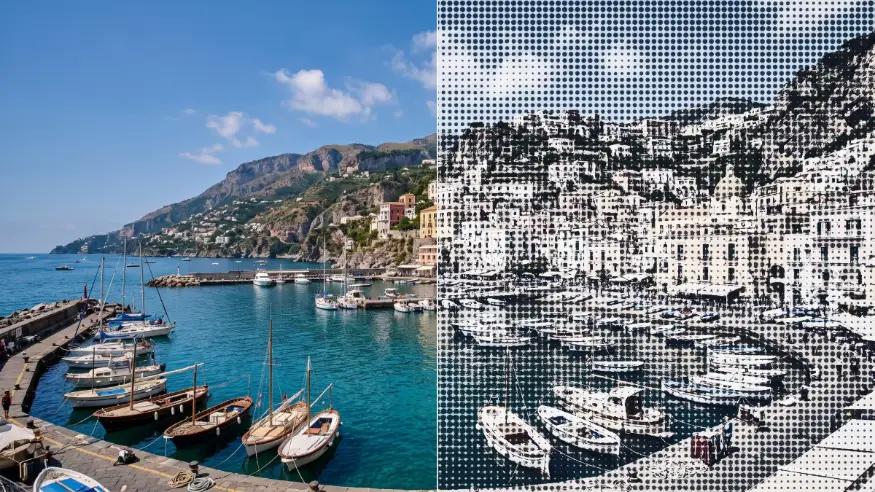

# Pattern Halftone

<!-- effect-docs: basic page sha=ad9d3d1b564b, written by scripts/effect-docs.mjs. Delete this line to write the page by hand (template B in Documentation-Site.md). -->

Halftone screen of circle, diamond or line marks sized by image darkness, in Ink on Paper; Shape picks the mark, Scale the cell size.

Group: [Print & Halftone](../Effects-Print.md) · [How to add an effect](../Effects.md#add-an-effect)

<figure class="docs-shot">

<figcaption>Left: the original. Right: Pattern Halftone at its default settings.</figcaption>
</figure>

*A short page made from the editor’s effect catalog: what the effect does and its controls. Tips and its node setup will follow.*

## Controls

<!-- generated:controls start -->
| Control | Range | Default |
|---|---|---|
| **Pattern** | | |
| Scale | 2 to 80 | 14 |
| Angle | −180 to 180 | 0 |
| Shape | circle, diamond, line | circle |
| **Style** | | |
| Amount | 0 to 1 | 0.75 |
| **Color** | | |
| Ink | a colour | `#111827` |
| Paper | a colour | `#f8fafc` |
<!-- generated:controls end -->

## Technical details

How effects are stored, rendered and exported: [Effect system](../Effect-System.md). Its building blocks: [Node Catalog](../Node-Catalog.md).
