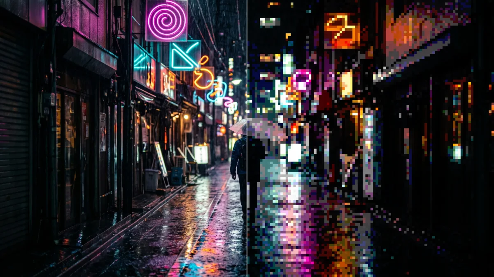

# Pixel Poster

<!-- effect-docs: basic page, written by scripts/effect-docs.mjs. Delete this line to write the page by hand (template B in Documentation-Site.md). -->

Pixelates the image into blocks and posterizes each to a few color levels; Block Size sets the pixel size.

Group: [Pixel & Mosaic](../Effects-Pixel.md) · [How to add an effect](../Effects.md#add-an-effect)

<figure class="docs-shot">

<figcaption>Left: the original. Right: Pixel Poster at its default settings.</figcaption>
</figure>

*A short page made from the editor’s effect catalog: what the effect does and its controls. Tips and its node setup will follow.*

## Controls

<!-- generated:controls start -->
| Control | Range | Default |
|---|---|---|
| **Pattern** | | |
| Block Size | 2 to 64 | 10 |
| Angle | −180 to 180 | 0 |
| **Style** | | |
| Amount | 0 to 1 | 0.75 |
| **Color** | | |
| Ink | a colour | `#111827` |
| Paper | a colour | `#f8fafc` |
<!-- generated:controls end -->

**Styles:** the **Style** menu in the effect card switches to another look with the same controls and keyframes: [Cross Stitch](./cross-stitch.md), [Dithering](./dither.md), [Halftone](./halftone.md), [Paper Print](./paper-print.md), [Riso](./riso.md), [Contour Map](./contour-map.md), [Crosshatch](./crosshatch.md), [Kilim Carpet](./kilim.md), [Vector Engraving](./vector-tiling.md).

## Technical details

Pixel Poster is one look of the pattern engine; its looks share one node setup. How effects are stored, rendered and exported: [Effect system](../Effect-System.md). Its building blocks: [Node Catalog](../Node-Catalog.md).
