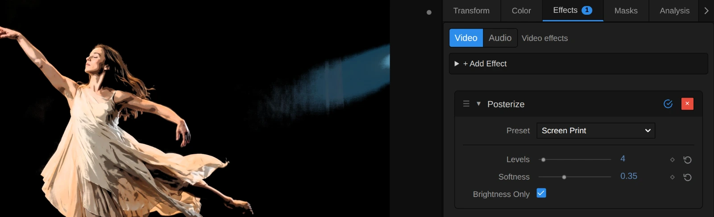
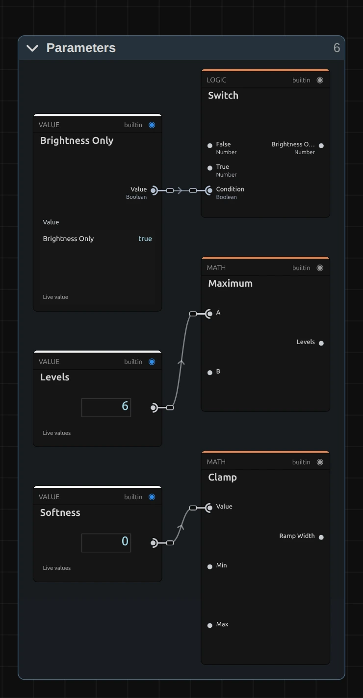
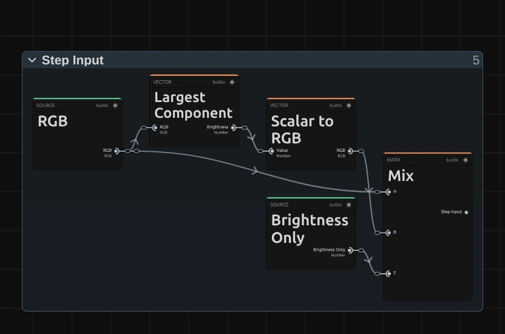
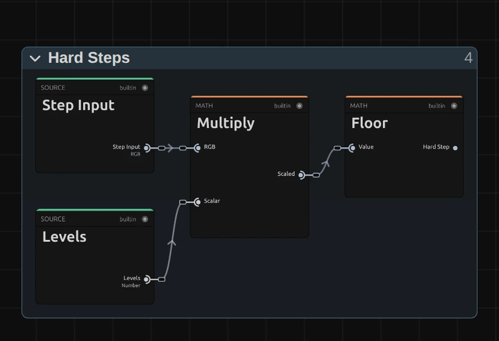
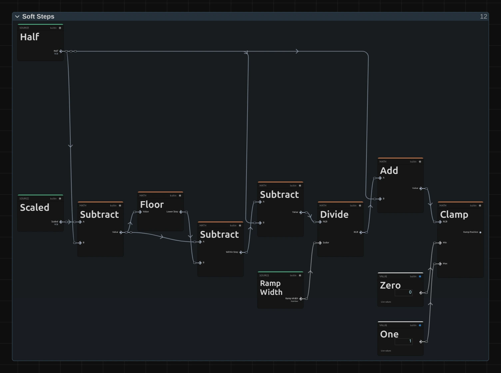
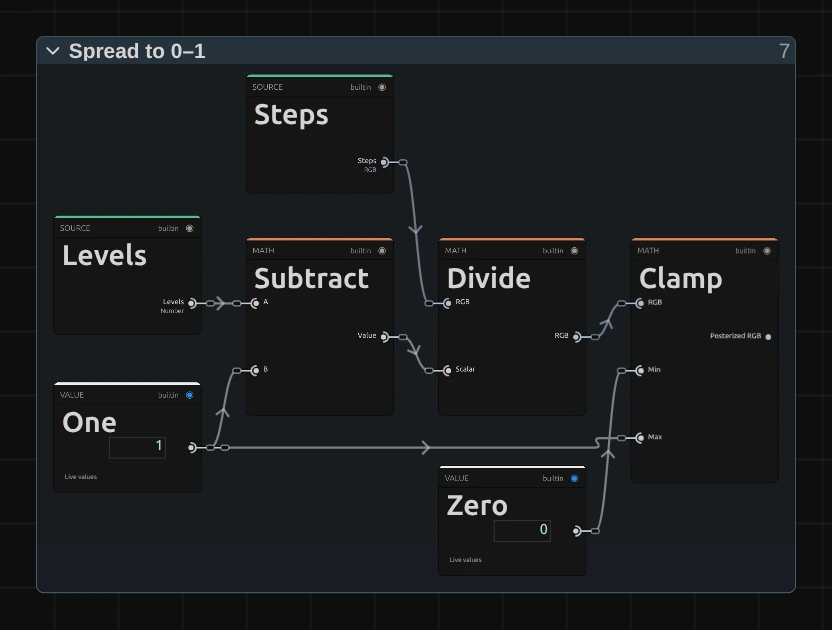

# Posterize

Reduces the picture to a few flat tones, like a screen print or a poster. Bold at 2–4 tones, subtle from 8 on.

Group: [Color & Tone](../Effects-Color.md) · [How to add an effect](../Effects.md#add-an-effect)

<figure class="docs-shot docs-compare">

<figcaption>Left: original. Right: Levels 4, Softness 0.35, Brightness Only on (the Screen Print preset).</figcaption>
</figure>

**Use it for:** a graphic, screen-printed look · pop-art colours · a base for a comic or stencil style.

- **Levels** – how many tones: 2–4 is bold and graphic, 8 and more subtle.
- **Softness** – rounds the edges between the tones.
- **Brightness Only** – keeps every colour and steps only its brightness.

**Tip:** on moving footage keep a little **Softness** (0.2–0.4). Noise in the picture then no longer flips pixels from one tone to the next, so the edges between the tones stop flickering.

## Presets

<figure class="docs-shot docs-shot--detail">

<figcaption>The four presets on the dancer.</figcaption>
</figure>

Pick one in the **Preset** row of the effect card. It sets all three controls in one undo step, and the row then shows its name until you change a value. A keyframed control keeps its keyframes, and the card says so.

**Stencil** – two tones (Levels 2, Softness 0.1): everything darker than half drops to black, the light parts keep their colour at full strength. A figure in a spotlight becomes a cut-out, like a spray stencil on a wall.

**Screen Print** – four flat inks with rounded edges (Levels 4, Softness 0.35). The classic poster look: faces and costumes stay readable, the background calms down into a few patches.

**Pop Art** – each colour channel on its own in two steps (Levels 2, Softness 0.1, Brightness Only off): only eight loud colours are left, from yellow and red to cyan and magenta. Skin turns orange and red, a blue sky turns cyan. Strong for a few seconds, on a beat or a cue.

**Banded Light** – eight hard steps of brightness (Levels 8, Softness 0). Soft light, haze and gradients turn into rings, like the lines of a relief map, while the figure stays almost natural. Beautiful with smoke on stage.

## Controls

<figure class="docs-shot">

<svg class="docs-shot-overlay" viewBox="0 0 1017 309" aria-hidden="true" focusable="false">
<defs><marker id="posterize-inspector-arrow" viewBox="0 0 10 10" refX="8" refY="5" markerWidth="5" markerHeight="5" orient="auto-start-reverse"><path d="M 0 0 L 10 5 L 0 10 Z" fill="#ffd54a" /></marker></defs>
<path class="docs-shot-arrow" d="M631 186 L715 186" marker-end="url(#posterize-inspector-arrow)" />
<circle class="docs-shot-number" cx="631" cy="186" r="18" /><text x="631" y="186" class="docs-shot-number-text">1</text>
<path class="docs-shot-arrow" d="M631 227 L715 227" marker-end="url(#posterize-inspector-arrow)" />
<circle class="docs-shot-number" cx="631" cy="227" r="18" /><text x="631" y="227" class="docs-shot-number-text">2</text>
<path class="docs-shot-arrow" d="M620 252 L704 252" marker-end="url(#posterize-inspector-arrow)" />
<circle class="docs-shot-number" cx="620" cy="252" r="18" /><text x="620" y="252" class="docs-shot-number-text">3</text>
<path class="docs-shot-arrow" d="M583 277 L667 277" marker-end="url(#posterize-inspector-arrow)" />
<circle class="docs-shot-number" cx="583" cy="277" r="18" /><text x="583" y="277" class="docs-shot-number-text">4</text>
</svg>

<figcaption>Posterize with the Screen Print preset. 1 — Preset: pick a starting point. 2 — Levels: how many tones. 3 — Softness: rounds the steps. 4 — Brightness Only: keeps the colours.</figcaption>
</figure>

**Preset** – one of the four starting points above; it sets all three controls.

<figure class="docs-shot docs-clip docs-shot--float-right">
<video src="../assets/effects/clips/posterize-levels.mp4" poster="../assets/effects/clips/posterize-levels.webp" width="720" height="540" autoplay muted loop playsinline preload="none" aria-label="The dancer turning on a dark stage with Posterize while Levels steps through 2, 3, 4, 6, 10 and 16: at 2 only her dress and the stage light stand out of a black stage, at 3 and 4 the light and the floor come back as flat patches, from 6 the haze returns as flat brown and blue bands, and at 10 and 16 the bands grow finer until the stage comes close to the original; the current value is shown at the bottom left"></video>
<figcaption>Levels 2, 3, 4, 6, 10 and 16, about 0.8 s each (Brightness Only on).</figcaption>
</figure>

**Levels** – how many tones are left, from black to full. 2 is a hard two-tone stencil, 3–4 a bold poster, 6 (the default) still clearly graphic, 8–12 turns soft light and haze into visible bands, and from about 16 only gradients still show steps. Darker parts fall to black first, because the lowest step is always black. Use whole numbers: a fraction makes the top step narrower than the others, and the card says so. 2 to 32, default 6. A keyframe, a node or the AI agent may send less than 2; the picture then uses 2 and the card says so.

<figure class="docs-shot docs-compare" data-before="Softness 0" data-after="Softness 0.5">

<figcaption>Left: Softness 0. Right: Softness 0.5. Both Levels 4, Brightness Only on.</figcaption>
</figure>

**Softness** – rounds the jump from one tone to the next into a short, smooth ramp. At 0 the edges are hard, and where the picture is noisy they break up into ragged, flickering borders. 0.2–0.4 keeps the flat tones but smooths their edges; around 0.5 the tones start to flow into each other, and at 1 the steps are fully rounded, a gentle banding over a smooth picture. It counts in steps, so it looks the same at every **Levels**. 0 to 1, default 0. A value below 0 is used as 0; a keyframe, a node or the AI agent may send more than 1, which is used as 1 (a wider ramp would overlap the next one and draw new hard edges in the middle of a tone). The card says so in both cases.

<figure class="docs-shot docs-compare" data-before="Brightness Only off" data-after="Brightness Only on">

<figcaption>Left: Brightness Only off. Right: Brightness Only on. Both Levels 4, Softness 0.2.</figcaption>
</figure>

**Brightness Only** – on, it steps only the brightness and keeps every colour as it is: a blue sky stays blue, skin keeps its tone, and only how light it is falls into steps. Turn it off for pop-art colours: then red, green and blue are each stepped on their own, so light greys can tint lavender or green and coloured fringes appear where the channels cross a step at different places. A switch: on or off, default on. A Posterize saved before the switch existed keeps its per-channel look (off).

## Node setup

<figure class="docs-shot docs-shot--graph">

<svg class="docs-shot-overlay" viewBox="0 0 1017 419" aria-hidden="true" focusable="false">
<defs><marker id="posterize-arrow" viewBox="0 0 10 10" refX="8" refY="5" markerWidth="5" markerHeight="5" orient="auto-start-reverse"><path d="M 0 0 L 10 5 L 0 10 Z" fill="#ffd54a" /></marker></defs>
<path class="docs-shot-arrow" d="M326 364 L326 280" marker-end="url(#posterize-arrow)" />
<circle class="docs-shot-number" cx="326" cy="364" r="18" /><text x="326" y="364" class="docs-shot-number-text">1</text>
<path class="docs-shot-arrow" d="M448 22 L448 75" marker-end="url(#posterize-arrow)" />
<circle class="docs-shot-number" cx="448" cy="22" r="18" /><text x="448" y="22" class="docs-shot-number-text">2</text>
<path class="docs-shot-arrow" d="M569 22 L569 75" marker-end="url(#posterize-arrow)" />
<circle class="docs-shot-number" cx="569" cy="22" r="18" /><text x="569" y="22" class="docs-shot-number-text">3</text>
<path class="docs-shot-arrow" d="M691 22 L691 75" marker-end="url(#posterize-arrow)" />
<circle class="docs-shot-number" cx="691" cy="22" r="18" /><text x="691" y="22" class="docs-shot-number-text">4</text>
<path class="docs-shot-arrow" d="M813 154 L813 238" marker-end="url(#posterize-arrow)" />
<circle class="docs-shot-number" cx="813" cy="154" r="18" /><text x="813" y="154" class="docs-shot-number-text">5</text>
</svg>

<figcaption>Posterize opened in the Nodes tab (the Parameters and Constants folders left out). 1 — Step Input: the colour, or only its brightness. 2 — Hard Steps: the plain staircase. 3 — Soft Steps: rounds the stairs. 4 — Spread to 0–1: the steps back as tones. 5 — Colour & Alpha: the colour back on.</figcaption>
</figure>

Posterize works as a path of stages, one folder each: **Step Input** picks what gets stepped, **Hard Steps** cuts it into a staircase, **Soft Steps** rounds the stairs when Softness is on, **Spread to 0–1** turns the steps back into tones, and **Colour & Alpha** puts the colour and the transparency back. A sixth folder, **Parameters**, makes the three controls safe and plugs into the ports that show a plain dot in the picture: Levels, Softness and Ramp Width, and Brightness Only. In the Nodes tab it sits at the top left, beside the Constants folder, with a cable to every stage; the picture leaves it out so the path reads as one line. Click a folder's header to open it; the sections below show what is inside.

### Parameters

<figure class="docs-shot docs-shot--graph docs-shot--float-right">

<svg class="docs-shot-overlay" viewBox="0 0 590 1135" aria-hidden="true" focusable="false">
<defs><marker id="posterize-parameters-arrow" viewBox="0 0 10 10" refX="8" refY="5" markerWidth="5" markerHeight="5" orient="auto-start-reverse"><path d="M 0 0 L 10 5 L 0 10 Z" fill="#ffd54a" /></marker></defs>
<path class="docs-shot-arrow" d="M432 22 L432 106" marker-end="url(#posterize-parameters-arrow)" />
<circle class="docs-shot-number" cx="432" cy="22" r="18" /><text x="432" y="22" class="docs-shot-number-text">1</text>
<path class="docs-shot-arrow" d="M432 327 L432 411" marker-end="url(#posterize-parameters-arrow)" />
<circle class="docs-shot-number" cx="432" cy="327" r="18" /><text x="432" y="327" class="docs-shot-number-text">2</text>
<path class="docs-shot-arrow" d="M432 643 L432 727" marker-end="url(#posterize-parameters-arrow)" />
<circle class="docs-shot-number" cx="432" cy="643" r="18" /><text x="432" y="643" class="docs-shot-number-text">3</text>
</svg>

<figcaption>Inside Parameters (the limits left out). 1 — Switch: Brightness Only as 0 or 1. 2 — Maximum: keeps Levels at 2 or more. 3 — Ramp Width: Softness, kept within one step.</figcaption>
</figure>

**Switch** – turns the Brightness Only switch into a number: 1 when it is on, 0 when it is off. Two **Mix** cards further on use it to choose between the two ways of stepping.

**Maximum** – keeps Levels at 2 or more (its **Minimum Levels** card in Constants). With fewer than two tones there would be nothing to step between; the card reports a lower value.

**Ramp Width** – a **Clamp**: Softness, kept between 0.0001 (the **Ramp Floor**) and 1 (the **Ramp Ceiling**). The ramp divides by this width, so it must not be 0; at Softness 0 the ramp is switched off anyway (see Soft Steps). Above one step the ramps of two neighbouring edges would overlap, so the ceiling keeps each ramp one step wide at most.

### Step Input

<figure class="docs-shot docs-shot--graph docs-shot--float-right">

<svg class="docs-shot-overlay" viewBox="0 0 590 390" aria-hidden="true" focusable="false">
<defs><marker id="posterize-input-arrow" viewBox="0 0 10 10" refX="8" refY="5" markerWidth="5" markerHeight="5" orient="auto-start-reverse"><path d="M 0 0 L 10 5 L 0 10 Z" fill="#ffd54a" /></marker></defs>
<path class="docs-shot-arrow" d="M227 22 L227 81" marker-end="url(#posterize-input-arrow)" />
<circle class="docs-shot-number" cx="227" cy="22" r="18" /><text x="227" y="22" class="docs-shot-number-text">1</text>
<path class="docs-shot-arrow" d="M500 88 L500 172" marker-end="url(#posterize-input-arrow)" />
<circle class="docs-shot-number" cx="500" cy="88" r="18" /><text x="500" y="88" class="docs-shot-number-text">2</text>
</svg>

<figcaption>Inside Step Input. 1 — Largest Component: the brightness of the colour. 2 — Mix: the colour or its brightness.</figcaption>
</figure>

**Largest Component** – the brightest of the three channels: how far the colour is from black. A pure red and a white both count as 1, so stepping it never washes out a strong colour.

**Mix** – passes on either the colour itself (Brightness Only off) or that brightness as a grey (on). Everything after this folder steps what comes out here.

### Hard Steps

<figure class="docs-shot docs-shot--graph docs-shot--float-right">

<svg class="docs-shot-overlay" viewBox="0 0 590 404" aria-hidden="true" focusable="false">
<defs><marker id="posterize-hard-arrow" viewBox="0 0 10 10" refX="8" refY="5" markerWidth="5" markerHeight="5" orient="auto-start-reverse"><path d="M 0 0 L 10 5 L 0 10 Z" fill="#ffd54a" /></marker></defs>
<path class="docs-shot-arrow" d="M295 23 L295 107" marker-end="url(#posterize-hard-arrow)" />
<circle class="docs-shot-number" cx="295" cy="23" r="18" /><text x="295" y="23" class="docs-shot-number-text">1</text>
<path class="docs-shot-arrow" d="M478 23 L478 107" marker-end="url(#posterize-hard-arrow)" />
<circle class="docs-shot-number" cx="478" cy="23" r="18" /><text x="478" y="23" class="docs-shot-number-text">2</text>
</svg>

<figcaption>Inside Hard Steps. 1 — Multiply: stretches 0–1 over the steps. 2 — Floor: drops the fraction.</figcaption>
</figure>

**Multiply** – multiplies each value by Levels, so 0 to 1 becomes 0 to 4 at Levels 4.

**Floor** – drops everything after the decimal point: 2.7 becomes 2. All values within one step get the same whole number, the **Hard Step**. This is the staircase itself.

### Soft Steps: where the edge is

Soft Steps rounds every stair edge into a short ramp. Its first part works out how far each value is from the nearest edge, the second turns that into a smooth curve.

<figure class="docs-shot docs-shot--graph">

<svg class="docs-shot-overlay" viewBox="0 0 1017 759" aria-hidden="true" focusable="false">
<defs><marker id="posterize-soft-edge-arrow" viewBox="0 0 10 10" refX="8" refY="5" markerWidth="5" markerHeight="5" orient="auto-start-reverse"><path d="M 0 0 L 10 5 L 0 10 Z" fill="#ffd54a" /></marker></defs>
<path class="docs-shot-arrow" d="M326 300 L326 384" marker-end="url(#posterize-soft-edge-arrow)" />
<circle class="docs-shot-number" cx="326" cy="300" r="18" /><text x="326" y="300" class="docs-shot-number-text">1</text>
<path class="docs-shot-arrow" d="M691 320 L691 404" marker-end="url(#posterize-soft-edge-arrow)" />
<circle class="docs-shot-number" cx="691" cy="320" r="18" /><text x="691" y="320" class="docs-shot-number-text">2</text>
<path class="docs-shot-arrow" d="M935 320 L935 404" marker-end="url(#posterize-soft-edge-arrow)" />
<circle class="docs-shot-number" cx="935" cy="320" r="18" /><text x="935" y="320" class="docs-shot-number-text">3</text>
</svg>

<figcaption>Inside Soft Steps, the edge. 1 — Floor: the step below the edge. 2 — Divide: the distance in ramp widths. 3 — Clamp: 0 to 1 across the ramp.</figcaption>
</figure>

**Floor** – the stretched value moved back by half a step, without its fraction: the **Lower Step**, the step just below the nearest edge. The Subtract cards around it only shift by half a step and back, so that the result counts from the edge: 0 right on the edge, −0.5 and 0.5 in the middles of the two steps beside it.

**Divide** – divides that distance by the **Ramp Width**: at Softness 0.35 the ramp is 0.35 of a step wide, and the distance now counts in ramp widths.

**Clamp** – after adding Half back, keeps the result between 0 and 1: the **Ramp Position**, 0 just before the ramp, 1 just after it, and in between on the ramp itself.

### Soft Steps: the ramp

<figure class="docs-shot docs-shot--graph">

<svg class="docs-shot-overlay" viewBox="0 0 1017 712" aria-hidden="true" focusable="false">
<defs><marker id="posterize-soft-ramp-arrow" viewBox="0 0 10 10" refX="8" refY="5" markerWidth="5" markerHeight="5" orient="auto-start-reverse"><path d="M 0 0 L 10 5 L 0 10 Z" fill="#ffd54a" /></marker></defs>
<path class="docs-shot-arrow" d="M589 157 L589 189" marker-end="url(#posterize-soft-ramp-arrow)" />
<circle class="docs-shot-number" cx="589" cy="157" r="18" /><text x="589" y="157" class="docs-shot-number-text">1</text>
<path class="docs-shot-arrow" d="M752 157 L752 189" marker-end="url(#posterize-soft-ramp-arrow)" />
<circle class="docs-shot-number" cx="752" cy="157" r="18" /><text x="752" y="157" class="docs-shot-number-text">2</text>
<path class="docs-shot-arrow" d="M752 616 L752 532" marker-end="url(#posterize-soft-ramp-arrow)" />
<circle class="docs-shot-number" cx="752" cy="616" r="18" /><text x="752" y="616" class="docs-shot-number-text">3</text>
<path class="docs-shot-arrow" d="M914 105 L914 189" marker-end="url(#posterize-soft-ramp-arrow)" />
<circle class="docs-shot-number" cx="914" cy="105" r="18" /><text x="914" y="105" class="docs-shot-number-text">4</text>
</svg>

<figcaption>Inside Soft Steps, the ramp. 1 — Multiply: the smooth S-curve. 2 — Add: the rounded staircase. 3 — Switch: is Softness on. 4 — Mix: hard or soft steps.</figcaption>
</figure>

**Multiply** – the last of three Multiply cards that bend the Ramp Position into a smooth S-curve, t × t × (3 − 2 t), the **Soft Ramp**: it starts and ends flat, so the step has no visible corner.

**Add** – puts the curve on top of the Lower Step: the staircase with rounded edges, the **Soft Steps**.

**Switch** – 1 when Softness is above 0, else 0 (**Greater Than** asks the question).

**Mix** – takes the Hard Step at Softness 0 and the Soft Steps above it. So Softness 0 is exactly the plain staircase, without any rounding.

### Spread to 0–1

<figure class="docs-shot docs-shot--graph docs-shot--float-right">

<svg class="docs-shot-overlay" viewBox="0 0 590 447" aria-hidden="true" focusable="false">
<defs><marker id="posterize-spread-arrow" viewBox="0 0 10 10" refX="8" refY="5" markerWidth="5" markerHeight="5" orient="auto-start-reverse"><path d="M 0 0 L 10 5 L 0 10 Z" fill="#ffd54a" /></marker></defs>
<path class="docs-shot-arrow" d="M227 385 L227 301" marker-end="url(#posterize-spread-arrow)" />
<circle class="docs-shot-number" cx="227" cy="385" r="18" /><text x="227" y="385" class="docs-shot-number-text">1</text>
<path class="docs-shot-arrow" d="M500 79 L500 163" marker-end="url(#posterize-spread-arrow)" />
<circle class="docs-shot-number" cx="500" cy="79" r="18" /><text x="500" y="79" class="docs-shot-number-text">2</text>
</svg>

<figcaption>Inside Spread to 0–1. 1 — Subtract: Levels minus one. 2 — Clamp: keeps the tones within 0 to 1.</figcaption>
</figure>

**Subtract** – Levels minus 1: at Levels 4 there are four tones but only three gaps between them. **Divide** then divides the steps by it, so the tones are 0, ⅓, ⅔ and 1: the darkest is black, the lightest full.

**Clamp** – keeps the result between 0 and 1. A pure white would otherwise land one step above full; this gives the **Posterized RGB**.

**Remix:** drag a cable from the folder's **Levels** input into the **Scalar** input of **Divide**, in place of Subtract's. The steps are then divided by 4 instead of 3, so the brightest tone sits a little below white (at Levels 4 at 75 %), for a softer, printed look.

### Colour & Alpha

<figure class="docs-shot docs-shot--graph">

<svg class="docs-shot-overlay" viewBox="0 0 1017 661" aria-hidden="true" focusable="false">
<defs><marker id="posterize-finish-arrow" viewBox="0 0 10 10" refX="8" refY="5" markerWidth="5" markerHeight="5" orient="auto-start-reverse"><path d="M 0 0 L 10 5 L 0 10 Z" fill="#ffd54a" /></marker></defs>
<path class="docs-shot-arrow" d="M369 375 L369 459" marker-end="url(#posterize-finish-arrow)" />
<circle class="docs-shot-number" cx="369" cy="375" r="18" /><text x="369" y="375" class="docs-shot-number-text">1</text>
<path class="docs-shot-arrow" d="M508 227 L508 311" marker-end="url(#posterize-finish-arrow)" />
<circle class="docs-shot-number" cx="508" cy="227" r="18" /><text x="508" y="227" class="docs-shot-number-text">2</text>
<path class="docs-shot-arrow" d="M787 22 L787 79" marker-end="url(#posterize-finish-arrow)" />
<circle class="docs-shot-number" cx="787" cy="22" r="18" /><text x="787" y="22" class="docs-shot-number-text">3</text>
<path class="docs-shot-arrow" d="M926 227 L926 311" marker-end="url(#posterize-finish-arrow)" />
<circle class="docs-shot-number" cx="926" cy="227" r="18" /><text x="926" y="227" class="docs-shot-number-text">4</text>
</svg>

<figcaption>Inside Colour & Alpha. 1 — Divide: how much lighter or darker. 2 — Multiply: scales the colour. 3 — Mix: stepped channels or kept colour. 4 — Combine RGB + Alpha: the transparency back on.</figcaption>
</figure>

**Divide** – the stepped brightness divided by the original brightness: the **Brightness Gain**. 0.5 means this pixel should be half as bright. **Maximum** keeps the original brightness above a tiny floor, so a black pixel never divides by zero.

**Multiply** – multiplies the original colour by that gain. All three channels change by the same factor, so the hue and the strength of the colour stay; **Clamp** keeps the result within 0 to 1.

**Mix** – with Brightness Only off it passes the stepped channels (Posterized RGB), with it on this kept colour.

**Combine RGB + Alpha** – joins the result with the original transparency, untouched.

## Technical details

- **Formula.** Each value `v` becomes `floor(v · L) / (L − 1)`, limited to 0–1, with `L` = Levels (at least 2). With Brightness Only the value is the largest channel `m`, and the colour is multiplied by `posterize(m) / m`. Softness `s` replaces each jump with a smoothstep ramp `min(s, 1)` steps wide, centred on the edge; Softness 0 without Brightness Only is exactly the earlier staircase.
- **Limits.** Levels below 2 renders as 2, negative Softness as 0 and Softness above 1 as 1 (wider ramps would overlap and jump in the middle of a tone; graphs saved before 2026-10-22 get the same limit when they load, which changes only Softness above 1); a fractional Levels makes the top step narrower. The card and the tool result say so.
- **Transparency.** Only the colour is stepped; the transparency passes through untouched.
- **Saved projects.** Brightness Only defaults to off, which is what saved effects and Look entries without the value mean, so a saved Posterize keeps stepping each channel; a new one starts with it on. Untouched earlier Posterize graphs become the current recipe; edited ones stay as saved. A saved graph that already has its folders keeps them (an older one: one Color Processing folder); a newly added Posterize opens with the stage folders above.
- What all colour effects share (8-bit range, adjustment layers): [Color & Tone](../Effect-System.md#color--tone-notes). Formulas and history: [Effect system](../Effect-System.md#editable-color-effect-graphs); blocks: [Node Catalog](../Node-Catalog.md) · [Styles and presets](../Effects.md#styles-and-presets).
