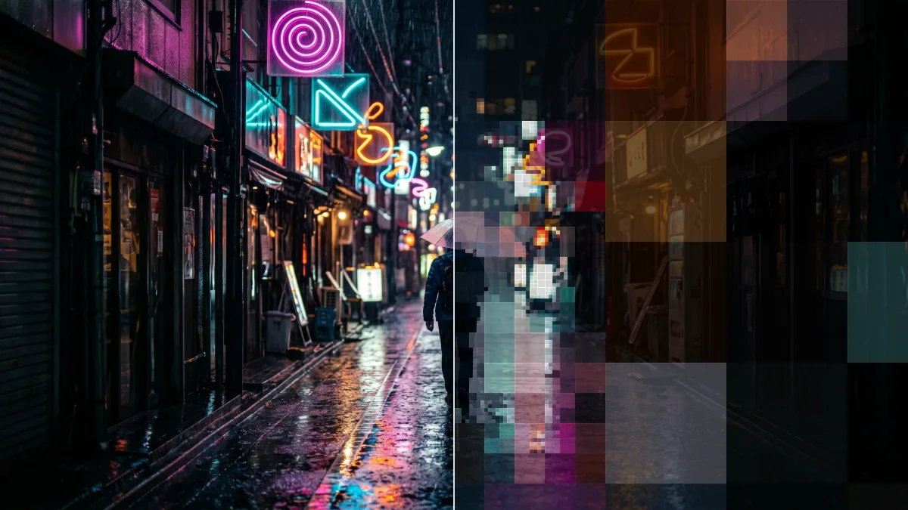

# Quadtree Zoom

<!-- effect-docs: basic page, written by scripts/effect-docs.mjs. Delete this line to write the page by hand (template B in Documentation-Site.md). -->

Splits the image into adaptive square blocks, small where detail is high and large in flat areas; Minimum Cell and Detail Threshold control the split.

Group: [Pixel & Mosaic](../Effects-Pixel.md) · [How to add an effect](../Effects.md#add-an-effect)

<figure class="docs-shot">

<figcaption>Left: the original. Right: Quadtree Zoom at its default settings, one frame of its movement.</figcaption>
</figure>

*A short page made from the editor’s effect catalog: what the effect does and its controls. Tips and its node setup will follow.*

## Controls

<!-- generated:controls start -->
| Control | Range | Default |
|---|---|---|
| **Structure** | | |
| Minimum Cell | 2 to 32 | 8 |
| Detail Threshold | 0.001 to 0.2 | 0.025 |
| **Style** | | |
| Amount | 0 to 1 | 0.8 |
| **Motion** | | |
| Speed | 0 to 4 | 0.5 |
<!-- generated:controls end -->

## Technical details

It runs as a GPU compute effect. It keeps moving while the playhead stands still. How effects are stored, rendered and exported: [Effect system](../Effect-System.md). Its building blocks: [Node Catalog](../Node-Catalog.md).
