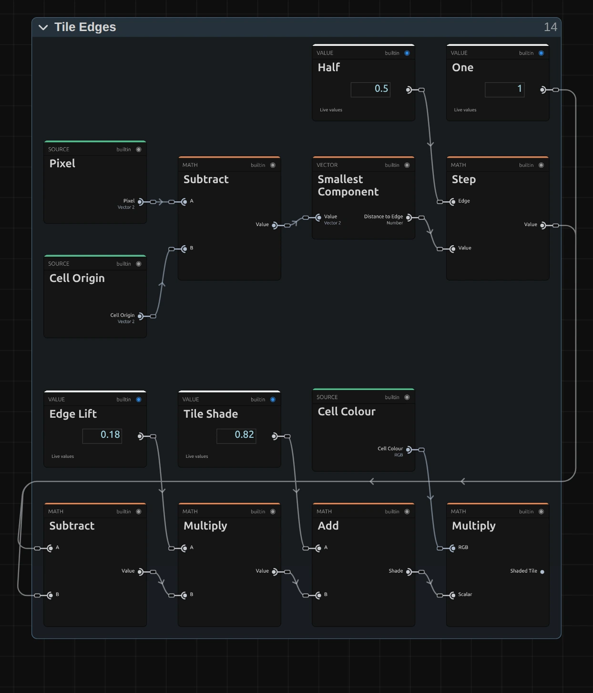
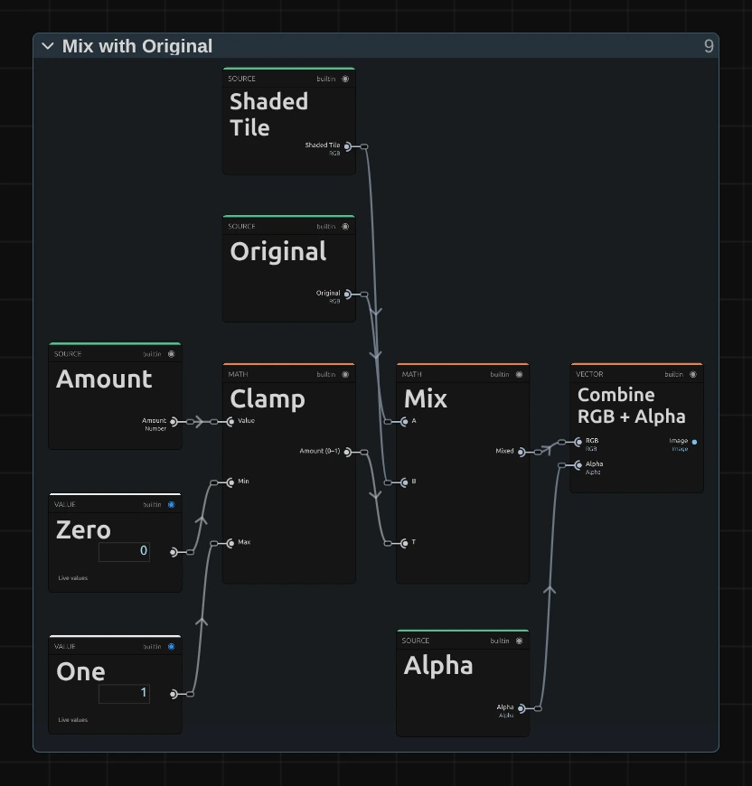

# Quadtree Zoom

Splits the picture into square tiles, small where there is detail and large where it is flat. For pictures that half resolve: a memory, a surveillance view, a figure that stays hidden.

Group: [Pixel & Mosaic](../Effects-Pixel.md) · [How to add an effect](../Effects.md#add-an-effect)

<figure class="docs-shot docs-clip docs-compare docs-shot--float-left">
<video src="../assets/effects/clips/quadtree-zoom.mp4" poster="../assets/effects/clips/quadtree-zoom.webp" width="960" height="460" autoplay muted loop playsinline preload="none" aria-label="The dancer turning on a dark stage, original left and with Quadtree Zoom right: the dark stage breaks into large flat squares, while her dress, arms and face split into ever smaller tiles that follow her as she moves, and the squares split and merge again as the picture changes"></video>
<figcaption>Left: original. Right: Quadtree Zoom at its default settings.</figcaption>
</figure>

**Use it for:** a figure that dissolves into blocks while the stage stays calm · a data or surveillance look · a picture that slowly comes into focus on a cue.

- **Minimum Cell** – how small the finest tiles get.
- **Detail Threshold** – how much detail makes a tile split.
- **Amount** – how much of the tiles lies over the picture.
- **Speed** – how fast the tiles split and merge on their own.

**Tip:** keyframe **Detail Threshold** from 0.2 down to 0.005: a picture of coarse blocks resolves into fine detail, first where it matters most.

## Presets

<figure class="docs-shot docs-clip">
<video src="../assets/effects/clips/quadtree-zoom-presets.mp4" poster="../assets/effects/clips/quadtree-zoom-presets.webp" width="962" height="938" autoplay muted loop playsinline preload="none" aria-label="The dancer four times in a grid, moving in sync, each with one preset: Fine Print top left with small tiles that trace her outline, Big Tiles top right with her figure, arms and legs in chunky blocks and large squares on the dark stage, Tile Veil bottom left with soft tiles laid over the clear picture, Breathing Grid bottom right with coarser tiles that keep splitting and merging quickly"></video>
<figcaption>The four presets on the moving dancer, in sync.</figcaption>
</figure>

Pick one in the **Preset** row of the effect card. It sets all controls at once, in one undo step, and the row then shows its name until you change something. A control with keyframes keeps them, and the card says so.

**Fine Print** – the finest tiles, split wherever the picture has texture: faces and hands stay readable, and only an even dark stage or sky turns into calm squares. The quietest look, good for a whole scene.

**Big Tiles** – chunky blocks on the figure and large squares on the stage, with no original showing through: the picture reads like a coarse mosaic, while arms and legs still keep their own blocks. Strong for a title, a memory or a face that should stay hidden.

**Tile Veil** – tiles laid at 60 % over the picture, so it stays clear under a soft grid of colour. For a scene that starts to fall apart, or behind text.

**Breathing Grid** – coarser tiles whose split pulses quickly, about twice a second, so they keep splitting and merging even where nothing moves. A restless, digital pulse for a cue or a breakdown.

## Controls

<figure class="docs-shot">

<svg class="docs-shot-overlay" viewBox="0 0 1017 715" aria-hidden="true" focusable="false">
<defs><marker id="quadtree-zoom-inspector-arrow" viewBox="0 0 10 10" refX="8" refY="5" markerWidth="5" markerHeight="5" orient="auto-start-reverse"><path d="M 0 0 L 10 5 L 0 10 Z" fill="#ffd54a" /></marker></defs>
<path class="docs-shot-arrow" d="M565 282 L649 282" marker-end="url(#quadtree-zoom-inspector-arrow)" />
<circle class="docs-shot-number" cx="565" cy="282" r="18" /><text x="565" y="282" class="docs-shot-number-text">1</text>
<path class="docs-shot-arrow" d="M546 387 L630 387" marker-end="url(#quadtree-zoom-inspector-arrow)" />
<circle class="docs-shot-number" cx="546" cy="387" r="18" /><text x="546" y="387" class="docs-shot-number-text">2</text>
<path class="docs-shot-arrow" d="M539 425 L623 425" marker-end="url(#quadtree-zoom-inspector-arrow)" />
<circle class="docs-shot-number" cx="539" cy="425" r="18" /><text x="539" y="425" class="docs-shot-number-text">3</text>
<path class="docs-shot-arrow" d="M592 540 L676 540" marker-end="url(#quadtree-zoom-inspector-arrow)" />
<circle class="docs-shot-number" cx="592" cy="540" r="18" /><text x="592" y="540" class="docs-shot-number-text">4</text>
<path class="docs-shot-arrow" d="M601 656 L685 656" marker-end="url(#quadtree-zoom-inspector-arrow)" />
<circle class="docs-shot-number" cx="601" cy="656" r="18" /><text x="601" y="656" class="docs-shot-number-text">5</text>
</svg>

<figcaption>Quadtree Zoom with the Big Tiles preset. 1 — Preset: pick a starting point. 2 — Minimum Cell. 3 — Detail Threshold. 4 — Amount. 5 — Speed.</figcaption>
</figure>

Every tile takes the colour of the pixel at its centre, a little darker than the picture, with a thin light line along its top and left edge, so the tiles read as tiles.

**Preset** – picks one of the four starting points above and sets the four controls below.

### Structure

<figure class="docs-shot docs-clip docs-shot--float-right">
<video src="../assets/effects/clips/quadtree-zoom-minimum-cell.mp4" poster="../assets/effects/clips/quadtree-zoom-minimum-cell.webp" width="720" height="540" autoplay muted loop playsinline preload="none" aria-label="The dancer with Quadtree Zoom while Minimum Cell runs from 2 to 24 px and back: her figure goes from fine tiles that keep her face readable to coarse blocks, and the large squares of the stage grow with it; the current value is shown at the bottom left"></video>
<figcaption>Minimum Cell from 2 to 24 px and back.</figcaption>
</figure>

**Minimum Cell** – the size of the finest tiles, where the picture has the most detail. The largest tile is 32 times as big (8 px gives tiles from 8 to 256 px), so it also sets how coarse the flat areas get. 2–4 keeps faces readable, 8 shows clear tiles, 16 turns a figure into a few chunky blocks, and above about 20 parts of a figure can vanish into the large squares around it. It counts pixels of a 1080p picture, so a 4K export shows the same tiles. 2 to 32 px, default 8 px.

<figure class="docs-shot docs-clip docs-shot--float-right">
<video src="../assets/effects/clips/quadtree-zoom-detail-threshold.mp4" poster="../assets/effects/clips/quadtree-zoom-detail-threshold.webp" width="720" height="540" autoplay muted loop playsinline preload="none" aria-label="The dancer with Quadtree Zoom while Detail Threshold runs from 0.003 to 0.08 and back: at the low end the whole picture is split into small tiles, then the stage and then her figure merge into larger and larger blocks until she fades into a few of them, and split again; the current value is shown at the bottom left"></video>
<figcaption>Detail Threshold from 0.003 to 0.08 and back.</figcaption>
</figure>

**Detail Threshold** – how much a tile may change in brightness before it splits into four smaller ones. Low values (0.005) split everything with texture into small tiles, but a dark, even stage still stays in large squares; 0.025 keeps flat stage and sky in large squares; 0.1 and more leaves big blocks even over a face. It works together with **Minimum Cell**: the threshold decides where to split, Minimum Cell how far. 0.001 to 0.2, default 0.025.

### Style

**Amount** – how much of the tiles you see. 0 shows the original, 1 only tiles, 0.5 lays them half over the picture, so it stays readable under a grid of colour. Values outside 0 to 1 are held at the nearest end, and the card says so. 0 to 1, default 0.8.

### Motion

<figure class="docs-shot docs-clip docs-shot--float-right">
<video src="../assets/effects/clips/quadtree-zoom-speed.mp4" poster="../assets/effects/clips/quadtree-zoom-speed.webp" width="720" height="540" autoplay muted loop playsinline preload="none" aria-label="The dancer with Quadtree Zoom at three speeds, about two seconds each: at Speed 0 the tiles only change where she moves, at 1 the blocks slowly split and merge, at 4 they flicker between coarse and fine; the speed is shown at the bottom left"></video>
<figcaption>Speed 0, 1 and 4, about two seconds each.</figcaption>
</figure>

**Speed** – how fast the tiles breathe. The threshold swings between about two thirds of and the full **Detail Threshold** (64 % to 100 %), so tiles split and merge in a pulse even where nothing moves. 0 holds the split still, and tiles change only where the picture does; at 0.5 one breath takes about six seconds, at 4 less than a second. It follows the playhead, so a paused picture stands still and the export matches the preview. 0 to 4, default 0.5.

## Node setup

<figure class="docs-shot docs-shot--graph">

<svg class="docs-shot-overlay" viewBox="0 0 1017 572" aria-hidden="true" focusable="false">
<defs><marker id="quadtree-zoom-arrow" viewBox="0 0 10 10" refX="8" refY="5" markerWidth="5" markerHeight="5" orient="auto-start-reverse"><path d="M 0 0 L 10 5 L 0 10 Z" fill="#ffd54a" /></marker></defs>
<path class="docs-shot-arrow" d="M314 22 L314 96" marker-end="url(#quadtree-zoom-arrow)" />
<circle class="docs-shot-number" cx="314" cy="22" r="18" /><text x="314" y="22" class="docs-shot-number-text">1</text>
<path class="docs-shot-arrow" d="M509 239 L509 323" marker-end="url(#quadtree-zoom-arrow)" />
<circle class="docs-shot-number" cx="509" cy="239" r="18" /><text x="509" y="239" class="docs-shot-number-text">2</text>
<path class="docs-shot-arrow" d="M703 403 L703 319" marker-end="url(#quadtree-zoom-arrow)" />
<circle class="docs-shot-number" cx="703" cy="403" r="18" /><text x="703" y="403" class="docs-shot-number-text">3</text>
<path class="docs-shot-arrow" d="M897 149 L897 233" marker-end="url(#quadtree-zoom-arrow)" />
<circle class="docs-shot-number" cx="897" cy="149" r="18" /><text x="897" y="149" class="docs-shot-number-text">4</text>
</svg>

<figcaption>Quadtree Zoom opened in the Nodes tab (input frame and output left out). 1 — Cell Size & Split: which tile a pixel lies in. 2 — Cell Colour: the colour of that tile. 3 — Tile Edges: the shade and the light edge line. 4 — Mix with Original: blends by Amount.</figcaption>
</figure>

Quadtree Zoom works in four stages, one folder each in the Nodes tab: **Cell Size & Split** finds the tile a pixel lies in and how big it is, **Cell Colour** reads the colour at the tile's centre, **Tile Edges** shades the tile and draws its light edge line, and **Mix with Original** blends the result with the picture by Amount. Click a folder's header to open it; the sections below show what is inside.

### Cell Size & Split

<figure class="docs-shot docs-shot--graph">

<svg class="docs-shot-overlay" viewBox="0 0 1017 1187" aria-hidden="true" focusable="false">
<defs><marker id="quadtree-zoom-split-arrow" viewBox="0 0 10 10" refX="8" refY="5" markerWidth="5" markerHeight="5" orient="auto-start-reverse"><path d="M 0 0 L 10 5 L 0 10 Z" fill="#ffd54a" /></marker></defs>
<path class="docs-shot-arrow" d="M508 727 L508 643" marker-end="url(#quadtree-zoom-split-arrow)" />
<circle class="docs-shot-number" cx="508" cy="727" r="18" /><text x="508" y="727" class="docs-shot-number-text">1</text>
<path class="docs-shot-arrow" d="M703 421 L703 451" marker-end="url(#quadtree-zoom-split-arrow)" />
<circle class="docs-shot-number" cx="703" cy="421" r="18" /><text x="703" y="421" class="docs-shot-number-text">2</text>
<path class="docs-shot-arrow" d="M898 367 L898 451" marker-end="url(#quadtree-zoom-split-arrow)" />
<circle class="docs-shot-number" cx="898" cy="367" r="18" /><text x="898" y="367" class="docs-shot-number-text">3</text>
</svg>

<figcaption>Inside Cell Size & Split (Minimum Cell, Detail Threshold, Speed). 1 — Divide: how much larger than 1080p the frame is. 2 — Multiply: the finest tile in pixels of this frame. 3 — Quadtree Partition: the tile of every pixel.</figcaption>
</figure>

**Divide** – the shorter side of the frame (Smallest Component of Resolution) divided by Reference Height 1080: how much larger or smaller this frame is than a 1080p one.

**Multiply** – Minimum Cell times that scale: the finest tile in pixels of this frame, so a 4K export, a lower Preview Quality and the thumbnails show the same tiles.

**Quadtree Partition** – starts with a tile 32 times the finest one and halves it, at most five times, while its brightness changes by more than Detail Threshold. It tests two ways: its four corners and its centre, then a grid of 4 × 4 pixels inside it, so a figure between the corners still splits the tile. Seconds × Speed lets the threshold breathe. It puts out the tile's top-left corner (Cell Origin) and its size.

### Cell Colour

<figure class="docs-shot docs-shot--graph">

<svg class="docs-shot-overlay" viewBox="0 0 1017 1168" aria-hidden="true" focusable="false">
<defs><marker id="quadtree-zoom-colour-arrow" viewBox="0 0 10 10" refX="8" refY="5" markerWidth="5" markerHeight="5" orient="auto-start-reverse"><path d="M 0 0 L 10 5 L 0 10 Z" fill="#ffd54a" /></marker></defs>
<path class="docs-shot-arrow" d="M883 487 L883 403" marker-end="url(#quadtree-zoom-colour-arrow)" />
<circle class="docs-shot-number" cx="883" cy="487" r="18" /><text x="883" y="487" class="docs-shot-number-text">1</text>
<path class="docs-shot-arrow" d="M132 774 L132 690" marker-end="url(#quadtree-zoom-colour-arrow)" />
<circle class="docs-shot-number" cx="132" cy="774" r="18" /><text x="132" y="774" class="docs-shot-number-text">2</text>
<path class="docs-shot-arrow" d="M508 616 L508 700" marker-end="url(#quadtree-zoom-colour-arrow)" />
<circle class="docs-shot-number" cx="508" cy="616" r="18" /><text x="508" y="616" class="docs-shot-number-text">3</text>
<path class="docs-shot-arrow" d="M696 1072 L696 988" marker-end="url(#quadtree-zoom-colour-arrow)" />
<circle class="docs-shot-number" cx="696" cy="1072" r="18" /><text x="696" y="1072" class="docs-shot-number-text">4</text>
</svg>

<figcaption>Inside Cell Colour. 1 — Add: the centre of the tile. 2 — Load Pixel: the colour there. 3 — Alpha to Scalar: how opaque the centre is. 4 — Mix: the tile colour.</figcaption>
</figure>

**Add** – Cell Origin plus half the tile size (Multiply by Half 0.5, then Floor): the centre of the tile, on a whole pixel.

**Load Pixel** – reads the picture at that centre. Its colour paints the whole tile. The second Load Pixel below it reads the pixel's own colour, which the next stages need.

**Alpha to Scalar** – the transparency of the centre pixel as a number from 0 to 1.

**Mix** – blends from the pixel's own colour to the centre's colour by that number. An opaque centre colours the whole tile; a transparent one, at the edge of a cut-out figure or a picture smaller than the frame, leaves the pixel its own colour instead of turning the tile black.

### Tile Edges

<figure class="docs-shot docs-shot--graph">

<svg class="docs-shot-overlay" viewBox="0 0 1017 1185" aria-hidden="true" focusable="false">
<defs><marker id="quadtree-zoom-edges-arrow" viewBox="0 0 10 10" refX="8" refY="5" markerWidth="5" markerHeight="5" orient="auto-start-reverse"><path d="M 0 0 L 10 5 L 0 10 Z" fill="#ffd54a" /></marker></defs>
<path class="docs-shot-arrow" d="M624 499 L624 415" marker-end="url(#quadtree-zoom-edges-arrow)" />
<circle class="docs-shot-number" cx="624" cy="499" r="18" /><text x="624" y="499" class="docs-shot-number-text">1</text>
<path class="docs-shot-arrow" d="M854 569 L854 485" marker-end="url(#quadtree-zoom-edges-arrow)" />
<circle class="docs-shot-number" cx="854" cy="569" r="18" /><text x="854" y="569" class="docs-shot-number-text">2</text>
<path class="docs-shot-arrow" d="M624 1162 L624 1078" marker-end="url(#quadtree-zoom-edges-arrow)" />
<circle class="docs-shot-number" cx="624" cy="1162" r="18" /><text x="624" y="1162" class="docs-shot-number-text">3</text>
<path class="docs-shot-arrow" d="M854 1162 L854 1078" marker-end="url(#quadtree-zoom-edges-arrow)" />
<circle class="docs-shot-number" cx="854" cy="1162" r="18" /><text x="854" y="1162" class="docs-shot-number-text">4</text>
</svg>

<figcaption>Inside Tile Edges. The number cards are values from the Constants folder, shown where they plug in. 1 — Smallest Component: the distance to the tile's top or left edge. 2 — Step: inside the tile or on its edge. 3 — Add: the shade. 4 — Multiply: the shaded tile.</figcaption>
</figure>

**Smallest Component** – Pixel minus Cell Origin is the pixel's place inside its tile; the smaller of its two coordinates is the distance to the tile's top or left edge.

**Step** – 1 inside the tile, 0 on its first row and first column (a distance below Half 0.5).

**Add** – Tile Shade 0.82, plus Edge Lift 0.18 on the edge: the shade, 0.82 inside the tile and 1 on its edge line.

**Multiply** – the tile colour times that shade: every tile a little darker than the picture, with a light line along its top and left edge.

**Remix:** open the **Constants** folder and set the value **0.82** (the Tile Shade card above) to **1**: the tiles keep the picture's full brightness, and the edge lines shine brighter than the tiles.

### Mix with Original

<figure class="docs-shot docs-shot--float-right">

<svg class="docs-shot-overlay" viewBox="0 0 590 617" aria-hidden="true" focusable="false">
<defs><marker id="quadtree-zoom-mix-arrow" viewBox="0 0 10 10" refX="8" refY="5" markerWidth="5" markerHeight="5" orient="auto-start-reverse"><path d="M 0 0 L 10 5 L 0 10 Z" fill="#ffd54a" /></marker></defs>
<path class="docs-shot-arrow" d="M227 548 L227 464" marker-end="url(#quadtree-zoom-mix-arrow)" />
<circle class="docs-shot-number" cx="227" cy="548" r="18" /><text x="227" y="548" class="docs-shot-number-text">1</text>
<path class="docs-shot-arrow" d="M363 195 L363 279" marker-end="url(#quadtree-zoom-mix-arrow)" />
<circle class="docs-shot-number" cx="363" cy="195" r="18" /><text x="363" y="195" class="docs-shot-number-text">2</text>
<path class="docs-shot-arrow" d="M500 477 L500 393" marker-end="url(#quadtree-zoom-mix-arrow)" />
<circle class="docs-shot-number" cx="500" cy="477" r="18" /><text x="500" y="477" class="docs-shot-number-text">3</text>
</svg>

<figcaption>Inside Mix with Original. 1 — Clamp: Amount between 0 and 1. 2 — Mix: original to tile. 3 — Combine RGB + Alpha: the original transparency back on.</figcaption>
</figure>

**Clamp** – keeps Amount between 0 and 1, so a keyframe or a typed value past the ends cannot push colours beyond the tile.

**Mix** – blends from the original colour to the shaded tile by Amount: 0 is the picture itself, 1 the tiles alone.

**Combine RGB + Alpha** – joins the mixed colour with the original transparency, so a cut-out figure keeps its own smooth outline while its inside turns into tiles.

## Technical details

- **Size.** Minimum Cell counts pixels of a frame whose shorter side is 1080: a 4K export, a portrait frame, a lower Preview Quality and the thumbnails show the same tiles. A tile is a whole number of pixels and never smaller than 2; the card says when Minimum Cell is below that. The grid starts at the top-left corner, so tiles at the right and bottom edge may be cut.
- **Detail.** The split tests a tile at its corners and centre, then on a 4 × 4 grid inside it (up to 21 pixels per level, six levels). A figure smaller than a quarter of a large tile can still fall between the grid pixels and disappear into it; a smaller Minimum Cell or a lower Detail Threshold keeps it.
- **Time.** The breathing follows the timeline time: scrubbing, playback and export give the same frame for the same moment, and a paused picture needs no extra rendering. Speed multiplies that time, so a keyframed Speed makes the breath jump; to start a change on a cue, keyframe Detail Threshold instead.
- **Colour.** A tile takes the colour of its centre pixel, not an average. A large tile therefore shows one pixel's colour, and on moving footage it can flash when its centre lands on an arm or the hair; a smaller Minimum Cell or a lower Detail Threshold keeps the tiles small enough to stay calm. [Blockify](blockify.md) averages its blocks instead.
- **Transparency.** The tiles keep the original transparency, so a cut-out figure keeps its outline. A tile whose centre is transparent leaves its pixels their own colour.
- **Saved projects.** Since 2026-10-22 Minimum Cell counts 1080p pixels (it counted output pixels, so the preview and a 4K export showed other tiles than a 1080p frame), a transparent centre no longer paints its tile black, Amount stays between 0 and 1, and the grid test splits large tiles that used to swallow a figure between their corners. Every tile that split before still splits, so the look changes only where detail had vanished. A Quadtree Zoom whose node setup you edited keeps its own recipe.
- **More:** [Effect system](../Effect-System.md#pixel--mosaic-notes) · [Node Catalog](../Node-Catalog.md) · [Styles and presets](../Effects.md#styles-and-presets).
