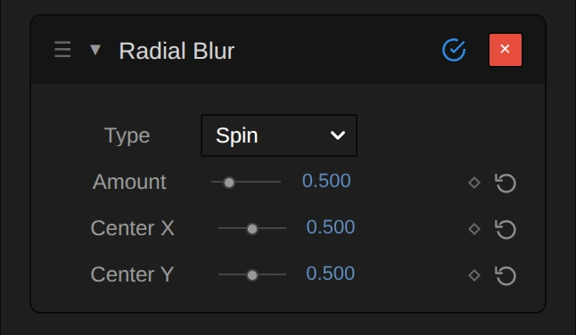

# Radial Blur

Blurs the picture around a centre point: Zoom streaks it outward from the middle, Spin turns it in circles.

Group: [Blur & Sharpen](../Effects-Blur.md) · [How to add an effect](../Effects.md#add-an-effect)

<figure class="docs-shot docs-compare docs-shot--float-left">

<figcaption>Left: original. Right: Type Spin, Amount 0.5.</figcaption>
</figure>

**Use it for:** a dizzy or spinning moment · drawing the eye to one point · a rush towards the middle of the frame.

- **Type** – Zoom streaks outward from the centre, Spin turns around it.
- **Amount** – how strong.
- **Center X / Center Y** – where the sharp middle sits.

**Tip:** put the centre on the performer: they stay sharp while the stage around them swirls. For a strong, even zoom burst use [Zoom Blur](./zoom-blur.md).

## Presets

<figure class="docs-shot docs-shot--detail">

<figcaption>The four presets on the night street.</figcaption>
</figure>

Pick one in the **Preset** row of the effect card. It sets Type and Amount and puts the centre back in the middle of the frame, in one undo step; the row shows its name until you change something. A control with keyframes keeps them, and the card says so.

**Dizzy** – Spin, Amount 0.2: the frame wobbles by a few degrees. A light dizziness or a drunken moment; faces near the middle stay readable.

**Turning Stage** – Spin, Amount 0.6: the camera seems to rotate. Figures smear in arcs but are still recognisable, like a pirouette caught with a slow shutter.

**Whirlpool** – Spin, Amount 1.5: everything but the middle turns into rings of light. For a fall into a dream or a transition; keyframe Amount up to it and back.

**Tunnel Vision** – Zoom, Amount 2: the edges of the frame rush outward while the middle stays sharp. For a moment of shock or focus on one person.

## Controls

<figure class="docs-shot">

<svg class="docs-shot-overlay" viewBox="0 0 1017 506" aria-hidden="true" focusable="false">
<defs><marker id="radial-blur-inspector-arrow" viewBox="0 0 10 10" refX="8" refY="5" markerWidth="5" markerHeight="5" orient="auto-start-reverse"><path d="M 0 0 L 10 5 L 0 10 Z" fill="#ffd54a" /></marker></defs>
<path class="docs-shot-arrow" d="M565 282 L649 282" marker-end="url(#radial-blur-inspector-arrow)" />
<circle class="docs-shot-number" cx="565" cy="282" r="18" /><text x="565" y="282" class="docs-shot-number-text">1</text>
<path class="docs-shot-arrow" d="M578 344 L662 344" marker-end="url(#radial-blur-inspector-arrow)" />
<circle class="docs-shot-number" cx="578" cy="344" r="18" /><text x="578" y="344" class="docs-shot-number-text">2</text>
<path class="docs-shot-arrow" d="M555 382 L639 382" marker-end="url(#radial-blur-inspector-arrow)" />
<circle class="docs-shot-number" cx="555" cy="382" r="18" /><text x="555" y="382" class="docs-shot-number-text">3</text>
<path class="docs-shot-arrow" d="M547 419 L631 419" marker-end="url(#radial-blur-inspector-arrow)" />
<circle class="docs-shot-number" cx="547" cy="419" r="18" /><text x="547" y="419" class="docs-shot-number-text">4</text>
<path class="docs-shot-arrow" d="M547 457 L631 457" marker-end="url(#radial-blur-inspector-arrow)" />
<circle class="docs-shot-number" cx="547" cy="457" r="18" /><text x="547" y="457" class="docs-shot-number-text">5</text>
</svg>

<figcaption>Radial Blur with the Whirlpool preset. 1 — Preset: pick a starting point. 2 — Type: streaks outward or circles. 3 — Amount: how strong. 4 — Center X: where the middle sits across. 5 — Center Y: where it sits up or down.</figcaption>
</figure>

**Preset** – a starting point for Type and Amount; see [Presets](#presets).

**Type** – how the picture moves around the centre. **Zoom** averages every pixel with the picture on the way to the centre, the nearest part counting most, so shapes smear outward like a quick push in. **Spin** averages along a circle around the centre, half one way and half the other, like a camera turning on its axis. In both the middle stays sharp and the streaks grow towards the edges: a Spin streak grows with the distance from the centre, a Zoom streak with the square of it, so Zoom keeps a larger sharp area. Zoom, Spin, default Zoom.

**Amount** – how strong the blur is. For Spin it is the turn: 20° per unit, so 0.2 is a light wobble, 0.5 a clear turn of 10° and 2 a full 40° whirl in which only the middle survives. For Zoom it is gentler: at 0.5 the far corners of a 1080p frame streak about 80 px, at 2 about 310 px, while the middle stays crisp. Animated it changes smoothly, and 0 leaves the picture untouched. 0 to 2, default 0.5.

**Center X** – where the sharp middle sits across the frame: 0 is the left edge, 0.5 the middle, 1 the right edge. The streaks are longest at the corner farthest from it, so an off-centre point gives a lopsided, more dynamic swirl. Keyframe it to follow a performer. 0 to 1, default 0.5.

**Center Y** – where the sharp middle sits from top to bottom: 0 is the top edge, 0.5 the middle, 1 the bottom. Raise it to the height of a face to keep the face sharp. 0 to 1, default 0.5.

## Node setup

<figure class="docs-shot docs-shot--graph">

<svg class="docs-shot-overlay" viewBox="0 0 1017 620" aria-hidden="true" focusable="false">
<defs><marker id="radial-blur-arrow" viewBox="0 0 10 10" refX="8" refY="5" markerWidth="5" markerHeight="5" orient="auto-start-reverse"><path d="M 0 0 L 10 5 L 0 10 Z" fill="#ffd54a" /></marker></defs>
<path class="docs-shot-arrow" d="M112 259 L196 259" marker-end="url(#radial-blur-arrow)" />
<circle class="docs-shot-number" cx="112" cy="259" r="18" /><text x="112" y="259" class="docs-shot-number-text">1</text>
<path class="docs-shot-arrow" d="M274 519 L358 519" marker-end="url(#radial-blur-arrow)" />
<circle class="docs-shot-number" cx="274" cy="519" r="18" /><text x="274" y="519" class="docs-shot-number-text">2</text>
<path class="docs-shot-arrow" d="M274 370 L358 370" marker-end="url(#radial-blur-arrow)" />
<circle class="docs-shot-number" cx="274" cy="370" r="18" /><text x="274" y="370" class="docs-shot-number-text">3</text>
<path class="docs-shot-arrow" d="M437 139 L521 139" marker-end="url(#radial-blur-arrow)" />
<circle class="docs-shot-number" cx="437" cy="139" r="18" /><text x="437" y="139" class="docs-shot-number-text">4</text>
<path class="docs-shot-arrow" d="M599 259 L683 259" marker-end="url(#radial-blur-arrow)" />
<circle class="docs-shot-number" cx="599" cy="259" r="18" /><text x="599" y="259" class="docs-shot-number-text">5</text>
<path class="docs-shot-arrow" d="M762 204 L846 204" marker-end="url(#radial-blur-arrow)" />
<circle class="docs-shot-number" cx="762" cy="204" r="18" /><text x="762" y="204" class="docs-shot-number-text">6</text>
</svg>

<figcaption>Radial Blur opened in the Nodes tab (Constants, Coordinates and the Output card left out). 1 — Blur Range: Zoom or Spin, and how far. 2 — Tap Counts & Box Length: how to cut the streak into pieces. 3 — Premultiplied Source: the picture, ready to average. 4 — Stage A: averages one short piece. 5 — Stage B: adds up the pieces along the streak. 6 — Straight Alpha Output: back to a normal picture.</figcaption>
</figure>

Radial Blur works in the six stages of [Motion Blur](./motion-blur.md#node-setup), one folder each in the Nodes tab; only the path of the streak differs. **Blur Range** picks Zoom or Spin and turns Amount into the range of the streak, **Tap Counts & Box Length** cuts the longest streak into short pieces, and **Premultiplied Source** prepares the picture so transparent edges stay clean. **Stage A** averages one short piece around every pixel along a ray or a circle and caches it, **Stage B** reads that cache once per piece along the whole streak, and **Straight Alpha Output** turns the result back into a normal picture. Click a folder's header to open it.

### Blur Range

<figure class="docs-shot docs-shot--graph">

<svg class="docs-shot-overlay" viewBox="0 0 1017 1348" aria-hidden="true" focusable="false">
<defs><marker id="radial-blur-blur-range-arrow" viewBox="0 0 10 10" refX="8" refY="5" markerWidth="5" markerHeight="5" orient="auto-start-reverse"><path d="M 0 0 L 10 5 L 0 10 Z" fill="#ffd54a" /></marker></defs>
<path class="docs-shot-arrow" d="M114 656 L198 656" marker-end="url(#radial-blur-blur-range-arrow)" />
<circle class="docs-shot-number" cx="114" cy="656" r="18" /><text x="114" y="656" class="docs-shot-number-text">1</text>
<path class="docs-shot-arrow" d="M276 581 L360 581" marker-end="url(#radial-blur-blur-range-arrow)" />
<circle class="docs-shot-number" cx="276" cy="581" r="18" /><text x="276" y="581" class="docs-shot-number-text">2</text>
<path class="docs-shot-arrow" d="M276 248 L360 248" marker-end="url(#radial-blur-blur-range-arrow)" />
<circle class="docs-shot-number" cx="276" cy="248" r="18" /><text x="276" y="248" class="docs-shot-number-text">3</text>
<path class="docs-shot-arrow" d="M276 980 L360 980" marker-end="url(#radial-blur-blur-range-arrow)" />
<circle class="docs-shot-number" cx="276" cy="980" r="18" /><text x="276" y="980" class="docs-shot-number-text">4</text>
<path class="docs-shot-arrow" d="M437 839 L521 839" marker-end="url(#radial-blur-blur-range-arrow)" />
<circle class="docs-shot-number" cx="437" cy="839" r="18" /><text x="437" y="839" class="docs-shot-number-text">5</text>
</svg>

<figcaption>Inside Blur Range, reduced to its recipe (how the Zoom scale and the longest range are worked out is left out). 1 — Maximum: never below 0. 2 — Greater Than: Zoom or Spin. 3 — Multiply: the Spin arc. 4 — Natural Logarithm: the Zoom range. 5 — Switch: picks the range.</figcaption>
</figure>

**Maximum** – keeps Amount at 0 or above. A negative Amount, which a keyframe overshoot or a tool can produce, leaves the picture unchanged, and the card and the tool result say so.

**Greater Than** – Type is 0 for Zoom and 1 for Spin; above **Half** it gives Is Spin, the switch every later stage reads.

**Multiply** – Amount times Spin Per Amount (0.3491, which is 20° in radians): the Spin Arc. The streak starts half of it behind the pixel (Spin Start) and ends half of it ahead.

**Natural Logarithm** – the Zoom path. The Zoom scale is 1 − 0.2 × Amount × the pixel's distance from the centre (in shares of the frame), never below Min Scale 0.05: how far towards the centre the streak reaches. Its logarithm is the Zoom Range, so equal steps along the streak are equal steps in size, as in a real zoom.

**Switch** – picks the Range Length: the Zoom Range or the Spin Arc. The second Switch picks where the streak starts: at the pixel itself for Zoom, at Spin Start for Spin.

**Remix:** to always spin, plug a **Value** of 1 into input A of **Greater Than**. Every Switch in the later stages then picks Spin, whatever Type says.

### Tap Counts & Box Length

<figure class="docs-shot docs-shot--graph">

<svg class="docs-shot-overlay" viewBox="0 0 1017 749" aria-hidden="true" focusable="false">
<defs><marker id="radial-blur-tap-counts-arrow" viewBox="0 0 10 10" refX="8" refY="5" markerWidth="5" markerHeight="5" orient="auto-start-reverse"><path d="M 0 0 L 10 5 L 0 10 Z" fill="#ffd54a" /></marker></defs>
<path class="docs-shot-arrow" d="M67 105 L151 105" marker-end="url(#radial-blur-tap-counts-arrow)" />
<circle class="docs-shot-number" cx="67" cy="105" r="18" /><text x="67" y="105" class="docs-shot-number-text">1</text>
<path class="docs-shot-arrow" d="M311 162 L395 162" marker-end="url(#radial-blur-tap-counts-arrow)" />
<circle class="docs-shot-number" cx="311" cy="162" r="18" /><text x="311" y="162" class="docs-shot-number-text">2</text>
<path class="docs-shot-arrow" d="M555 199 L639 199" marker-end="url(#radial-blur-tap-counts-arrow)" />
<circle class="docs-shot-number" cx="555" cy="199" r="18" /><text x="555" y="199" class="docs-shot-number-text">3</text>
<path class="docs-shot-arrow" d="M798 178 L882 178" marker-end="url(#radial-blur-tap-counts-arrow)" />
<circle class="docs-shot-number" cx="798" cy="178" r="18" /><text x="798" y="178" class="docs-shot-number-text">4</text>
</svg>

<figcaption>Inside Tap Counts & Box Length. 1 — Multiply: the longest streak in pixels. 2 — Square Root: the balance of both stages. 3 — Clamp: how many pieces. 4 — Maximum: how long one piece is.</figcaption>
</figure>

**Multiply** – the Longest Range (the range at the corner farthest from the centre) times that corner's distance in pixels: the longest streak anywhere in the frame. At the default (Zoom 0.5, centred) it is about 80 px in a 1080p frame, with Spin 0.5 about 190 px.

**Square Root** – the square root of twice that length. Cutting the streak into that many pieces gives both stages about the same work: 190 px become 20 pieces of about 10 px, so a pixel reads about 30 times instead of 190.

**Clamp** – rounds that up and keeps it between 1 and 64: the Coarse Taps, the most pieces Stage B reads.

**Maximum** – the Longest Range divided by the number of pieces: the Box Length, shared by every pixel. It is measured along the range, not in pixels, so a piece is longer far from the centre and shorter close to it, just like the streak. It never reaches 0, so a zero streak cannot divide by zero.

### Premultiplied Source

<figure class="docs-shot docs-shot--graph">

<svg class="docs-shot-overlay" viewBox="0 0 1017 377" aria-hidden="true" focusable="false">
<defs><marker id="radial-blur-premultiplied-source-arrow" viewBox="0 0 10 10" refX="8" refY="5" markerWidth="5" markerHeight="5" orient="auto-start-reverse"><path d="M 0 0 L 10 5 L 0 10 Z" fill="#ffd54a" /></marker></defs>
<path class="docs-shot-arrow" d="M437 262 L521 262" marker-end="url(#radial-blur-premultiplied-source-arrow)" />
<circle class="docs-shot-number" cx="437" cy="262" r="18" /><text x="437" y="262" class="docs-shot-number-text">1</text>
<path class="docs-shot-arrow" d="M762 134 L846 134" marker-end="url(#radial-blur-premultiplied-source-arrow)" />
<circle class="docs-shot-number" cx="762" cy="134" r="18" /><text x="762" y="134" class="docs-shot-number-text">2</text>
</svg>

<figcaption>Inside Premultiplied Source (cached). 1 — Multiply: colour times transparency. 2 — Cache Image: keeps the prepared picture.</figcaption>
</figure>

**Multiply** – multiplies each pixel's colour by its alpha. A see-through pixel then adds almost nothing to the average, so the colour of its invisible part cannot smear into the streak as a dark rim around a cut-out figure or a title.

**Cache Image** – keeps the prepared picture in a 16-bit float texture for Stage A to read, so no precision is lost in dark areas.

### Stage A: Short Box

<figure class="docs-shot docs-shot--graph">

<svg class="docs-shot-overlay" viewBox="0 0 1017 874" aria-hidden="true" focusable="false">
<defs><marker id="radial-blur-stage-a-arrow" viewBox="0 0 10 10" refX="8" refY="5" markerWidth="5" markerHeight="5" orient="auto-start-reverse"><path d="M 0 0 L 10 5 L 0 10 Z" fill="#ffd54a" /></marker></defs>
<path class="docs-shot-arrow" d="M67 454 L151 454" marker-end="url(#radial-blur-stage-a-arrow)" />
<circle class="docs-shot-number" cx="67" cy="454" r="18" /><text x="67" y="454" class="docs-shot-number-text">1</text>
<path class="docs-shot-arrow" d="M433 282 L517 282" marker-end="url(#radial-blur-stage-a-arrow)" />
<circle class="docs-shot-number" cx="433" cy="282" r="18" /><text x="433" y="282" class="docs-shot-number-text">2</text>
<path class="docs-shot-arrow" d="M189 210 L273 210" marker-end="url(#radial-blur-stage-a-arrow)" />
<circle class="docs-shot-number" cx="189" cy="210" r="18" /><text x="189" y="210" class="docs-shot-number-text">3</text>
<path class="docs-shot-arrow" d="M555 470 L639 470" marker-end="url(#radial-blur-stage-a-arrow)" />
<circle class="docs-shot-number" cx="555" cy="470" r="18" /><text x="555" y="470" class="docs-shot-number-text">4</text>
<path class="docs-shot-arrow" d="M798 454 L882 454" marker-end="url(#radial-blur-stage-a-arrow)" />
<circle class="docs-shot-number" cx="798" cy="454" r="18" /><text x="798" y="454" class="docs-shot-number-text">5</text>
</svg>

<figcaption>Inside Stage A, reduced to its recipe (how the read offset and position are worked out is left out). 1 — Length: the distance from the centre. 2 — Clamp: reads per piece. 3 — Switch: along a ray or a circle. 4 — Sequence Reduce: adds up the reads. 5 — Cache Image: keeps the short pieces.</figcaption>
</figure>

**Length** – the pixel's distance from the centre in pixels. Times the Box Length it gives how long this pixel's piece is: the farther out, the longer.

**Clamp** – that length rounded up, between 1 and 256: one read per pixel of the piece, so no pixel along it is skipped.

**Switch** – where the reads go. For Zoom, **Multiply** scales the offset from the centre, so the reads run along the ray to the centre; for Spin, **Rotate UV** turns it, so they run along the circle. Is Spin picks one. A read that falls outside the frame repeats the edge pixel; a mirrored edge, as in Motion Blur, would fold the path onto another ray or circle.

**Sequence Reduce** – reads the Premultiplied Source at every position along the piece (**Sample Image**) and adds up the reads; Normalize by Weight turns the sum into an average.

**Cache Image** – keeps, for every pixel, the average of the short piece around it: the Short Boxes that Stage B reads.

### Stage B: Coarse Taps

<figure class="docs-shot docs-shot--graph">

![Inside the Stage B folder, reduced to its recipe: Streak length divided by Box Length gives the number of pieces; minus the Coarse Tap and clamped it gives the covered share, at least Covered Floor by Maximum the Box Weight; Distance along divided by Streak length gives Position t, times Half and One minus that the Zoom taper, and a Switch picks it or One by Is Spin; Multiply weighs the taper with the Box Weight into the Tap Weight; Sample Image reads the Short Boxes at the Read position, Sequence Reduce adds up the weighted reads over Taps Here and Normalize by Weight divides by the summed weight](../assets/effects/graphs/radial-blur-stage-b.webp)

<svg class="docs-shot-overlay" viewBox="0 0 1017 928" aria-hidden="true" focusable="false">
<defs><marker id="radial-blur-stage-b-arrow" viewBox="0 0 10 10" refX="8" refY="5" markerWidth="5" markerHeight="5" orient="auto-start-reverse"><path d="M 0 0 L 10 5 L 0 10 Z" fill="#ffd54a" /></marker></defs>
<path class="docs-shot-arrow" d="M311 126 L395 126" marker-end="url(#radial-blur-stage-b-arrow)" />
<circle class="docs-shot-number" cx="311" cy="126" r="18" /><text x="311" y="126" class="docs-shot-number-text">1</text>
<path class="docs-shot-arrow" d="M311 836 L395 836" marker-end="url(#radial-blur-stage-b-arrow)" />
<circle class="docs-shot-number" cx="311" cy="836" r="18" /><text x="311" y="836" class="docs-shot-number-text">2</text>
<path class="docs-shot-arrow" d="M433 485 L517 485" marker-end="url(#radial-blur-stage-b-arrow)" />
<circle class="docs-shot-number" cx="433" cy="485" r="18" /><text x="433" y="485" class="docs-shot-number-text">3</text>
<path class="docs-shot-arrow" d="M555 304 L639 304" marker-end="url(#radial-blur-stage-b-arrow)" />
<circle class="docs-shot-number" cx="555" cy="304" r="18" /><text x="555" y="304" class="docs-shot-number-text">4</text>
<path class="docs-shot-arrow" d="M676 301 L760 301" marker-end="url(#radial-blur-stage-b-arrow)" />
<circle class="docs-shot-number" cx="676" cy="301" r="18" /><text x="676" y="301" class="docs-shot-number-text">5</text>
</svg>

<figcaption>Inside Stage B, reduced to its recipe (how the read position is worked out is left out). 1 — Clamp: how much of a piece lies on the streak. 2 — Subtract: the Zoom fade. 3 — Switch: fade or even. 4 — Multiply: the weight of a read. 5 — Sequence Reduce: adds up the pieces.</figcaption>
</figure>

**Clamp** – how much of piece number Coarse Tap still lies on this pixel's streak, between 0 and 1. Every Zoom streak has its own length, rarely a whole number of pieces, so the last piece counts only its covered share and the blur grows smoothly when Amount changes.

**Subtract** – One minus half the Position t: the Zoom fade. The read at the pixel counts fully, the one nearest the centre half, which keeps the middle of the picture from washing out over the edges.

**Switch** – picks that fade for Zoom and an even 1 for Spin, whose circle has no inside or outside.

**Multiply** – the fade times the Box Weight: the Tap Weight of a read.

**Sequence Reduce** – reads one cached short piece per tap (**Sample Image** on the Short Boxes), adds them up with their Tap Weights, and Normalize by Weight divides by the summed weight, so the streak keeps the picture's brightness.

**Remix:** for an even Zoom streak without the fade, open **Stage B**, unplug **Subtract** from input False of the **Switch** and plug a **Value** of 1 into it. The streaks then look longer and harder, closer to [Zoom Blur](./zoom-blur.md).

### Straight Alpha Output

<figure class="docs-shot docs-shot--graph">

<svg class="docs-shot-overlay" viewBox="0 0 1017 409" aria-hidden="true" focusable="false">
<defs><marker id="radial-blur-straight-alpha-arrow" viewBox="0 0 10 10" refX="8" refY="5" markerWidth="5" markerHeight="5" orient="auto-start-reverse"><path d="M 0 0 L 10 5 L 0 10 Z" fill="#ffd54a" /></marker></defs>
<path class="docs-shot-arrow" d="M437 132 L521 132" marker-end="url(#radial-blur-straight-alpha-arrow)" />
<circle class="docs-shot-number" cx="437" cy="132" r="18" /><text x="437" y="132" class="docs-shot-number-text">1</text>
<path class="docs-shot-arrow" d="M599 294 L683 294" marker-end="url(#radial-blur-straight-alpha-arrow)" />
<circle class="docs-shot-number" cx="599" cy="294" r="18" /><text x="599" y="294" class="docs-shot-number-text">2</text>
<path class="docs-shot-arrow" d="M762 177 L846 177" marker-end="url(#radial-blur-straight-alpha-arrow)" />
<circle class="docs-shot-number" cx="762" cy="177" r="18" /><text x="762" y="177" class="docs-shot-number-text">3</text>
</svg>

<figcaption>Inside Straight Alpha Output. 1 — Maximum: never divide by zero. 2 — Divide: the colour back to full strength. 3 — Combine RGB + Alpha: the finished picture.</figcaption>
</figure>

**Maximum** – the averaged alpha, but never below the Coverage Floor, a tiny 0.000001 (the card rounds it to 0). Fully transparent pixels then stay black and transparent instead of turning into errors.

**Divide** – divides the averaged colour by the averaged alpha: the reverse of the Multiply in Premultiplied Source, so half-transparent streaks get their real colour back.

**Combine RGB + Alpha** – joins colour and alpha into the finished picture that leaves the effect.

## Technical details

- **Units.** Center X and Y are shares of the frame (0 to 1, from the top left). Spin turns by 20° per unit of Amount in total, half each way, so its streak at a pixel is Amount × 0.349 × the distance from the centre. Zoom reads from the pixel towards the centre down to a scale of 1 − 0.2 × Amount × the distance from the centre in shares of the frame, never below 0.05, and weights its reads 1 − t/2. At Amount 0.3, [Zoom Blur](./zoom-blur.md)'s streak is about five times as long.
- **Two stages.** About 2 × √(2 × longest streak in pixels) reads per pixel: Stage B reads up to 64 pieces, Stage A up to 256 pixels per piece. A streak beyond that (only on very large frames) reads its pieces further apart, and the card and the tool result say so.
- **Edges.** At the frame edge the picture is clamped, not mirrored. Transparent edges smear without a dark rim, and the preview and the export match.
- **Below 0 and zero.** A negative Amount leaves the picture unchanged, as in earlier versions, and the card and the tool result say so. An unedited Radial Blur at Amount 0 is skipped, so the picture passes through exactly.
- **Software preview.** Where the editor falls back to its software preview, Radial Blur reads up to 64 taps along the same path in one stage; very long streaks can look stepped there, and the `SoftwareBlur` log says so.
- **Saved projects.** They keep their look. A missing or unknown Type counts as Zoom. The old Samples value is kept in the project but no longer changes anything. A Radial Blur whose node setup you edited keeps its own recipe; when that recipe does not read Type, the card hides it and says so if it is set.
- **More:** [Blur & Sharpen notes](../Effect-System.md#blur--sharpen-notes) · [Editable blur kernels](../Effect-System.md#editable-blur-kernels) · [Node Catalog](../Node-Catalog.md) · [Styles and presets](../Effects.md#styles-and-presets).
