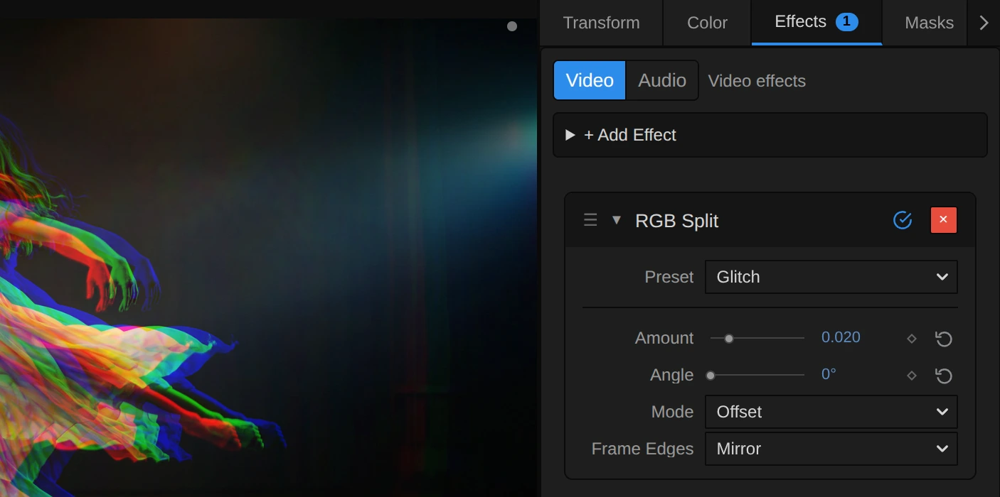
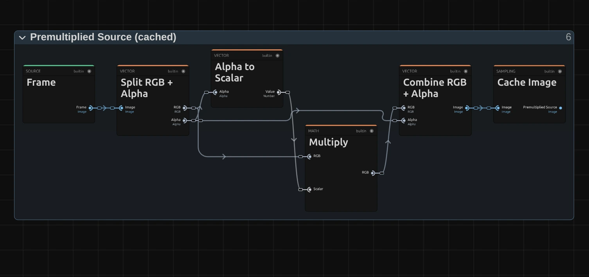

# RGB Split

Shifts the red and blue colour layers apart, like a misprinted poster, a cheap lens or a glitching screen.

Group: [Lens & Distort](../Effects-Distort.md) · [How to add an effect](../Effects.md#add-an-effect)

<figure class="docs-shot docs-compare">

<figcaption>Left: original. Right: RGB Split with Amount 0.012.</figcaption>
</figure>

**Use it for:** glitch hits on the beat · a cheap-lens or 3D-glasses look · nervous, unsettled moments · a misprinted poster.

- **Amount** – how far red and blue move apart.
- **Angle** – which way they move.
- **Mode** – a straight shift of the whole picture, or a lens that stays clean in the middle.

**Tip:** keyframe **Amount** in short bursts from 0 for glitch hits on the beat.

## Presets

<figure class="docs-shot docs-shot--detail">

<figcaption>The four presets on the night street.</figcaption>
</figure>

Pick one in the **Preset** row of the effect card. It sets all controls at once, in one undo step, and the row then shows its name until you change something. A control with keyframes keeps them, and the card says so. Each preset sets **Amount**, **Angle** and **Mode**; **Frame Edges** goes back to its default, **Mirror**, so choose another edge mode after the preset.

**Misprint** – Amount 0.004 at 30°: a fine diagonal edge of colour, like a poster printed with slightly shifted plates. Best seen on sharp lines and lettering.

**Glitch** – Amount 0.02, sideways: a clear red and blue double image for a hit on the beat.

**Cheap Lens** – Lens mode, Amount 0.012: the middle stays sharp, and the colour fringes grow towards the left and right edges, as through an old or cheap lens.

**Double Vision** – Amount 0.05, sideways: red, green and blue lie far apart, so everything appears three times, as in a dizzy spell.

## Controls

<figure class="docs-shot">

<svg class="docs-shot-overlay" viewBox="0 0 1017 506" aria-hidden="true" focusable="false">
<defs><marker id="rgb-split-inspector-arrow" viewBox="0 0 10 10" refX="8" refY="5" markerWidth="5" markerHeight="5" orient="auto-start-reverse"><path d="M 0 0 L 10 5 L 0 10 Z" fill="#ffd54a" /></marker></defs>
<path class="docs-shot-arrow" d="M565 282 L649 282" marker-end="url(#rgb-split-inspector-arrow)" />
<circle class="docs-shot-number" cx="565" cy="282" r="18" /><text x="565" y="282" class="docs-shot-number-text">1</text>
<path class="docs-shot-arrow" d="M555 344 L639 344" marker-end="url(#rgb-split-inspector-arrow)" />
<circle class="docs-shot-number" cx="555" cy="344" r="18" /><text x="555" y="344" class="docs-shot-number-text">2</text>
<path class="docs-shot-arrow" d="M571 382 L655 382" marker-end="url(#rgb-split-inspector-arrow)" />
<circle class="docs-shot-number" cx="571" cy="382" r="18" /><text x="571" y="382" class="docs-shot-number-text">3</text>
<path class="docs-shot-arrow" d="M572 419 L656 419" marker-end="url(#rgb-split-inspector-arrow)" />
<circle class="docs-shot-number" cx="572" cy="419" r="18" /><text x="572" y="419" class="docs-shot-number-text">4</text>
<path class="docs-shot-arrow" d="M511 457 L595 457" marker-end="url(#rgb-split-inspector-arrow)" />
<circle class="docs-shot-number" cx="511" cy="457" r="18" /><text x="511" y="457" class="docs-shot-number-text">5</text>
</svg>

<figcaption>RGB Split with the Glitch preset. 1 — Preset: pick a starting point. 2 — Amount: how far the colours move. 3 — Angle: which way. 4 — Mode: a straight shift or a lens. 5 — Frame Edges: what fills in at the edge.</figcaption>
</figure>

**Preset** – a starting point for Amount, Angle and Mode; see [Presets](#presets).

**Amount** – how far red and blue move, each in its own direction, while green stays in place. It is a share of the picture width for a sideways split and of the height for an upright one, so a 4K export and the preview look the same. 0.005 (the default) is a fine fringe, 0.01 to 0.02 a clear glitch, and from 0.05 the picture falls apart into three copies. At 0 the picture is unchanged. In Lens mode it is the split at the left and right edges. 0 to 0.1, default 0.005.

**Angle** – the direction of the split, as an angle on screen: 0° sideways, 90° up and down, 45° diagonal. Red moves one way and blue the other, so 180° swaps their sides. Only in Offset mode; in Lens mode the card dims it, because the lens splits outwards from the centre. 0 to 360°, default 0°; a typed or keyframed angle may go further and goes round again.

**Mode** – **Offset** shifts the whole picture by the same amount; **Lens** leaves the middle clean and lets the split grow towards the edges, like the colour fringes of a cheap lens. Offset, Lens, default Offset.

**Frame Edges** – what fills in where a shifted colour reads from beyond the frame, a strip as wide as the split along the edges. **Mirror** reflects the picture at the edge, so the colours keep going; **Clamp** repeats the outermost pixels; **Transparent** leaves that colour empty there, so a coloured rim lets the layer below show through. Mirror, Clamp, Transparent, default Mirror.

## Node setup

<figure class="docs-shot docs-shot--graph">

<svg class="docs-shot-overlay" viewBox="0 0 1017 825" aria-hidden="true" focusable="false">
<defs><marker id="rgb-split-arrow" viewBox="0 0 10 10" refX="8" refY="5" markerWidth="5" markerHeight="5" orient="auto-start-reverse"><path d="M 0 0 L 10 5 L 0 10 Z" fill="#ffd54a" /></marker></defs>
<path class="docs-shot-arrow" d="M386 22 L386 106" marker-end="url(#rgb-split-arrow)" />
<circle class="docs-shot-number" cx="386" cy="22" r="18" /><text x="386" y="22" class="docs-shot-number-text">1</text>
<path class="docs-shot-arrow" d="M386 802 L386 718" marker-end="url(#rgb-split-arrow)" />
<circle class="docs-shot-number" cx="386" cy="802" r="18" /><text x="386" y="802" class="docs-shot-number-text">2</text>
<path class="docs-shot-arrow" d="M629 201 L629 285" marker-end="url(#rgb-split-arrow)" />
<circle class="docs-shot-number" cx="629" cy="201" r="18" /><text x="629" y="201" class="docs-shot-number-text">3</text>
<path class="docs-shot-arrow" d="M873 201 L873 285" marker-end="url(#rgb-split-arrow)" />
<circle class="docs-shot-number" cx="873" cy="201" r="18" /><text x="873" y="201" class="docs-shot-number-text">4</text>
</svg>

<figcaption>RGB Split opened in the Nodes tab (Constants, Coordinates and the Output card left out). 1 — Split Offset: how far and which way. 2 — Premultiplied Source: the picture, ready to read. 3 — Channel Reads & Frame Edges: reads the picture three times. 4 — Channel Merge & Straight Alpha: one colour from each read.</figcaption>
</figure>

RGB Split does not paint anything: it reads the picture three times at slightly different places, like every effect in its group moves where a pixel reads ([the shared idea](../Effects-Distort.md#the-shared-idea)). **Split Offset** works out how far and in which direction red and blue move, **Channel Reads & Frame Edges** reads the picture there and in place, from the **Premultiplied Source** prepared once per frame, and **Channel Merge & Straight Alpha** takes red from the first read, green from the second and blue from the third. Click a folder's header to open it; the sections below show what is inside.

### Split Offset

<figure class="docs-shot docs-shot--graph">

<svg class="docs-shot-overlay" viewBox="0 0 1017 1082" aria-hidden="true" focusable="false">
<defs><marker id="rgb-split-offset-arrow" viewBox="0 0 10 10" refX="8" refY="5" markerWidth="5" markerHeight="5" orient="auto-start-reverse"><path d="M 0 0 L 10 5 L 0 10 Z" fill="#ffd54a" /></marker></defs>
<path class="docs-shot-arrow" d="M386 475 L386 559" marker-end="url(#rgb-split-offset-arrow)" />
<circle class="docs-shot-number" cx="386" cy="475" r="18" /><text x="386" y="475" class="docs-shot-number-text">1</text>
<path class="docs-shot-arrow" d="M386 194 L386 278" marker-end="url(#rgb-split-offset-arrow)" />
<circle class="docs-shot-number" cx="386" cy="194" r="18" /><text x="386" y="194" class="docs-shot-number-text">2</text>
<path class="docs-shot-arrow" d="M629 589 L629 505" marker-end="url(#rgb-split-offset-arrow)" />
<circle class="docs-shot-number" cx="629" cy="589" r="18" /><text x="629" y="589" class="docs-shot-number-text">3</text>
<path class="docs-shot-arrow" d="M873 879 L873 795" marker-end="url(#rgb-split-offset-arrow)" />
<circle class="docs-shot-number" cx="873" cy="879" r="18" /><text x="873" y="879" class="docs-shot-number-text">4</text>
<path class="docs-shot-arrow" d="M873 194 L873 278" marker-end="url(#rgb-split-offset-arrow)" />
<circle class="docs-shot-number" cx="873" cy="194" r="18" /><text x="873" y="194" class="docs-shot-number-text">5</text>
</svg>

<figcaption>Inside Split Offset, reduced to its recipe (how the Offset in pixels comes from Amount and Angle is left out). 1 — Divide: the straight offset. 2 — Multiply: the lens offset. 3 — Switch: picks one by Mode. 4 — Add: where red reads. 5 — Subtract: where blue reads.</figcaption>
</figure>

**Divide** – the straight offset of Offset mode. Before it, Cosine and Sine of **Angle** give the direction, and **Amount** times the frame's reach in that direction gives the length in pixels; Divide turns those pixels back into a share of the frame.

**Multiply** – the lens offset of Lens mode: the place of the pixel measured From Centre, times −2 × **Amount**. It is zero in the middle and grows towards the edges.

**Switch** – picks the straight or the lens offset, by **Mode**.

**Add** – the place where red reads: the pixel's own place (UV) plus the Split Offset.

**Subtract** – the place where blue reads: UV minus the Split Offset, the same distance the other way. Green reads at UV itself.

### Premultiplied Source

<figure class="docs-shot docs-shot--graph">

<svg class="docs-shot-overlay" viewBox="0 0 1017 478" aria-hidden="true" focusable="false">
<defs><marker id="rgb-split-premultiplied-source-arrow" viewBox="0 0 10 10" refX="8" refY="5" markerWidth="5" markerHeight="5" orient="auto-start-reverse"><path d="M 0 0 L 10 5 L 0 10 Z" fill="#ffd54a" /></marker></defs>
<path class="docs-shot-arrow" d="M589 455 L589 371" marker-end="url(#rgb-split-premultiplied-source-arrow)" />
<circle class="docs-shot-number" cx="589" cy="455" r="18" /><text x="589" y="455" class="docs-shot-number-text">1</text>
<path class="docs-shot-arrow" d="M914 22 L914 106" marker-end="url(#rgb-split-premultiplied-source-arrow)" />
<circle class="docs-shot-number" cx="914" cy="22" r="18" /><text x="914" y="22" class="docs-shot-number-text">2</text>
</svg>

<figcaption>Inside Premultiplied Source (cached). 1 — Multiply: colour times transparency. 2 — Cache Image: keeps the prepared picture.</figcaption>
</figure>

**Multiply** – multiplies every pixel's colour by its transparency. When a read later blends two neighbouring pixels, a transparent one then adds no colour, so a cut-out figure keeps clean coloured fringes instead of dark ones.

**Cache Image** – keeps the prepared picture, so it is made once per frame, not once per pixel, and all three reads share it.

### Channel Reads & Frame Edges

<figure class="docs-shot docs-shot--graph">

<svg class="docs-shot-overlay" viewBox="0 0 1017 1058" aria-hidden="true" focusable="false">
<defs><marker id="rgb-split-reads-arrow" viewBox="0 0 10 10" refX="8" refY="5" markerWidth="5" markerHeight="5" orient="auto-start-reverse"><path d="M 0 0 L 10 5 L 0 10 Z" fill="#ffd54a" /></marker></defs>
<path class="docs-shot-arrow" d="M314 147 L314 231" marker-end="url(#rgb-split-reads-arrow)" />
<circle class="docs-shot-number" cx="314" cy="147" r="18" /><text x="314" y="147" class="docs-shot-number-text">1</text>
<path class="docs-shot-arrow" d="M425 526 L395 526" marker-end="url(#rgb-split-reads-arrow)" />
<circle class="docs-shot-number" cx="425" cy="526" r="18" /><text x="425" y="526" class="docs-shot-number-text">2</text>
<path class="docs-shot-arrow" d="M509 147 L509 231" marker-end="url(#rgb-split-reads-arrow)" />
<circle class="docs-shot-number" cx="509" cy="147" r="18" /><text x="509" y="147" class="docs-shot-number-text">3</text>
<path class="docs-shot-arrow" d="M703 50 L703 134" marker-end="url(#rgb-split-reads-arrow)" />
<circle class="docs-shot-number" cx="703" cy="50" r="18" /><text x="703" y="50" class="docs-shot-number-text">4</text>
<path class="docs-shot-arrow" d="M150 768 L234 768" marker-end="url(#rgb-split-reads-arrow)" />
<circle class="docs-shot-number" cx="150" cy="768" r="18" /><text x="150" y="768" class="docs-shot-number-text">5</text>
</svg>

<figcaption>The red read of Channel Reads & Frame Edges; the blue read works the same way at the Blue Read position. 1 — Mirror Repeat: reflects at the edge. 2 — Clamp: stops at the edge. 3 — Switch: picks one by Frame Edges. 4 — Sample Image: reads the picture for red. 5 — Sample Image: reads it in place for green.</figcaption>
</figure>

**Mirror Repeat** – folds a Red Read beyond the frame back in, as in a mirror: the **Mirror** choice.

**Clamp** – holds the Red Read between Zero and One, so it stops at the outermost pixel: the **Clamp** choice, and the base of **Transparent**.

**Switch** – picks the mirrored or the clamped position. Not Mirror is true for Clamp and Transparent.

**Sample Image** – reads the Premultiplied Source at that position, blending the four nearest pixels. The Switch and Multiply after it scale the read by Edge Coverage for **Transparent**, which falls from 1 to 0 within one pixel of the frame edge, and by One otherwise.

**Sample Image** – the green read, at the pixel's own place (UV). It never leaves the frame, so it needs no edge handling.

### Channel Merge & Straight Alpha

<figure class="docs-shot docs-shot--graph">

<svg class="docs-shot-overlay" viewBox="0 0 1017 793" aria-hidden="true" focusable="false">
<defs><marker id="rgb-split-channel-merge-arrow" viewBox="0 0 10 10" refX="8" refY="5" markerWidth="5" markerHeight="5" orient="auto-start-reverse"><path d="M 0 0 L 10 5 L 0 10 Z" fill="#ffd54a" /></marker></defs>
<path class="docs-shot-arrow" d="M509 382 L509 466" marker-end="url(#rgb-split-channel-merge-arrow)" />
<circle class="docs-shot-number" cx="509" cy="382" r="18" /><text x="509" y="382" class="docs-shot-number-text">1</text>
<path class="docs-shot-arrow" d="M703 47 L703 131" marker-end="url(#rgb-split-channel-merge-arrow)" />
<circle class="docs-shot-number" cx="703" cy="47" r="18" /><text x="703" y="47" class="docs-shot-number-text">2</text>
<path class="docs-shot-arrow" d="M897 177 L897 261" marker-end="url(#rgb-split-channel-merge-arrow)" />
<circle class="docs-shot-number" cx="897" cy="177" r="18" /><text x="897" y="177" class="docs-shot-number-text">3</text>
</svg>

<figcaption>Inside Channel Merge & Straight Alpha, reduced to the merge (the straight-alpha step after it is left out). 1 — Split Vector: takes a plate apart. 2 — Maximum: the Union Alpha. 3 — Combine Vector: one colour from each plate.</figcaption>
</figure>

**Split Vector** – takes each read, here the Blue Plate, apart into its red, green, blue and alpha numbers.

**Maximum** – keeps the largest of the three alphas, the Union Alpha. Over transparency, a split logo then shows every coloured fringe, not only the place where all three overlap.

**Combine Vector** – joins red from the Red Plate, green from the Green Plate and blue from the Blue Plate with the Union Alpha. The straight-alpha step after it divides the colour by the alpha again, so half-transparent fringes keep their real colour.

**Remix:** for red and cyan like 3D glasses, plug the **B** output of the Green Plate's **Split Vector** into **B** of **Combine Vector**. Blue then stays with green, and only red moves away.

## Technical details

- **Offset mode** moves red and blue Amount × |(cos × width, sin × height)| pixels along the on-screen Angle, in opposite directions; green stays in place. The slider stops at 0; a negative Amount from a node cable is used as it is and swaps the sides of red and blue, like Angle + 180°.
- **Lens mode** offsets their reads by ∓2 × Amount × the distance from the centre: no split in the middle, Amount × width at the left and right edges. Angle is dimmed there.
- **Alpha** is the largest of the three reads, so a split logo on transparency shows its fringes. The picture is read premultiplied, so cut-out figures keep clean edges; the preview and the export match.
- **Units.** Angle is stored in radians and shown in degrees; keyframe lanes, MIDI and tools use radians. Amount is a share of the frame, so a 4K export, a portrait frame and the thumbnails show the same split. RGB Split does not move with time: a still frame stays still.
- **Saved projects** keep their look; diagonal splits point exactly along the on-screen angle.
- **More:** [Effect system: Lens & Distort](../Effect-System.md#lens--distort-notes) · [Editable mirror, split and pixel graphs](../Effect-System.md#editable-mirror-split-and-pixel-graphs) · [Node Catalog](../Node-Catalog.md) · [Styles and presets](../Effects.md#styles-and-presets).
