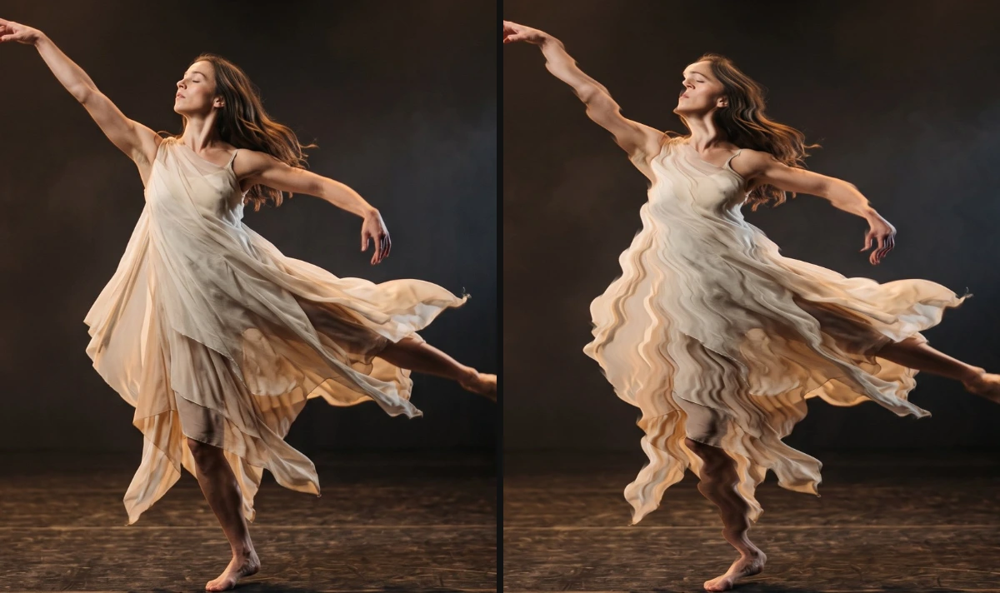
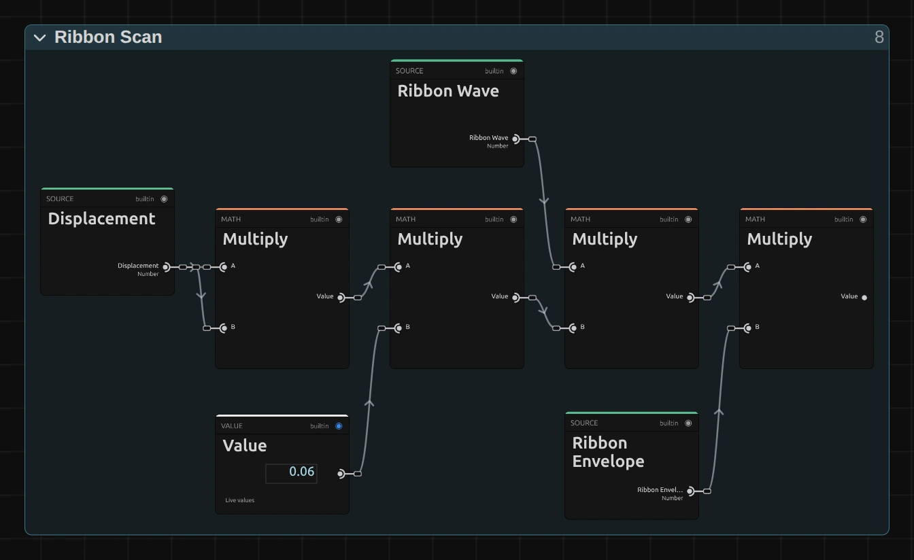

# Ribbon Scan

Rolls soft horizontal ribbons down the picture that push it sideways, like a wobbling video signal. At low values a face stays readable; at the top of the range the picture tears apart.

Group: [Analog & Glitch](../Effects-Analog.md) · [How to add an effect](../Effects.md#add-an-effect)

<figure class="docs-shot">

<figcaption>Left: original. Right: default settings (Displacement 0.3); the ribbons roll down over time.</figcaption>
</figure>

**Use it for:** a wavering signal or heat haze · a dreamlike wobble on a performer · a transition (animate Displacement up and back).

- **Ribbons** – how many ribbons fit in the picture height (at least 3).
- **Displacement** – how far the ribbons push the picture. It grows gently: at the default 0.3 a face stays readable, at 1 the picture tears apart.
- **Edges** – whether reads past the frame edge mirror back (Mirror) or wrap around to the other side (Wrap).
- **Speed** – how many ribbons roll past per second; 0 holds them still.

**Tip:** for a few slow, large waves, set Ribbons to 3 and Speed to 0.2.

## Controls

<!-- generated:controls start -->
| Control | Range | Default |
|---|---|---|
| **Pattern** | | |
| Ribbons | 3 to 80 | 14 |
| **Style** | | |
| Displacement | 0 to 1 | 0.3 |
| Edges | Mirror, Wrap | Mirror |
| **Motion** | | |
| Speed | 0 to 5 | 1 |
<!-- generated:controls end -->

## Node setup

<figure class="docs-shot docs-shot--graph">

<figcaption>The shift: Displacement² × 0.06 × the wave × the envelope of the ribbon.</figcaption>
</figure>

Ribbon Scan is one flat node graph. Each ribbon has a phase that runs from top to bottom and scrolls with time; **Ribbon Wave** is the sine of that phase, and **Ribbon Envelope** fades the ribbon in over its first 18 % and out over its last 38 %. The first **Multiply** squares Displacement, so the low half of the control stays subtle, and the **Value** of 0.06 sets the largest shift: 6 % of the frame width. How to open it: [The node setup](../Effects.md#the-node-setup).

**Remix:** for a shift that grows evenly with the slider, unplug input B of the first **Multiply** and plug a **Value** of 1 into it. Then 0.3 pushes 1.8 % of the width instead of 0.54 %.

## Technical details

- **Units.** The shift is sin(2π × phase) × Displacement² × 6 % of the frame width: at most 0.54 % at the default 0.3. Ribbons below 3 render as 3, and the inspector says so.
- **Transparency.** Both reads come from a premultiplied cache and blend premultiplied, so cut-out edges keep their colour. Reads past the frame edge mirror or wrap instead of smearing the edge pixel.
- **Time.** The ribbons scroll by Speed ribbons per second of timeline time; the preview, scrubbing and the export match. Displacement 0 leaves every pixel unchanged.
- **Saved projects.** A Ribbon Scan saved before the 2026-10 rebuild keeps its earlier look (a shift of up to 8 %, clamped edges) and has no Edges control; add the effect again for the current version.

The recipe: [Effect system: Ribbon Scan](../Effect-System.md#ribbon-scan). Nodes: [Node Catalog](../Node-Catalog.md).
