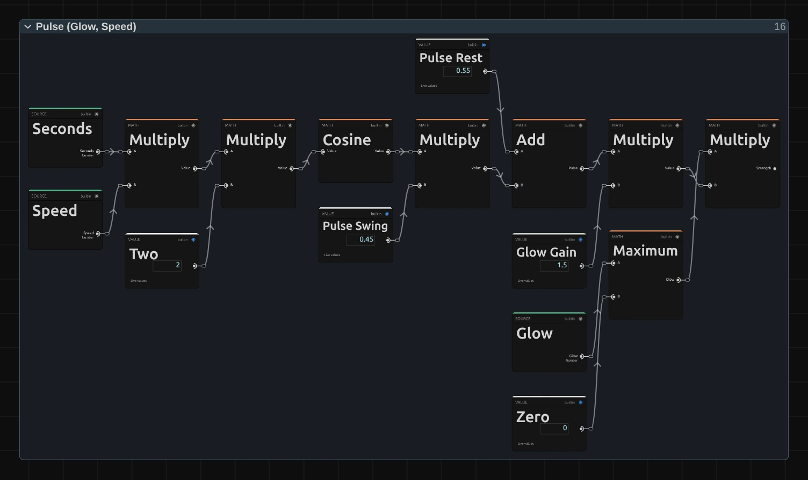

# Riso Glow

A two-ink riso print whose bright ink glows and slowly breathes, like fluorescent ink. For dreamlike, pulsing pictures on a dark stage: a figure that shines from within, neon in the rain, a poster under ultraviolet light.

Group: [Print & Halftone](../Effects-Print.md) · [How to add an effect](../Effects.md#add-an-effect)

<figure class="docs-shot docs-clip docs-compare docs-shot--float-left">
<video src="../assets/effects/clips/riso-glow.mp4" poster="../assets/effects/clips/riso-glow.webp" width="1200" height="430" autoplay muted loop playsinline preload="none" aria-label="The dancer turning on a dark stage, original left and with Riso Glow right: a two-ink print of fine pink and deep indigo dots on a near-black stage, where her dress, skin and the lamp at the left edge bloom with a soft pink glow that swells and fades once"></video>
<figcaption>Left: original. Right: Riso Glow at its default settings, one full breath of the glow (about three seconds).</figcaption>
</figure>

**Use it for:** a figure that seems to give off light on a dark stage · neon signs and warm lamps that glow in print · a slow, hypnotic pulse under a song or a scene.

- **Glow** – how brightly the glow ink shines.
- **Speed** – how fast the glow breathes.
- **Glow Ink** – the colour that glows.
- **Dot Size** – how large the dots of the print are.

**Tip:** the glow comes from the parts the glow ink prints and, a little weaker, from the light parts the print leaves as paper: a white costume, lit skin and lamps bloom in the glow ink's colour and spill into the dark around them. Set **Speed** to 0 for a steady glow, and keyframe **Glow** from 0 to bring it up on a cue.

## Presets

<figure class="docs-shot docs-clip">
<video src="../assets/effects/clips/riso-glow-presets.mp4" poster="../assets/effects/clips/riso-glow-presets.webp" width="962" height="946" autoplay muted loop playsinline preload="none" aria-label="The dancer four times in a grid, moving in sync, each with one preset: Blacklight top left, a pink-white glowing figure on a deep violet stage; Neon Sign top right, a pale figure with a coral sheen on dark teal; Embers bottom left, a figure glowing coral in a smoky, near-black print; Heartbeat bottom right, a pink glow that beats fast on dark maroon"></video>
<figcaption>The four presets on the moving dancer, in sync.</figcaption>
</figure>

Pick one in the **Preset** row of the effect card. It sets all controls at once, in one undo step, and the row then shows its name until you change something. A control with keyframes keeps them, and the card says so.

**Blacklight** – medium blue and fluorescent pink, breathing slowly: a poster under ultraviolet light. The stage turns deep violet and the figure glows pink-white out of it.

**Neon Sign** – teal and fluorescent coral in fine dots, the softest glow of the four, breathing a little faster than Blacklight: the figure stays pale and clear on a dark teal stage, with a coral sheen around its light parts.

**Embers** – black and fluorescent coral in coarse dots, with a slow, strong glow: the figure glows coral in a smoky, almost black print, and the haze around it breathes. Calm and heavy, good for firelight and night scenes.

**Heartbeat** – slate and bright red, the glow beating about 76 times a minute: a pink glow pulses fast on a dark maroon stage. For tension, fear or a heart on stage.

## Controls

<figure class="docs-shot">

<svg class="docs-shot-overlay" viewBox="0 0 1017 569" aria-hidden="true" focusable="false">
<defs><marker id="riso-glow-inspector-arrow" viewBox="0 0 10 10" refX="8" refY="5" markerWidth="5" markerHeight="5" orient="auto-start-reverse"><path d="M 0 0 L 10 5 L 0 10 Z" fill="#ffd54a" /></marker></defs>
<path class="docs-shot-arrow" d="M618 193 L702 193" marker-end="url(#riso-glow-inspector-arrow)" />
<circle class="docs-shot-number" cx="618" cy="193" r="18" /><text x="618" y="193" class="docs-shot-number-text">1</text>
<path class="docs-shot-arrow" d="M632 266 L716 266" marker-end="url(#riso-glow-inspector-arrow)" />
<circle class="docs-shot-number" cx="632" cy="266" r="18" /><text x="632" y="266" class="docs-shot-number-text">2</text>
<path class="docs-shot-arrow" d="M650 371 L734 371" marker-end="url(#riso-glow-inspector-arrow)" />
<circle class="docs-shot-number" cx="650" cy="371" r="18" /><text x="650" y="371" class="docs-shot-number-text">3</text>
<path class="docs-shot-arrow" d="M643 397 L727 397" marker-end="url(#riso-glow-inspector-arrow)" />
<circle class="docs-shot-number" cx="643" cy="397" r="18" /><text x="643" y="397" class="docs-shot-number-text">4</text>
<path class="docs-shot-arrow" d="M631 502 L715 502" marker-end="url(#riso-glow-inspector-arrow)" />
<circle class="docs-shot-number" cx="631" cy="502" r="18" /><text x="631" y="502" class="docs-shot-number-text">5</text>
</svg>

<figcaption>Riso Glow with the Neon Sign preset. 1 — Preset: pick a starting point. 2 — Dot Size. 3 — Glow: how brightly the glow ink shines. 4 — Speed: how fast the glow breathes. 5 — Glow Ink: the colour that glows.</figcaption>
</figure>

**Style** – switches to another look of the same engine, for example [Riso](./riso.md), [Halftone](./halftone.md) or [Paper Print](./paper-print.md). A control you changed keeps its value and keyframes when the new look has the same control, also under another name (Shadow Ink is Halftone's Ink); the others start at the new look's defaults. Riso keeps Dot Size and Registration, brought into its 0 to 32 px; in the other looks Registration is no mark size, so their Scale opens at its default. Glow stays for a switch back.

### Pattern

<figure class="docs-shot docs-clip docs-shot--float-right">
<video src="../assets/effects/clips/riso-glow-dot-size.mp4" poster="../assets/effects/clips/riso-glow-dot-size.webp" width="720" height="628" autoplay muted loop playsinline preload="none" aria-label="The dancer with Riso Glow while Dot Size runs from 3 to 20 px and back: the fine print of pink and deep indigo dots coarsens into large round dots and the glow widens with them, then both shrink again; the current value is shown at the bottom left"></video>
<figcaption>Dot Size from 3 to 20 px and back.</figcaption>
</figure>

**Dot Size** – how large the dots of both inks are, and with them how far the glow reaches: about three dots each way. 3 to 5 px gives a fine print that still reads as a photo, 6 to 10 px the classic risograph grain, 20 and more turns a figure into big glowing dots like a lightboard. It counts pixels of a 1080p picture, so a 4K export shows the same dots and the same glow as the preview. 2 to 40 px, default 6 px.

<figure class="docs-shot docs-clip docs-shot--float-right">
<video src="../assets/effects/clips/riso-glow-registration.mp4" poster="../assets/effects/clips/riso-glow-registration.webp" width="720" height="628" autoplay muted loop playsinline preload="none" aria-label="The dancer with Riso Glow while Registration runs from 0 to 16 px and back: the pink and indigo prints slide apart until pink fringes stand beside every edge, and come together again; the current value is shown at the bottom left"></video>
<figcaption>Registration from 0 to 16 px and back.</figcaption>
</figure>

**Registration** – how far the two inks slip apart, like two drums of the press that did not line up. At 0 they print exactly on top of each other; 2 to 4 px gives the slight misprint of a real risograph; 10 and more lets the glow ink stand beside every edge of the figure as a glowing fringe. The shadow ink moves up and to the left, the glow ink down and to the right, half the distance each. Above about 30 px the two inks separate into two pictures; the slider reaches 80 so older projects keep their setting. 0 to 80 px, default 3 px.

### Glow & Pulse

<figure class="docs-shot docs-clip docs-shot--float-right">
<video src="../assets/effects/clips/riso-glow-glow.mp4" poster="../assets/effects/clips/riso-glow-glow.webp" width="720" height="628" autoplay muted loop playsinline preload="none" aria-label="The dancer with Riso Glow while Glow runs from 0 to 2 and back at Speed 0: a plain two-ink print on a dark stage starts to shine pink around her dress, skin and the lamp, the glow blooms strongly and fades again; the current value is shown at the bottom left"></video>
<figcaption>Glow from 0 to 2 and back, at Speed 0 so the pulse holds still.</figcaption>
</figure>

**Glow** – how brightly the glow ink shines at the top of its pulse. At 0 Riso Glow is a plain two-ink print; 0.5 gives a soft sheen, 1 a clear glow that spills into the dark around the figure, 2 a strong haze. It lights the parts the glow ink prints and, weaker, the light parts the print leaves as paper, and spills into the dark around them. Where both inks print in full, as in black, the print's darkest colour stays and gives no glow. Keyframe it from 0 to let a picture start to glow on a cue. 0 to 2, default 1.

<figure class="docs-shot docs-clip docs-shot--float-right">
<video src="../assets/effects/clips/riso-glow-speed.mp4" poster="../assets/effects/clips/riso-glow-speed.webp" width="720" height="628" autoplay muted loop playsinline preload="none" aria-label="The dancer with Riso Glow at three speeds, about two seconds each: at Speed 0 the glow holds steady, at 2 it swells and fades a little more than once, at 4 it pulses twice as fast; the speed is shown at the bottom left"></video>
<figcaption>Speed 0, 2 and 4, about two seconds each (one breath lasts about 3.1 s ÷ Speed).</figcaption>
</figure>

**Speed** – how fast the glow breathes, from full down to a tenth of its strength and back. At 1 it breathes about every three seconds, 0.3 is a slow, sleepy swell, 3 and more a quick pulse. At 0 the glow holds still at its full strength. It follows the playhead, so a paused picture stands still and the export matches the preview, and a keyframed Speed speeds the breathing up smoothly. 0 to 5, default 1.

### Color

**Shadow Ink** – the first ink, printed through a grid of dots turned 15°. Choose the darker of the two: it carries the shadows and, where it prints over the glow ink, it covers the glow. Deep blues, teals, violet, midnight and black work well: the darker it is, the darker the stage stays where both inks print, and the more the glow stands out. It takes a colour, default `#1b1f4a`.

**Glow Ink** – the second ink, printed through a grid turned 75°, and the one that glows. Each part of the picture is printed with whatever mix of the two inks comes closest to its colour, so the glow appears where the picture has this ink's colour: pick it to match what should shine. Fluorescent pink, coral and bright red glow beautifully on warm skin and lamps. It takes a colour, default `#f43f5e`.

The paper is a fixed cream. To print on another paper, open the Nodes tab and change **Paper R**, **Paper G** and **Paper B** in the **Constants** folder.

<figure class="docs-shot docs-clip docs-shot--float-right">
<video src="../assets/effects/clips/riso-glow-amount.mp4" poster="../assets/effects/clips/riso-glow-amount.webp" width="720" height="628" autoplay muted loop playsinline preload="none" aria-label="The dancer with Riso Glow while Amount runs from 0 to 1 and back: the original stage picture turns into the glowing pink and deep indigo print and back again; the current value is shown at the bottom left"></video>
<figcaption>Amount from 0 to 1 and back.</figcaption>
</figure>

**Amount** – how much of the glowing print covers the picture. At 1 there is only ink, paper and glow; 0.5 lays it softly over the picture's own colours; 0 switches it off. 0 to 1, default 1.

## Node setup

<figure class="docs-shot docs-shot--graph">

<svg class="docs-shot-overlay" viewBox="0 0 1017 895" aria-hidden="true" focusable="false">
<defs><marker id="riso-glow-arrow" viewBox="0 0 10 10" refX="8" refY="5" markerWidth="5" markerHeight="5" orient="auto-start-reverse"><path d="M 0 0 L 10 5 L 0 10 Z" fill="#ffd54a" /></marker></defs>
<path class="docs-shot-arrow" d="M654 805 L654 721" marker-end="url(#riso-glow-arrow)" />
<circle class="docs-shot-number" cx="654" cy="805" r="18" /><text x="654" y="805" class="docs-shot-number-text">1</text>
<path class="docs-shot-arrow" d="M752 111 L752 195" marker-end="url(#riso-glow-arrow)" />
<circle class="docs-shot-number" cx="752" cy="111" r="18" /><text x="752" y="111" class="docs-shot-number-text">2</text>
<path class="docs-shot-arrow" d="M976 157 L892 157" marker-end="url(#riso-glow-arrow)" />
<circle class="docs-shot-number" cx="976" cy="157" r="18" /><text x="976" y="157" class="docs-shot-number-text">3</text>
<path class="docs-shot-arrow" d="M849 337 L849 421" marker-end="url(#riso-glow-arrow)" />
<circle class="docs-shot-number" cx="849" cy="337" r="18" /><text x="849" y="337" class="docs-shot-number-text">4</text>
<path class="docs-shot-arrow" d="M946 520 L946 436" marker-end="url(#riso-glow-arrow)" />
<circle class="docs-shot-number" cx="946" cy="520" r="18" /><text x="946" y="520" class="docs-shot-number-text">5</text>
</svg>

<figcaption>Riso Glow opened in the Nodes tab (input frame and output left out). 1 — Dots: the round dots of both inks. 2 — Print &amp; Glow Share: the print and where the glow ink shows. 3 — Glow Spill: that share gathered from around each pixel. 4 — Pulse: the breathing strength. 5 — Glow &amp; Mix: the glow screened onto the print.</figcaption>
</figure>

Riso Glow is [Riso](./riso.md)'s print with a glow on top, in eleven folders. The first seven print the picture in two inks of dots, exactly as Riso does: **Dots** is the last of them. **Print & Glow Share** puts the inks on the paper and works out where the glow ink shows, **Glow Spill** gathers that from around each pixel into a soft light, **Pulse** turns Glow and Speed into a breathing strength, and **Glow & Mix** screens the light onto the print. Click a folder's header to open it.

### Paper & Inks

The paper and the two inks as light, and how much of the paper's light each ink takes away. The same as in Riso: [Riso › Paper & Inks](./riso.md#paper--inks), where the Shadow Ink is called Dark Ink and the Glow Ink Warm Ink.

### Screens

Each ink's grid of dots: the paper pixel slipped by Registration, turned 15° (shadow ink) or 75° (glow ink) and cut into cells of Dot Size. The same as [Riso › Screens](./riso.md#screens).

### Cell Filter

The picture averaged over boxes of half a cell, so the four reads of a cell together give its whole colour and the dots move smoothly with moving footage. The same as [Halftone › Cell Filter](./halftone.md#cell-filter).

### Cell Colour

The colour of each cell, read at four points of the Cell Filter in linear light. The same as [Riso › Cell Colour](./riso.md#cell-colour).

### Separation

How the cell's colour splits between the two inks: a fit of the light the cell takes from the paper. The same as [Riso › Separation](./riso.md#separation).

### Tone

How much of each ink the cell needs to keep its brightness: the coverage of both inks. Glow uses the glow ink's coverage and the shadow ink's beside it. The same as [Riso › Tone](./riso.md#tone).

### Dots

The round dot that covers exactly that share of each cell, one pixel soft at the edge. The same as [Riso › Dots](./riso.md#dots).

### Print & Glow Share

<figure class="docs-shot docs-shot--graph">

<svg class="docs-shot-overlay" viewBox="0 0 1017 583" aria-hidden="true" focusable="false">
<defs><marker id="riso-glow-print-arrow" viewBox="0 0 10 10" refX="8" refY="5" markerWidth="5" markerHeight="5" orient="auto-start-reverse"><path d="M 0 0 L 10 5 L 0 10 Z" fill="#ffd54a" /></marker></defs>
<path class="docs-shot-arrow" d="M230 22 L230 79" marker-end="url(#riso-glow-print-arrow)" />
<circle class="docs-shot-number" cx="230" cy="22" r="18" /><text x="230" y="22" class="docs-shot-number-text">1</text>
<path class="docs-shot-arrow" d="M369 22 L369 79" marker-end="url(#riso-glow-print-arrow)" />
<circle class="docs-shot-number" cx="369" cy="22" r="18" /><text x="369" y="22" class="docs-shot-number-text">2</text>
<path class="docs-shot-arrow" d="M508 22 L508 79" marker-end="url(#riso-glow-print-arrow)" />
<circle class="docs-shot-number" cx="508" cy="22" r="18" /><text x="508" y="22" class="docs-shot-number-text">3</text>
<path class="docs-shot-arrow" d="M787 22 L787 79" marker-end="url(#riso-glow-print-arrow)" />
<circle class="docs-shot-number" cx="787" cy="22" r="18" /><text x="787" y="22" class="docs-shot-number-text">4</text>
<path class="docs-shot-arrow" d="M926 261 L926 177" marker-end="url(#riso-glow-print-arrow)" />
<circle class="docs-shot-number" cx="926" cy="261" r="18" /><text x="926" y="261" class="docs-shot-number-text">5</text>
</svg>

<figcaption>Inside Print &amp; Glow Share. 1 — Mix: how much a cell glows, from paper share to full. 2 — Multiply: what the shadow ink leaves open. 3 — Multiply: on opaque pixels only, the Glow Share. 4 — Combine RGB + Alpha: the print with the share beside it. 5 — Cache Image: keeps both for the next folders.</figcaption>
</figure>

**Mix** – how much of a cell can glow: 0.6 (Glow Paper Share) where the cell is paper, rising to 1 where the glow ink prints in full (its coverage is the mix). So the glow ink glows fully, and the light parts the print leaves as paper, such as a white costume, glow too, a little weaker.

**Multiply** – that times one minus the shadow ink's coverage (Subtract): the part the shadow ink leaves open. Where both inks print in full, as in black, nothing is left to glow.

**Multiply** – that times the pixel's own alpha: the Glow Share, from 0 to 1. Transparent pixels never glow, so the surround of a cut-out figure adds no glow to it.

**Combine RGB + Alpha** – packs the print into the colour and the Glow Share into the alpha of one picture. The other Multiply is the print itself, the paper's light through the dots of both inks, as in Riso.

**Cache Image** – keeps that picture for the rest of the effect, so the print is worked out once per pixel and the next folder can read the Glow Share of its neighbours.

**Remix:** open the **Constants** folder and set **Glow Paper Share** to **0**: only the glow ink's own colours glow, and a white costume stays plain paper.

### Glow Spill

<figure class="docs-shot docs-shot--graph">

![Inside the Glow Spill folder: the Kernel Index, minus the Glow Centre Tap 4, gives a tap from −4 to 4 in each direction; its Length goes through Gaussian Falloff with Glow Sigma 2; the tap times the Tap Step (Dot Size times Glow Step Cells 0.75) is added to the pixel and clamped to the frame; Sample Image reads the cached picture there, Kernel Sum (Rect) adds up a Glow Window of 9 by 9 taps, Divide by the weight sum gives the gathered share, and Multiply with the Glow Ink Light gives the Glow Light](../assets/effects/graphs/riso-glow-spill.webp)

<svg class="docs-shot-overlay" viewBox="0 0 1017 1386" aria-hidden="true" focusable="false">
<defs><marker id="riso-glow-spill-arrow" viewBox="0 0 10 10" refX="8" refY="5" markerWidth="5" markerHeight="5" orient="auto-start-reverse"><path d="M 0 0 L 10 5 L 0 10 Z" fill="#ffd54a" /></marker></defs>
<path class="docs-shot-arrow" d="M99 1174 L183 1174" marker-end="url(#riso-glow-spill-arrow)" />
<circle class="docs-shot-number" cx="99" cy="1174" r="18" /><text x="99" y="1174" class="docs-shot-number-text">1</text>
<path class="docs-shot-arrow" d="M508 514 L508 430" marker-end="url(#riso-glow-spill-arrow)" />
<circle class="docs-shot-number" cx="508" cy="514" r="18" /><text x="508" y="514" class="docs-shot-number-text">2</text>
<path class="docs-shot-arrow" d="M240 868 L240 952" marker-end="url(#riso-glow-spill-arrow)" />
<circle class="docs-shot-number" cx="240" cy="868" r="18" /><text x="240" y="868" class="docs-shot-number-text">3</text>
<path class="docs-shot-arrow" d="M374 1184 L374 1100" marker-end="url(#riso-glow-spill-arrow)" />
<circle class="docs-shot-number" cx="374" cy="1184" r="18" /><text x="374" y="1184" class="docs-shot-number-text">4</text>
<path class="docs-shot-arrow" d="M642 1171 L642 1087" marker-end="url(#riso-glow-spill-arrow)" />
<circle class="docs-shot-number" cx="642" cy="1171" r="18" /><text x="642" y="1171" class="docs-shot-number-text">5</text>
</svg>

<figcaption>Inside Glow Spill. 1 — Gaussian Falloff: how much each tap counts. 2 — Multiply: the step between taps. 3 — Sample Image: reads the cached Glow Share. 4 — Kernel Sum (Rect): adds up 9 × 9 taps. 5 — Divide: their weighted average.</figcaption>
</figure>

**Gaussian Falloff** – the weight of one tap: 1 in the middle, falling off smoothly with its distance (Glow Sigma 2 taps). Near taps count more than far ones, so the glow fades softly instead of ending in a hard edge.

**Multiply** – Dot Size times 0.75 (Glow Step Cells): the step between two taps. Four steps each way make the glow reach about three dots, so a coarser print glows wider.

**Sample Image** – reads the cached picture at one tap, kept inside the frame (Clamp). Its alpha is the Glow Share there.

**Kernel Sum (Rect)** – runs Sample Image and Gaussian Falloff for every tap of a 9 × 9 window (Glow Window) and adds them up, weighted.

**Divide** – the weighted sum divided by the sum of the weights: the Gathered Share, a soft field that spills past the edges of the glowing parts. Multiplied by the glow ink's own light it becomes the Glow Light.

**Remix:** open the **Constants** folder and set **Glow Step Cells** to **1.5**: the glow reaches twice as far, a wide, misty aura around everything that glows.

### Pulse

<figure class="docs-shot docs-shot--graph">

<svg class="docs-shot-overlay" viewBox="0 0 1017 606" aria-hidden="true" focusable="false">
<defs><marker id="riso-glow-pulse-arrow" viewBox="0 0 10 10" refX="8" refY="5" markerWidth="5" markerHeight="5" orient="auto-start-reverse"><path d="M 0 0 L 10 5 L 0 10 Z" fill="#ffd54a" /></marker></defs>
<path class="docs-shot-arrow" d="M448 60 L448 144" marker-end="url(#riso-glow-pulse-arrow)" />
<circle class="docs-shot-number" cx="448" cy="60" r="18" /><text x="448" y="60" class="docs-shot-number-text">1</text>
<path class="docs-shot-arrow" d="M691 60 L691 144" marker-end="url(#riso-glow-pulse-arrow)" />
<circle class="docs-shot-number" cx="691" cy="60" r="18" /><text x="691" y="60" class="docs-shot-number-text">2</text>
<path class="docs-shot-arrow" d="M813 493 L813 409" marker-end="url(#riso-glow-pulse-arrow)" />
<circle class="docs-shot-number" cx="813" cy="493" r="18" /><text x="813" y="493" class="docs-shot-number-text">3</text>
<path class="docs-shot-arrow" d="M935 60 L935 144" marker-end="url(#riso-glow-pulse-arrow)" />
<circle class="docs-shot-number" cx="935" cy="60" r="18" /><text x="935" y="60" class="docs-shot-number-text">4</text>
</svg>

<figcaption>Inside Pulse (Glow, Speed). 1 — Cosine: one smooth breath. 2 — Add: the pulse, between 0.1 and 1. 3 — Maximum: Glow, at least 0. 4 — Multiply: the Strength.</figcaption>
</figure>

**Cosine** – the seconds of the timeline times Speed times two, turned into a smooth swing between 1 and −1. It starts at the top at second 0, and at Speed 0 it stays there.

**Add** – Pulse Rest 0.55 plus Pulse Swing 0.45 times that swing: the pulse, breathing between 1 and 0.1, so the glow never quite goes out.

**Maximum** – keeps Glow at 0 or more; the card says so if a keyframe or a tool asks for less.

**Multiply** – Glow times the pulse times Glow Gain 1.5: the Strength of the glow right now.

**Remix:** set **Pulse Swing** to **0.55** and **Pulse Rest** to **0.45**: at the bottom of every breath the glow goes out completely, like a sign switching off.

### Glow & Mix

<figure class="docs-shot docs-shot--graph">

<svg class="docs-shot-overlay" viewBox="0 0 1017 1389" aria-hidden="true" focusable="false">
<defs><marker id="riso-glow-finish-arrow" viewBox="0 0 10 10" refX="8" refY="5" markerWidth="5" markerHeight="5" orient="auto-start-reverse"><path d="M 0 0 L 10 5 L 0 10 Z" fill="#ffd54a" /></marker></defs>
<path class="docs-shot-arrow" d="M509 136 L509 220" marker-end="url(#riso-glow-finish-arrow)" />
<circle class="docs-shot-number" cx="509" cy="136" r="18" /><text x="509" y="136" class="docs-shot-number-text">1</text>
<path class="docs-shot-arrow" d="M880 136 L880 220" marker-end="url(#riso-glow-finish-arrow)" />
<circle class="docs-shot-number" cx="880" cy="136" r="18" /><text x="880" y="136" class="docs-shot-number-text">2</text>
<path class="docs-shot-arrow" d="M323 786 L323 870" marker-end="url(#riso-glow-finish-arrow)" />
<circle class="docs-shot-number" cx="323" cy="786" r="18" /><text x="323" y="786" class="docs-shot-number-text">3</text>
<path class="docs-shot-arrow" d="M694 854 L694 938" marker-end="url(#riso-glow-finish-arrow)" />
<circle class="docs-shot-number" cx="694" cy="854" r="18" /><text x="694" y="854" class="docs-shot-number-text">4</text>
</svg>

<figcaption>Inside Glow &amp; Mix (Amount). 1 — Exponential: how much of the dark one unit of light keeps. 2 — Power: how much of the dark the Glow Light keeps. 3 — Subtract: the glowing print. 4 — Mix: over the picture by Amount.</figcaption>
</figure>

**Exponential** – e to the power of minus the Strength: how much of the print's darkness a full unit of light keeps. 1 when there is no glow, smaller the stronger it is.

**Power** – raises that to the Glow Light, channel by channel: where the glow ink shines brightly, little of the dark is kept; where there is no glow light, all of it.

**Subtract** – one minus the print's darkness times what is kept: the glow is screened onto the print in linear light, so it brightens the dark parts most and never clips into a hard white.

**Mix** – turns the glowing print into a colour (Linear to sRGB) and lays it over the picture by Amount; Combine RGB + Alpha then puts each pixel's own transparency back on.

## Technical details

- **Size.** Dot Size and Registration count pixels of a frame whose shorter side is 1080, and the glow reaches a fixed number of dots: a 4K export, a portrait frame, a lower Preview Quality and the thumbnails show the same dots and the same glow. A cell is never smaller than one pixel of the frame being drawn, so small dots can come out coarser in a preview at 1/4 quality than in the export; the card says so, for the preview as well as the export.
- **Glow.** The print and the glow share (mix(0.6, 1, the glow ink's coverage) × the part the shadow ink leaves open × the pixel's alpha) are cached in one pass; the second pass gathers the share over 9 × 9 taps 0.75 dots apart with Gaussian weights and screens the glow ink's light onto the print in linear light: 1 − (1 − print) × e^(−strength × light). Black keeps the print's darkest colour (both inks in full) and gives no glow; light parts glow with the glow ink and spill into the dark around them.
- **Time.** The pulse is 0.55 + 0.45 × cos(2 × seconds × Speed) of the timeline: scrubbing, playback and export give the same frame for the same moment, and a paused picture needs no extra rendering. A keyframed Speed breathes faster or slower smoothly, without a jump.
- **Transparency.** Transparent parts of the picture take no ink and give no glow, and each pixel keeps its own alpha: on a cut-out figure the glow stays inside its outline and does not spill onto what lies behind it.
- **Saved projects.** A project stores each effect's node setup, so a saved Riso Glow keeps the look it was saved with, also its Shadow Ink (effects saved without one keep `#4f46e5`). One saved before Dot Size existed, without a node setup, keeps its earlier look: both inks printed the same darkness, a little apart (Registration in pixels of the frame), without dots, with a pulsing tint of both inks, mixed over the picture at Amount 0.75. Its card hides Dot Size and Glow and says so; add the effect again for the print described here. A custom Look keeps the node setup it was saved with in the same way.
- **More:** [Riso](./riso.md) · [Effect system](../Effect-System.md#riso-glow) · [Node Catalog](../Node-Catalog.md) · [Styles and presets](../Effects.md#styles-and-presets).
