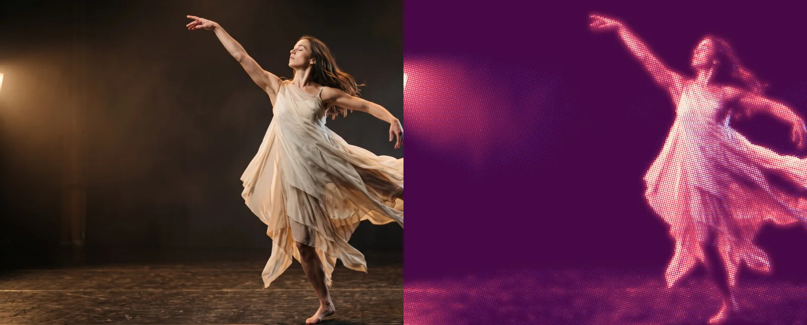

# Riso Glow

<!-- effect-docs: basic page sha=3036915b7479, written by scripts/effect-docs.mjs. Delete this line to write the page by hand (template B in Documentation-Site.md). -->

Two-ink risograph print look with a pulsing glow added to the inks; Registration sets how far the two inks sit apart, Shadow and Glow Ink the colors, Speed the pulse rate.

Group: [Print & Halftone](../Effects-Print.md) · [How to add an effect](../Effects.md#add-an-effect)

<figure class="docs-shot">

<figcaption>Left: the original. Right: Riso Glow at its default settings, one frame of its movement.</figcaption>
</figure>

*A short page made from the editor’s effect catalog: what the effect does and its controls. Tips and its node setup will follow.*

## Controls

<!-- generated:controls start -->
| Control | Range | Default |
|---|---|---|
| **Pattern** | | |
| Registration | 2 to 80 | 14 |
| **Mix** | | |
| Amount | 0 to 1 | 0.75 |
| **Color** | | |
| Shadow Ink | a colour | `#4f46e5` |
| Glow Ink | a colour | `#f43f5e` |
| **Motion** | | |
| Speed | 0 to 5 | 1 |
<!-- generated:controls end -->

**Styles:** the **Style** menu in the effect card switches to another look of the same engine. Controls you changed keep their values and keyframes when the new look has the same control, also under another name; the others start at the new look's defaults. Looks of Print & Halftone: [Dither Studio](./dither-studio.md), [Dithering](./dither.md), [Halftone](./halftone.md), [Paper Print](./paper-print.md), [Pattern Halftone](./pattern-halftone.md), [Riso](./riso.md), [Tone Geometry](./tone-geometry.md). Further looks under [Lens & Distort](../Effects-Distort.md) (4), [Pixel & Mosaic](../Effects-Pixel.md) (2), [Lines & Engraving](../Effects-Lines.md) (6), [Textile & Craft](../Effects-Textile.md) (3), [Analog & Glitch](../Effects-Analog.md) (4), [3D & Particles](../Effects-3D-Particles.md) (1).

## Technical details

Riso Glow is one look of the pattern engine; its looks share one node setup. It keeps moving while the playhead stands still. How effects are stored, rendered and exported: [Effect system](../Effect-System.md). Its building blocks: [Node Catalog](../Node-Catalog.md).
