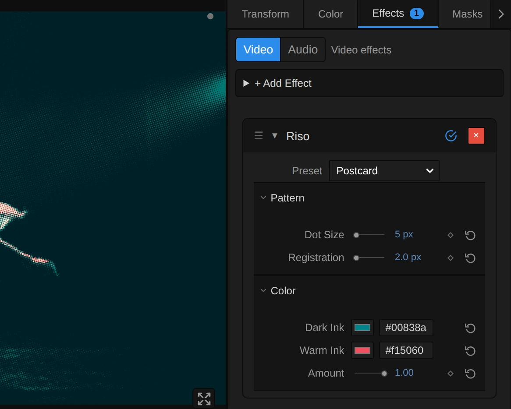

# Riso

Prints the picture in two inks of fine dots on cream paper, a little off register, like a risograph.

Group: [Print & Halftone](../Effects-Print.md) · [How to add an effect](../Effects.md#add-an-effect)

<figure class="docs-shot docs-compare docs-shot--float-left">

<figcaption>Left: original. Right: Riso at its default settings, a detail.</figcaption>
</figure>

**Use it for:** a hand-printed zine or poster look · programme art, flyers and projections in the colours of a production · a warm, analogue texture on a dark stage.

- **Dot Size** – how large the dots of the inks are.
- **Registration** – how far the two inks slip apart.
- **Dark Ink** and **Warm Ink** – the two colours that print the picture.

**Tip:** pick two inks of the production's colour scheme: Riso works out by itself which ink prints which part of the picture, and where both overlap you get the darkest colour the two can make. A dark ink with a light, bright one reads best.

## Presets

<figure class="docs-shot">

<figcaption>The five presets on the upper body. Click for full size: one pixel of a 1080p frame per screen pixel.</figcaption>
</figure>

Pick one in the **Preset** row of the effect card. It sets all controls at once, in one undo step, and the row then shows its name until you change something. A control with keyframes keeps them, and the card says so.

**Zine** – medium blue and fluorescent pink in coarse dots, clearly off register: a self-printed fanzine. Loud and friendly, with pink fringes along the edges.

**Postcard** – teal and bright red in fine dots, almost in register: a holiday postcard. Skin goes warm red, shadows and the stage cool teal.

**Art Print** – hunter green and fluorescent pink in very fine dots: a quiet, almost photographic art print. The figure stays detailed and pale.

**Gig Poster** – black and bright red in bold dots: a concert poster. The black ink carries the picture, the red only the warm parts.

**Off Register** – burgundy and aqua in large dots, far off register: the aqua ink glows beside every edge like a print that slipped on the press. Made for large surfaces and graphic moments.

## Controls

<figure class="docs-shot">

<svg class="docs-shot-overlay" viewBox="0 0 1017 493" aria-hidden="true" focusable="false">
<defs><marker id="riso-inspector-arrow" viewBox="0 0 10 10" refX="8" refY="5" markerWidth="5" markerHeight="5" orient="auto-start-reverse"><path d="M 0 0 L 10 5 L 0 10 Z" fill="#ffd54a" /></marker></defs>
<path class="docs-shot-arrow" d="M663 206 L747 206" marker-end="url(#riso-inspector-arrow)" />
<circle class="docs-shot-number" cx="663" cy="206" r="18" /><text x="663" y="206" class="docs-shot-number-text">1</text>
<path class="docs-shot-arrow" d="M678 283 L762 283" marker-end="url(#riso-inspector-arrow)" />
<circle class="docs-shot-number" cx="678" cy="283" r="18" /><text x="678" y="283" class="docs-shot-number-text">2</text>
<path class="docs-shot-arrow" d="M658 310 L742 310" marker-end="url(#riso-inspector-arrow)" />
<circle class="docs-shot-number" cx="658" cy="310" r="18" /><text x="658" y="310" class="docs-shot-number-text">3</text>
<path class="docs-shot-arrow" d="M679 395 L763 395" marker-end="url(#riso-inspector-arrow)" />
<circle class="docs-shot-number" cx="679" cy="395" r="18" /><text x="679" y="395" class="docs-shot-number-text">4</text>
<path class="docs-shot-arrow" d="M672 422 L756 422" marker-end="url(#riso-inspector-arrow)" />
<circle class="docs-shot-number" cx="672" cy="422" r="18" /><text x="672" y="422" class="docs-shot-number-text">5</text>
<path class="docs-shot-arrow" d="M682 450 L766 450" marker-end="url(#riso-inspector-arrow)" />
<circle class="docs-shot-number" cx="682" cy="450" r="18" /><text x="682" y="450" class="docs-shot-number-text">6</text>
</svg>

<figcaption>Riso with the Postcard preset. 1 — Preset: pick a starting point. 2 — Dot Size. 3 — Registration: how far the inks slip apart. 4 — Dark Ink. 5 — Warm Ink. 6 — Amount.</figcaption>
</figure>

**Style** – switches to another look of the same engine, for example [Riso Glow](./riso-glow.md), [Halftone](./halftone.md) or [Paper Print](./paper-print.md). A control you changed keeps its value and keyframes when the new look has the same control, also under another name (Dark Ink is Halftone's Ink); the others start at the new look's defaults. Riso Glow keeps Dot Size and Registration; in the other looks Registration is no mark size, so their Scale opens at its default, and Dot Size stays for a switch back.

### Pattern

**Dot Size** – how large the dots of both inks are. 3 to 5 px gives a fine print that still reads as a photo, 6 to 10 px the classic risograph grain, 20 and more turns a figure into a graphic pattern of big dots. Each ink has its own grid of dots, turned against the other, so where both print they form small rosettes. It counts pixels of a 1080p picture, so a 4K export shows the same dots as the preview; on a frame too small for one pixel the card says what renders. 2 to 40 px, default 6 px.

**Registration** – how far the two inks slip apart, like two drums of the press that did not line up. At 0 they print exactly on top of each other; 2 to 4 px gives the slight, honest misprint of a real risograph; 10 and more lets one ink glow beside every edge of the figure. The dark ink moves up and to the left, the warm ink down and to the right, half the distance each. Keyframe it from 0 for a print that slowly drifts apart. 0 to 32 px, default 3 px.

### Color

**Dark Ink** – the first ink, printed through a grid turned 15°. Choose the darker of the two: it carries the shadows, and together with the warm ink it makes the darkest colour of the print. Blues, teals, greens, burgundy and black work well. It takes a colour, default `#2046b3`.

**Warm Ink** – the second ink, printed through a grid turned 75°. A bright colour gives the print its light: pink, red, orange, aqua or yellow. Each part of the picture is printed with whatever mix of the two inks comes closest to its colour, and every part keeps its brightness. It takes a colour, default `#ef476f`.

The paper is a fixed cream. To print on another paper, open the Nodes tab and change **Paper R**, **Paper G** and **Paper B** in the **Constants** folder (see the Remix under [Paper & Inks](#paper--inks)).

**Amount** – how much of the print covers the picture. At 1 there is only ink on paper; 0.5 lays the dots softly over the picture's own colours; 0 switches it off. Keyframe it to let a scene turn into print on a cue. 0 to 1, default 1.

## Node setup

<figure class="docs-shot docs-shot--graph">

<svg class="docs-shot-overlay" viewBox="0 0 1017 1099" aria-hidden="true" focusable="false">
<defs><marker id="riso-arrow" viewBox="0 0 10 10" refX="8" refY="5" markerWidth="5" markerHeight="5" orient="auto-start-reverse"><path d="M 0 0 L 10 5 L 0 10 Z" fill="#ffd54a" /></marker></defs>
<path class="docs-shot-arrow" d="M326 22 L326 75" marker-end="url(#riso-arrow)" />
<circle class="docs-shot-number" cx="326" cy="22" r="18" /><text x="326" y="22" class="docs-shot-number-text">1</text>
<path class="docs-shot-arrow" d="M204 716 L204 800" marker-end="url(#riso-arrow)" />
<circle class="docs-shot-number" cx="204" cy="716" r="18" /><text x="204" y="716" class="docs-shot-number-text">2</text>
<path class="docs-shot-arrow" d="M326 581 L326 497" marker-end="url(#riso-arrow)" />
<circle class="docs-shot-number" cx="326" cy="581" r="18" /><text x="326" y="581" class="docs-shot-number-text">3</text>
<path class="docs-shot-arrow" d="M448 448 L448 532" marker-end="url(#riso-arrow)" />
<circle class="docs-shot-number" cx="448" cy="448" r="18" /><text x="448" y="448" class="docs-shot-number-text">4</text>
<path class="docs-shot-arrow" d="M569 614 L569 530" marker-end="url(#riso-arrow)" />
<circle class="docs-shot-number" cx="569" cy="614" r="18" /><text x="569" y="614" class="docs-shot-number-text">5</text>
<path class="docs-shot-arrow" d="M691 602 L691 686" marker-end="url(#riso-arrow)" />
<circle class="docs-shot-number" cx="691" cy="602" r="18" /><text x="691" y="602" class="docs-shot-number-text">6</text>
<path class="docs-shot-arrow" d="M813 1077 L813 993" marker-end="url(#riso-arrow)" />
<circle class="docs-shot-number" cx="813" cy="1077" r="18" /><text x="813" y="1077" class="docs-shot-number-text">7</text>
<path class="docs-shot-arrow" d="M935 314 L935 398" marker-end="url(#riso-arrow)" />
<circle class="docs-shot-number" cx="935" cy="314" r="18" /><text x="935" y="314" class="docs-shot-number-text">8</text>
</svg>

<figcaption>Riso opened in the Nodes tab (input frame and output left out). 1 — Paper & Inks: the paper and the two inks as light. 2 — Screens: where each ink's dots lie. 3 — Cell Filter: the picture averaged over half a cell. 4 — Cell Colour: one colour per cell. 5 — Separation: which ink prints what. 6 — Tone: how much ink. 7 — Dots: round dots. 8 — Print & Mix: ink on paper, over the picture.</figcaption>
</figure>

Riso works in eight stages, one folder each in the Nodes tab. **Paper & Inks** turns the paper and the two ink colours into light. **Screens** places each ink's grid of dots: slipped by Registration, turned to its own angle, cut into cells of Dot Size. **Cell Filter** averages the picture over boxes of half a cell, and **Cell Colour** reads one colour of that for every cell. **Separation** splits that colour between the two inks, **Tone** sets how much ink the cell gets so that it keeps its brightness, and **Dots** draws the round dot that covers that share of the cell. **Print & Mix** prints both inks on the paper and lays the print over the picture by Amount. Every folder holds the same nodes twice, once for each ink; the pictures below show the dark ink's.

### Paper & Inks

<figure class="docs-shot docs-shot--graph">

<svg class="docs-shot-overlay" viewBox="0 0 1017 755" aria-hidden="true" focusable="false">
<defs><marker id="riso-paper-inks-arrow" viewBox="0 0 10 10" refX="8" refY="5" markerWidth="5" markerHeight="5" orient="auto-start-reverse"><path d="M 0 0 L 10 5 L 0 10 Z" fill="#ffd54a" /></marker></defs>
<path class="docs-shot-arrow" d="M264 567 L264 483" marker-end="url(#riso-paper-inks-arrow)" />
<circle class="docs-shot-number" cx="264" cy="567" r="18" /><text x="264" y="567" class="docs-shot-number-text">1</text>
<path class="docs-shot-arrow" d="M589 573 L589 489" marker-end="url(#riso-paper-inks-arrow)" />
<circle class="docs-shot-number" cx="589" cy="573" r="18" /><text x="589" y="573" class="docs-shot-number-text">2</text>
<path class="docs-shot-arrow" d="M589 105 L589 189" marker-end="url(#riso-paper-inks-arrow)" />
<circle class="docs-shot-number" cx="589" cy="105" r="18" /><text x="589" y="105" class="docs-shot-number-text">3</text>
<path class="docs-shot-arrow" d="M914 385 L914 301" marker-end="url(#riso-paper-inks-arrow)" />
<circle class="docs-shot-number" cx="914" cy="385" r="18" /><text x="914" y="385" class="docs-shot-number-text">4</text>
</svg>

<figcaption>Inside Paper & Inks, with the dark ink (the warm ink is built the same way). 1 — Combine Vector: the paper's colour. 2 — sRGB to Linear: the paper as light. 3 — Subtract: what the ink takes. 4 — Luminance: as one brightness.</figcaption>
</figure>

**Combine Vector** – the paper is a fixed cream: Paper R, G and B are 0.96, 0.93 and 0.85.

**sRGB to Linear** – turns the paper into light, as it adds up on a screen; a second one does the same for the ink colour of the card. All mixing in Riso happens in light, like real ink on paper seen from a distance.

**Subtract** – one minus the ink's light: how much of each colour channel a full layer of the ink takes away from the paper (Dark Ink Takes). A blue ink takes almost all red and green and little blue.

**Luminance** – the same as one brightness, measured on the paper (Multiply). Tone uses it to keep each cell's brightness; a second Luminance in the folder measures both inks on top of each other.

**Remix:** open the **Constants** folder and set **Paper R**, **Paper G** and **Paper B** to **1** for white paper, or to **0.85**, **0.72** and **0.55** for brown kraft paper: the whole print, its light parts and its separation follow the new paper.

### Screens

<figure class="docs-shot docs-shot--graph">

<svg class="docs-shot-overlay" viewBox="0 0 1017 984" aria-hidden="true" focusable="false">
<defs><marker id="riso-screens-arrow" viewBox="0 0 10 10" refX="8" refY="5" markerWidth="5" markerHeight="5" orient="auto-start-reverse"><path d="M 0 0 L 10 5 L 0 10 Z" fill="#ffd54a" /></marker></defs>
<path class="docs-shot-arrow" d="M744 424 L744 340" marker-end="url(#riso-screens-arrow)" />
<circle class="docs-shot-number" cx="744" cy="424" r="18" /><text x="744" y="424" class="docs-shot-number-text">1</text>
<path class="docs-shot-arrow" d="M902 99 L902 183" marker-end="url(#riso-screens-arrow)" />
<circle class="docs-shot-number" cx="902" cy="99" r="18" /><text x="902" y="99" class="docs-shot-number-text">2</text>
<path class="docs-shot-arrow" d="M273 568 L273 652" marker-end="url(#riso-screens-arrow)" />
<circle class="docs-shot-number" cx="273" cy="568" r="18" /><text x="273" y="568" class="docs-shot-number-text">3</text>
<path class="docs-shot-arrow" d="M430 893 L430 809" marker-end="url(#riso-screens-arrow)" />
<circle class="docs-shot-number" cx="430" cy="893" r="18" /><text x="430" y="893" class="docs-shot-number-text">4</text>
<path class="docs-shot-arrow" d="M744 568 L744 652" marker-end="url(#riso-screens-arrow)" />
<circle class="docs-shot-number" cx="744" cy="568" r="18" /><text x="744" y="568" class="docs-shot-number-text">5</text>
</svg>

<figcaption>Inside Screens (Dot Size, Registration), with the dark ink. 1 — Multiply: the slip. 2 — Add: the dark ink's drum. 3 — Rotate UV: the screen angle. 4 — Divide: counted in cells. 5 — Subtract: the place in the cell.</figcaption>
</figure>

**Multiply** – half of Registration (in pixels of this frame, Frame Scale) along a slanted direction, 0.8 across and 0.6 down: how far each ink slips.

**Add** – moves the pixel by the slip: the place on the dark ink's drum (Dark Drum). The warm ink subtracts it instead, so the two inks part in opposite directions.

**Rotate UV** – turns that place around the frame centre by the ink's screen angle, 15° for the dark ink and 75° for the warm ink, so the two grids of dots cross and form small rosettes instead of a moiré.

**Divide** – divides by Dot Size: the place counted in cells. Floor of it says which cell the pixel belongs to.

**Subtract** – Fraction and Subtract Half give the place inside the cell, from −0.5 to 0.5: Dots measures the distance from the cell's centre with it.

### Cell Filter

The picture averaged over boxes of half a cell, in linear light and weighted by alpha, once for both inks (they share Dot Size). The four reads of a cell lie in the middle of four such boxes, which together cover the cell, so each cell prints the average colour of all its pixels and its dots change smoothly on moving footage. The same as [Halftone › Cell Filter](./halftone.md#cell-filter), sized by Dot Size.

### Cell Colour

<figure class="docs-shot docs-shot--graph">

![Inside the Cell Colour folder, with one of its four reading points: Floor and Add give the middle of the cell, Multiply turns it into pixels, Rotate UV turns it back by Minus Dark Angle and Add puts it on the frame: the Dark Cell Centre; Subtract takes the Quarter Diagonal off it, Divide by Resolution gives the place to read, Clamped Image Sample reads the Cell Filter there, Split RGB + Alpha splits it, sRGB to Linear and Alpha to Scalar feed Multiply; Divide splits the Light of All Points by their alpha: the Dark Cell Colour](../assets/effects/graphs/riso-cell-colour.webp)

<svg class="docs-shot-overlay" viewBox="0 0 1017 929" aria-hidden="true" focusable="false">
<defs><marker id="riso-cell-colour-arrow" viewBox="0 0 10 10" refX="8" refY="5" markerWidth="5" markerHeight="5" orient="auto-start-reverse"><path d="M 0 0 L 10 5 L 0 10 Z" fill="#ffd54a" /></marker></defs>
<path class="docs-shot-arrow" d="M744 22 L744 99" marker-end="url(#riso-cell-colour-arrow)" />
<circle class="docs-shot-number" cx="744" cy="22" r="18" /><text x="744" y="22" class="docs-shot-number-text">1</text>
<path class="docs-shot-arrow" d="M115 496 L115 580" marker-end="url(#riso-cell-colour-arrow)" />
<circle class="docs-shot-number" cx="115" cy="496" r="18" /><text x="115" y="496" class="docs-shot-number-text">2</text>
<path class="docs-shot-arrow" d="M744 907 L744 823" marker-end="url(#riso-cell-colour-arrow)" />
<circle class="docs-shot-number" cx="744" cy="907" r="18" /><text x="744" y="907" class="docs-shot-number-text">3</text>
<path class="docs-shot-arrow" d="M902 821 L902 737" marker-end="url(#riso-cell-colour-arrow)" />
<circle class="docs-shot-number" cx="902" cy="821" r="18" /><text x="902" y="821" class="docs-shot-number-text">4</text>
</svg>

<figcaption>Inside Cell Colour, with the dark ink and one of its four reading points. 1 — Rotate UV: the cell's centre on the picture. 2 — Subtract: one reading point. 3 — sRGB to Linear: colour as light. 4 — Multiply: weighted by alpha.</figcaption>
</figure>

**Rotate UV** – turns the middle of the cell back by the screen angle and puts it on the picture: the Dark Cell Centre. Every pixel of a cell finds the same centre, so the whole cell gets one colour and one clean dot.

**Subtract** – one reading point: the centre minus a quarter of the cell along its diagonal (Quarter Diagonal). The other three points sit on the other corners of the same small square. Each reads the Cell Filter, the average of a quarter of the cell, so together they give the average of the whole cell.

**sRGB to Linear** – turns the colour the Cell Filter holds there into light, as it adds up on a screen.

**Multiply** – weights that light with the point's alpha, so a transparent point does not darken the cell. Divide splits the light of all four points by their alpha: the cell's colour (Dark Cell Colour). A little paper is added to both sums, so a cell whose points are all transparent prints no ink at all.

### Separation

<figure class="docs-shot docs-shot--graph">

<svg class="docs-shot-overlay" viewBox="0 0 1017 959" aria-hidden="true" focusable="false">
<defs><marker id="riso-separation-arrow" viewBox="0 0 10 10" refX="8" refY="5" markerWidth="5" markerHeight="5" orient="auto-start-reverse"><path d="M 0 0 L 10 5 L 0 10 Z" fill="#ffd54a" /></marker></defs>
<path class="docs-shot-arrow" d="M695 132 L695 216" marker-end="url(#riso-separation-arrow)" />
<circle class="docs-shot-number" cx="695" cy="132" r="18" /><text x="695" y="132" class="docs-shot-number-text">1</text>
<path class="docs-shot-arrow" d="M882 132 L882 216" marker-end="url(#riso-separation-arrow)" />
<circle class="docs-shot-number" cx="882" cy="132" r="18" /><text x="882" y="132" class="docs-shot-number-text">2</text>
<path class="docs-shot-arrow" d="M695 937 L695 853" marker-end="url(#riso-separation-arrow)" />
<circle class="docs-shot-number" cx="695" cy="937" r="18" /><text x="695" y="937" class="docs-shot-number-text">3</text>
</svg>

<figcaption>Inside Separation, comparing the cell with the dark ink. 1 — Maximum: what the cell takes from the paper. 2 — Multiply: channel by channel with the ink. 3 — Add: summed up.</figcaption>
</figure>

**Maximum** – one minus the cell's colour divided by the paper: how much of each channel the cell takes away from the paper, at least 0 (Dark Cell Takes). A cell lighter than the paper takes nothing.

**Multiply** – compares that, channel by channel, with what a full layer of the dark ink takes. The same is done with the warm ink.

**Add** – sums the three channels (Cell · Dark Ink). Together with the inks compared with each other (Dark · Dark, Dark · Warm, Warm · Warm in the folder), these numbers are all a least-squares fit needs.

From these numbers the folder solves for the two shares: first the dark ink's share as if nothing limited it, kept between 0 (no ink) and 1 (a full layer), then the warm ink's share beside it, then the dark ink's once more: Dark Share and Warm Share. Two equal inks share the work.

### Tone

<figure class="docs-shot docs-shot--graph">

<svg class="docs-shot-overlay" viewBox="0 0 1017 1872" aria-hidden="true" focusable="false">
<defs><marker id="riso-tone-arrow" viewBox="0 0 10 10" refX="8" refY="5" markerWidth="5" markerHeight="5" orient="auto-start-reverse"><path d="M 0 0 L 10 5 L 0 10 Z" fill="#ffd54a" /></marker></defs>
<path class="docs-shot-arrow" d="M865 199 L865 283" marker-end="url(#riso-tone-arrow)" />
<circle class="docs-shot-number" cx="865" cy="199" r="18" /><text x="865" y="199" class="docs-shot-number-text">1</text>
<path class="docs-shot-arrow" d="M571 843 L487 843" marker-end="url(#riso-tone-arrow)" />
<circle class="docs-shot-number" cx="571" cy="843" r="18" /><text x="571" y="843" class="docs-shot-number-text">2</text>
<path class="docs-shot-arrow" d="M627 1559 L627 1475" marker-end="url(#riso-tone-arrow)" />
<circle class="docs-shot-number" cx="627" cy="1559" r="18" /><text x="627" y="1559" class="docs-shot-number-text">3</text>
<path class="docs-shot-arrow" d="M865 1285 L865 1201" marker-end="url(#riso-tone-arrow)" />
<circle class="docs-shot-number" cx="865" cy="1285" r="18" /><text x="865" y="1285" class="docs-shot-number-text">4</text>
</svg>

<figcaption>Inside Tone, the scale (the dark ink's cell). 1 — Maximum: how much darker than the paper. 2 — Square Root: where the inks overlap. 3 — Divide: the exact scale. 4 — Minimum: or the darkest the inks reach.</figcaption>
</figure>

**Maximum** – how much darker than the paper the cell is, as one brightness: the gap the inks have to fill. 0 for a cell as light as the paper.

**Square Root** – where both inks print on the same spot, they multiply and darken less than side by side (Multiply: the overlap). The square root solves the small equation that counts that overlap.

**Divide** – the scale for both shares that gives the cell exactly its brightness: twice the gap, divided by the slope (Add: how much the shares darken side by side) plus the root.

**Minimum** – takes that scale, or the deepest the inks can go (the other Divide) if the cell is darker than the two inks can print. The rest of the folder scales the other ink's share by it and then solves this ink's coverage exactly beside it, so when one ink is already full, the other prints the rest: Dark Coverage.

### Dots

<figure class="docs-shot docs-shot--graph">

<svg class="docs-shot-overlay" viewBox="0 0 1017 924" aria-hidden="true" focusable="false">
<defs><marker id="riso-dots-arrow" viewBox="0 0 10 10" refX="8" refY="5" markerWidth="5" markerHeight="5" orient="auto-start-reverse"><path d="M 0 0 L 10 5 L 0 10 Z" fill="#ffd54a" /></marker></defs>
<path class="docs-shot-arrow" d="M648 293 L648 377" marker-end="url(#riso-dots-arrow)" />
<circle class="docs-shot-number" cx="648" cy="293" r="18" /><text x="648" y="293" class="docs-shot-number-text">1</text>
<path class="docs-shot-arrow" d="M787 293 L787 377" marker-end="url(#riso-dots-arrow)" />
<circle class="docs-shot-number" cx="787" cy="293" r="18" /><text x="787" y="293" class="docs-shot-number-text">2</text>
<path class="docs-shot-arrow" d="M926 601 L926 517" marker-end="url(#riso-dots-arrow)" />
<circle class="docs-shot-number" cx="926" cy="601" r="18" /><text x="926" y="601" class="docs-shot-number-text">3</text>
<path class="docs-shot-arrow" d="M230 319 L230 235" marker-end="url(#riso-dots-arrow)" />
<circle class="docs-shot-number" cx="230" cy="319" r="18" /><text x="230" y="319" class="docs-shot-number-text">4</text>
</svg>

<figcaption>Inside Dots, with the dark ink. 1 — Subtract: the radius of a large dot. 2 — Switch: small or large. 3 — Add: pure black and white. 4 — Smoothstep: the dot's edge.</figcaption>
</figure>

**Subtract** – a round dot that covers exactly the ink's coverage of the cell has the radius √(coverage / π) (Multiply and Square Root below). Once the dots touch their neighbours, at about 79 % coverage, the paper is left only in the corners of the cell; this radius closes those corners, so a full coverage prints solid ink.

**Switch** – picks the small or the large radius by the coverage (Greater Than the Dark Touch Share of π/4).

**Add** – moves the radius by up to half an edge (Edge Shift): a cell without ink shows no speck, a full one no hairline of paper.

**Smoothstep** – draws the dot with an edge one pixel soft at every Dot Size, measured from the place in the cell: the Dark Dots.

### Print & Mix

<figure class="docs-shot docs-shot--graph">

<svg class="docs-shot-overlay" viewBox="0 0 1017 625" aria-hidden="true" focusable="false">
<defs><marker id="riso-print-arrow" viewBox="0 0 10 10" refX="8" refY="5" markerWidth="5" markerHeight="5" orient="auto-start-reverse"><path d="M 0 0 L 10 5 L 0 10 Z" fill="#ffd54a" /></marker></defs>
<path class="docs-shot-arrow" d="M369 599 L369 515" marker-end="url(#riso-print-arrow)" />
<circle class="docs-shot-number" cx="369" cy="599" r="18" /><text x="369" y="599" class="docs-shot-number-text">1</text>
<path class="docs-shot-arrow" d="M508 389 L508 305" marker-end="url(#riso-print-arrow)" />
<circle class="docs-shot-number" cx="508" cy="389" r="18" /><text x="508" y="389" class="docs-shot-number-text">2</text>
<path class="docs-shot-arrow" d="M926 365 L926 281" marker-end="url(#riso-print-arrow)" />
<circle class="docs-shot-number" cx="926" cy="365" r="18" /><text x="926" y="365" class="docs-shot-number-text">3</text>
</svg>

<figcaption>Inside Print & Mix (Amount). 1 — Mix: the warm ink where its dot sits. 2 — Multiply: both inks on the paper. 3 — Combine RGB + Alpha: the transparency back on.</figcaption>
</figure>

**Mix** – the warm ink's light where its dot sits, and 1 (no ink) between the dots; the dark ink has the same node above it.

**Multiply** – the paper's light through both inks: where the dots of both inks overlap, they multiply into the darkest colour of the print, as real inks do. Linear to sRGB turns that light back into a colour, the Print, and the second Mix lays it over the picture by Amount.

**Combine RGB + Alpha** – puts each pixel's own transparency back on, so a cut-out figure keeps its outline and empty areas stay empty.

## Technical details

- **Size.** Dot Size and Registration count pixels of a frame whose shorter side is 1080: a 4K export, a portrait frame, a lower Preview Quality and the thumbnails show the same dots and the same slip. A cell is never smaller than one pixel of the frame being drawn, so small dots can come out coarser in a preview at 1/4 quality than in the export; the card says so, for the preview as well as the export. Registration may stay below a pixel.
- **Colour.** Each cell's colour is the average of all its pixels in linear light (four reads of the Cell Filter) and split between the two inks by a least-squares fit of the light it takes from the paper. The inks multiply where they overlap, and over an area the dots keep the colour's brightness within a few percent. A colour the two inks cannot make (green with blue and pink ink) keeps its brightness and takes the nearest mix; black prints both inks in full, white stays paper.
- **Screens.** The dark ink's dots lie on a grid turned 15°, the warm ink's on one turned 75°; dot edges are one output pixel soft, so a 4K export is sharper than the preview, not different.
- **Transparency.** Transparent reading points do not count towards a cell's colour, and a cell whose points are all transparent prints no ink. Each pixel keeps its own alpha, so the inks slip inside a cut-out figure's outline.
- **Time.** Riso does not move by itself: a paused picture needs no extra rendering. On moving footage the grids stay in place and the dots change with the picture.
- **Saved projects.** A project stores each effect's node setup, so a saved Riso keeps the look it was saved with. One saved before Dot Size existed, without a node setup, keeps its earlier look exactly: both inks printed the same darkness, a little apart (Registration in pixels of the frame), without dots, mixed over the picture at Amount 0.75. Its card hides Dot Size and says so; add the effect again for the print described here. A custom Look keeps the node setup it was saved with in the same way. A Dot Size or Registration below its limit renders at the limit, and the card says so, also on a saved node setup.
- **More:** [Effect system](../Effect-System.md#riso) · [Node Catalog](../Node-Catalog.md) · [Styles and presets](../Effects.md#styles-and-presets).
