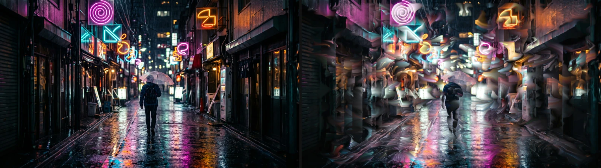

# Rom1

Watery smoke: bright parts of the picture smear along slowly drifting currents. Their trails build
up over time and fade. This was the original look of Acuarela.

Group: [Light & Stylize](../Effects-Stylize.md) · [How to add an effect](../Effects.md#add-an-effect)

<figure class="docs-shot">

<figcaption>Left: original. Right: Rom1 at its default settings, after 3 seconds.</figcaption>
</figure>

**Use it for:** dreamy, liquid light on stage footage · trails behind moving lights · an abstract,
smoky backdrop.

- **Strength** – how far the picture smears.
- **Speed** – how fast the currents drift.
- **Gain** – brightens the trails; above 0.25 it eases off, so high values wash the picture out but
  never turn it white.
- **History Loop** and **Reset** – whether the trails start fresh when playback loops, and a manual
  restart.

**Tip:** the trails build up while the clip plays; a single paused frame shows less.

## Controls

<!-- generated:controls start -->
| Control | Range | Default |
|---|---|---|
| History Loop | Reset, Continuous | Reset |
| Opacity | 0 to 1 | 1 |
| Gain | 0 to 1 | 0.01 |
| Speed | 0 to 40 | 4 |
| Detail | 0 to 8 | 4 |
| Strength | 0 to 1 | 0.32 |
| Density | 0 to 100 | 4 |
| Gain X | 0 to 1 | 0.3 |
| Gain Y | 0 to 1 | 0.3 |
| Reset | on or off | off |
<!-- generated:controls end -->

## Node setup

Rom1 is one flat graph without folders, a few hundred nodes. Four layers of noise make the drifting
currents; the effect reads its own previous frame (**Previous Output**) along them, keeps the
brighter of that and the lifted picture, and a **Mix** with Opacity blends the result with the
original.

**Remix:** select the **Value** 0.98 that feeds the **Multiply** of the previous frame and set it to
0.9: the trails fade much faster.

## Technical details

- **Feedback.** Every frame builds on the previous result, which fades by 0.98 per frame; History
  Loop and Reset control the restart: [Effect system](../Effect-System.md#editable-keying-and-feedback-graphs).
- **Gain.** The lift equals Gain up to 0.25, then eases towards 0.5, so the frame never turns white.
  Gain above 1 is reported.
- **Saved projects.** The Gain curve applies to saved effects too: up to 0.25 they look as before,
  higher Gain washes out where it used to turn white.
- **Software preview.** The worker software preview runs Rom1 on the CPU.
- Shared notes: [Light & Stylize](../Effects-Stylize.md#technical-details). Blocks:
  [Node Catalog](../Node-Catalog.md).
