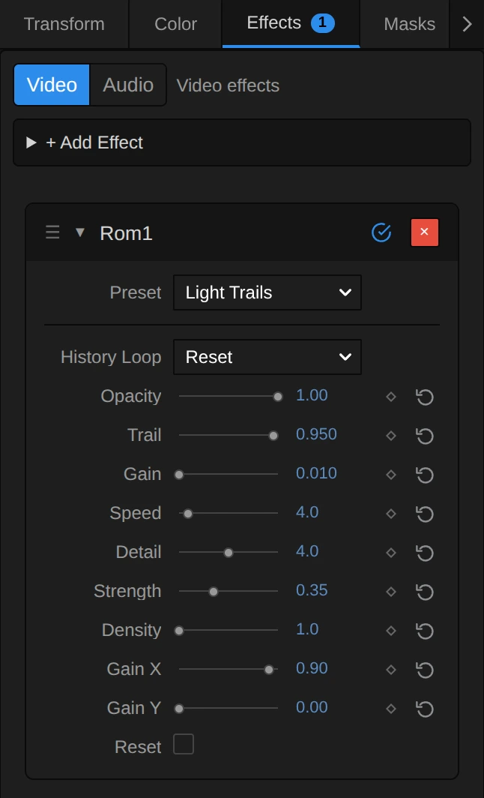
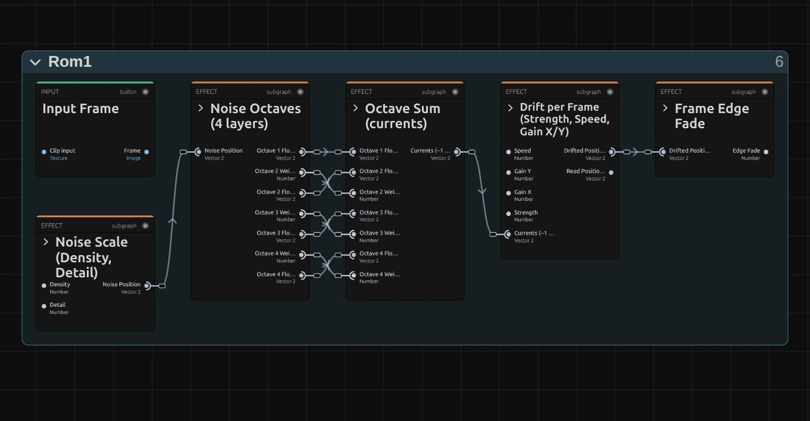
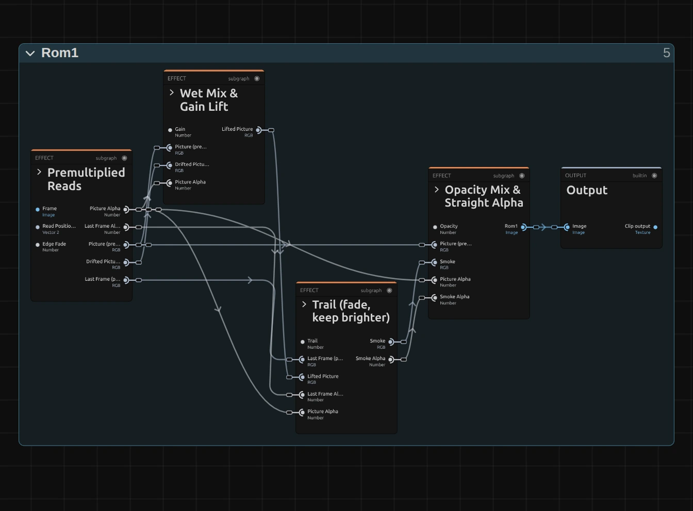
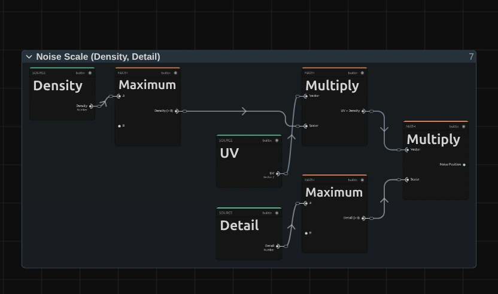
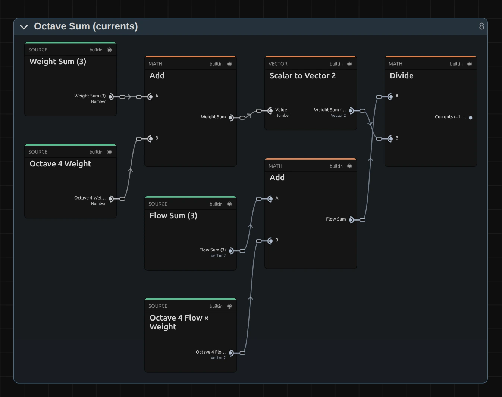
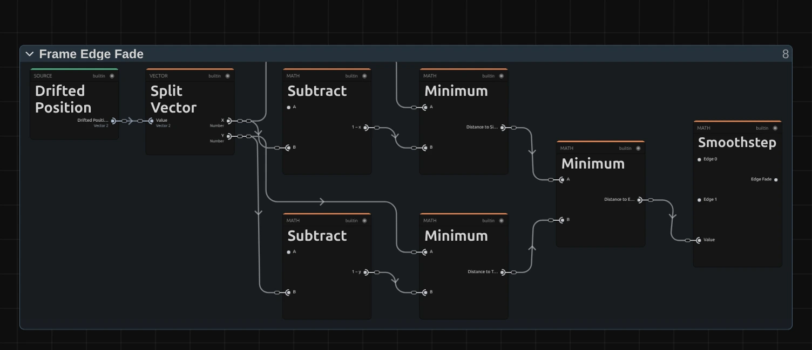

# Rom1

Watery smoke: bright parts of the picture leave trails that drift along slow, invisible currents and fade. For dreamlike movement, ghosts of a dancer and smoky light on stage.

Group: [Light & Stylize](../Effects-Stylize.md) · [How to add an effect](../Effects.md#add-an-effect)

<figure class="docs-shot docs-clip docs-compare docs-shot--float-left">
<video src="../assets/effects/clips/rom1.mp4" poster="../assets/effects/clips/rom1.webp" width="960" height="460" autoplay muted loop playsinline preload="none" aria-label="The dancer turning on a dark stage, original left and with Rom1 right: her white dress, arms and red hair leave soft, smoky trails that flow sideways and upwards in streaky currents and slowly fade, so every turn hangs in the air for a moment"></video>
<figcaption>Left: original. Right: Rom1 at its default settings.</figcaption>
</figure>

**Use it for:** ghostly trails behind dancers and moving lights · dreamy, liquid stage pictures · an abstract smoke backdrop from any footage.

- **Trail** – how long the smoke stays.
- **Strength** – how far it flows each frame.
- **Density** – how large the currents are.
- **Gain X** and **Gain Y** – sideways or up and down.

**Tip:** Rom1 builds on its own last frames, so it needs time and movement: the trails grow while the clip plays, and a single paused frame shows little. Keyframe **Trail** from 0.5 up to 0.98 to let the smoke rise on a cue.

## Presets

<figure class="docs-shot docs-clip">
<video src="../assets/effects/clips/rom1-presets.mp4" poster="../assets/effects/clips/rom1-presets.webp" width="962" height="938" autoplay muted loop playsinline preload="none" aria-label="The dancer four times in a grid, moving in sync, each with one preset: Soft Echo top left with faint trails beside her and her face clear, Light Trails top right with her arms and dress streaking sideways and her face readable, Dripping Light bottom left with long vertical streaks hanging below and above her, Smoke Storm bottom right with large swirling smoke that fills the stage"></video>
<figcaption>The four presets on the moving dancer, in sync.</figcaption>
</figure>

Pick one in the **Preset** row of the effect card. It sets all controls at once, in one undo step, and the row then shows its name until you change something. A control with keyframes keeps them, and the card says so.

**Soft Echo** – short, faint trails beside the figure at Opacity 0.6. Face and costume stay clear; a gentle afterglow for dance and slow movement.

**Light Trails** – the flow runs sideways only, so arms, lights and a dress streak across the frame; at Opacity 0.8 the face stays readable. Strong on turns and on lights passing by.

**Dripping Light** – the flow runs up and down only, fast and far (Speed 10, Strength 0.5), and the picture is lifted a little: every movement leaves long vertical streaks that hang and run like rain down a window.

**Smoke Storm** – long trails in fast, wide currents: the figure dissolves into swirling smoke. For a breakdown, a dream or a transition between scenes.

## Controls

<figure class="docs-shot docs-shot--float-right">

<svg class="docs-shot-overlay" viewBox="0 0 590 970" aria-hidden="true" focusable="false">
<defs><marker id="rom1-inspector-arrow" viewBox="0 0 10 10" refX="8" refY="5" markerWidth="5" markerHeight="5" orient="auto-start-reverse"><path d="M 0 0 L 10 5 L 0 10 Z" fill="#ffd54a" /></marker></defs>
<path class="docs-shot-arrow" d="M44 356 L128 356" marker-end="url(#rom1-inspector-arrow)" />
<circle class="docs-shot-number" cx="44" cy="356" r="18" /><text x="44" y="356" class="docs-shot-number-text">1</text>
<path class="docs-shot-arrow" d="M65 529 L149 529" marker-end="url(#rom1-inspector-arrow)" />
<circle class="docs-shot-number" cx="65" cy="529" r="18" /><text x="65" y="529" class="docs-shot-number-text">2</text>
<path class="docs-shot-arrow" d="M24 719 L108 719" marker-end="url(#rom1-inspector-arrow)" />
<circle class="docs-shot-number" cx="24" cy="719" r="18" /><text x="24" y="719" class="docs-shot-number-text">3</text>
<path class="docs-shot-arrow" d="M34 766 L118 766" marker-end="url(#rom1-inspector-arrow)" />
<circle class="docs-shot-number" cx="34" cy="766" r="18" /><text x="34" y="766" class="docs-shot-number-text">4</text>
<path class="docs-shot-arrow" d="M40 813 L124 813" marker-end="url(#rom1-inspector-arrow)" />
<circle class="docs-shot-number" cx="40" cy="813" r="18" /><text x="40" y="813" class="docs-shot-number-text">5</text>
</svg>

<figcaption>Rom1 with the Light Trails preset. 1 — Preset: pick a starting point. 2 — Trail: how long the smoke stays. 3 — Strength: how far it flows each frame. 4 — Density: how large the currents are. 5 — Gain X: the sideways share of the flow.</figcaption>
</figure>

Rom1 makes every frame from its own last one: it pushes that frame a little along the currents, keeps whichever is brighter, the picture or the smoke, and lets the smoke fade by **Trail**. Some controls overlap: **Strength** and **Speed** multiply each other, and so do **Density** and **Detail**. The **Preset** row sets them all at once.

**History Loop** – what happens to the smoke when playback loops back to the start. Reset clears it, so every pass starts clean, as on the first play; Continuous keeps the trails across the loop point, for an installation loop without a visible restart. Scrubbing or jumping always starts fresh. Two settings: Reset, Continuous, default Reset.

<figure class="docs-shot docs-clip docs-shot--float-right">
<video src="../assets/effects/clips/rom1-opacity.mp4" poster="../assets/effects/clips/rom1-opacity.webp" width="640" height="480" autoplay muted loop playsinline preload="none" aria-label="The dancer with Rom1 while Opacity runs from 0 to 1 and back: the clean footage gains smoky trails and loses them again; the current value is shown at the bottom left"></video>
<figcaption>Opacity from 0 to 1 and back.</figcaption>
</figure>

**Opacity** – how much of the smoke covers the original. 1 is the full effect, 0.5 keeps the footage clear under a soft haze of trails, 0 leaves the picture untouched. 0 to 1, default 1.

<figure class="docs-shot docs-clip docs-shot--float-right">
<video src="../assets/effects/clips/rom1-trail.mp4" poster="../assets/effects/clips/rom1-trail.webp" width="640" height="480" autoplay muted loop playsinline preload="none" aria-label="The dancer with Rom1 while Trail runs from 0.5 to 0.995 and back: at first only a faint smear clings to her edges, then long smoky trails build up behind every movement and fade again; the current value is shown at the bottom left"></video>
<figcaption>Trail from 0.5 to 0.995 and back.</figcaption>
</figure>

**Trail** – how much of the smoke stays from one frame to the next, so how long it lingers. 0.5 leaves only a faint smear at the edges, 0.9 short echoes, 0.98 long trails of about two seconds, 0.995 smoke that hardly fades. A higher value renders as 0.995, and the card says so. Each frame also fades the smoke by at least three quarters of an 8-bit step, so even 0.995 fades out completely, after about ten seconds, instead of leaving a grey ghost. It counts frames, so at a higher frame rate the smoke fades sooner. 0 to 0.995, default 0.98.

<figure class="docs-shot docs-clip docs-shot--float-right">
<video src="../assets/effects/clips/rom1-gain.mp4" poster="../assets/effects/clips/rom1-gain.webp" width="640" height="480" autoplay muted loop playsinline preload="none" aria-label="The dancer with Rom1 while Gain runs from 0 to 0.3 and back: the whole picture brightens and washes out towards a milky grey, the trails turn pale, then the colour comes back; the current value is shown at the bottom left"></video>
<figcaption>Gain from 0 to 0.3 and back.</figcaption>
</figure>

**Gain** – lifts the whole picture before it turns into smoke, so the trails get brighter and the picture paler. 0.01 is a hint, 0.05 a clear haze, 0.25 washes the picture out to grey. Above 0.25 the lift eases off towards 0.5, so even 1 never turns the frame white. 0 to 1, default 0.01.

**Speed** – the same as **Strength**, on a larger scale: the two multiply, so doubling one does the same as doubling the other, and the Strength loop below shows both. Set Speed for the overall pace (4 drifts slowly, 10 and more smears the figure into large swirls) and keyframe Strength. At 0 the smoke still trails behind moving things but no longer flows (the card says so). The currents themselves change slowly over time, whatever Speed is. 0 to 40, default 4.

**Detail** – the same as **Density**: the two multiply, so the Density loop below shows both. Low values give broad, slow sweeps, high values finer, more broken streaks. At 0 the currents merge into one wide stream (the card says so). 0 to 8, default 4.

<figure class="docs-shot docs-clip docs-shot--float-right">
<video src="../assets/effects/clips/rom1-strength.mp4" poster="../assets/effects/clips/rom1-strength.webp" width="640" height="480" autoplay muted loop playsinline preload="none" aria-label="The dancer with Rom1 while Strength runs from 0 to 1 and back: the trails start to flow and smear further and further into large swirling shapes, then calm down again; the current value is shown at the bottom left"></video>
<figcaption>Strength from 0 to 1 and back.</figcaption>
</figure>

**Strength** – how far the picture flows along the currents each frame. 0 stops the flow, so only the trail of moving things remains; 0.3 drifts gently; 1 smears the picture into large swirls. Use Strength for fine changes and keyframes, Speed for the overall pace. 0 to 1, default 0.32.

<figure class="docs-shot docs-clip docs-shot--float-right">
<video src="../assets/effects/clips/rom1-density.mp4" poster="../assets/effects/clips/rom1-density.webp" width="640" height="480" autoplay muted loop playsinline preload="none" aria-label="The dancer with Rom1 at Strength 0.4 and Trail 0.97 at three Density values for about 1.7 seconds each: at 1 her trails flow in a few broad, smooth sweeps, at 4 they ripple in wavy currents, at 16 they break into many small ragged shreds; the value is shown at the bottom left"></video>
<figcaption>Density 1, 4 and 16 at Strength 0.4, about 1.7 seconds each.</figcaption>
</figure>

**Density** – how many currents cross the frame, together with **Detail** (the two multiply): at the defaults, 4 × 4, about 16 across the width. 1 makes a few broad, smooth sweeps, 4 wavy currents, 16 many small, ragged ones; very high values break the smoke into grain. 0 to 100, default 4.

<figure class="docs-shot docs-clip docs-shot--float-right">
<video src="../assets/effects/clips/rom1-gain-x.mp4" poster="../assets/effects/clips/rom1-gain-x.webp" width="640" height="480" autoplay muted loop playsinline preload="none" aria-label="The dancer with Rom1 while Gain X runs from 0 to 1 and back: the trails spread more and more to the sides and narrow again; the current value is shown at the bottom left"></video>
<figcaption>Gain X from 0 to 1 and back.</figcaption>
</figure>

**Gain X** – how much of the flow runs sideways. With **Gain Y** at 0 the smoke streaks only left and right, as in Light Trails. It counts shares of the frame, so on a wide frame the same value travels further than Gain Y. 0 to 1, default 0.3.

<figure class="docs-shot docs-clip docs-shot--float-right">
<video src="../assets/effects/clips/rom1-gain-y.mp4" poster="../assets/effects/clips/rom1-gain-y.webp" width="640" height="480" autoplay muted loop playsinline preload="none" aria-label="The dancer with Rom1 while Gain Y runs from 0 to 1 and back: the trails spread more and more up and down and narrow again; the current value is shown at the bottom left"></video>
<figcaption>Gain Y from 0 to 1 and back.</figcaption>
</figure>

**Gain Y** – how much of the flow runs up and down. With **Gain X** at 0 the smoke runs only vertically, as in Dripping Light. The currents point both ways, so the smoke drips and climbs; it does not rise as a whole. 0 to 1, default 0.3.

**Reset** – clears the smoke at once when you switch it on; it then builds again from the current picture. Switch it off again before the next reset. A switch: on or off, default off.

## Node setup

<figure class="docs-shot docs-shot--graph">

<svg class="docs-shot-overlay" viewBox="0 0 1017 530" aria-hidden="true" focusable="false">
<defs><marker id="rom1-arrow" viewBox="0 0 10 10" refX="8" refY="5" markerWidth="5" markerHeight="5" orient="auto-start-reverse"><path d="M 0 0 L 10 5 L 0 10 Z" fill="#ffd54a" /></marker></defs>
<path class="docs-shot-arrow" d="M120 507 L120 423" marker-end="url(#rom1-arrow)" />
<circle class="docs-shot-number" cx="120" cy="507" r="18" /><text x="120" y="507" class="docs-shot-number-text">1</text>
<path class="docs-shot-arrow" d="M314 22 L314 96" marker-end="url(#rom1-arrow)" />
<circle class="docs-shot-number" cx="314" cy="22" r="18" /><text x="314" y="22" class="docs-shot-number-text">2</text>
<path class="docs-shot-arrow" d="M509 468 L509 384" marker-end="url(#rom1-arrow)" />
<circle class="docs-shot-number" cx="509" cy="468" r="18" /><text x="509" y="468" class="docs-shot-number-text">3</text>
<path class="docs-shot-arrow" d="M703 22 L703 96" marker-end="url(#rom1-arrow)" />
<circle class="docs-shot-number" cx="703" cy="22" r="18" /><text x="703" y="22" class="docs-shot-number-text">4</text>
<path class="docs-shot-arrow" d="M897 312 L897 228" marker-end="url(#rom1-arrow)" />
<circle class="docs-shot-number" cx="897" cy="312" r="18" /><text x="897" y="312" class="docs-shot-number-text">5</text>
</svg>

<figcaption>Rom1 opened in the Nodes tab, first half (Coordinates, Parameters, Constants and the later stages left out). 1 — Noise Scale: how large the currents are. 2 — Noise Octaves: four layers of noise. 3 — Octave Sum: the currents. 4 — Drift per Frame: where each pixel reads. 5 — Frame Edge Fade: no smoke from beyond the edge.</figcaption>
</figure>

<figure class="docs-shot docs-shot--graph">

<svg class="docs-shot-overlay" viewBox="0 0 1017 751" aria-hidden="true" focusable="false">
<defs><marker id="rom1-paint-arrow" viewBox="0 0 10 10" refX="8" refY="5" markerWidth="5" markerHeight="5" orient="auto-start-reverse"><path d="M 0 0 L 10 5 L 0 10 Z" fill="#ffd54a" /></marker></defs>
<path class="docs-shot-arrow" d="M120 533 L120 449" marker-end="url(#rom1-paint-arrow)" />
<circle class="docs-shot-number" cx="120" cy="533" r="18" /><text x="120" y="533" class="docs-shot-number-text">1</text>
<path class="docs-shot-arrow" d="M314 22 L314 96" marker-end="url(#rom1-paint-arrow)" />
<circle class="docs-shot-number" cx="314" cy="22" r="18" /><text x="314" y="22" class="docs-shot-number-text">2</text>
<path class="docs-shot-arrow" d="M509 727 L509 643" marker-end="url(#rom1-paint-arrow)" />
<circle class="docs-shot-number" cx="509" cy="727" r="18" /><text x="509" y="727" class="docs-shot-number-text">3</text>
<path class="docs-shot-arrow" d="M703 155 L703 239" marker-end="url(#rom1-paint-arrow)" />
<circle class="docs-shot-number" cx="703" cy="155" r="18" /><text x="703" y="155" class="docs-shot-number-text">4</text>
</svg>

<figcaption>Second half. 1 — Premultiplied Reads: the picture and the last frame. 2 — Wet Mix & Gain Lift: a little liquid, a little lifted. 3 — Trail: fade and keep the brighter. 4 — Opacity Mix: blend with the original.</figcaption>
</figure>

Rom1 works in nine stages, one folder each in the Nodes tab. **Noise Scale**, **Noise Octaves** and **Octave Sum** make the currents: four layers of noise that change slowly with the playhead. **Drift per Frame** turns them into the place each pixel reads from, and **Frame Edge Fade** keeps smoke from flowing in from outside the frame. **Premultiplied Reads** reads the picture and the last frame there, **Wet Mix & Gain Lift** blends a little of the drifted picture in and lifts it, **Trail** fades the last frame and keeps the brighter of the two, and **Opacity Mix** blends the result with the original. Click a folder's header to open it; the sections below show what is inside.

### Noise Scale (Density, Detail)

<figure class="docs-shot docs-shot--float-right">

<svg class="docs-shot-overlay" viewBox="0 0 590 349" aria-hidden="true" focusable="false">
<defs><marker id="rom1-noise-scale-arrow" viewBox="0 0 10 10" refX="8" refY="5" markerWidth="5" markerHeight="5" orient="auto-start-reverse"><path d="M 0 0 L 10 5 L 0 10 Z" fill="#ffd54a" /></marker></defs>
<path class="docs-shot-arrow" d="M175 263 L175 179" marker-end="url(#rom1-noise-scale-arrow)" />
<circle class="docs-shot-number" cx="175" cy="263" r="18" /><text x="175" y="263" class="docs-shot-number-text">1</text>
<path class="docs-shot-arrow" d="M397 22 L397 74" marker-end="url(#rom1-noise-scale-arrow)" />
<circle class="docs-shot-number" cx="397" cy="22" r="18" /><text x="397" y="22" class="docs-shot-number-text">2</text>
<path class="docs-shot-arrow" d="M517 327 L517 243" marker-end="url(#rom1-noise-scale-arrow)" />
<circle class="docs-shot-number" cx="517" cy="327" r="18" /><text x="517" y="327" class="docs-shot-number-text">3</text>
</svg>

<figcaption>Inside Noise Scale. 1 — Maximum: Density above 0. 2 — UV × Density: the frame in currents. 3 — Noise Position: where the noise is read.</figcaption>
</figure>

**Maximum** – keeps Density above 0 (at least 0.001); the other Maximum does the same for Detail, so a 0 never turns the currents into nothing.

**UV × Density** – the position of the pixel in the frame (0 to 1 each way), times Density.

**Noise Position** – times Detail as well: the place in the noise this pixel looks at. Both controls stretch the same number, which is why they act alike.

### Noise Octaves (4 layers)

<figure class="docs-shot docs-shot--graph">

<svg class="docs-shot-overlay" viewBox="0 0 1017 729" aria-hidden="true" focusable="false">
<defs><marker id="rom1-octaves-arrow" viewBox="0 0 10 10" refX="8" refY="5" markerWidth="5" markerHeight="5" orient="auto-start-reverse"><path d="M 0 0 L 10 5 L 0 10 Z" fill="#ffd54a" /></marker></defs>
<path class="docs-shot-arrow" d="M314 23 L314 107" marker-end="url(#rom1-octaves-arrow)" />
<circle class="docs-shot-number" cx="314" cy="23" r="18" /><text x="314" y="23" class="docs-shot-number-text">1</text>
<path class="docs-shot-arrow" d="M509 23 L509 107" marker-end="url(#rom1-octaves-arrow)" />
<circle class="docs-shot-number" cx="509" cy="23" r="18" /><text x="509" y="23" class="docs-shot-number-text">2</text>
<path class="docs-shot-arrow" d="M703 247 L703 331" marker-end="url(#rom1-octaves-arrow)" />
<circle class="docs-shot-number" cx="703" cy="247" r="18" /><text x="703" y="247" class="docs-shot-number-text">3</text>
<path class="docs-shot-arrow" d="M897 607 L897 523" marker-end="url(#rom1-octaves-arrow)" />
<circle class="docs-shot-number" cx="897" cy="607" r="18" /><text x="897" y="607" class="docs-shot-number-text">4</text>
</svg>

<figcaption>Inside Noise Octaves, the first layer, reduced to its recipe (the value noise inside and the other three layers are left out). 1 — Octave 1 Position: the layer's scale. 2 — Octave 1 Noise X Read: moved by the playhead. 3 — Octave 1 Flow (−1 to 1): a direction. 4 — Octave 1 Flow × Weight: the layer's share.</figcaption>
</figure>

**Octave 1 Position** – the Noise Position times the octave's scale: 1 for the first layer, then 2, 4 and 8, so every layer is twice as fine as the one before.

**Octave 1 Noise X Read** – shifts that place by the playhead (seconds × 0.071 and × 0.113, plus 13.37 per layer), so the currents change slowly while the clip plays. A second read at another place gives Noise Y. Each read is a smooth value noise of its own, about 25 cards inside the folder.

**Octave 1 Flow (−1 to 1)** – the two noises, between 0 and 1, doubled minus 1: a direction that can point any way.

**Octave 1 Flow × Weight** – the layer's share: 0.5 for the first layer, and 0.53 times that for each finer one.

### Octave Sum (currents)

<figure class="docs-shot docs-shot--graph">

<svg class="docs-shot-overlay" viewBox="0 0 1017 804" aria-hidden="true" focusable="false">
<defs><marker id="rom1-octave-sum-arrow" viewBox="0 0 10 10" refX="8" refY="5" markerWidth="5" markerHeight="5" orient="auto-start-reverse"><path d="M 0 0 L 10 5 L 0 10 Z" fill="#ffd54a" /></marker></defs>
<path class="docs-shot-arrow" d="M386 23 L386 107" marker-end="url(#rom1-octave-sum-arrow)" />
<circle class="docs-shot-number" cx="386" cy="23" r="18" /><text x="386" y="23" class="docs-shot-number-text">1</text>
<path class="docs-shot-arrow" d="M629 634 L629 550" marker-end="url(#rom1-octave-sum-arrow)" />
<circle class="docs-shot-number" cx="629" cy="634" r="18" /><text x="629" y="634" class="docs-shot-number-text">2</text>
<path class="docs-shot-arrow" d="M873 23 L873 107" marker-end="url(#rom1-octave-sum-arrow)" />
<circle class="docs-shot-number" cx="873" cy="23" r="18" /><text x="873" y="23" class="docs-shot-number-text">3</text>
</svg>

<figcaption>Inside Octave Sum, the last of four additions. 1 — Weight Sum: all four weights. 2 — Flow Sum: all four flows. 3 — Divide: the currents.</figcaption>
</figure>

**Weight Sum** – the four weights added up.

**Flow Sum** – the four weighted flows added up.

**Divide** – Flow Sum divided by Weight Sum: the currents, a direction between −1 and 1 for every pixel.

**Remix:** open the **Constants** folder and set **Amplitude Ratio** from 0.53 to 0.9: the fine layers count almost as much as the coarse one, and the smoke turns more ragged and finely broken.

### Drift per Frame (Strength, Speed, Gain X/Y)

<figure class="docs-shot docs-shot--graph">

<svg class="docs-shot-overlay" viewBox="0 0 1017 703" aria-hidden="true" focusable="false">
<defs><marker id="rom1-drift-arrow" viewBox="0 0 10 10" refX="8" refY="5" markerWidth="5" markerHeight="5" orient="auto-start-reverse"><path d="M 0 0 L 10 5 L 0 10 Z" fill="#ffd54a" /></marker></defs>
<path class="docs-shot-arrow" d="M432 22 L432 83" marker-end="url(#rom1-drift-arrow)" />
<circle class="docs-shot-number" cx="432" cy="22" r="18" /><text x="432" y="22" class="docs-shot-number-text">1</text>
<path class="docs-shot-arrow" d="M321 539 L321 455" marker-end="url(#rom1-drift-arrow)" />
<circle class="docs-shot-number" cx="321" cy="539" r="18" /><text x="321" y="539" class="docs-shot-number-text">2</text>
<path class="docs-shot-arrow" d="M564 256 L564 340" marker-end="url(#rom1-drift-arrow)" />
<circle class="docs-shot-number" cx="564" cy="256" r="18" /><text x="564" y="256" class="docs-shot-number-text">3</text>
<path class="docs-shot-arrow" d="M808 681 L808 597" marker-end="url(#rom1-drift-arrow)" />
<circle class="docs-shot-number" cx="808" cy="681" r="18" /><text x="808" y="681" class="docs-shot-number-text">4</text>
<path class="docs-shot-arrow" d="M940 261 L940 345" marker-end="url(#rom1-drift-arrow)" />
<circle class="docs-shot-number" cx="940" cy="261" r="18" /><text x="940" y="261" class="docs-shot-number-text">5</text>
</svg>

<figcaption>Inside Drift per Frame (the numbers 0.005 and −1 come from Constants). 1 — Drift Direction: Gain X and Gain Y. 2 — Drift Scale: how far per frame. 3 — Drift: currents times scale. 4 — Drifted Position: where the pixel reads. 5 — Clamp: inside the frame.</figcaption>
</figure>

**Drift Direction** – Gain X and minus Gain Y as one direction.

**Drift Scale** – times Strength, times 0.005, times Speed (at least 0.001): how far a pixel may read away in one frame, as a share of the frame.

**Drift** – the currents times the scale: how far and which way this pixel reads.

**Drifted Position** – the pixel's own place plus the drift.

**Clamp** – keeps the read inside the frame (0 to 1); **Frame Edge Fade** takes care of what lies beyond.

### Frame Edge Fade

<figure class="docs-shot docs-shot--graph">

<svg class="docs-shot-overlay" viewBox="0 0 1017 440" aria-hidden="true" focusable="false">
<defs><marker id="rom1-edge-fade-arrow" viewBox="0 0 10 10" refX="8" refY="5" markerWidth="5" markerHeight="5" orient="auto-start-reverse"><path d="M 0 0 L 10 5 L 0 10 Z" fill="#ffd54a" /></marker></defs>
<path class="docs-shot-arrow" d="M581 22 L581 80" marker-end="url(#rom1-edge-fade-arrow)" />
<circle class="docs-shot-number" cx="581" cy="22" r="18" /><text x="581" y="22" class="docs-shot-number-text">1</text>
<path class="docs-shot-arrow" d="M752 400 L752 316" marker-end="url(#rom1-edge-fade-arrow)" />
<circle class="docs-shot-number" cx="752" cy="400" r="18" /><text x="752" y="400" class="docs-shot-number-text">2</text>
<path class="docs-shot-arrow" d="M924 61 L924 145" marker-end="url(#rom1-edge-fade-arrow)" />
<circle class="docs-shot-number" cx="924" cy="61" r="18" /><text x="924" y="61" class="docs-shot-number-text">3</text>
</svg>

<figcaption>Inside Frame Edge Fade (the edges −0.005 and 0.025 come from Constants). 1 — Distance to Side: left or right. 2 — Distance to Edge: the nearest edge. 3 — Smoothstep: the fade.</figcaption>
</figure>

**Distance to Side** – the smaller of x and 1 − x: how close the drifted place is to the left or right edge. Its twin does the same for top and bottom.

**Distance to Edge** – the smaller of both.

**Smoothstep** – 0 just outside the frame, 1 from 2.5 % inside: the last frame fades in over that strip, so no smoke streams in from the edge.

### Premultiplied Reads

<figure class="docs-shot docs-shot--graph">

<svg class="docs-shot-overlay" viewBox="0 0 1017 658" aria-hidden="true" focusable="false">
<defs><marker id="rom1-reads-arrow" viewBox="0 0 10 10" refX="8" refY="5" markerWidth="5" markerHeight="5" orient="auto-start-reverse"><path d="M 0 0 L 10 5 L 0 10 Z" fill="#ffd54a" /></marker></defs>
<path class="docs-shot-arrow" d="M264 285 L264 201" marker-end="url(#rom1-reads-arrow)" />
<circle class="docs-shot-number" cx="264" cy="285" r="18" /><text x="264" y="285" class="docs-shot-number-text">1</text>
<path class="docs-shot-arrow" d="M752 143 L752 227" marker-end="url(#rom1-reads-arrow)" />
<circle class="docs-shot-number" cx="752" cy="143" r="18" /><text x="752" y="143" class="docs-shot-number-text">2</text>
<path class="docs-shot-arrow" d="M914 313 L914 229" marker-end="url(#rom1-reads-arrow)" />
<circle class="docs-shot-number" cx="914" cy="313" r="18" /><text x="914" y="313" class="docs-shot-number-text">3</text>
</svg>

<figcaption>Inside Premultiplied Reads, the read of the last frame (the two reads of the picture are left out). 1 — Sample Image: the last frame. 2 — Last Frame Alpha (faded at edges): no smoke from outside. 3 — Last Frame (premultiplied): colour × transparency.</figcaption>
</figure>

**Sample Image** – reads the last frame (the frame history) at the drifted place. Two more reads, left out here, take the picture at the pixel itself and at the drifted place.

**Last Frame Alpha (faded at edges)** – the last frame's transparency times the edge fade.

**Last Frame (premultiplied)** – its colour times that transparency. Working with colour × transparency is what keeps the smoke beside a cut-out figure in its own colour as it fades.

### Wet Mix & Gain Lift

<figure class="docs-shot docs-shot--graph">

<svg class="docs-shot-overlay" viewBox="0 0 1017 889" aria-hidden="true" focusable="false">
<defs><marker id="rom1-lift-arrow" viewBox="0 0 10 10" refX="8" refY="5" markerWidth="5" markerHeight="5" orient="auto-start-reverse"><path d="M 0 0 L 10 5 L 0 10 Z" fill="#ffd54a" /></marker></defs>
<path class="docs-shot-arrow" d="M589 592 L589 508" marker-end="url(#rom1-lift-arrow)" />
<circle class="docs-shot-number" cx="589" cy="592" r="18" /><text x="589" y="592" class="docs-shot-number-text">1</text>
<path class="docs-shot-arrow" d="M264 22 L264 102" marker-end="url(#rom1-lift-arrow)" />
<circle class="docs-shot-number" cx="264" cy="22" r="18" /><text x="264" y="22" class="docs-shot-number-text">2</text>
<path class="docs-shot-arrow" d="M914 22 L914 102" marker-end="url(#rom1-lift-arrow)" />
<circle class="docs-shot-number" cx="914" cy="22" r="18" /><text x="914" y="22" class="docs-shot-number-text">3</text>
</svg>

<figcaption>Inside Wet Mix & Gain Lift, reduced to its recipe (the knee's inner cards are left out). 1 — Wet Picture: 18 % of the drifted picture. 2 — Gain Lift: Gain after its knee. 3 — Clamp: within the picture's coverage.</figcaption>
</figure>

**Wet Picture** – mixes 18 % of the drifted picture into the picture itself (Wet Factor 0.18), so the footage looks a little liquid even without trails.

**Gain Lift** – Gain after its knee: unchanged up to 0.25, then easing towards 0.5. It is added to every colour, times the picture's transparency.

**Clamp** – keeps the lifted picture between 0 and the picture's own transparency, so the lift never reaches beyond a cut-out.

**Remix:** select **Wet Factor** and set it from 0.18 to 0.6: the picture itself flows along the currents, as if seen through running water.

### Trail (fade, keep brighter)

<figure class="docs-shot docs-shot--graph">

<svg class="docs-shot-overlay" viewBox="0 0 1017 565" aria-hidden="true" focusable="false">
<defs><marker id="rom1-trail-arrow" viewBox="0 0 10 10" refX="8" refY="5" markerWidth="5" markerHeight="5" orient="auto-start-reverse"><path d="M 0 0 L 10 5 L 0 10 Z" fill="#ffd54a" /></marker></defs>
<path class="docs-shot-arrow" d="M204 543 L204 459" marker-end="url(#rom1-trail-arrow)" />
<circle class="docs-shot-number" cx="204" cy="543" r="18" /><text x="204" y="543" class="docs-shot-number-text">1</text>
<path class="docs-shot-arrow" d="M326 37 L326 121" marker-end="url(#rom1-trail-arrow)" />
<circle class="docs-shot-number" cx="326" cy="37" r="18" /><text x="326" y="37" class="docs-shot-number-text">2</text>
<path class="docs-shot-arrow" d="M691 208 L691 292" marker-end="url(#rom1-trail-arrow)" />
<circle class="docs-shot-number" cx="691" cy="208" r="18" /><text x="691" y="208" class="docs-shot-number-text">3</text>
<path class="docs-shot-arrow" d="M813 22 L813 44" marker-end="url(#rom1-trail-arrow)" />
<circle class="docs-shot-number" cx="813" cy="22" r="18" /><text x="813" y="22" class="docs-shot-number-text">4</text>
<path class="docs-shot-arrow" d="M935 208 L935 292" marker-end="url(#rom1-trail-arrow)" />
<circle class="docs-shot-number" cx="935" cy="208" r="18" /><text x="935" y="208" class="docs-shot-number-text">5</text>
</svg>

<figcaption>Inside Trail (fade, keep brighter), reduced to its recipe (the transparency takes the same steps). 1 — Trail (kept in range): the control, 0 to 0.995. 2 — Faded Trail: the last frame times Trail. 3 — Missing Fade: what the fade lacks of 3/4 step. 4 — Faded Trail (at least a step): always a little fainter. 5 — Smoke: the brighter of trail and picture.</figcaption>
</figure>

**Trail (kept in range)** – the Trail control, kept between 0 and 0.995.

**Faded Trail** – the last frame times Trail: the smoke, a little fainter than a frame ago.

**Missing Fade** – the frame history keeps 8 bits per channel, so a fade smaller than half a step would round back to the same value and the smoke would never quite go. The two Subtract cards before it measure how much the fade by Trail falls short of the Fade Floor (three quarters of a step); Maximum with Zero keeps only a shortfall.

**Faded Trail (at least a step)** – the Faded Trail minus that shortfall: every frame the smoke fades by at least three quarters of a step, so even Trail 0.995 fades out completely. Bright smoke fades by Trail alone; only the last faint tail is affected.

**Smoke** – the brighter of this faded trail and the lifted picture, colour by colour. Bright things leave smoke behind; dark things cannot cover it. The transparency goes through the same steps (Smoke Alpha), so smoke can lie over transparent parts of a layer.

### Opacity Mix & Straight Alpha

<figure class="docs-shot docs-shot--graph">

<svg class="docs-shot-overlay" viewBox="0 0 1017 1035" aria-hidden="true" focusable="false">
<defs><marker id="rom1-finish-arrow" viewBox="0 0 10 10" refX="8" refY="5" markerWidth="5" markerHeight="5" orient="auto-start-reverse"><path d="M 0 0 L 10 5 L 0 10 Z" fill="#ffd54a" /></marker></defs>
<path class="docs-shot-arrow" d="M509 675 L509 591" marker-end="url(#rom1-finish-arrow)" />
<circle class="docs-shot-number" cx="509" cy="675" r="18" /><text x="509" y="675" class="docs-shot-number-text">1</text>
<path class="docs-shot-arrow" d="M314 450 L314 366" marker-end="url(#rom1-finish-arrow)" />
<circle class="docs-shot-number" cx="314" cy="450" r="18" /><text x="314" y="450" class="docs-shot-number-text">2</text>
<path class="docs-shot-arrow" d="M703 23 L703 107" marker-end="url(#rom1-finish-arrow)" />
<circle class="docs-shot-number" cx="703" cy="23" r="18" /><text x="703" y="23" class="docs-shot-number-text">3</text>
<path class="docs-shot-arrow" d="M897 450 L897 366" marker-end="url(#rom1-finish-arrow)" />
<circle class="docs-shot-number" cx="897" cy="450" r="18" /><text x="897" y="450" class="docs-shot-number-text">4</text>
</svg>

<figcaption>Inside Opacity Mix & Straight Alpha, reduced to its recipe (turning the colour back into an image is left out). 1 — Mixed (premultiplied): picture and smoke by Opacity. 2 — Mixed Alpha: transparency by Opacity. 3 — Divide: back to plain colour. 4 — Clamp: 0 to 1.</figcaption>
</figure>

**Mixed (premultiplied)** – blends the picture and the smoke by Opacity.

**Mixed Alpha** – blends their transparency the same way.

**Divide** – colour divided by transparency (at least 0.001): back from colour × transparency to the plain colour the next effect expects.

**Clamp** – keeps the colour between 0 and 1.

## Technical details

- **Feedback.** Every frame builds on the effect's own last result. Seeking, jumping back, editing its node setup and the start of an export clear it; History Loop and Reset decide what a playback loop and a manual reset do: [Effect system](../Effect-System.md#editable-keying-and-feedback-graphs).
- **Per frame.** Trail and the flow count frames, not seconds: the export renders every frame of its frame rate, and a higher frame rate gives shorter, slower-moving smoke.
- **Size.** The currents and the flow count shares of the frame, so a 4K export shows the same smoke as 1080p. On a wide frame a Gain X value travels further in pixels than the same Gain Y.
- **Transparency.** The smoke is kept as colour × transparency: beside a cut-out layer it fades in transparency and keeps its colour.
- **Limits.** Gain above 1 or below 0, Opacity outside 0–1, Trail above 0.995 or below 0, and Speed, Detail or Density at or below 0 are reported in the card and the tool result.
- **Saved projects.** A Rom1 saved before 2026-10-22 opens with Trail 0.98, the value it always used. Its untouched node setup is upgraded to the colour × transparency smoke: a bug fix, since smoke beside a cut-out layer used to turn dark; on an opaque layer it paints the same pixels. An edited node setup keeps its own recipe.
- **Software preview.** The worker software preview runs Rom1 on the CPU with the same math, including the fade floor on its 8-bit history, so trails fade out there as in the GPU preview and the export.
- **More:** [Effect system](../Effect-System.md#editable-keying-and-feedback-graphs) · [Light & Stylize notes](../Effect-System.md#light--stylize-notes) · [Node Catalog](../Node-Catalog.md) · [Styles and presets](../Effects.md#styles-and-presets).
