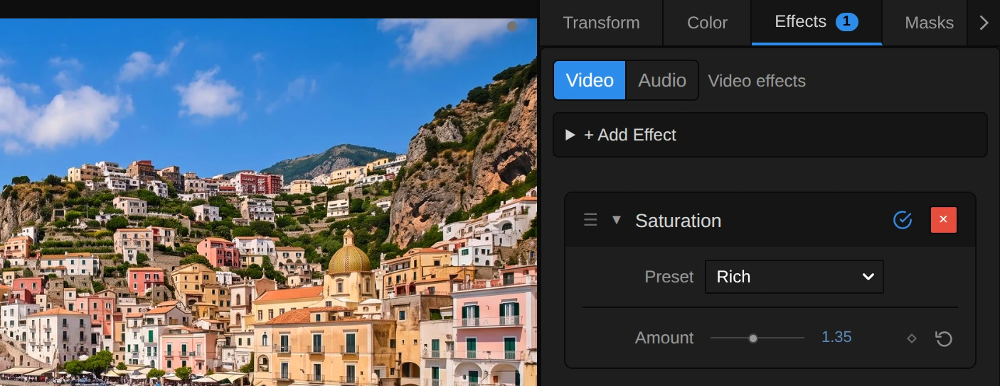
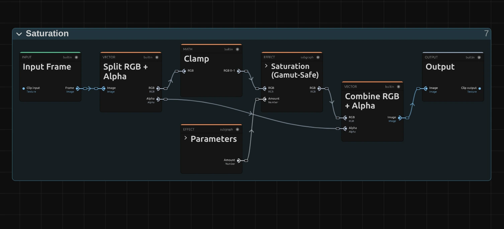
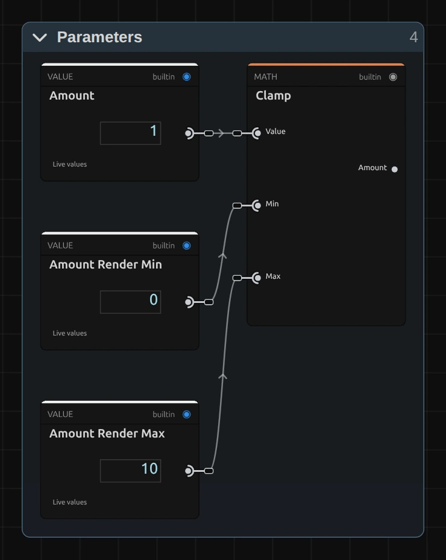
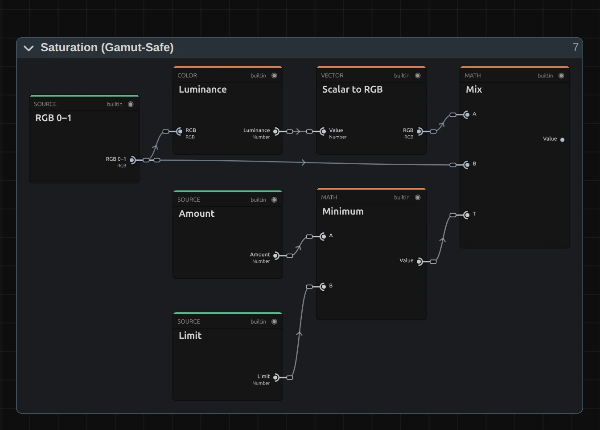

# Saturation

Makes colours stronger or weaker, from black and white to rich and glowing. When you push it, every colour stops at the strongest version the screen can show, so it keeps its shade and its brightness instead of turning into a flat block.

Group: [Color & Tone](../Effects-Color.md) · [How to add an effect](../Effects.md#add-an-effect)

<figure class="docs-shot docs-compare">

<figcaption>Left: original. Right: Amount 1.8 (the Vivid preset).</figcaption>
</figure>

**Use it for:** dull, washed-out footage · a black-and-white picture · a quiet, muted mood · matching the colour strength of two shots.

- **Amount** – 0 is black and white, 1 unchanged, 1.3–1.8 rich.

**Tip:** keyframe Amount from 0 up to 1 to let the colour flow into a black-and-white scene, for a memory that turns into the present. On faces in close-up, use [Vibrance](./vibrance.md) instead, so skin does not turn orange.

## Presets

<figure class="docs-shot docs-shot--detail">

<figcaption>The four presets on the harbour town.</figcaption>
</figure>

Pick one in the **Preset** row of the effect card. It sets Amount in one undo step, and the row then shows its name until you change the value. A keyframed Amount keeps its keyframes, and the card says so.

**Black & White** – no colour at all (Amount 0). Each pixel becomes the grey of its own brightness, measured the way the eye sees it: green counts most, blue least.

**Faded** – only a memory of colour is left (Amount 0.3), like an old photograph or a flashback. The brightness stays as it was.

**Rich** – fuller colour without a garish look (Amount 1.35). A good first step for dull or washed-out footage.

**Vivid** – strong, glowing colour (Amount 1.8). The brightest colours have reached the edge of what the screen can show and stay there, so the sky does not clip into a flat blue and white stays white.

## Controls

<figure class="docs-shot">

<svg class="docs-shot-overlay" viewBox="0 0 1017 393" aria-hidden="true" focusable="false">
<defs><marker id="saturation-inspector-arrow" viewBox="0 0 10 10" refX="8" refY="5" markerWidth="5" markerHeight="5" orient="auto-start-reverse"><path d="M 0 0 L 10 5 L 0 10 Z" fill="#ffd54a" /></marker></defs>
<path class="docs-shot-arrow" d="M565 282 L649 282" marker-end="url(#saturation-inspector-arrow)" />
<circle class="docs-shot-number" cx="565" cy="282" r="18" /><text x="565" y="282" class="docs-shot-number-text">1</text>
<path class="docs-shot-arrow" d="M555 344 L639 344" marker-end="url(#saturation-inspector-arrow)" />
<circle class="docs-shot-number" cx="555" cy="344" r="18" /><text x="555" y="344" class="docs-shot-number-text">2</text>
</svg>

<figcaption>Saturation with the Rich preset. 1 — Preset: pick a starting point. 2 — Amount: weaker or stronger colour.</figcaption>
</figure>

**Preset** – one of the four starting points above; it sets Amount.

<figure class="docs-shot docs-clip docs-shot--float-right">
<video src="../assets/effects/clips/saturation-amount.mp4" poster="../assets/effects/clips/saturation-amount.webp" width="720" height="540" autoplay muted loop playsinline preload="none" aria-label="The dancer turning on a dark stage with Saturation while Amount runs from 0 to 1.8 and back: first the whole picture is black and white, then the warm stage light, her skin and the blue backlight come back and grow strong and glowing, while the brightness of every part stays the same; the current value is shown at the bottom left"></video>
<figcaption>Amount from 0 to 1.8 and back.</figcaption>
</figure>

**Amount** – how strong the colours are. 0 is black and white, 1 leaves the picture as it is, and below 1 the colours fade toward grey. Above 1 they grow stronger: 1.2 is a gentle lift, 1.5–1.8 rich and glowing. Each colour stops where its first colour channel reaches full or nothing, so the strongest colours stop growing first and higher values change less and less; 3 looks only a little stronger than 2. On dark, compressed footage high values also bring out coloured noise in the shadows. 0 to 3, default 1. In the number field you can type up to 10; beyond that, and below 0, the picture uses the limit and the inspector says so.

## Node setup

<figure class="docs-shot docs-shot--graph">

<svg class="docs-shot-overlay" viewBox="0 0 1017 465" aria-hidden="true" focusable="false">
<defs><marker id="saturation-arrow" viewBox="0 0 10 10" refX="8" refY="5" markerWidth="5" markerHeight="5" orient="auto-start-reverse"><path d="M 0 0 L 10 5 L 0 10 Z" fill="#ffd54a" /></marker></defs>
<path class="docs-shot-arrow" d="M427 442 L427 358" marker-end="url(#saturation-arrow)" />
<circle class="docs-shot-number" cx="427" cy="442" r="18" /><text x="427" y="442" class="docs-shot-number-text">1</text>
<path class="docs-shot-arrow" d="M427 22 L427 83" marker-end="url(#saturation-arrow)" />
<circle class="docs-shot-number" cx="427" cy="22" r="18" /><text x="427" y="22" class="docs-shot-number-text">2</text>
<path class="docs-shot-arrow" d="M589 22 L589 99" marker-end="url(#saturation-arrow)" />
<circle class="docs-shot-number" cx="589" cy="22" r="18" /><text x="589" y="22" class="docs-shot-number-text">3</text>
</svg>

<figcaption>Saturation opened in the Nodes tab (the Constants folder left out). 1 — Parameters: Amount, kept within its range. 2 — Clamp: keeps the colour within 0 to 1. 3 — Saturation (Gamut-Safe): mixes between grey and colour, never past the edge.</figcaption>
</figure>

Saturation works in one block: **Parameters** holds Amount, **Clamp** keeps each colour channel of the picture between 0 and 1, and **Saturation (Gamut-Safe)** does the work. **Split RGB + Alpha** takes the transparency aside first and **Combine RGB + Alpha** puts it back untouched. Every colour effect has this shape ([Color & Tone](../Effects-Color.md#the-shared-idea)). Click a folder's header to open it; the sections below show what is inside. The same block is in **right-click → Reusable Nodes**, and [Vibrance](./vibrance.md) uses it too.

### Parameters

<figure class="docs-shot docs-shot--float-right">

<svg class="docs-shot-overlay" viewBox="0 0 590 740" aria-hidden="true" focusable="false">
<defs><marker id="saturation-parameters-arrow" viewBox="0 0 10 10" refX="8" refY="5" markerWidth="5" markerHeight="5" orient="auto-start-reverse"><path d="M 0 0 L 10 5 L 0 10 Z" fill="#ffd54a" /></marker></defs>
<path class="docs-shot-arrow" d="M432 521 L432 437" marker-end="url(#saturation-parameters-arrow)" />
<circle class="docs-shot-number" cx="432" cy="521" r="18" /><text x="432" y="521" class="docs-shot-number-text">1</text>
</svg>

<figcaption>Inside Parameters. 1 — Clamp: keeps Amount between 0 and 10.</figcaption>
</figure>

**Clamp** – keeps Amount between 0 and 10, the values in **Amount Render Min** and **Amount Render Max**. Below 0 there is no colour less than none (a negative of the colours is [Invert](./invert.md)), and above 10 nothing visible changes any more. A keyframe, a node or the AI agent may send more; the block then uses the limit, and the card and the tool result say so.

### Saturation (Gamut-Safe)

The block has two parts: a mix between grey and colour, and the limit that keeps that mix inside what the screen can show.

<figure class="docs-shot docs-shot--graph">

<svg class="docs-shot-overlay" viewBox="0 0 1017 730" aria-hidden="true" focusable="false">
<defs><marker id="saturation-mix-arrow" viewBox="0 0 10 10" refX="8" refY="5" markerWidth="5" markerHeight="5" orient="auto-start-reverse"><path d="M 0 0 L 10 5 L 0 10 Z" fill="#ffd54a" /></marker></defs>
<path class="docs-shot-arrow" d="M386 22 L386 106" marker-end="url(#saturation-mix-arrow)" />
<circle class="docs-shot-number" cx="386" cy="22" r="18" /><text x="386" y="22" class="docs-shot-number-text">1</text>
<path class="docs-shot-arrow" d="M629 633 L629 549" marker-end="url(#saturation-mix-arrow)" />
<circle class="docs-shot-number" cx="629" cy="633" r="18" /><text x="629" y="633" class="docs-shot-number-text">2</text>
<path class="docs-shot-arrow" d="M873 22 L873 106" marker-end="url(#saturation-mix-arrow)" />
<circle class="docs-shot-number" cx="873" cy="22" r="18" /><text x="873" y="22" class="docs-shot-number-text">3</text>
</svg>

<figcaption>Inside Saturation (Gamut-Safe), the mix (the limit comes in as a stub). 1 — Luminance: the grey of each pixel. 2 — Minimum: Amount, but never past the limit. 3 — Mix: from grey to colour and beyond.</figcaption>
</figure>

**Luminance** – the brightness of each pixel as the eye sees it (Rec.709: 21 % red, 72 % green, 7 % blue). **Scalar to RGB** turns it into a grey of the same brightness.

**Minimum** – takes the smaller of **Amount** and the **Limit** below. Up to the limit Amount acts as it is; past it the colour of that pixel stays where it is.

**Mix** – blends from **A**, the grey, to **B**, the original colour, by **T**: 0 gives the grey, 1 the original, and above 1 the mix goes beyond the colour, away from the grey. Since the grey has the brightness of the colour, the brightness stays the same at every value.

**Remix:** wire **Amount** straight into **T** of **Mix**, past the Minimum: you get the classic, harsher saturation, where strong colours run into the edge, clip and change their shade.

<figure class="docs-shot docs-shot--graph">

<svg class="docs-shot-overlay" viewBox="0 0 1017 847" aria-hidden="true" focusable="false">
<defs><marker id="saturation-limit-arrow" viewBox="0 0 10 10" refX="8" refY="5" markerWidth="5" markerHeight="5" orient="auto-start-reverse"><path d="M 0 0 L 10 5 L 0 10 Z" fill="#ffd54a" /></marker></defs>
<path class="docs-shot-arrow" d="M230 331 L230 247" marker-end="url(#saturation-limit-arrow)" />
<circle class="docs-shot-number" cx="230" cy="331" r="18" /><text x="230" y="331" class="docs-shot-number-text">1</text>
<path class="docs-shot-arrow" d="M508 23 L508 107" marker-end="url(#saturation-limit-arrow)" />
<circle class="docs-shot-number" cx="508" cy="23" r="18" /><text x="508" y="23" class="docs-shot-number-text">2</text>
<path class="docs-shot-arrow" d="M787 23 L787 107" marker-end="url(#saturation-limit-arrow)" />
<circle class="docs-shot-number" cx="787" cy="23" r="18" /><text x="787" y="23" class="docs-shot-number-text">3</text>
<path class="docs-shot-arrow" d="M787 492 L787 408" marker-end="url(#saturation-limit-arrow)" />
<circle class="docs-shot-number" cx="787" cy="492" r="18" /><text x="787" y="492" class="docs-shot-number-text">4</text>
<path class="docs-shot-arrow" d="M926 23 L926 107" marker-end="url(#saturation-limit-arrow)" />
<circle class="docs-shot-number" cx="926" cy="23" r="18" /><text x="926" y="23" class="docs-shot-number-text">5</text>
</svg>

<figcaption>Inside Saturation (Gamut-Safe), the limit (the constants 0, 1 and 0.000001 are left out). 1 — Subtract: the colour without its grey. 2 — Largest Component: the channel furthest above the grey. 3 — Divide: how far until that channel reaches 1. 4 — Divide: how far until the lowest channel reaches 0. 5 — Minimum: the nearer of the two edges.</figcaption>
</figure>

**Subtract** – the colour minus its grey: what makes the pixel coloured. A grey pixel has nothing left here.

**Largest Component** – the channel that lies furthest above the grey; **Smallest Component** the one furthest below it, which **Subtract** turns into a positive distance. The two **Maximum** cards keep both at least 0.000001, so a grey pixel does not divide by zero.

**Divide** (top) – the room up to white (**Subtract**: 1 minus the grey) divided by the largest channel: the Amount at which that channel reaches 1.

**Divide** (bottom) – the grey divided by the lowest channel's distance: the Amount at which that channel reaches 0.

**Minimum** – the nearer of the two edges. That is the **Limit**: the strongest Amount at which this pixel still keeps its shade. For a grey pixel it is huge, so grey stays grey at every Amount.

## Technical details

- **Formula.** `y = L + (x − L) · min(Amount, limit)` with `L = 0.2126 R + 0.7152 G + 0.0722 B` (Rec.709), and `limit` the Amount at which the first channel reaches 0 or 1. An orange of (0.9, 0.5, 0.2) reaches its limit at Amount 1.3 as (1, 0.48, 0.09) and stays there; its brightness stays 0.56 throughout.
- **Range.** The slider covers 0 to 3; typed values, keyframes and nodes render up to 10. Below 0 and above 10 the block uses the limit, and the inspector and the tool result say so.
- **Colour.** Hue and brightness stay; only the distance from grey changes. Pure black, white and grey stay as they are at every value.
- **Transparency.** Only the colour is changed; the transparency passes through untouched.
- What all colour effects share (8-bit range, saved projects, adjustment layers): [Color & Tone](../Effect-System.md#color--tone-notes). Formulas: [Effect system](../Effect-System.md#editable-color-effect-graphs); blocks: [Node Catalog](../Node-Catalog.md) · [Styles and presets](../Effects.md#styles-and-presets).
