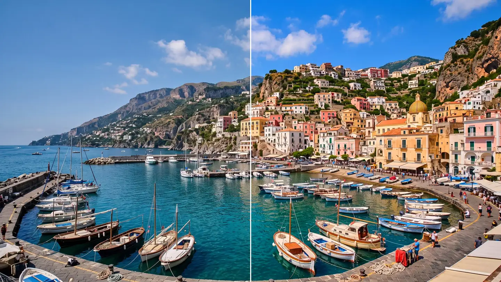

# Saturation

Makes colours stronger or weaker, from black and white to rich. When you push it, every colour
stops at the strongest version the screen can show, so it keeps its shade instead of turning into
a flat block.

Group: [Color & Tone](../Effects-Color.md) · [How to add an effect](../Effects.md#add-an-effect)

<figure class="docs-shot">

<figcaption>Left: original. Right: Amount 1.6.</figcaption>
</figure>

**Use it for:** dull, washed-out footage · a black-and-white picture (Amount 0) · a muted, quiet
mood (below 1).

- **Amount** – 0 is black and white, 1 unchanged, 1.3–1.6 rich.

**Tip:** on people, use [Vibrance](./vibrance.md) instead, so skin does not turn orange.

## Controls

<!-- generated:controls start -->
| Control | Range | Default |
|---|---|---|
| Amount | 0 to 3 | 1 |
<!-- generated:controls end -->

## Node setup

The work happens in **Saturation (Gamut-Safe)**. **Luminance** measures the grey of each pixel, and
**Mix** goes from that grey (Amount 0) through the original colour (1) and beyond. Before the Mix,
the last **Minimum** lowers the Amount to the point where the first colour channel would reach 0 or
1, so the hue and the brightness stay. The same block is in **right-click → Reusable Nodes**.

**Remix:** for the classic, harsher saturation that lets colours clip, plug the **Amount** straight
into input T of **Mix**, past the last **Minimum**.

## Technical details

- **Formula.** A mix with the Rec.709 brightness, stopped where the first channel reaches 0 or 1
  (hue and brightness stay).
- **Range.** The slider covers 0 to 3; typed values render up to 10, and the inspector reports
  anything beyond that.
- Shared colour notes: [Color & Tone](../Effects-Color.md#technical-details). Formulas:
  [Effect system](../Effect-System.md#editable-color-effect-graphs); blocks:
  [Node Catalog](../Node-Catalog.md).
