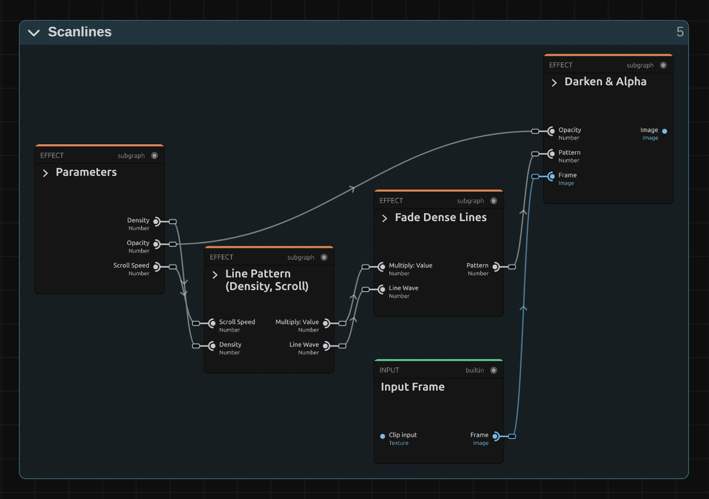

# Scanlines

Lays fine horizontal lines over the picture, like an old TV or computer monitor. They can roll
slowly up the picture.

Group: [Analog & Glitch](../Effects-Analog.md) · [How to add an effect](../Effects.md#add-an-effect)

<figure class="docs-shot">

<figcaption>Left: original. Right: Density 4, Opacity 0.55.</figcaption>
</figure>

**Use it for:** a retro screen or surveillance look · footage that should look filmed off a
monitor · a texture behind titles.

- **Density** – how many lines: 5 gives about 80 lines from top to bottom.
- **Opacity** – how dark the lines are.
- **Scroll Speed** – lets the lines roll slowly up the picture.

**Tip:** lines too close to show at the current size blend into an even darkening instead of
flickering, so a small preview can look smoother than the full-size export. Judge Density at full
size.

## Controls

<!-- generated:controls start -->
| Control | Range | Default |
|---|---|---|
| Density | 1 to 20 | 5 |
| Opacity | 0 to 1 | 0.3 |
| Scroll Speed | 0 to 5 | 0 |

The effect card also has controls of its own that this table does not list.
<!-- generated:controls end -->

## Node setup

<figure class="docs-shot docs-shot--graph">

<figcaption>Scanlines with the Constants and Coordinates folders and the Output card left out.</figcaption>
</figure>

**Line Pattern** makes a sine wave down the frame height, its frequency from Density and its phase
moving with time × Scroll Speed. **Fade Dense Lines** blends lines that are too close to show into
their even average, and **Darken & Alpha** darkens the picture by the pattern times Opacity.

**Remix:** for vertical lines, open **Line Pattern (Density, Scroll)** and drag the cable from the
**X** output of **Split Vector** into the **Add**, in place of **Y**. The lines now run from top to
bottom, and Scroll Speed moves them sideways.

## Technical details

- **Pattern.** `0.5 + 0.5 · sin((v + time · Scroll Speed · 0.1) · Density · 100)` over the frame
  height v (0–1), so Density 5 gives about 80 lines at any resolution.
- **Dense lines** fade into their even average below a 4 px line spacing (fully at 2 px), and the
  effect card says so. Opacity is limited to 0–1.
- **Saved projects.** A Scanlines saved before 2026-10-21 keeps its earlier look, which can flicker
  with very dense lines; its card offers **Use the new Scanlines**. The Scanline Glitch transition
  uses the current recipe.
- **Software preview.** The worker software preview fades too dense lines like the graph, but shows
  the Scanline Glitch transition's lines without that fade.
- Shared notes on stylize recipes: [Light & Stylize](../Effects-Stylize.md#technical-details).
  Formulas: [Effect system](../Effect-System.md#editable-color-effect-graphs); blocks:
  [Node Catalog](../Node-Catalog.md).
