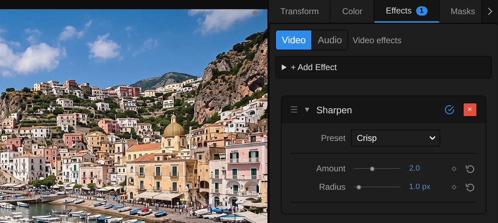
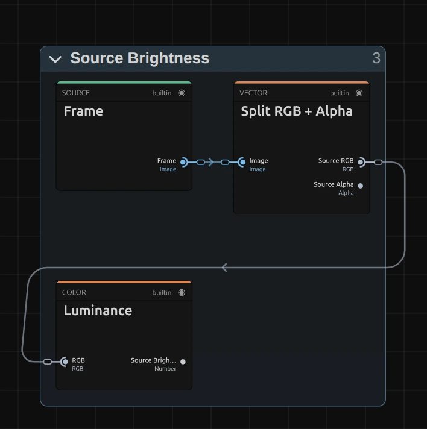
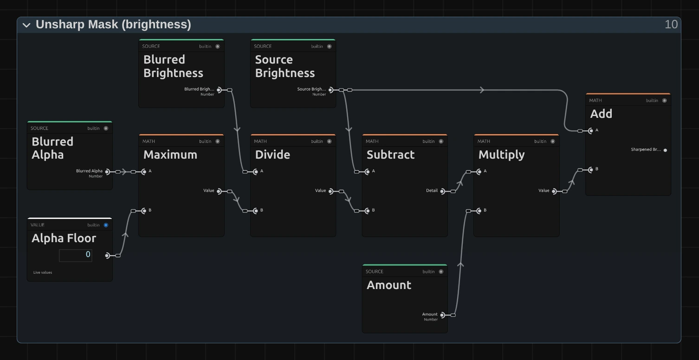
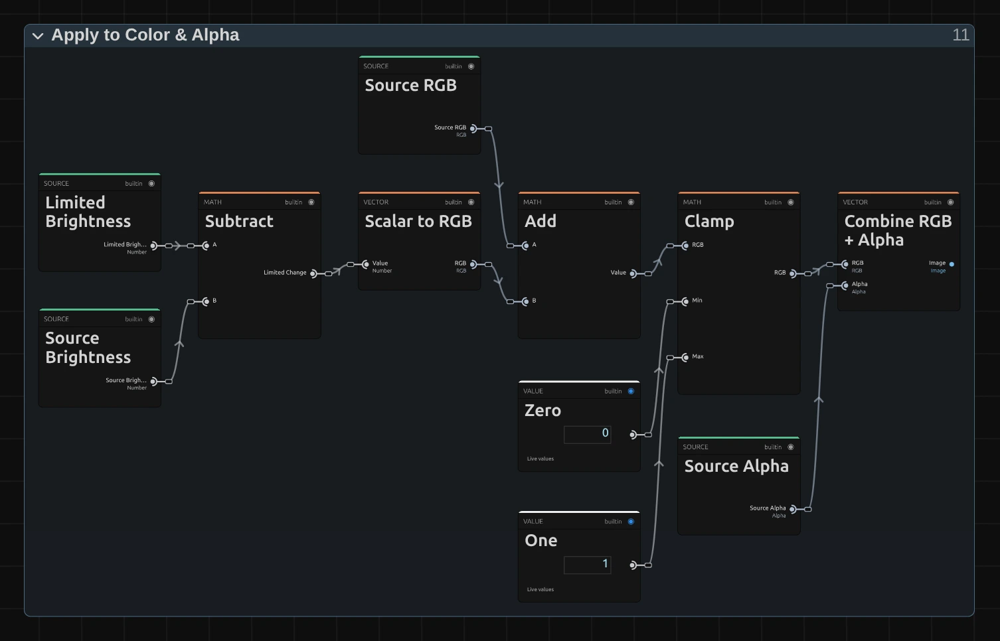

# Sharpen

Brings out detail and crisp edges in soft footage, without the thick bright and dark outlines of strong sharpening.

Group: [Blur & Sharpen](../Effects-Blur.md) · [How to add an effect](../Effects.md#add-an-effect)

<figure class="docs-shot docs-compare docs-shot--float-left">

<figcaption>Houses on the harbour front, enlarged. Left: original. Right: Amount 3.</figcaption>
</figure>

**Use it for:** slightly soft camera footage · upscaled or compressed clips · a rough, gritty texture.

- **Amount** – how much crisper.
- **Radius** – the size of the detail it works on.

**Tip:** put Sharpen last in the stack, after scaling and colour effects: each card works on the result of the cards above it ([Order matters](../Effects.md#order-matters)).

## Presets

<figure class="docs-shot docs-shot--detail">

<figcaption>The four presets on the houses of the harbour town, enlarged.</figcaption>
</figure>

Pick one in the **Preset** row of the effect card. It sets Amount and Radius in one undo step, and the row shows its name until you change something. A control with keyframes keeps them, and the card says so.

**Fine Detail** – Amount 1, Radius 0.7: hair, fabric and fine texture a touch crisper, without looking processed. A safe start for faces.

**Crisp** – Amount 2, Radius 1: slightly soft camera footage becomes clearly crisp. The everyday setting for a clip that looks a little out of focus.

**Gritty** – Amount 5, Radius 1.5: every grain and texture is pulled out, a rough, high-contrast look. It also shows noise and compression, so use it as a style.

**Punch** – Amount 1.5, Radius 4: larger shapes stand out against each other, more depth than detail. Bright walls get brighter, so watch the highlights.

## Controls

<figure class="docs-shot">

<svg class="docs-shot-overlay" viewBox="0 0 1017 455" aria-hidden="true" focusable="false">
<defs><marker id="sharpen-inspector-arrow" viewBox="0 0 10 10" refX="8" refY="5" markerWidth="5" markerHeight="5" orient="auto-start-reverse"><path d="M 0 0 L 10 5 L 0 10 Z" fill="#ffd54a" /></marker></defs>
<path class="docs-shot-arrow" d="M565 282 L649 282" marker-end="url(#sharpen-inspector-arrow)" />
<circle class="docs-shot-number" cx="565" cy="282" r="18" /><text x="565" y="282" class="docs-shot-number-text">1</text>
<path class="docs-shot-arrow" d="M555 344 L639 344" marker-end="url(#sharpen-inspector-arrow)" />
<circle class="docs-shot-number" cx="555" cy="344" r="18" /><text x="555" y="344" class="docs-shot-number-text">2</text>
<path class="docs-shot-arrow" d="M561 382 L645 382" marker-end="url(#sharpen-inspector-arrow)" />
<circle class="docs-shot-number" cx="561" cy="382" r="18" /><text x="561" y="382" class="docs-shot-number-text">3</text>
</svg>

<figcaption>Sharpen with the Crisp preset. 1 — Preset: pick a starting point. 2 — Amount: how much crisper. 3 — Radius: the size of the detail it works on.</figcaption>
</figure>

**Preset** – a starting point for Amount and Radius; see [Presets](#presets).

**Amount** – how much crisper the picture gets. 1 is gentle, 2–3 clearly crisp, 4–5 a gritty, high-contrast look. Even at 5, edges get only a thin outline, because the halo limit (see [Node setup](#node-setup)) keeps them small. 0 leaves the picture untouched. A value below 0, typed or set by a tool, softens instead, and the card says so. 0 to 5, default 1.

**Radius** – the size of the detail it works on. 0.5–1 crisps fine texture such as hair, fabric and leaves; 2–3 works on the edges of faces and objects; 4–5 makes larger shapes stand out, more like local contrast than sharpening, and with a high Amount bright walls can turn white. It counts pixels of a 1080p picture, so a 4K export looks the same, only finer. It changes smoothly when animated. 0.5 to 5 px, default 1 px.

## Node setup

<figure class="docs-shot docs-shot--graph">

<svg class="docs-shot-overlay" viewBox="0 0 1017 889" aria-hidden="true" focusable="false">
<defs><marker id="sharpen-arrow" viewBox="0 0 10 10" refX="8" refY="5" markerWidth="5" markerHeight="5" orient="auto-start-reverse"><path d="M 0 0 L 10 5 L 0 10 Z" fill="#ffd54a" /></marker></defs>
<path class="docs-shot-arrow" d="M67 529 L151 529" marker-end="url(#sharpen-arrow)" />
<circle class="docs-shot-number" cx="67" cy="529" r="18" /><text x="67" y="529" class="docs-shot-number-text">1</text>
<path class="docs-shot-arrow" d="M189 799 L273 799" marker-end="url(#sharpen-arrow)" />
<circle class="docs-shot-number" cx="189" cy="799" r="18" /><text x="189" y="799" class="docs-shot-number-text">2</text>
<path class="docs-shot-arrow" d="M67 360 L151 360" marker-end="url(#sharpen-arrow)" />
<circle class="docs-shot-number" cx="67" cy="360" r="18" /><text x="67" y="360" class="docs-shot-number-text">3</text>
<path class="docs-shot-arrow" d="M189 119 L273 119" marker-end="url(#sharpen-arrow)" />
<circle class="docs-shot-number" cx="189" cy="119" r="18" /><text x="189" y="119" class="docs-shot-number-text">4</text>
<path class="docs-shot-arrow" d="M311 439 L395 439" marker-end="url(#sharpen-arrow)" />
<circle class="docs-shot-number" cx="311" cy="439" r="18" /><text x="311" y="439" class="docs-shot-number-text">5</text>
<path class="docs-shot-arrow" d="M433 163 L517 163" marker-end="url(#sharpen-arrow)" />
<circle class="docs-shot-number" cx="433" cy="163" r="18" /><text x="433" y="163" class="docs-shot-number-text">6</text>
<path class="docs-shot-arrow" d="M555 204 L639 204" marker-end="url(#sharpen-arrow)" />
<circle class="docs-shot-number" cx="555" cy="204" r="18" /><text x="555" y="204" class="docs-shot-number-text">7</text>
<path class="docs-shot-arrow" d="M555 571 L639 571" marker-end="url(#sharpen-arrow)" />
<circle class="docs-shot-number" cx="555" cy="571" r="18" /><text x="555" y="571" class="docs-shot-number-text">8</text>
<path class="docs-shot-arrow" d="M676 379 L760 379" marker-end="url(#sharpen-arrow)" />
<circle class="docs-shot-number" cx="676" cy="379" r="18" /><text x="676" y="379" class="docs-shot-number-text">9</text>
<path class="docs-shot-arrow" d="M798 204 L882 204" marker-end="url(#sharpen-arrow)" />
<circle class="docs-shot-number" cx="798" cy="204" r="18" /><text x="798" y="204" class="docs-shot-number-text">10</text>
</svg>

<figcaption>Sharpen opened in the Nodes tab (Constants, Coordinates and the Output card left out). 1 — Radius & Window Size: how far to look. 2 — Source Brightness: this pixel's brightness. 3 — Premultiplied Source: the picture, ready to blur. 4 — Horizontal Blur Pass: blurs the rows. 5 — Row Darkest & Brightest: the range along the row. 6 — Vertical Blur Pass: blurs the columns. 7 — Unsharp Mask: the sharpened brightness. 8 — Window Darkest & Brightest: the range around the pixel. 9 — Halo Limit: keeps outlines thin. 10 — Apply to Color & Alpha: the finished picture.</figcaption>
</figure>

Sharpen does two things at once. It makes a soft copy of the picture and adds the difference between the picture and that copy, times Amount: the classic **Unsharp Mask**. And it measures how dark and how bright the picture is around each pixel, so the **Halo Limit** can stop the result from shooting far past that range, which is what draws the thick bright and dark outlines of strong sharpening. The soft copy comes from the same two passes as [Gaussian Blur](./gaussian-blur.md#node-setup): **Horizontal Blur Pass** and **Vertical Blur Pass**, on the **Premultiplied Source**. The range is measured along the row first (**Row Darkest & Brightest**) and then over a column of those rows (**Window Darkest & Brightest**). **Radius & Window Size** sets how far both look, **Source Brightness** is the pixel's own brightness that everything compares with, and **Apply to Color & Alpha** turns the brightness change into the finished picture. Click a folder's header to open it.

### Radius & Window Size

<figure class="docs-shot docs-shot--graph">

<svg class="docs-shot-overlay" viewBox="0 0 1017 583" aria-hidden="true" focusable="false">
<defs><marker id="sharpen-radius-window-arrow" viewBox="0 0 10 10" refX="8" refY="5" markerWidth="5" markerHeight="5" orient="auto-start-reverse"><path d="M 0 0 L 10 5 L 0 10 Z" fill="#ffd54a" /></marker></defs>
<path class="docs-shot-arrow" d="M41 199 L125 199" marker-end="url(#sharpen-radius-window-arrow)" />
<circle class="docs-shot-number" cx="41" cy="199" r="18" /><text x="41" y="199" class="docs-shot-number-text">1</text>
<path class="docs-shot-arrow" d="M138 199 L222 199" marker-end="url(#sharpen-radius-window-arrow)" />
<circle class="docs-shot-number" cx="138" cy="199" r="18" /><text x="138" y="199" class="docs-shot-number-text">2</text>
<path class="docs-shot-arrow" d="M624 298 L708 298" marker-end="url(#sharpen-radius-window-arrow)" />
<circle class="docs-shot-number" cx="624" cy="298" r="18" /><text x="624" y="298" class="docs-shot-number-text">3</text>
<path class="docs-shot-arrow" d="M722 311 L806 311" marker-end="url(#sharpen-radius-window-arrow)" />
<circle class="docs-shot-number" cx="722" cy="311" r="18" /><text x="722" y="311" class="docs-shot-number-text">4</text>
<path class="docs-shot-arrow" d="M819 320 L903 320" marker-end="url(#sharpen-radius-window-arrow)" />
<circle class="docs-shot-number" cx="819" cy="320" r="18" /><text x="819" y="320" class="docs-shot-number-text">5</text>
</svg>

<figcaption>Inside Radius & Window Size, the window part (the blur's own reach and tap count are as in Gaussian Blur). 1 — Maximum: the blur's sigma. 2 — Multiply: how far the window reaches. 3 — Ceiling: taps needed per side. 4 — Minimum: at most 24 taps. 5 — Clamp: how much of the outermost tap counts.</figcaption>
</figure>

**Maximum** – the sigma of the soft copy: Radius in pixels of this frame (Radius × the shorter side ÷ 1080), but at least 0.25 px, so a tiny frame still gets a blur. The Gaussian passes read 3 sigma to each side, with the same pairs and stride as [Gaussian Blur](./gaussian-blur.md#radius--tap-count).

**Multiply** – the window reaches twice the sigma to each side, at least 1 px. That is as far as the blur's own halo reaches, so the range covers every pixel that can push this one.

**Ceiling** – how many taps per side the window needs: the reach in taps, rounded up. Up to a reach of 24 px the taps sit one pixel apart; beyond that (only on frames far larger than 4K) they spread out.

**Minimum** – caps the taps at 24 per side, so the window never costs more than 49 reads in each direction.

**Clamp** – how much of each tap counts: 1 inside the reach, and for the outermost tap the share the reach covers (between 0 and 1). When an animated Radius makes the window one tap wider, the new tap starts at 0 and grows in, so the picture changes smoothly instead of jumping.

### Source Brightness

<figure class="docs-shot docs-shot--graph docs-shot--float-right">

<svg class="docs-shot-overlay" viewBox="0 0 590 547" aria-hidden="true" focusable="false">
<defs><marker id="sharpen-source-brightness-arrow" viewBox="0 0 10 10" refX="8" refY="5" markerWidth="5" markerHeight="5" orient="auto-start-reverse"><path d="M 0 0 L 10 5 L 0 10 Z" fill="#ffd54a" /></marker></defs>
<path class="docs-shot-arrow" d="M239 167 L323 167" marker-end="url(#sharpen-source-brightness-arrow)" />
<circle class="docs-shot-number" cx="239" cy="167" r="18" /><text x="239" y="167" class="docs-shot-number-text">1</text>
<path class="docs-shot-arrow" d="M22 422 L82 422" marker-end="url(#sharpen-source-brightness-arrow)" />
<circle class="docs-shot-number" cx="22" cy="422" r="18" /><text x="22" y="422" class="docs-shot-number-text">2</text>
</svg>

<figcaption>Inside Source Brightness. 1 — Split RGB + Alpha: colour and transparency. 2 — Luminance: the pixel's brightness.</figcaption>
</figure>

**Split RGB + Alpha** – splits the pixel into its colour and its transparency. Both go on to Apply to Color & Alpha, so the finished pixel keeps its colour and its alpha.

**Luminance** – the brightness of the pixel, weighted like the eye sees it (green counts most). Sharpen works on brightness only and adds the same change to red, green and blue, so edges get crisp without coloured fringes.

### Premultiplied Source

<figure class="docs-shot docs-shot--graph">

<svg class="docs-shot-overlay" viewBox="0 0 1017 377" aria-hidden="true" focusable="false">
<defs><marker id="sharpen-premultiplied-source-arrow" viewBox="0 0 10 10" refX="8" refY="5" markerWidth="5" markerHeight="5" orient="auto-start-reverse"><path d="M 0 0 L 10 5 L 0 10 Z" fill="#ffd54a" /></marker></defs>
<path class="docs-shot-arrow" d="M437 262 L521 262" marker-end="url(#sharpen-premultiplied-source-arrow)" />
<circle class="docs-shot-number" cx="437" cy="262" r="18" /><text x="437" y="262" class="docs-shot-number-text">1</text>
<path class="docs-shot-arrow" d="M762 134 L846 134" marker-end="url(#sharpen-premultiplied-source-arrow)" />
<circle class="docs-shot-number" cx="762" cy="134" r="18" /><text x="762" y="134" class="docs-shot-number-text">2</text>
</svg>

<figcaption>Inside Premultiplied Source (cached). 1 — Multiply: colour times transparency. 2 — Cache Image: keeps the prepared picture.</figcaption>
</figure>

**Multiply** – multiplies each pixel's colour by its alpha. A see-through pixel then adds almost nothing to the soft copy or the range, so the colour of its invisible part cannot darken the edge of a cut-out figure or a title.

**Cache Image** – keeps the prepared picture in a 16-bit float texture, which both the blur and the row range read.

### Horizontal Blur Pass

<figure class="docs-shot docs-shot--graph">

<svg class="docs-shot-overlay" viewBox="0 0 1017 684" aria-hidden="true" focusable="false">
<defs><marker id="sharpen-horizontal-pass-arrow" viewBox="0 0 10 10" refX="8" refY="5" markerWidth="5" markerHeight="5" orient="auto-start-reverse"><path d="M 0 0 L 10 5 L 0 10 Z" fill="#ffd54a" /></marker></defs>
<path class="docs-shot-arrow" d="M226 116 L310 116" marker-end="url(#sharpen-horizontal-pass-arrow)" />
<circle class="docs-shot-number" cx="226" cy="116" r="18" /><text x="226" y="116" class="docs-shot-number-text">1</text>
<path class="docs-shot-arrow" d="M504 179 L588 179" marker-end="url(#sharpen-horizontal-pass-arrow)" />
<circle class="docs-shot-number" cx="504" cy="179" r="18" /><text x="504" y="179" class="docs-shot-number-text">2</text>
<path class="docs-shot-arrow" d="M783 169 L867 169" marker-end="url(#sharpen-horizontal-pass-arrow)" />
<circle class="docs-shot-number" cx="783" cy="169" r="18" /><text x="783" y="169" class="docs-shot-number-text">3</text>
</svg>

<figcaption>Inside Horizontal Blur Pass, reduced to its recipe. 1 — Gaussian Falloff: how much each pixel counts. 2 — Sequence Reduce: adds up the reads. 3 — Split RGB + Alpha: the blurred row.</figcaption>
</figure>

This is the horizontal pass of [Gaussian Blur](./gaussian-blur.md#horizontal-pass), unchanged.

**Gaussian Falloff** – the bell curve: how much a pixel at that distance counts, 1 at the centre and fading smoothly; the sigma from Radius & Window Size sets how wide.

**Sequence Reduce** – reads the Premultiplied Source along the row and adds up the reads, each times its weight; **Normalize by Weight** turns the sum into an average.

**Split RGB + Alpha** – hands the blurred colour and alpha to Row Darkest & Brightest, which stores their brightness in the same cache as the row range.

### Row Darkest & Brightest

<figure class="docs-shot docs-shot--graph">

<svg class="docs-shot-overlay" viewBox="0 0 1017 683" aria-hidden="true" focusable="false">
<defs><marker id="sharpen-rows-arrow" viewBox="0 0 10 10" refX="8" refY="5" markerWidth="5" markerHeight="5" orient="auto-start-reverse"><path d="M 0 0 L 10 5 L 0 10 Z" fill="#ffd54a" /></marker></defs>
<path class="docs-shot-arrow" d="M208 198 L292 198" marker-end="url(#sharpen-rows-arrow)" />
<circle class="docs-shot-number" cx="208" cy="198" r="18" /><text x="208" y="198" class="docs-shot-number-text">1</text>
<path class="docs-shot-arrow" d="M473 443 L557 443" marker-end="url(#sharpen-rows-arrow)" />
<circle class="docs-shot-number" cx="473" cy="443" r="18" /><text x="473" y="443" class="docs-shot-number-text">2</text>
<path class="docs-shot-arrow" d="M208 356 L292 356" marker-end="url(#sharpen-rows-arrow)" />
<circle class="docs-shot-number" cx="208" cy="356" r="18" /><text x="208" y="356" class="docs-shot-number-text">3</text>
<path class="docs-shot-arrow" d="M561 372 L645 372" marker-end="url(#sharpen-rows-arrow)" />
<circle class="docs-shot-number" cx="561" cy="372" r="18" /><text x="561" y="372" class="docs-shot-number-text">4</text>
<path class="docs-shot-arrow" d="M827 368 L911 368" marker-end="url(#sharpen-rows-arrow)" />
<circle class="docs-shot-number" cx="827" cy="368" r="18" /><text x="827" y="368" class="docs-shot-number-text">5</text>
</svg>

<figcaption>Inside Row Darkest & Brightest, the brightest half (the darkest half mirrors it). 1 — Add: the tap, by its covered share. 2 — Multiply: the tap's weight. 3 — Exponential: brighter taps count far more. 4 — Kernel Sum (Rect): adds up the row. 5 — Divide: the row's brightest.</figcaption>
</figure>

The folder reads every tap of the window along the row from the Premultiplied Source and turns it back into a plain brightness.

**Add** – the tap as it counts: for a tap inside the reach its own brightness; for the outermost, partly covered tap a value between this pixel's brightness and its own, by the share from Radius & Window Size.

**Multiply** – the tap's weight: its alpha times its share. Transparent pixels and the uncovered part of the outermost tap weigh nothing.

**Exponential** – a soft maximum. Each tap counts by e to the power of 64 × (tap − this pixel), so a tap a little brighter than the rest outweighs all of them; the result follows the brightest tap closely but moves smoothly from pixel to pixel instead of jumping. The darkest half does the same with the sign turned.

**Kernel Sum (Rect)** – adds up the weighted brightness and the weights over all taps of the row.

**Divide** – the sum by the summed weight: the row's brightest. With the row's darkest, the blurred brightness and alpha it goes into one cache image for the vertical pass. A row without any opaque pixel marks itself out of range, so the column ignores it.

### Vertical Blur Pass

<figure class="docs-shot docs-shot--graph">

<svg class="docs-shot-overlay" viewBox="0 0 1017 642" aria-hidden="true" focusable="false">
<defs><marker id="sharpen-vertical-pass-arrow" viewBox="0 0 10 10" refX="8" refY="5" markerWidth="5" markerHeight="5" orient="auto-start-reverse"><path d="M 0 0 L 10 5 L 0 10 Z" fill="#ffd54a" /></marker></defs>
<path class="docs-shot-arrow" d="M112 259 L196 259" marker-end="url(#sharpen-vertical-pass-arrow)" />
<circle class="docs-shot-number" cx="112" cy="259" r="18" /><text x="112" y="259" class="docs-shot-number-text">1</text>
<path class="docs-shot-arrow" d="M599 259 L683 259" marker-end="url(#sharpen-vertical-pass-arrow)" />
<circle class="docs-shot-number" cx="599" cy="259" r="18" /><text x="599" y="259" class="docs-shot-number-text">2</text>
<path class="docs-shot-arrow" d="M274 468 L358 468" marker-end="url(#sharpen-vertical-pass-arrow)" />
<circle class="docs-shot-number" cx="274" cy="468" r="18" /><text x="274" y="468" class="docs-shot-number-text">3</text>
</svg>

<figcaption>Inside Vertical Blur Pass, the read position and the sum. 1 — Combine Vector: the offset points up and down. 2 — Sample Image: reads the rows cache. 3 — Split Vector: blurred brightness and alpha.</figcaption>
</figure>

The same recipe as the horizontal pass, down the columns:

**Combine Vector** – puts the offset into the vertical place (the first is Zero), so the reads go up and down a column.

**Sample Image** – reads the rows cache, which holds the row-blurred brightness and alpha. A bell curve along the rows and then down the columns gives a round blur.

**Split Vector** – hands over the blurred brightness (still multiplied by alpha) and the blurred alpha to the Unsharp Mask.

### Unsharp Mask

<figure class="docs-shot docs-shot--graph">

<svg class="docs-shot-overlay" viewBox="0 0 1017 524" aria-hidden="true" focusable="false">
<defs><marker id="sharpen-unsharp-mask-arrow" viewBox="0 0 10 10" refX="8" refY="5" markerWidth="5" markerHeight="5" orient="auto-start-reverse"><path d="M 0 0 L 10 5 L 0 10 Z" fill="#ffd54a" /></marker></defs>
<path class="docs-shot-arrow" d="M274 270 L358 270" marker-end="url(#sharpen-unsharp-mask-arrow)" />
<circle class="docs-shot-number" cx="274" cy="270" r="18" /><text x="274" y="270" class="docs-shot-number-text">1</text>
<path class="docs-shot-arrow" d="M437 270 L521 270" marker-end="url(#sharpen-unsharp-mask-arrow)" />
<circle class="docs-shot-number" cx="437" cy="270" r="18" /><text x="437" y="270" class="docs-shot-number-text">2</text>
<path class="docs-shot-arrow" d="M599 270 L683 270" marker-end="url(#sharpen-unsharp-mask-arrow)" />
<circle class="docs-shot-number" cx="599" cy="270" r="18" /><text x="599" y="270" class="docs-shot-number-text">3</text>
<path class="docs-shot-arrow" d="M762 210 L846 210" marker-end="url(#sharpen-unsharp-mask-arrow)" />
<circle class="docs-shot-number" cx="762" cy="210" r="18" /><text x="762" y="210" class="docs-shot-number-text">4</text>
</svg>

<figcaption>Inside Unsharp Mask (brightness). 1 — Divide: the soft copy's brightness. 2 — Subtract: the detail. 3 — Multiply: the detail times Amount. 4 — Add: the sharpened brightness.</figcaption>
</figure>

**Divide** – the blurred brightness divided by the blurred alpha (at least a tiny floor): the brightness of the soft copy, back at full strength at half-transparent edges.

**Subtract** – the pixel's brightness minus the soft copy's: the detail. It is large at edges and texture and zero on flat areas, which is why flat skies and walls stay as they are.

**Multiply** – the detail times **Amount**. A negative Amount turns it around and softens.

**Add** – the detail added back to the pixel's brightness: the sharpened brightness, before the halo limit.

### Window Darkest & Brightest

<figure class="docs-shot docs-shot--graph">

<svg class="docs-shot-overlay" viewBox="0 0 1017 786" aria-hidden="true" focusable="false">
<defs><marker id="sharpen-window-arrow" viewBox="0 0 10 10" refX="8" refY="5" markerWidth="5" markerHeight="5" orient="auto-start-reverse"><path d="M 0 0 L 10 5 L 0 10 Z" fill="#ffd54a" /></marker></defs>
<path class="docs-shot-arrow" d="M208 569 L292 569" marker-end="url(#sharpen-window-arrow)" />
<circle class="docs-shot-number" cx="208" cy="569" r="18" /><text x="208" y="569" class="docs-shot-number-text">1</text>
<path class="docs-shot-arrow" d="M208 477 L292 477" marker-end="url(#sharpen-window-arrow)" />
<circle class="docs-shot-number" cx="208" cy="477" r="18" /><text x="208" y="477" class="docs-shot-number-text">2</text>
<path class="docs-shot-arrow" d="M561 325 L645 325" marker-end="url(#sharpen-window-arrow)" />
<circle class="docs-shot-number" cx="561" cy="325" r="18" /><text x="561" y="325" class="docs-shot-number-text">3</text>
<path class="docs-shot-arrow" d="M827 488 L911 488" marker-end="url(#sharpen-window-arrow)" />
<circle class="docs-shot-number" cx="827" cy="488" r="18" /><text x="827" y="488" class="docs-shot-number-text">4</text>
</svg>

<figcaption>Inside Window Darkest & Brightest, the brightest half. 1 — Add: a row's brightest, by its covered share. 2 — Exponential: the soft maximum. 3 — Kernel Sum (Rect): adds up the column. 4 — Divide: the brightest nearby.</figcaption>
</figure>

The same soft maximum and minimum, now down a column of the row results, so together they cover a square around the pixel.

**Add** – a row's brightest, moved towards this pixel's brightness by the share of that row the window covers, like the outermost tap of a row.

**Exponential** – brighter rows count far more, exactly as in Row Darkest & Brightest.

**Kernel Sum (Rect)** – adds them up down the column, each weighted by its share.

**Divide** – the result: the brightest brightness nearby. Its mirror image is the darkest nearby. Both go to the Halo Limit.

### Halo Limit

<figure class="docs-shot docs-shot--graph">

![Inside the Halo Limit folder, the brightening half: Brightest Nearby minus Darkest Nearby is the range; times Overshoot 0.05 and at least the Margin Floor 0.04 by Maximum it is the margin; Brightest Nearby plus the margin, at least Source Brightness, is the Ceiling; Sharpened Brightness minus the Ceiling, at least Zero, is the excess; divided by the Roll-off Scale (margin times Roll Off 0.5), plus One, through Natural Logarithm and times the scale it is the rolled-off excess; Clamp keeps the Sharpened Brightness between Floor and Ceiling, and Add puts the two together](../assets/effects/graphs/sharpen-halo-limit.webp)

<svg class="docs-shot-overlay" viewBox="0 0 1017 598" aria-hidden="true" focusable="false">
<defs><marker id="sharpen-halo-limit-arrow" viewBox="0 0 10 10" refX="8" refY="5" markerWidth="5" markerHeight="5" orient="auto-start-reverse"><path d="M 0 0 L 10 5 L 0 10 Z" fill="#ffd54a" /></marker></defs>
<path class="docs-shot-arrow" d="M165 324 L249 324" marker-end="url(#sharpen-halo-limit-arrow)" />
<circle class="docs-shot-number" cx="165" cy="324" r="18" /><text x="165" y="324" class="docs-shot-number-text">1</text>
<path class="docs-shot-arrow" d="M240 234 L324 234" marker-end="url(#sharpen-halo-limit-arrow)" />
<circle class="docs-shot-number" cx="240" cy="234" r="18" /><text x="240" y="234" class="docs-shot-number-text">2</text>
<path class="docs-shot-arrow" d="M389 324 L473 324" marker-end="url(#sharpen-halo-limit-arrow)" />
<circle class="docs-shot-number" cx="389" cy="324" r="18" /><text x="389" y="324" class="docs-shot-number-text">3</text>
<path class="docs-shot-arrow" d="M688 269 L772 269" marker-end="url(#sharpen-halo-limit-arrow)" />
<circle class="docs-shot-number" cx="688" cy="269" r="18" /><text x="688" y="269" class="docs-shot-number-text">4</text>
<path class="docs-shot-arrow" d="M763 337 L847 337" marker-end="url(#sharpen-halo-limit-arrow)" />
<circle class="docs-shot-number" cx="763" cy="337" r="18" /><text x="763" y="337" class="docs-shot-number-text">5</text>
</svg>

<figcaption>Inside Halo Limit, the brightening half (the darkening half mirrors it). 1 — Maximum: the margin. 2 — Add: the Ceiling. 3 — Subtract: what passes the Ceiling. 4 — Natural Logarithm: rolls it off. 5 — Clamp: the part within range.</figcaption>
</figure>

**Maximum** – the margin the result may go past the range: 5 % of the range between darkest and brightest nearby (**Overshoot**), but at least 0.04 (**Margin Floor**). Without it, flat areas could not gain any contrast at all.

**Add** – the **Ceiling**: the brightest nearby plus the margin, and never below the pixel itself. The **Floor** is the darkest nearby minus the margin.

**Subtract** – how far the sharpened brightness goes past the Ceiling (zero when it stays below). That excess is what would become a bright outline.

**Natural Logarithm** – rolls the excess off: Scale × ln(1 + excess ÷ Scale), with Scale half the margin. It keeps growing, only slower and slower, so a stronger Amount still adds a little contrast and neighbouring pixels never swap their order. A step edge keeps a halo of about 18 % of the step at Amount 1 and about 26 % at Amount 5; a plain unsharp mask overshoots by 40 % and more.

**Clamp** – the sharpened brightness kept between Floor and Ceiling. A second Add puts the rolled-off excess on top; the darkening half takes off what falls below the Floor the same way.

**Remix:** select **Overshoot** (0.05) in this folder and set it to 0.5 for a punchier look with visible halos, or to 0 to keep only the Margin Floor and the thinnest outlines.

### Apply to Color & Alpha

<figure class="docs-shot docs-shot--graph">

<svg class="docs-shot-overlay" viewBox="0 0 1017 652" aria-hidden="true" focusable="false">
<defs><marker id="sharpen-apply-arrow" viewBox="0 0 10 10" refX="8" refY="5" markerWidth="5" markerHeight="5" orient="auto-start-reverse"><path d="M 0 0 L 10 5 L 0 10 Z" fill="#ffd54a" /></marker></defs>
<path class="docs-shot-arrow" d="M112 270 L196 270" marker-end="url(#sharpen-apply-arrow)" />
<circle class="docs-shot-number" cx="112" cy="270" r="18" /><text x="112" y="270" class="docs-shot-number-text">1</text>
<path class="docs-shot-arrow" d="M437 270 L521 270" marker-end="url(#sharpen-apply-arrow)" />
<circle class="docs-shot-number" cx="437" cy="270" r="18" /><text x="437" y="270" class="docs-shot-number-text">2</text>
<path class="docs-shot-arrow" d="M599 298 L683 298" marker-end="url(#sharpen-apply-arrow)" />
<circle class="docs-shot-number" cx="599" cy="298" r="18" /><text x="599" y="298" class="docs-shot-number-text">3</text>
<path class="docs-shot-arrow" d="M762 256 L846 256" marker-end="url(#sharpen-apply-arrow)" />
<circle class="docs-shot-number" cx="762" cy="256" r="18" /><text x="762" y="256" class="docs-shot-number-text">4</text>
</svg>

<figcaption>Inside Apply to Color & Alpha. 1 — Subtract: the brightness change. 2 — Add: the change on the colour. 3 — Clamp: within black and white. 4 — Combine RGB + Alpha: the finished picture.</figcaption>
</figure>

**Subtract** – the limited brightness minus the pixel's brightness: how much this pixel gets brighter or darker.

**Add** – adds that change to red, green and blue alike, so the hue stays and no coloured fringes appear.

**Clamp** – keeps each channel between black and white.

**Combine RGB + Alpha** – joins the colour with the pixel's own alpha: Sharpen never changes transparency.

## Technical details

- **Size.** Radius is the sigma of the soft copy in pixels of a frame whose shorter side is 1080, at least 0.25 px: preview, export, 4K and portrait frames show the same sharpening. Below that the card and the tool result say it is used as 0.25 px.
- **Halo limit.** A smooth darkest and brightest brightness within ±2 sigma (at least ±1 px), one pixel apart, up to 24 taps per side (wider steps beyond, also reported), taken along each row in the horizontal pass and down a column of rows in the final pass. The outermost tap counts by the share the window covers, so an animated Radius changes smoothly.
- **Colour and transparency.** Only brightness is sharpened; the change goes to R, G and B alike and alpha is kept. The blur and the range read a premultiplied copy, so a cut-out on transparency gets no dark or bright rim.
- **Zero and below.** Amount 0 leaves the picture exactly as it was. An Amount below 0 (typed or via tools) softens and is reported.
- **Cost.** Three GPU passes, independent of the timeline time.
- **Saved projects.** An untouched Sharpen saved with version 3.2.7 loads with this recipe: it fixes a flicker when Radius is animated and looks the same at Radius 0.5, 1, 1.5 … (in between, the difference is slight). A Sharpen saved before 2026-10-21 keeps its earlier graph without a halo limit; its card offers **Use the new Sharpen**. An edited node setup keeps its own recipe.
- **More:** [Blur & Sharpen notes](../Effect-System.md#blur--sharpen-notes) · [Editable blur kernels](../Effect-System.md#editable-blur-kernels) · [Node Catalog](../Node-Catalog.md) · [Styles and presets](../Effects.md#styles-and-presets).
