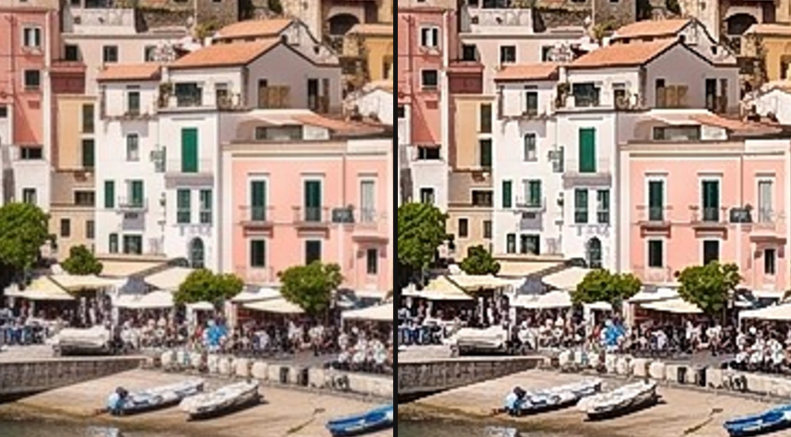

# Sharpen

Brings out detail and crisp edges in soft footage. It avoids the thick bright and dark outlines that
strong sharpening usually leaves.

Group: [Blur & Sharpen](../Effects-Blur.md) · [How to add an effect](../Effects.md#add-an-effect)

<figure class="docs-shot">

<figcaption>Houses on the harbour front, enlarged. Left: original. Right: Amount 3, Radius 1.</figcaption>
</figure>

**Use it for:** slightly soft camera footage · upscaled or compressed clips · a gritty, detailed
look (high Amount).

- **Amount** – how much crisper: 1 is gentle, 2–3 clearly crisp, 4–5 a gritty, high-contrast look.
- **Radius** – the size of the detail it works on: 1 for fine texture, 3–5 for larger shapes.

**Tip:** sharpen after scaling and colour effects, at the end of the stack: the effects below a card
work on its result ([Order matters](../Effects.md#order-matters)).

## Controls

<!-- generated:controls start -->
| Control | Range | Default |
|---|---|---|
| Amount | 0 to 5 | 1 |
| Radius | 0.5 to 5 | 1 |

The effect card also has controls of its own that this table does not list.
<!-- generated:controls end -->

## Node setup

<figure class="docs-shot docs-shot--graph">

<figcaption>Halo Limit, brightening half: the sharpened brightness up to the Ceiling passes as it is; what goes past it is rolled off, Scale × ln(1 + Excess / Scale).</figcaption>
</figure>

Sharpen blurs a copy with the same two passes as [Gaussian Blur](./gaussian-blur.md#node-setup)
(**Horizontal** and **Vertical Blur Pass**) and adds the difference between the picture and that
soft copy, times Amount (an unsharp mask). Classic sharpening stops there and draws bright and dark
outlines along edges. **Halo Limit** keeps them small. The folders **Row: Darkest & Brightest** and
**Window: Darkest & Brightest** measure the darkest and brightest brightness around each pixel, up
to two Radius away. The **Ceiling** is that brightest value plus a small margin (the **Floor**
likewise below the darkest). Up to it the sharpened brightness passes as it is; what goes past it is
rolled off, so it still grows a little, slower and slower. Texture keeps its contrast and its order,
and edges get only a thin halo.

**Remix:** the margin is **Overshoot** × the brightness range nearby, at least **Margin Floor**
(0.04); both are value cards in the **Constants** folder. Select **Overshoot** (0.05) and set it to
0.5 for a punchier look with visible halos, or 0 to keep only the Margin Floor.

## Technical details

- **Units.** Radius is in pixels of a 1080p frame and scales with the rendered size, so preview,
  export and 4K match.
- **Unsharp mask.** A premultiplied source cache, then Gaussian Blur's separable passes
  (sigma = Radius); the brightness mask is applied equally to red, green and blue.
- **Halo limit.** A smooth minimum and maximum within ±2 sigma (at least ±1 px), dense (one pixel
  apart, up to 24 reads per side), taken along each row in the horizontal pass and down a column of
  rows in the final pass. The result passes unchanged within that range ± a margin (5 % of the
  range, at least 0.04); the excess rolls off as `s × ln(1 + excess / s)`, s = half the margin.
  Halos at a step edge stay at about 18 % (Amount 1) to 26 % (Amount 5) of the step, and
  neighbouring pixels never swap their order.
- **Cost.** Three passes, independent of the timeline time.
- **Below 0.** An Amount below 0 (typed or via tools) softens the picture and is reported.
- **Saved projects.** A Sharpen saved before 2026-10-21 keeps its earlier graph; its card offers
  **Use the new Sharpen**.
- Shared notes: [Blur & Sharpen](../Effects-Blur.md#technical-details). Formulas:
  [Effect system](../Effect-System.md#editable-blur-kernels); blocks:
  [Node Catalog](../Node-Catalog.md).
