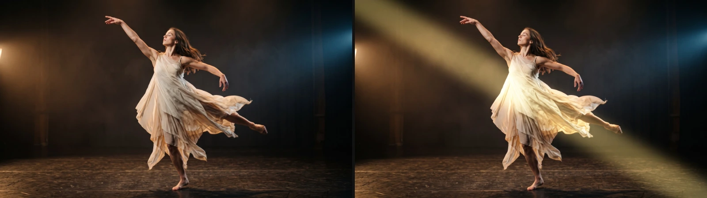

# Sheen

A band of light that sweeps across the layer, the classic shine over a logo or a title. It stays
inside the layer's shape, and the picture underneath stays visible in the light.

Group: [Light & Stylize](../Effects-Stylize.md) · [How to add an effect](../Effects.md#add-an-effect)

<figure class="docs-shot">

<figcaption>Left: original. Right: a warm Sheen (Color #ffcc66, Angle −60°, Width 0.16, Intensity 1.2).</figcaption>
</figure>

**Use it for:** a glint over a logo or a title · a beam of light crossing a set piece · a metallic
or glossy accent.

- **Position** – where the band is; keyframe it from 0 to 1 for the sweep.
- **Angle** – the direction of the band, in degrees.
- **Width** and **Softness** – how far the light reaches from the middle of the band, and how gently
  it fades (1 fades all the way, 0 is a hard-edged band).
- **Intensity** and **Color** – how bright it is and its tint.
- **Highlights** – how much more the light catches bright parts than dark ones.

**Tip:** on a title, a narrow, soft band (Width 0.08) sweeping in half a second reads as a glint.

## Controls

<!-- generated:controls start -->
| Control | Range | Default |
|---|---|---|
| Position | 0 to 1 | 0.5 |
| Angle | −180 to 180° | 25° |
| Width | 0.01 to 1 | 0.18 |
| Softness | 0 to 1 | 0.7 |
| Intensity | 0 to 3 | 0.9 |
| Highlights | 0 to 1 | 0.6 |
| Color | a colour | `#ffffff` |
<!-- generated:controls end -->

## Node setup

Sheen has no node setup to open: it is one fixed shader, and everything it does is in its controls.
The formula of its light is under Technical details.

## Technical details

- **Light.** The band's light falls off from its middle as `exp(−4.5 t^(2 / Softness))` (t = 0 in
  the middle, 1 at Width; one pixel of anti-aliasing at the edge). It is weighted by the colour's
  brightness through Highlights and lifts each colour with a soft shoulder,
  `1 − (1 − c) · exp(−light / (1 − c))`, so it never clips to flat white.
- **Position** spans the whole layer. On a small logo in a large transparent layer, the band
  crosses the logo during only part of the sweep.
- **Saved projects.** A Sheen saved before the soft falloff and Highlights existed keeps its
  flat-topped band and even light; the effect card says so, and adding Sheen again gives the
  current look.
- **Warnings.** Intensity below 0, Width at or below 0 and Softness or Highlights outside 0–1 are
  clamped and reported in the effect card and the tool result.
- Shared notes: [Light & Stylize](../Effect-System.md#light--stylize-notes). How effects are stored
  and rendered: [Effect system](../Effect-System.md).
