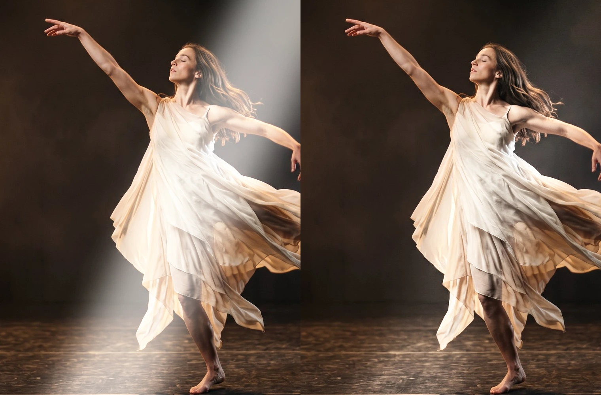

# Sheen

A band of light that sweeps across the layer, the classic shine over a logo or a title. The light stays inside the layer's shape, and the picture underneath stays visible in it.

Group: [Light & Stylize](../Effects-Stylize.md) · [How to add an effect](../Effects.md#add-an-effect)

<figure class="docs-shot docs-compare docs-shot--float-left">

<figcaption>Left: original. Right: Sheen at its default settings.</figcaption>
</figure>

**Use it for:** a glint over a logo or a title · a beam of light crossing a set piece · a glossy or metallic accent.

- **Position** – where the band is; keyframe it from 0 to 1 for the sweep.
- **Angle** – which way the band travels.
- **Width** – how far the light reaches from the middle of the band.
- **Intensity** – how bright it is.

**Tip:** for a glint on a title, pick **Glint** and keyframe **Position** from 0 to 1 over half a second.

## Presets

<figure class="docs-shot docs-shot--detail">

<figcaption>The four presets on the dancer.</figcaption>
</figure>

Pick one in the **Preset** row of the effect card. It sets all controls at once, in one undo step, and the row shows its name until you change something. A control with keyframes keeps them, and the card says so, so a sweep keyframed on Position keeps running.

**Glint** – a thin, bright streak. Swept quickly across a logo or a title, it reads as the flash of light on a polished surface.

**Golden Beam** – a wide, warm beam falling diagonally from the top left, like low sun through a window. Moved slowly, it wanders across a scene.

**Glass Streak** – a hard-edged white band, like the reflection on a pane of glass or polished metal. Good on graphic shapes and lettering.

**Moon Wash** – a broad, cool light across the middle of the picture that falls mainly on bright surfaces. It brings out a light costume in cold light while the dark stage stays dark.

## Controls

<figure class="docs-shot">

<svg class="docs-shot-overlay" viewBox="0 0 1017 619" aria-hidden="true" focusable="false">
<defs><marker id="sheen-inspector-arrow" viewBox="0 0 10 10" refX="8" refY="5" markerWidth="5" markerHeight="5" orient="auto-start-reverse"><path d="M 0 0 L 10 5 L 0 10 Z" fill="#ffd54a" /></marker></defs>
<path class="docs-shot-arrow" d="M565 282 L649 282" marker-end="url(#sheen-inspector-arrow)" />
<circle class="docs-shot-number" cx="565" cy="282" r="18" /><text x="565" y="282" class="docs-shot-number-text">1</text>
<path class="docs-shot-arrow" d="M554 344 L638 344" marker-end="url(#sheen-inspector-arrow)" />
<circle class="docs-shot-number" cx="554" cy="344" r="18" /><text x="554" y="344" class="docs-shot-number-text">2</text>
<path class="docs-shot-arrow" d="M571 382 L655 382" marker-end="url(#sheen-inspector-arrow)" />
<circle class="docs-shot-number" cx="571" cy="382" r="18" /><text x="571" y="382" class="docs-shot-number-text">3</text>
<path class="docs-shot-arrow" d="M571 419 L655 419" marker-end="url(#sheen-inspector-arrow)" />
<circle class="docs-shot-number" cx="571" cy="419" r="18" /><text x="571" y="419" class="docs-shot-number-text">4</text>
<path class="docs-shot-arrow" d="M548 457 L632 457" marker-end="url(#sheen-inspector-arrow)" />
<circle class="docs-shot-number" cx="548" cy="457" r="18" /><text x="548" y="457" class="docs-shot-number-text">5</text>
<path class="docs-shot-arrow" d="M551 494 L635 494" marker-end="url(#sheen-inspector-arrow)" />
<circle class="docs-shot-number" cx="551" cy="494" r="18" /><text x="551" y="494" class="docs-shot-number-text">6</text>
</svg>

<figcaption>Sheen with the Golden Beam preset. 1 — Preset: pick a starting point. 2 — Position: where the band is. 3 — Angle: which way it travels. 4 — Width: how far the light reaches. 5 — Softness: how gently it fades. 6 — Intensity: how bright.</figcaption>
</figure>

**Preset** – a starting point for all controls; see [Presets](#presets).

<figure class="docs-shot docs-clip docs-shot--float-right">
<video src="../assets/effects/clips/sheen-position.mp4" poster="../assets/effects/clips/sheen-position.webp" width="768" height="432" autoplay muted loop playsinline preload="none" aria-label="The dancer turning on a dark stage while Sheen's Position runs from 0 to 1 and back: a soft white band of light, leaning to the right, slides in from the left edge, crosses her dress, leaves at the right edge and comes back; the current value is shown at the bottom left"></video>
<figcaption>Position from 0 to 1 and back.</figcaption>
</figure>

**Position** – where the band is on its way across the layer. At 0 it waits just outside one edge, at 1 just outside the other, so a keyframe from 0 to 1 is one complete sweep that starts and ends with no light at all. Near both ends only the tip of the band touches a corner, so the light seems to arrive a little late and leave a little early. Half a second reads as a glint, three seconds and more as a slow beam. 0 to 1, default 0.5.

**Angle** – which way the band travels as Position rises; the band itself stands across that way. At 0° it stands upright and travels from left to right, at 90° it lies flat and travels from top to bottom, and the default 25° leans it to the right. Turning Angle by 180° gives the same band travelling the other way. −180 to 180°, default 25°.

**Width** – how far the light reaches from the middle of the band to each side. 0.03–0.08 is a thin streak, the default 0.18 a soft beam, and at 1 a band in the middle reaches both edges of the layer and lights all of it. It counts in halves of the layer's size along the way the band travels, so on a wide frame the same Width gives a broader upright band (0°) than a lying one (90°). 0.01 to 1, default 0.18.

**Softness** – how gently the light fades towards the band's edges. At 1 it fades all the way from the middle, like a beam in haze; around 0.3 the band has a broad, even middle; at 0 it is a hard-edged band of even light, for a reflection on glass. The very edge always gets one pixel of smoothing, so even a hard band has no stair steps. 0 to 1, default 0.7.

**Intensity** – how bright the light is. 0.5 is a faint sheen, the default 0.9 a clear one, and 2–3 makes the middle of the band almost white. The light is laid on with a soft shoulder, so bright parts approach white without turning into a flat patch, and the folds of a dress or the edges of a letter stay readable inside the band. At 0 there is no light. 0 to 3, default 0.9.

<figure class="docs-shot docs-compare docs-shot--float-right" data-before="Highlights 0" data-after="Highlights 1">

<figcaption>Left: Highlights 0, the same light everywhere. Right: Highlights 1, only bright surfaces catch it.</figcaption>
</figure>

**Highlights** – how much more the light catches bright surfaces than dark ones. At 0 every part of the band gets the same light, so it also shows over black as a grey haze, like a beam in smoke. At 1 the light falls only where the picture is already bright, like a reflection on a glossy surface, and black stays black. The default 0.6 lies in between: the band shows on the dark stage but is strongest on the dress. 0 to 1, default 0.6.

**Color** – the tint of the light. White keeps the colours of the picture, warm yellow gives sunlight, pale blue moonlight. A darker colour gives a dimmer light of that tint, and black gives none. a colour, default `#ffffff`.

## Node setup

Sheen has no node setup to open: it is one fixed shader, and everything it does is in its controls. How its light is shaped and laid on is under [Technical details](#technical-details).

**Remix:** add Sheen twice and give the second one a warm Color, a slightly different Angle and its own Position keyframes that start a little later: two beams cross the layer one after the other, like light through a moving window.

## Technical details

- **Light.** The band's light falls off from its middle as `exp(−4.5 t^(2 / Softness))` (t = 0 in the middle, 1 at Width), lowered by its value at t = 1 and scaled back to 1 in the middle, so it reaches exactly nothing at Width; the edge gets one pixel of anti-aliasing. It is weighted by the pixel's brightness through Highlights and lifts each colour with a soft shoulder, `1 − (1 − c) · exp(−light / (1 − c))`, so it never clips to flat white. A colour channel already at 1 or above (HDR) stays as it is.
- **Size.** Position and Width are shares of the whole layer along the direction of travel, and the band keeps its angle on wide and portrait layers. On a small logo in a large transparent layer, the band crosses the logo during only part of the sweep; place Position keyframes for the part where it does, or crop the layer to the logo.
- **Transparency.** Sheen changes only colour, never transparency: transparent parts stay transparent, and the band ends cleanly at the edges of a cut-out, a logo or a title.
- **Saved projects.** A Sheen saved before the soft falloff and Highlights existed keeps its flat-topped band and even light; the effect card says so, and adding Sheen again gives the current look. Sheens saved with the soft falloff before 2026-10-22 ended in a faint step where the light should fade out (about 1 % of the band's brightness, visible on skies at high Intensity); they now fade to nothing, and are otherwise unchanged.
- **Warnings.** Intensity below 0, Width at or below 0 and Softness or Highlights outside 0–1 are clamped and reported in the effect card and the tool result.
- Shared notes: [Light & Stylize](../Effect-System.md#light--stylize-notes). How effects are stored and rendered: [Effect system](../Effect-System.md).
