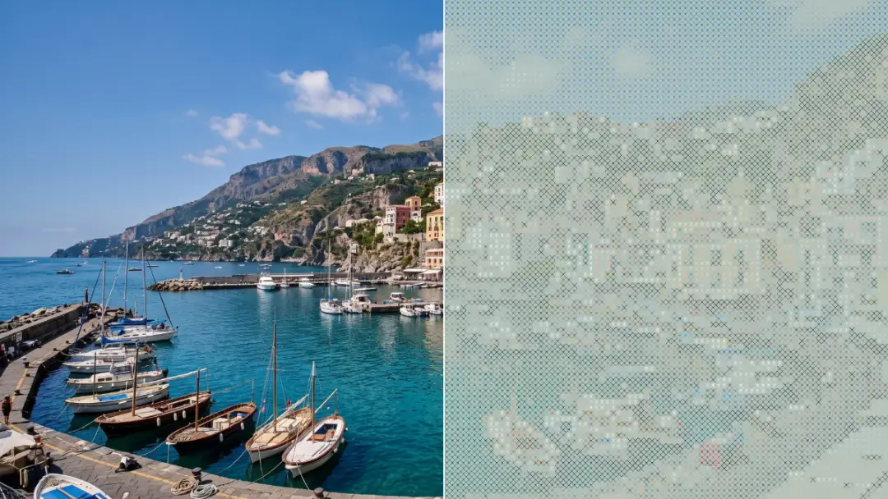

# Stitch Poster

<!-- effect-docs: basic page sha=522d24231016, written by scripts/effect-docs.mjs. Delete this line to write the page by hand (template B in Documentation-Site.md). -->

Combines character art with cross-stitch X marks that get denser in dark areas over a paper-tinted background; Cell Size sets stitch size.

Group: [Textile & Craft](../Effects-Textile.md) · [How to add an effect](../Effects.md#add-an-effect)

<figure class="docs-shot">

<figcaption>Left: the original. Right: Stitch Poster at its default settings.</figcaption>
</figure>

*A short page made from the editor’s effect catalog: what the effect does and its controls. Tips and its node setup will follow.*

## Controls

<!-- generated:controls start -->
| Control | Range | Default |
|---|---|---|
| **Grid** | | |
| Cell Size | 4 to 72 | 12 |
| **Style** | | |
| Amount | 0 to 1 | 1 |
| Invert Ramp | on or off | off |
| **Glyphs** | | |
| Ramp | standard, detailed, blocks, binary, numeric, symbols | symbols |
| Custom Ramp | text | empty |
| Font | Monospace, Serif, Sans Serif | Monospace |
| Weight | 200 to 900 | 600 |
| **Color** | | |
| Color Source | Source, Duotone | Source |
| Dark | a colour | `#081018` |
| Light | a colour | `#e8fff5` |
<!-- generated:controls end -->

**Styles:** the **Style** menu in the effect card switches to another look of the same engine. Controls with the same name keep their values and keyframes; the others start at their defaults. Looks under [Text & Glyph](../Effects-Glyph.md) (17).

## Technical details

Stitch Poster is one look of the glyph engine; its looks share one node setup. How effects are stored, rendered and exported: [Effect system](../Effect-System.md). Its building blocks: [Node Catalog](../Node-Catalog.md).
