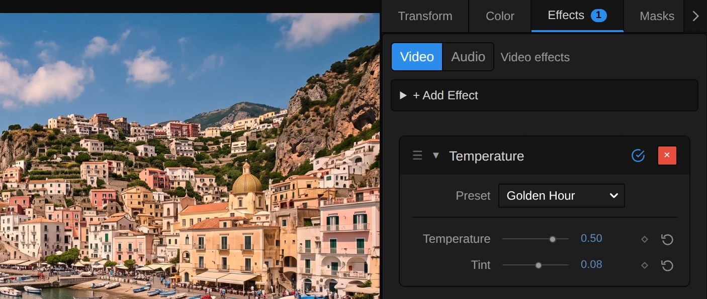
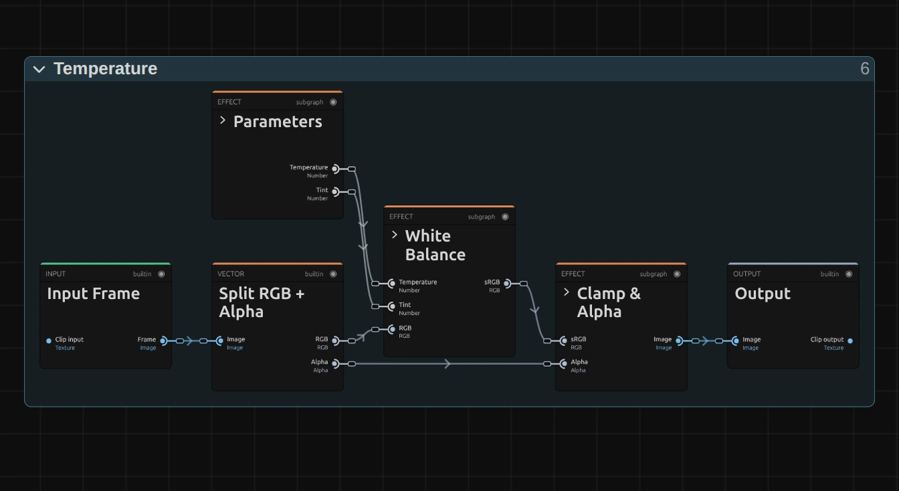
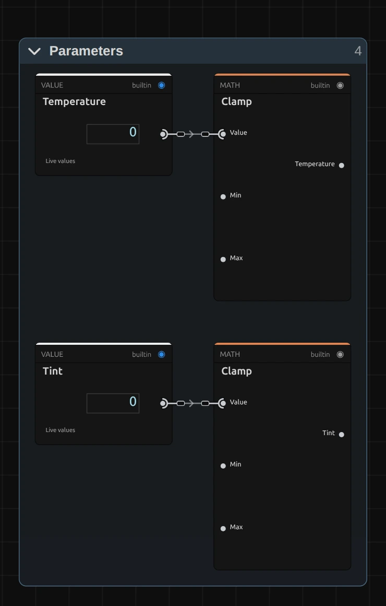
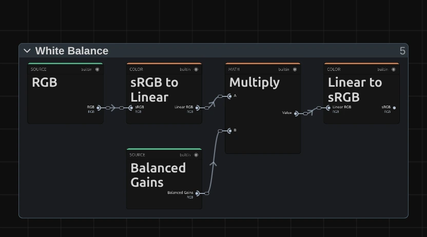
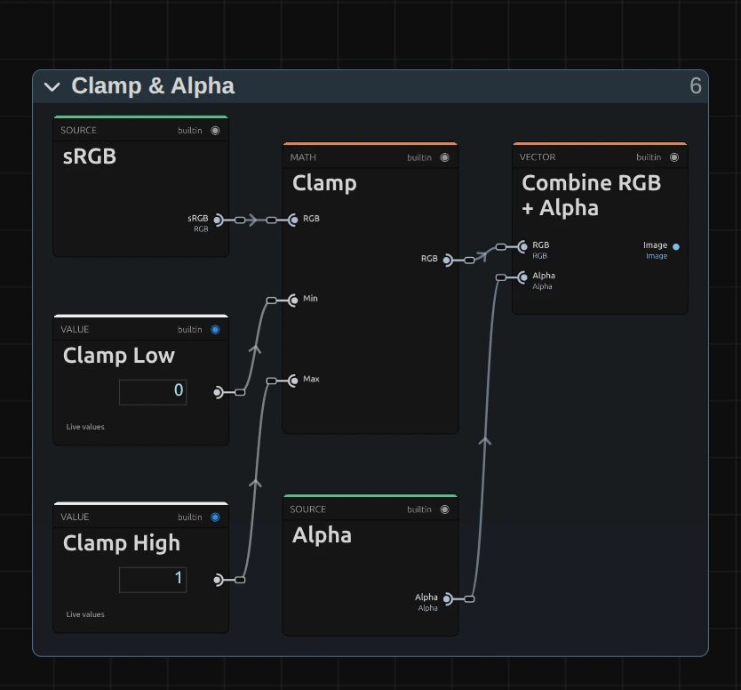

# Temperature

Makes the light warmer or cooler, like the white balance of a camera. Blacks stay black and the overall brightness stays the same.

Group: [Color & Tone](../Effects-Color.md) · [How to add an effect](../Effects.md#add-an-effect)

<figure class="docs-shot docs-compare">

<figcaption>Left: original. Right: Temperature 1, Tint 0.12 (the Candlelight preset).</figcaption>
</figure>

**Use it for:** footage shot under the wrong white balance · matching two cameras · a warm or cold mood of light, from late sun to moonlight.

- **Temperature** – warmer (orange) or cooler (blue) light.
- **Tint** – towards magenta or towards green.

**Tip:** a stage light that slowly goes cold: keyframe **Temperature** from 0 down to −0.8 over a scene. Since the brightness stays, the picture does not seem to fade, only the light changes its colour.

## Presets

<figure class="docs-shot docs-shot--detail">

<figcaption>The four presets on the dancer.</figcaption>
</figure>

Pick one in the **Preset** row of the effect card. It sets Temperature and Tint in one undo step, and the row then shows its name until you change a value. A keyframed control keeps its keyframes, and the card says so.

**Golden Hour** – the low sun of a late afternoon (Temperature 0.5, Tint 0.08). Warm, but still natural; the touch of magenta keeps skin from turning yellow.

**Candlelight** – a deep orange (Temperature 1, Tint 0.12), like a room lit by flames or an old tungsten bulb. For an intimate interior or a memory.

**Moonlight** – a cold, blue night (Temperature −0.8, Tint 0.1). The slight magenta keeps the blue from drifting into cyan. Lower [Exposure](./exposure.md) a little as well for a darker night.

**Fluorescent** – the green cast of old fluorescent tubes (Temperature −0.15, Tint −0.45): an office at night, a hospital corridor, a feeling of unease.

## Controls

<figure class="docs-shot">

<svg class="docs-shot-overlay" viewBox="0 0 1017 377" aria-hidden="true" focusable="false">
<defs><marker id="temperature-inspector-arrow" viewBox="0 0 10 10" refX="8" refY="5" markerWidth="5" markerHeight="5" orient="auto-start-reverse"><path d="M 0 0 L 10 5 L 0 10 Z" fill="#ffd54a" /></marker></defs>
<path class="docs-shot-arrow" d="M610 247 L694 247" marker-end="url(#temperature-inspector-arrow)" />
<circle class="docs-shot-number" cx="610" cy="247" r="18" /><text x="610" y="247" class="docs-shot-number-text">1</text>
<path class="docs-shot-arrow" d="M569 301 L653 301" marker-end="url(#temperature-inspector-arrow)" />
<circle class="docs-shot-number" cx="569" cy="301" r="18" /><text x="569" y="301" class="docs-shot-number-text">2</text>
<path class="docs-shot-arrow" d="M629 334 L713 334" marker-end="url(#temperature-inspector-arrow)" />
<circle class="docs-shot-number" cx="629" cy="334" r="18" /><text x="629" y="334" class="docs-shot-number-text">3</text>
</svg>

<figcaption>Temperature with the Candlelight preset. 1 — Preset: pick a starting point. 2 — Temperature: warmer or cooler light. 3 — Tint: towards magenta or green.</figcaption>
</figure>

**Preset** – one of the four starting points above; it sets both controls.

<figure class="docs-shot docs-clip docs-shot--float-right">
<video src="../assets/effects/clips/temperature-temperature.mp4" poster="../assets/effects/clips/temperature-temperature.webp" width="720" height="540" autoplay muted loop playsinline preload="none" aria-label="The dancer turning on a dark stage with Temperature while it runs from −1 to 1 and back: at −1 her dress turns a cold white and the backlight a deep blue, then the dress, her skin and the haze grow warmer until at 1 the whole stage glows orange like firelight, while the brightness stays the same; the current value is shown at the bottom left"></video>
<figcaption>Temperature from −1 to 1 and back.</figcaption>
</figure>

**Temperature** – warmer or cooler light, the way a camera's white balance shifts it. Above 0 red grows and blue shrinks, below 0 the other way round, while green stays and the brightness of every grey stays the same. 0.1–0.3 corrects footage that is a little too blue or too orange; 0.5–1 is a clear colour mood, from late sun to candlelight or from dusk to moonlight. Very bright colours can reach full red or full blue and stop there. −1 to 1, default 0. In the number field you can type up to ±4, a fiery orange or a deep blue; beyond that the picture uses the limit and the inspector says so.

<figure class="docs-shot docs-compare" data-before="Tint −0.6" data-after="Tint 0.6">

<figcaption>Left: Tint −0.6. Right: Tint 0.6.</figcaption>
</figure>

**Tint** – the second axis of white balance, between green and magenta. Above 0 green shrinks and the picture turns pinker; below 0 it turns greener. Use it to remove the green cast of fluorescent or cheap LED light (a little above 0), or to give a scene a sickly green. Small values do a lot: 0.1–0.2 is a correction, 0.5 a strong colour. It works together with **Temperature**: warm light usually wants a touch of magenta, so skin does not turn yellow. −1 to 1, default 0. In the number field you can type up to ±4.

## Node setup

<figure class="docs-shot docs-shot--graph">

<svg class="docs-shot-overlay" viewBox="0 0 1017 555" aria-hidden="true" focusable="false">
<defs><marker id="temperature-arrow" viewBox="0 0 10 10" refX="8" refY="5" markerWidth="5" markerHeight="5" orient="auto-start-reverse"><path d="M 0 0 L 10 5 L 0 10 Z" fill="#ffd54a" /></marker></defs>
<path class="docs-shot-arrow" d="M314 22 L314 96" marker-end="url(#temperature-arrow)" />
<circle class="docs-shot-number" cx="314" cy="22" r="18" /><text x="314" y="22" class="docs-shot-number-text">1</text>
<path class="docs-shot-arrow" d="M509 142 L509 226" marker-end="url(#temperature-arrow)" />
<circle class="docs-shot-number" cx="509" cy="142" r="18" /><text x="509" y="142" class="docs-shot-number-text">2</text>
<path class="docs-shot-arrow" d="M703 533 L703 449" marker-end="url(#temperature-arrow)" />
<circle class="docs-shot-number" cx="703" cy="533" r="18" /><text x="703" y="533" class="docs-shot-number-text">3</text>
</svg>

<figcaption>Temperature opened in the Nodes tab (the Constants folder left out). 1 — Parameters: Temperature and Tint, kept within their ranges. 2 — White Balance: turns them into a gain per colour and applies it to the light. 3 — Clamp & Alpha: keeps the colour within 0 to 1 and puts the transparency back.</figcaption>
</figure>

Temperature works in three stages ([Color & Tone](../Effects-Color.md#the-shared-idea) shows the shape all colour effects share): **Parameters** holds the two controls, the block **White Balance** does the work, and **Clamp & Alpha** finishes. **Split RGB + Alpha** takes the transparency aside first. Click a folder's header to open it; the sections below show what is inside. The same block is in **right-click → Reusable Nodes**.

### Parameters

<figure class="docs-shot docs-shot--graph docs-shot--float-right">

<svg class="docs-shot-overlay" viewBox="0 0 590 926" aria-hidden="true" focusable="false">
<defs><marker id="temperature-parameters-arrow" viewBox="0 0 10 10" refX="8" refY="5" markerWidth="5" markerHeight="5" orient="auto-start-reverse"><path d="M 0 0 L 10 5 L 0 10 Z" fill="#ffd54a" /></marker></defs>
<path class="docs-shot-arrow" d="M432 22 L432 106" marker-end="url(#temperature-parameters-arrow)" />
<circle class="docs-shot-number" cx="432" cy="22" r="18" /><text x="432" y="22" class="docs-shot-number-text">1</text>
</svg>

<figcaption>Inside Parameters (the limits of the Clamps left out). 1 — Clamp: keeps Temperature between −4 and 4; the Clamp below it does the same for Tint.</figcaption>
</figure>

**Clamp** – there are two, one per control. Each keeps its value between −4 and 4, the values in **Temperature Render Min** and **Temperature Render Max** (and the same pair for Tint). At ±4 red and blue are almost five stops apart, and every light colour has reached full orange or full blue. A driving node (LFO, Math) or the AI agent's effect update may send more; the picture then uses the limit, and the card and the tool result say so.

### White Balance: the gains

The block has two parts: it turns the two controls into one gain per colour channel, and then applies those gains to the light (next section).

<figure class="docs-shot docs-shot--graph">

<svg class="docs-shot-overlay" viewBox="0 0 1017 542" aria-hidden="true" focusable="false">
<defs><marker id="temperature-gains-arrow" viewBox="0 0 10 10" refX="8" refY="5" markerWidth="5" markerHeight="5" orient="auto-start-reverse"><path d="M 0 0 L 10 5 L 0 10 Z" fill="#ffd54a" /></marker></defs>
<path class="docs-shot-arrow" d="M204 22 L204 106" marker-end="url(#temperature-gains-arrow)" />
<circle class="docs-shot-number" cx="204" cy="22" r="18" /><text x="204" y="22" class="docs-shot-number-text">1</text>
<path class="docs-shot-arrow" d="M448 22 L448 106" marker-end="url(#temperature-gains-arrow)" />
<circle class="docs-shot-number" cx="448" cy="22" r="18" /><text x="448" y="22" class="docs-shot-number-text">2</text>
<path class="docs-shot-arrow" d="M813 237 L813 153" marker-end="url(#temperature-gains-arrow)" />
<circle class="docs-shot-number" cx="813" cy="237" r="18" /><text x="813" y="237" class="docs-shot-number-text">3</text>
<path class="docs-shot-arrow" d="M935 22 L935 106" marker-end="url(#temperature-gains-arrow)" />
<circle class="docs-shot-number" cx="935" cy="22" r="18" /><text x="935" y="22" class="docs-shot-number-text">4</text>
</svg>

<figcaption>Inside White Balance, the gains. 1 — Multiply: Temperature in stops. 2 — Power of Two: stops to a gain. 3 — Luminance: how bright the gains are together. 4 — Divide: scales the gains so grey keeps its brightness.</figcaption>
</figure>

**Multiply** – there are three. The top one turns Temperature into stops: one unit is 0.6 stops (the **Value** 0.6). The one below gives the Tint's share for red and blue (Value 0.25), the lowest one the Tint's stops for green (Value −0.5). **Add** then collects the stops of red, **Subtract** those of blue: warmth adds to red and is taken from blue.

**Power of Two** – there are three, one per channel. Each turns stops into a gain: 0 stops is 1 (no change), +0.6 stops is 1.52, −0.6 stops 0.66. **Combine Vector** and **Vector to RGB** join the three gains into one colour.

**Luminance** – how bright those gains would make a white, measured as the eye sees it (Rec.709: 21 % red, 72 % green, 7 % blue).

**Divide** – divides the gains by that brightness. The result, the **Balanced Gains**, changes the colour of the light but not its strength, so a grey stays exactly as bright as before at every setting.

**Remix:** select the **Value** 0.6 and set it to 0.3 in the node inspector: the Temperature slider becomes half as strong, for fine corrections over its whole travel.

### White Balance: in linear light

<figure class="docs-shot docs-shot--graph docs-shot--float-right">

<svg class="docs-shot-overlay" viewBox="0 0 590 328" aria-hidden="true" focusable="false">
<defs><marker id="temperature-light-arrow" viewBox="0 0 10 10" refX="8" refY="5" markerWidth="5" markerHeight="5" orient="auto-start-reverse"><path d="M 0 0 L 10 5 L 0 10 Z" fill="#ffd54a" /></marker></defs>
<path class="docs-shot-arrow" d="M227 22 L227 81" marker-end="url(#temperature-light-arrow)" />
<circle class="docs-shot-number" cx="227" cy="22" r="18" /><text x="227" y="22" class="docs-shot-number-text">1</text>
<path class="docs-shot-arrow" d="M363 22 L363 81" marker-end="url(#temperature-light-arrow)" />
<circle class="docs-shot-number" cx="363" cy="22" r="18" /><text x="363" y="22" class="docs-shot-number-text">2</text>
<path class="docs-shot-arrow" d="M500 22 L500 81" marker-end="url(#temperature-light-arrow)" />
<circle class="docs-shot-number" cx="500" cy="22" r="18" /><text x="500" y="22" class="docs-shot-number-text">3</text>
</svg>

<figcaption>Inside White Balance, the light (the gains come in as a stub). 1 — sRGB to Linear: screen colours to amounts of light. 2 — Multiply: applies the gains. 3 — Linear to sRGB: back to screen colours.</figcaption>
</figure>

**sRGB to Linear** – screen colours are stored brighter than the light they stand for. This turns them back into amounts of light, as [Exposure](./exposure.md#exposure-stops) does too.

**Multiply** – multiplies each channel's light by its balanced gain. Black has no light to multiply, so it stays black.

**Linear to sRGB** – turns the light back into screen colours. Because the gains act on light and not on the stored values, the shift looks like a different lamp, not like a coloured layer laid over the picture.

### Clamp & Alpha

<figure class="docs-shot docs-shot--graph docs-shot--float-right">

<svg class="docs-shot-overlay" viewBox="0 0 590 549" aria-hidden="true" focusable="false">
<defs><marker id="temperature-finish-arrow" viewBox="0 0 10 10" refX="8" refY="5" markerWidth="5" markerHeight="5" orient="auto-start-reverse"><path d="M 0 0 L 10 5 L 0 10 Z" fill="#ffd54a" /></marker></defs>
<path class="docs-shot-arrow" d="M295 23 L295 107" marker-end="url(#temperature-finish-arrow)" />
<circle class="docs-shot-number" cx="295" cy="23" r="18" /><text x="295" y="23" class="docs-shot-number-text">1</text>
</svg>

<figcaption>Inside Clamp & Alpha. 1 — Clamp: keeps each channel between 0 and 1.</figcaption>
</figure>

**Clamp** – keeps each colour channel between 0 and 1 (its Clamp Low and Clamp High cards). A channel that a gain pushed past full stays at full: this is where very bright colours stop at full red or full blue.

**Combine RGB + Alpha** then puts the original transparency back, untouched.

## Technical details

- **Formula.** In linear light each channel is multiplied by `g / L(g)`, with the gains `g = (2^(0.6·T + 0.25·Tint), 2^(−0.5·Tint), 2^(0.25·Tint − 0.6·T))` and `L` the Rec.709 luminance. Temperature 1 puts red and blue 1.2 stops apart; Tint 1 puts green 0.75 stops below red and blue. Grey keeps its luminance, black stays black; the result is limited to 0–1. There is no Kelvin scale.
- **Range.** The sliders cover −1 to 1; typed values (also keyed in the inspector) and driving nodes render up to ±4. Beyond that the picture uses the limit, and the inspector and the tool result say so.
- **Transparency.** Only the colour is changed; the transparency passes through untouched.
- What all colour effects share (8-bit range, saved projects, adjustment layers): [Color & Tone](../Effect-System.md#color--tone-notes). Formulas: [Effect system](../Effect-System.md#editable-color-effect-graphs); blocks: [Node Catalog](../Node-Catalog.md) · [Styles and presets](../Effects.md#styles-and-presets).
