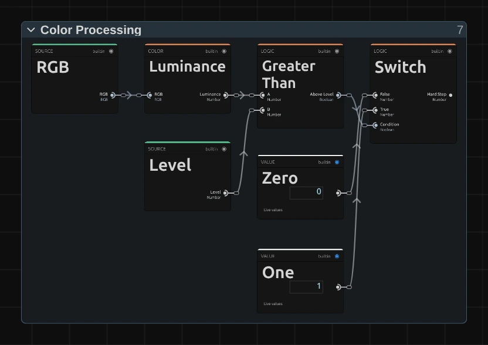

# Threshold

Turns the picture into pure black and white at a brightness you choose. Everything brighter becomes
white, the rest black.

Group: [Color & Tone](../Effects-Color.md) · [How to add an effect](../Effects.md#add-an-effect)

<figure class="docs-shot">

<figcaption>Left: original. Right: Level 0.3, Softness 0.12.</figcaption>
</figure>

**Use it for:** a hard silhouette · a graphic, xeroxed look · a black-and-white matte to use as a
mask.

- **Level** – the brightness that splits black from white.
- **Softness** – a soft grey edge instead of a hard cut.

**Tip:** animate Level for a silhouette that appears out of the dark.

## Controls

<!-- generated:controls start -->
| Control | Range | Default |
|---|---|---|
| Level | 0 to 1 | 0.5 |
| Softness | 0 to 0.5 | 0 |
<!-- generated:controls end -->

## Node setup

<figure class="docs-shot docs-shot--float-right">

<figcaption>The core of Threshold: Greater Than compares the brightness with Level, and a Switch picks Zero (black) or One (white).</figcaption>
</figure>

**Luminance** measures the brightness, **Greater Than** compares it with **Level**, and a **Switch**
picks black or white. With Softness above 0, a **Mix** blends in a soft ramp instead of the hard
step.

**Remix:** for black where the picture is bright (with Softness at 0), swap the two cables at the
**Switch**: **One** into False, **Zero** into True.

## Technical details

- **Brightness.** Rec.709 brightness against Level. Softness widens the hard step into a smooth ramp
  of that width around Level; Softness 0 is pixel-identical to the earlier hard step. The
  transparency is kept.
- **Saved projects.** Untouched earlier Threshold graphs become the current recipe automatically;
  edited ones stay as saved.
- Formulas and history: [Effect system](../Effect-System.md#editable-color-effect-graphs); blocks:
  [Node Catalog](../Node-Catalog.md).
