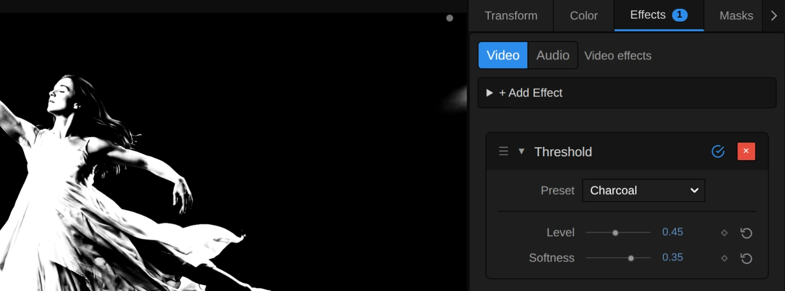
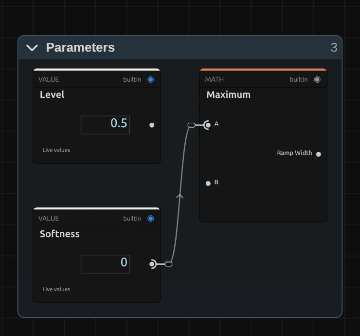
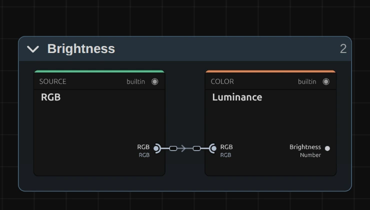
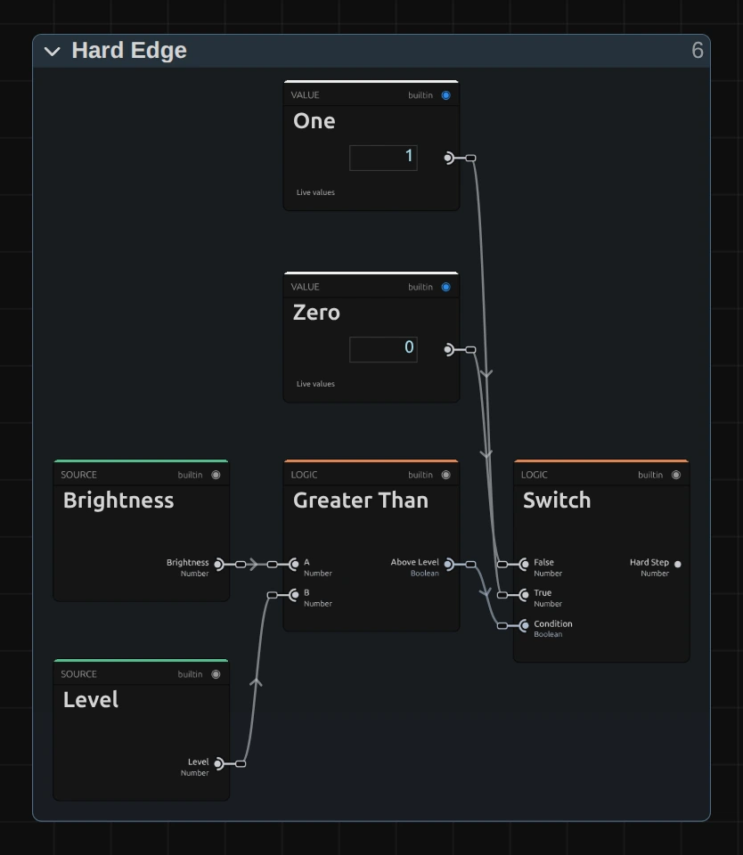
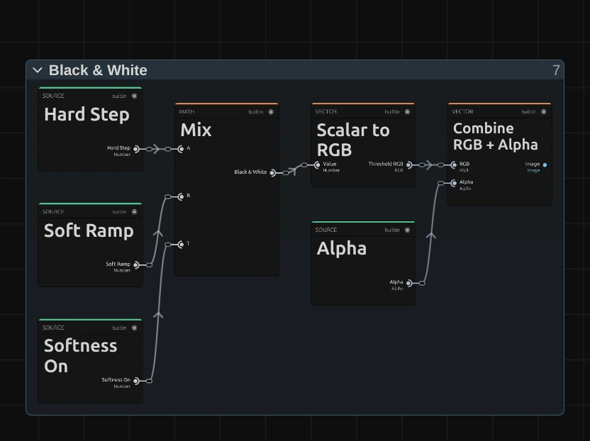

# Threshold

Turns the picture into pure black and white: everything brighter than **Level** becomes white, the rest black. With **Softness** the cut gets a grey edge.

Group: [Color & Tone](../Effects-Color.md) · [How to add an effect](../Effects.md#add-an-effect)

<figure class="docs-shot docs-compare">

<figcaption>Left: original. Right: Level 0.2, Softness 0.06 (the Shadow Matte preset).</figcaption>
</figure>

**Use it for:** a hard silhouette · a graphic, photocopied look · a black-and-white layer to blend over the original.

- **Level** – the brightness where black turns into white.
- **Softness** – a soft grey edge instead of a hard cut.

**Tip:** put Threshold on a copy of the clip above the original and set the copy's blend mode to **Screen** in the Transform panel: white burns the brightest parts out, black leaves the rest as it was. With noisy footage raise **Softness** a little (0.05–0.1), so the edge stops crawling.

## Presets

<figure class="docs-shot docs-shot--detail">

<figcaption>The four presets on the harbour.</figcaption>
</figure>

Pick one in the **Preset** row of the effect card. It sets both controls in one undo step, and the row then shows its name until you change a value. A keyframed control keeps its keyframes, and the card says so.

**Photocopy** – the plain hard cut at middle grey (Level 0.5, Softness 0), like a copy machine turned up too far. Clear shapes, no grey at all.

**Charcoal** – a wide soft edge (Level 0.45, Softness 0.35): the bright and dark parts are still black and white, but everything in between keeps grey half-tones, like a charcoal drawing. Faces and folds stay readable.

**Highlights** – only the brightest lights stay white (Level 0.75, Softness 0.08): lamps, neon, a spotlight on skin, light on water. Over the original in Screen mode only the lights burn out.

**Shadow Matte** – everything except the deepest shadows turns white (Level 0.2, Softness 0.06). Dark figures stand out as black shapes against a white world. Over the original in Multiply mode only the shadows sink into solid black.

## Controls

<figure class="docs-shot">

<svg class="docs-shot-overlay" viewBox="0 0 1017 431" aria-hidden="true" focusable="false">
<defs><marker id="threshold-inspector-arrow" viewBox="0 0 10 10" refX="8" refY="5" markerWidth="5" markerHeight="5" orient="auto-start-reverse"><path d="M 0 0 L 10 5 L 0 10 Z" fill="#ffd54a" /></marker></defs>
<path class="docs-shot-arrow" d="M565 282 L649 282" marker-end="url(#threshold-inspector-arrow)" />
<circle class="docs-shot-number" cx="565" cy="282" r="18" /><text x="565" y="282" class="docs-shot-number-text">1</text>
<path class="docs-shot-arrow" d="M574 344 L658 344" marker-end="url(#threshold-inspector-arrow)" />
<circle class="docs-shot-number" cx="574" cy="344" r="18" /><text x="574" y="344" class="docs-shot-number-text">2</text>
<path class="docs-shot-arrow" d="M548 382 L632 382" marker-end="url(#threshold-inspector-arrow)" />
<circle class="docs-shot-number" cx="548" cy="382" r="18" /><text x="548" y="382" class="docs-shot-number-text">3</text>
</svg>

<figcaption>Threshold with the Charcoal preset. 1 — Preset: pick a starting point. 2 — Level: where black turns white. 3 — Softness: a grey edge instead of a hard cut.</figcaption>
</figure>

**Preset** – one of the four starting points above; it sets both controls.

<figure class="docs-shot docs-clip docs-shot--float-right">
<video src="../assets/effects/clips/threshold-level.mp4" poster="../assets/effects/clips/threshold-level.webp" width="720" height="540" autoplay muted loop playsinline preload="none" aria-label="The dancer turning on a dark stage with Threshold while Level runs from 0.15 to 0.7 and back: at 0.15 she is a full white silhouette standing on a white-speckled floor, as Level rises the floor goes black and her figure thins out until at 0.7 only the brightest folds of her dress, her arms and her face are left, then she fills in again; the current value is shown at the bottom left"></video>
<figcaption>Level from 0.15 to 0.7 and back (Softness 0).</figcaption>
</figure>

**Level** – the brightness where black turns into white, measured like the eye sees it (green counts most, blue least). Low values make almost everything white and leave only the darkest shadows black; around 0.5 (the default) a figure in a spotlight becomes a clean white silhouette; from about 0.7 only the brightest lights are left. At 1 everything is black, since nothing is brighter than white. Animate it for a silhouette that grows out of the dark or burns away. 0 to 1, default 0.5. A keyframe, a node or the AI agent may send a value outside: below 0 everything turns white, above 1 everything black.

<figure class="docs-shot docs-compare" data-before="Softness 0" data-after="Softness 0.4">

<figcaption>Left: Softness 0. Right: Softness 0.4. Both Level 0.4.</figcaption>
</figure>

**Softness** – turns the hard cut into a smooth grey ramp, centred on Level. At 0 (the default) every pixel is pure black or pure white, and where the picture is noisy the edge breaks into grainy, flickering borders. 0.05–0.1 only smooths that edge; 0.2–0.35 keeps grey shading in faces and fabric, like a drawing; at 0.5 the ramp spans half the brightness range and the picture comes close to a high-contrast black-and-white photo. Because the ramp is centred, a wide Softness with Level near 0 or 1 turns even pure black (or pure white) grey. 0 to 0.5, default 0. A value below 0 is used as 0, and the card says so; a value typed past 0.5 widens the ramp further.

## Node setup

<figure class="docs-shot docs-shot--graph">

<svg class="docs-shot-overlay" viewBox="0 0 1017 538" aria-hidden="true" focusable="false">
<defs><marker id="threshold-arrow" viewBox="0 0 10 10" refX="8" refY="5" markerWidth="5" markerHeight="5" orient="auto-start-reverse"><path d="M 0 0 L 10 5 L 0 10 Z" fill="#ffd54a" /></marker></defs>
<path class="docs-shot-arrow" d="M427 474 L427 390" marker-end="url(#threshold-arrow)" />
<circle class="docs-shot-number" cx="427" cy="474" r="18" /><text x="427" y="474" class="docs-shot-number-text">1</text>
<path class="docs-shot-arrow" d="M427 22 L427 83" marker-end="url(#threshold-arrow)" />
<circle class="docs-shot-number" cx="427" cy="22" r="18" /><text x="427" y="22" class="docs-shot-number-text">2</text>
<path class="docs-shot-arrow" d="M589 22 L589 94" marker-end="url(#threshold-arrow)" />
<circle class="docs-shot-number" cx="589" cy="22" r="18" /><text x="589" y="22" class="docs-shot-number-text">3</text>
<path class="docs-shot-arrow" d="M589 515 L589 431" marker-end="url(#threshold-arrow)" />
<circle class="docs-shot-number" cx="589" cy="515" r="18" /><text x="589" y="515" class="docs-shot-number-text">4</text>
<path class="docs-shot-arrow" d="M752 26 L752 110" marker-end="url(#threshold-arrow)" />
<circle class="docs-shot-number" cx="752" cy="26" r="18" /><text x="752" y="26" class="docs-shot-number-text">5</text>
</svg>

<figcaption>Threshold opened in the Nodes tab (the Constants folder left out). 1 — Parameters: the two controls, made safe. 2 — Brightness: one number per pixel. 3 — Hard Edge: black or white at Level. 4 — Soft Edge: the grey ramp around Level. 5 — Black & White: picks the edge and builds the picture.</figcaption>
</figure>

Threshold works as a short path of stages, one folder each: **Parameters** holds the two controls, **Brightness** measures each pixel, **Hard Edge** and **Soft Edge** work side by side on that brightness, and **Black & White** picks one of them and turns it back into a picture with its transparency. Click a folder's header to open it; the sections below show what is inside.

### Parameters

<figure class="docs-shot docs-shot--graph docs-shot--float-right">

<svg class="docs-shot-overlay" viewBox="0 0 590 551" aria-hidden="true" focusable="false">
<defs><marker id="threshold-parameters-arrow" viewBox="0 0 10 10" refX="8" refY="5" markerWidth="5" markerHeight="5" orient="auto-start-reverse"><path d="M 0 0 L 10 5 L 0 10 Z" fill="#ffd54a" /></marker></defs>
<path class="docs-shot-arrow" d="M432 22 L432 106" marker-end="url(#threshold-parameters-arrow)" />
<circle class="docs-shot-number" cx="432" cy="22" r="18" /><text x="432" y="22" class="docs-shot-number-text">1</text>
</svg>

<figcaption>Inside Parameters (the limits left out). 1 — Maximum: Softness, never quite 0.</figcaption>
</figure>

**Level** and **Softness** are the two controls of the card. Level goes on as it is.

**Maximum** – Softness, but never below 0.0001 (the **Ramp Floor** in Constants): the **Ramp Width**. The Soft Edge divides by this width, so it must not be 0; at Softness 0 the soft edge is switched off anyway (see Black & White).

### Brightness

<figure class="docs-shot docs-shot--graph docs-shot--float-right">

<svg class="docs-shot-overlay" viewBox="0 0 590 335" aria-hidden="true" focusable="false">
<defs><marker id="threshold-brightness-arrow" viewBox="0 0 10 10" refX="8" refY="5" markerWidth="5" markerHeight="5" orient="auto-start-reverse"><path d="M 0 0 L 10 5 L 0 10 Z" fill="#ffd54a" /></marker></defs>
<path class="docs-shot-arrow" d="M432 22 L432 106" marker-end="url(#threshold-brightness-arrow)" />
<circle class="docs-shot-number" cx="432" cy="22" r="18" /><text x="432" y="22" class="docs-shot-number-text">1</text>
</svg>

<figcaption>Inside Brightness. 1 — Luminance: the brightness of each pixel.</figcaption>
</figure>

**Luminance** – turns the colour of each pixel into one number from 0 to 1, weighted like the eye sees it (Rec. 709: green counts most, blue least). A pure green is much brighter here than a pure blue, so it turns white sooner. Both edges read this number.

### Hard Edge

<figure class="docs-shot docs-shot--graph docs-shot--float-right">

<svg class="docs-shot-overlay" viewBox="0 0 590 680" aria-hidden="true" focusable="false">
<defs><marker id="threshold-hard-arrow" viewBox="0 0 10 10" refX="8" refY="5" markerWidth="5" markerHeight="5" orient="auto-start-reverse"><path d="M 0 0 L 10 5 L 0 10 Z" fill="#ffd54a" /></marker></defs>
<path class="docs-shot-arrow" d="M295 592 L295 508" marker-end="url(#threshold-hard-arrow)" />
<circle class="docs-shot-number" cx="295" cy="592" r="18" /><text x="295" y="592" class="docs-shot-number-text">1</text>
<path class="docs-shot-arrow" d="M478 275 L478 359" marker-end="url(#threshold-hard-arrow)" />
<circle class="docs-shot-number" cx="478" cy="275" r="18" /><text x="478" y="275" class="docs-shot-number-text">2</text>
</svg>

<figcaption>Inside Hard Edge. 1 — Greater Than: is the pixel above Level. 2 — Switch: black or white.</figcaption>
</figure>

**Greater Than** – asks for each pixel whether its brightness is above Level: **Above Level** is true or false. A pixel exactly at Level counts as not above, which is why Level 1 leaves even pure white black.

**Switch** – turns that answer into a value: **One** (white) when it is true, **Zero** (black) when it is false. This is the **Hard Step**, the plain cut.

**Remix:** with Softness at 0, swap the two cables at the **Switch**: **One** into False and **Zero** into True. The bright parts then turn black and the dark parts white, a negative of the cut.

### Soft Edge

<figure class="docs-shot docs-shot--graph">

<svg class="docs-shot-overlay" viewBox="0 0 1017 487" aria-hidden="true" focusable="false">
<defs><marker id="threshold-soft-arrow" viewBox="0 0 10 10" refX="8" refY="5" markerWidth="5" markerHeight="5" orient="auto-start-reverse"><path d="M 0 0 L 10 5 L 0 10 Z" fill="#ffd54a" /></marker></defs>
<path class="docs-shot-arrow" d="M204 22 L204 106" marker-end="url(#threshold-soft-arrow)" />
<circle class="docs-shot-number" cx="204" cy="22" r="18" /><text x="204" y="22" class="docs-shot-number-text">1</text>
<path class="docs-shot-arrow" d="M326 22 L326 106" marker-end="url(#threshold-soft-arrow)" />
<circle class="docs-shot-number" cx="326" cy="22" r="18" /><text x="326" y="22" class="docs-shot-number-text">2</text>
<path class="docs-shot-arrow" d="M569 22 L569 106" marker-end="url(#threshold-soft-arrow)" />
<circle class="docs-shot-number" cx="569" cy="22" r="18" /><text x="569" y="22" class="docs-shot-number-text">3</text>
<path class="docs-shot-arrow" d="M935 22 L935 106" marker-end="url(#threshold-soft-arrow)" />
<circle class="docs-shot-number" cx="935" cy="22" r="18" /><text x="935" y="22" class="docs-shot-number-text">4</text>
<path class="docs-shot-arrow" d="M326 450 L326 366" marker-end="url(#threshold-soft-arrow)" />
<circle class="docs-shot-number" cx="326" cy="450" r="18" /><text x="326" y="450" class="docs-shot-number-text">5</text>
</svg>

<figcaption>Inside Soft Edge (the Constants left out). 1 — Subtract: how far from Level. 2 — Divide: in ramp widths. 3 — Clamp: 0 to 1 across the ramp. 4 — Multiply: the smooth S-curve. 5 — Switch: is Softness on.</figcaption>
</figure>

**Subtract** – the brightness minus Level: the **Distance** of each pixel from the cut, negative below it and positive above it.

**Divide** – divides that distance by the **Ramp Width**: at Softness 0.35 the ramp is 0.35 wide, and the distance now counts in ramp widths. **Add** then moves it up by a half, so Level itself sits in the middle of the ramp.

**Clamp** – keeps the result between 0 and 1: the **Ramp Position**, 0 below the ramp, 1 above it, and in between on the ramp itself.

**Multiply** – the last of three Multiply cards that bend the Ramp Position into a smooth S-curve, t × t × (3 − 2 t), the **Soft Ramp**: it starts and ends flat, so the grey edge has no visible corner where it meets black or white.

**Switch** – 1 when Softness is above 0, else 0 (**Greater Than** asks the question): **Softness On**.

### Black & White

<figure class="docs-shot docs-shot--graph docs-shot--float-right">

<svg class="docs-shot-overlay" viewBox="0 0 590 441" aria-hidden="true" focusable="false">
<defs><marker id="threshold-finish-arrow" viewBox="0 0 10 10" refX="8" refY="5" markerWidth="5" markerHeight="5" orient="auto-start-reverse"><path d="M 0 0 L 10 5 L 0 10 Z" fill="#ffd54a" /></marker></defs>
<path class="docs-shot-arrow" d="M227 22 L227 97" marker-end="url(#threshold-finish-arrow)" />
<circle class="docs-shot-number" cx="227" cy="22" r="18" /><text x="227" y="22" class="docs-shot-number-text">1</text>
<path class="docs-shot-arrow" d="M363 22 L363 97" marker-end="url(#threshold-finish-arrow)" />
<circle class="docs-shot-number" cx="363" cy="22" r="18" /><text x="363" y="22" class="docs-shot-number-text">2</text>
<path class="docs-shot-arrow" d="M500 22 L500 97" marker-end="url(#threshold-finish-arrow)" />
<circle class="docs-shot-number" cx="500" cy="22" r="18" /><text x="500" y="22" class="docs-shot-number-text">3</text>
</svg>

<figcaption>Inside Black & White. 1 — Mix: the hard or the soft edge. 2 — Scalar to RGB: the value as a grey. 3 — Combine RGB + Alpha: the transparency back on.</figcaption>
</figure>

**Mix** – takes the Hard Step when Softness is 0 and the Soft Ramp above it. So Softness 0 is exactly the plain cut, without any rounding.

**Scalar to RGB** – puts that one value into red, green and blue alike: black, white or a grey in between, the **Threshold RGB**.

**Combine RGB + Alpha** – joins it with the original transparency, untouched. A cut-out keeps its shape, and a soft edge stays soft.

## Technical details

- **Formula.** With `y` the Rec. 709 brightness of a pixel and `L` = Level: white where `y > L`, black elsewhere. Softness `s` above 0 replaces the cut with `smoothstep` over `L − s/2 … L + s/2`; Softness 0 is pixel-identical to the earlier hard step.
- **Limits.** Softness below 0 renders as 0 (hard), and the card and the tool result say so. Level is used as it is: below 0 everything is white, from 1 everything black.
- **Transparency.** Only the colour is replaced; the transparency passes through untouched.
- **Saved projects.** Untouched earlier Threshold graphs become the current recipe; edited ones stay as saved. A saved graph that already has its folders keeps them (an older one: one Color Processing folder); a newly added Threshold opens with the stage folders above. The picture is the same either way.
- What all colour effects share (8-bit range, adjustment layers): [Color & Tone](../Effect-System.md#color--tone-notes). Formulas and history: [Effect system](../Effect-System.md#editable-color-effect-graphs); blocks: [Node Catalog](../Node-Catalog.md) · [Styles and presets](../Effects.md#styles-and-presets).
