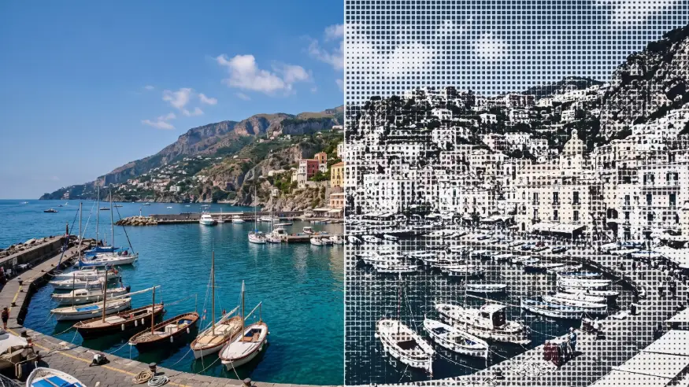

# Tone Geometry

<!-- effect-docs: basic page sha=2556f77223f6, written by scripts/effect-docs.mjs. Delete this line to write the page by hand (template B in Documentation-Site.md). -->

Replaces the image with a grid of squares, circles or triangles sized by darkness, in Ink on Paper; Shape picks the form, Scale the cell size.

Group: [Print & Halftone](../Effects-Print.md) · [How to add an effect](../Effects.md#add-an-effect)

<figure class="docs-shot">

<figcaption>Left: the original. Right: Tone Geometry at its default settings, one frame of its movement.</figcaption>
</figure>

*A short page made from the editor’s effect catalog: what the effect does and its controls. Tips and its node setup will follow.*

## Controls

<!-- generated:controls start -->
| Control | Range | Default |
|---|---|---|
| **Pattern** | | |
| Scale | 2 to 80 | 14 |
| Angle | −180 to 180 | 0 |
| Shape | square, circle, triangle | square |
| **Mix** | | |
| Amount | 0 to 1 | 0.75 |
| **Color** | | |
| Ink | a colour | `#111827` |
| Paper | a colour | `#f8fafc` |
| **Motion** | | |
| Speed | 0 to 5 | 1 |
<!-- generated:controls end -->

**Styles:** the **Style** menu in the effect card switches to another look of the same engine. Controls with the same name keep their values and keyframes; the others start at their defaults. Looks of Print & Halftone: [Dither Studio](./dither-studio.md), [Dithering](./dither.md), [Halftone](./halftone.md), [Paper Print](./paper-print.md), [Pattern Halftone](./pattern-halftone.md), [Riso](./riso.md), [Riso Glow](./riso-glow.md). Further looks under [Lens & Distort](../Effects-Distort.md) (4), [Pixel & Mosaic](../Effects-Pixel.md) (2), [Lines & Engraving](../Effects-Lines.md) (6), [Textile & Craft](../Effects-Textile.md) (3), [Analog & Glitch](../Effects-Analog.md) (4), [3D & Particles](../Effects-3D-Particles.md) (1).

## Technical details

Tone Geometry is one look of the pattern engine; its looks share one node setup. It keeps moving while the playhead stands still. How effects are stored, rendered and exported: [Effect system](../Effect-System.md). Its building blocks: [Node Catalog](../Node-Catalog.md).
