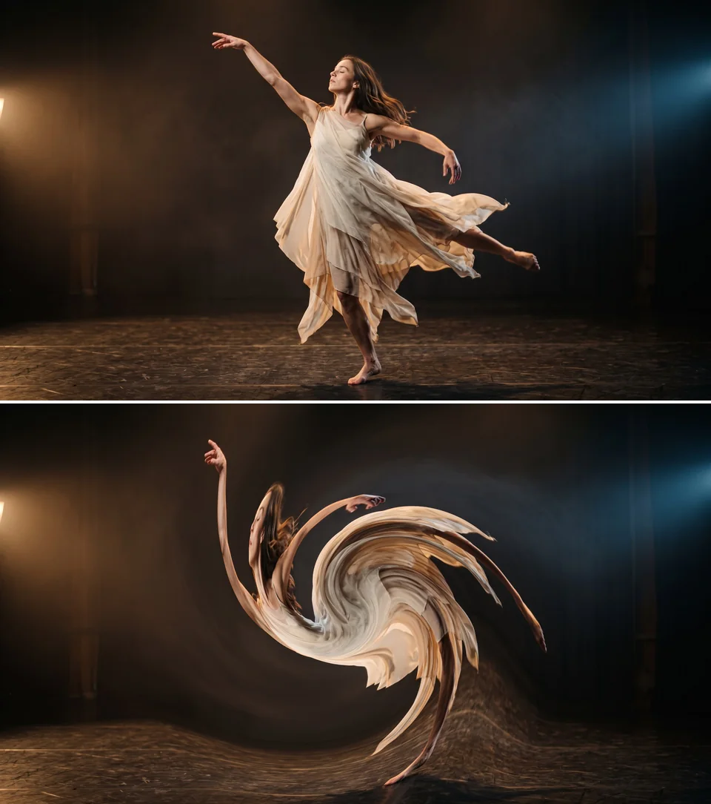
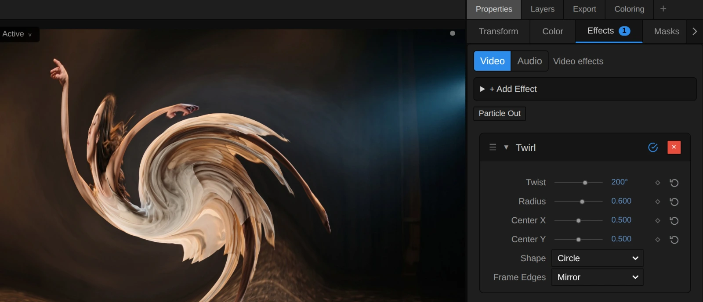
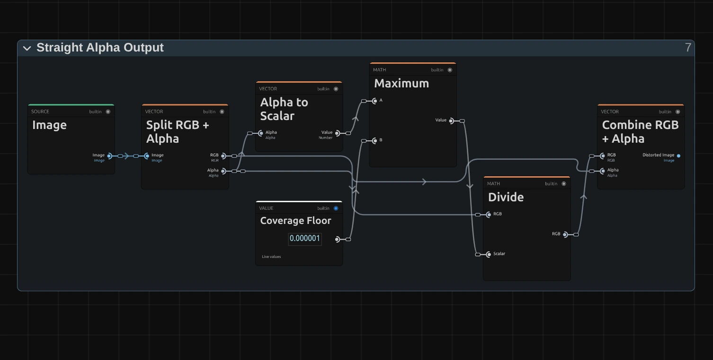

# Twirl

Winds the picture into a spiral around a centre point, strongest in the middle. For swirl transitions, dreams and whirlpools.

Group: [Lens & Distort](../Effects-Distort.md) · [How to add an effect](../Effects.md#add-an-effect)

<figure class="docs-shot docs-compare">

<figcaption>Left: original. Right: Twist 200°, Radius 0.6.</figcaption>
</figure>

**Use it for:** a swirl transition · a dream or a dizzy spell · a whirlpool in water, smoke or light.

- **Twist** – how far the middle turns.
- **Radius** – how large the turning area is.
- **Center X / Center Y** – where the middle of the spiral sits.

**Tip:** keyframe **Twist** from 0 up to 360° over the last second of one shot and from 360° back to 0 over the first second of the next: the cut disappears inside a whirlpool.

## Presets

<figure class="docs-shot docs-shot--detail">

<figcaption>The four presets on the dancer.</figcaption>
</figure>

Pick one in the **Preset** row of the effect card. It sets all controls at once, in one undo step, and the row then shows its name until you change something. A control with keyframes keeps them, and the card says so.

**Soft Stir** – Twist 80°, Radius 0.8: the picture bends gently over a wide area and stays easy to read, as if seen through moving water. Good for unease or a memory.

**Knot** – Twist 540°, Radius 0.25: a small, tight spiral in the middle, the rest of the frame untouched. Put **Center X / Center Y** on a body or a face to twist just that.

**Whirlpool** – Twist 360°, Radius 0.6: one full turn that draws the middle of the picture into a clear spiral, while the edges still show the scene.

**Vortex** – Twist 720°, Radius 1: two full turns across the whole frame. Nothing is left but rings of colour; strong at the peak of a swirl transition.

## Controls

<figure class="docs-shot">

<svg class="docs-shot-overlay" viewBox="0 0 1017 581" aria-hidden="true" focusable="false">
<defs><marker id="twirl-inspector-arrow" viewBox="0 0 10 10" refX="8" refY="5" markerWidth="5" markerHeight="5" orient="auto-start-reverse"><path d="M 0 0 L 10 5 L 0 10 Z" fill="#ffd54a" /></marker></defs>
<path class="docs-shot-arrow" d="M565 282 L649 282" marker-end="url(#twirl-inspector-arrow)" />
<circle class="docs-shot-number" cx="565" cy="282" r="18" /><text x="565" y="282" class="docs-shot-number-text">1</text>
<path class="docs-shot-arrow" d="M576 344 L660 344" marker-end="url(#twirl-inspector-arrow)" />
<circle class="docs-shot-number" cx="576" cy="344" r="18" /><text x="576" y="344" class="docs-shot-number-text">2</text>
<path class="docs-shot-arrow" d="M561 382 L645 382" marker-end="url(#twirl-inspector-arrow)" />
<circle class="docs-shot-number" cx="561" cy="382" r="18" /><text x="561" y="382" class="docs-shot-number-text">3</text>
<path class="docs-shot-arrow" d="M547 419 L631 419" marker-end="url(#twirl-inspector-arrow)" />
<circle class="docs-shot-number" cx="547" cy="419" r="18" /><text x="547" y="419" class="docs-shot-number-text">4</text>
<path class="docs-shot-arrow" d="M511 532 L595 532" marker-end="url(#twirl-inspector-arrow)" />
<circle class="docs-shot-number" cx="511" cy="532" r="18" /><text x="511" y="532" class="docs-shot-number-text">5</text>
</svg>

<figcaption>Twirl with the Whirlpool preset. 1 — Preset: pick a starting point. 2 — Twist: how far the middle turns. 3 — Radius: how large the area is. 4 — Center X: where the middle sits. 5 — Frame Edges: what fills in beyond the frame.</figcaption>
</figure>

**Preset** – a starting point for Twist and Radius; see [Presets](#presets).

**Twist** – how far the middle of the area turns, in degrees. The turn is strongest in the middle and fades in a soft curve to nothing at the edge of the area, so the picture bends instead of tearing. 45° is a soft swirl, 115° a clear one, 360° a full turn and 720° two; negative values turn the other way. Animate it from 0 for a swirl that winds up. −720 to 720°, default 114.59°.

**Radius** – how large the turning area is, as a share of the picture height (the width in a portrait picture). 0.5 makes a circle as tall as the picture, 0.25 a small spot around the centre, and 1 reaches almost into the corners. Outside the area the picture stays as it is. 0.05 to 1, default 0.5.

**Center X** – where the middle of the spiral sits across the picture: 0 is the left edge, 1 the right edge. Keyframe it with Center Y to let the spiral follow something moving. 0 to 1, default 0.5.

**Center Y** – where the middle sits from top to bottom: 0 is the top edge, 1 the bottom edge. 0 to 1, default 0.5.

**Shape** – the outline of the area. **Circle** keeps it round on any frame. **Stretch to Frame** stretches it to the frame's proportions: on a wide picture it becomes a flat oval, and at Radius 0.5 it touches all four edges. Circle, Stretch to Frame, default Circle.

**Frame Edges** – what fills in where the turn reads from beyond the frame, which happens at a large Radius near the corners. **Mirror** reflects the picture at the edge, so the spiral keeps flowing; **Clamp** repeats the outermost pixels into streaks; **Transparent** leaves those places empty, so the layer below shows through. Mirror, Clamp, Transparent, default Mirror.

## Node setup

<figure class="docs-shot docs-shot--graph">

<svg class="docs-shot-overlay" viewBox="0 0 1017 785" aria-hidden="true" focusable="false">
<defs><marker id="twirl-arrow" viewBox="0 0 10 10" refX="8" refY="5" markerWidth="5" markerHeight="5" orient="auto-start-reverse"><path d="M 0 0 L 10 5 L 0 10 Z" fill="#ffd54a" /></marker></defs>
<path class="docs-shot-arrow" d="M314 123 L314 207" marker-end="url(#twirl-arrow)" />
<circle class="docs-shot-number" cx="314" cy="123" r="18" /><text x="314" y="123" class="docs-shot-number-text">1</text>
<path class="docs-shot-arrow" d="M509 22 L509 96" marker-end="url(#twirl-arrow)" />
<circle class="docs-shot-number" cx="509" cy="22" r="18" /><text x="509" y="22" class="docs-shot-number-text">2</text>
<path class="docs-shot-arrow" d="M509 763 L509 679" marker-end="url(#twirl-arrow)" />
<circle class="docs-shot-number" cx="509" cy="763" r="18" /><text x="509" y="763" class="docs-shot-number-text">3</text>
<path class="docs-shot-arrow" d="M703 194 L703 278" marker-end="url(#twirl-arrow)" />
<circle class="docs-shot-number" cx="703" cy="194" r="18" /><text x="703" y="194" class="docs-shot-number-text">4</text>
<path class="docs-shot-arrow" d="M897 194 L897 278" marker-end="url(#twirl-arrow)" />
<circle class="docs-shot-number" cx="897" cy="194" r="18" /><text x="897" y="194" class="docs-shot-number-text">5</text>
</svg>

<figcaption>Twirl opened in the Nodes tab (Constants, Coordinates and the Output card left out). 1 — Centre, Shape & Radius: where a pixel sits. 2 — Twirl Angle: how far it turns. 3 — Premultiplied Source: the picture, ready to read. 4 — Frame Edges & Sampling: reads the picture there. 5 — Straight Alpha Output: back to a normal picture.</figcaption>
</figure>

Twirl does not paint anything: it moves where each pixel reads, like every effect in its group ([the shared idea](../Effects-Distort.md#the-shared-idea)). **Centre, Shape & Radius** works out where a pixel sits from the middle of the spiral, **Twirl Angle** turns that position, **Frame Edges & Sampling** reads the picture at the turned place, from the **Premultiplied Source** prepared once per frame, and **Straight Alpha Output** turns the result back into a normal picture. Click a folder's header to open it; the sections below show what is inside.

### Centre, Shape & Radius

<figure class="docs-shot docs-shot--graph">

<svg class="docs-shot-overlay" viewBox="0 0 1017 818" aria-hidden="true" focusable="false">
<defs><marker id="twirl-centre-shape-arrow" viewBox="0 0 10 10" refX="8" refY="5" markerWidth="5" markerHeight="5" orient="auto-start-reverse"><path d="M 0 0 L 10 5 L 0 10 Z" fill="#ffd54a" /></marker></defs>
<path class="docs-shot-arrow" d="M326 92 L326 176" marker-end="url(#twirl-centre-shape-arrow)" />
<circle class="docs-shot-number" cx="326" cy="92" r="18" /><text x="326" y="92" class="docs-shot-number-text">1</text>
<path class="docs-shot-arrow" d="M569 169 L569 253" marker-end="url(#twirl-centre-shape-arrow)" />
<circle class="docs-shot-number" cx="569" cy="169" r="18" /><text x="569" y="169" class="docs-shot-number-text">2</text>
<path class="docs-shot-arrow" d="M691 169 L691 253" marker-end="url(#twirl-centre-shape-arrow)" />
<circle class="docs-shot-number" cx="691" cy="169" r="18" /><text x="691" y="169" class="docs-shot-number-text">3</text>
<path class="docs-shot-arrow" d="M935 169 L935 253" marker-end="url(#twirl-centre-shape-arrow)" />
<circle class="docs-shot-number" cx="935" cy="169" r="18" /><text x="935" y="169" class="docs-shot-number-text">4</text>
</svg>

<figcaption>Inside Centre, Shape & Radius. The number cards are values from the Constants folder, shown where they plug in. 1 — Minimum: the shorter side. 2 — Switch: round or stretched. 3 — Multiply: the Offset. 4 — Divide: the Radius Share.</figcaption>
</figure>

**Minimum** – the shorter side of the frame in pixels. Divided into the resolution, it gives the scale that keeps the area a circle on a wide or a tall frame.

**Switch** – picks that circle scale for **Circle**, or One for **Stretch to Frame**, so each side then counts in its own length. Greater Than compares the Shape choice with Half to decide.

**Multiply** – the Offset: the pixel's place (UV) minus the Centre, times the scale. It says how far and in which direction the pixel lies from the middle of the spiral.

**Divide** – the Radius Share: the length of the Offset divided by Radius. It is 0 in the middle and 1 at the edge of the area. Maximum keeps Radius above a tiny Space Epsilon, so the division never fails.

### Twirl Angle

<figure class="docs-shot docs-shot--graph">

<svg class="docs-shot-overlay" viewBox="0 0 1017 387" aria-hidden="true" focusable="false">
<defs><marker id="twirl-angle-arrow" viewBox="0 0 10 10" refX="8" refY="5" markerWidth="5" markerHeight="5" orient="auto-start-reverse"><path d="M 0 0 L 10 5 L 0 10 Z" fill="#ffd54a" /></marker></defs>
<path class="docs-shot-arrow" d="M326 64 L326 148" marker-end="url(#twirl-angle-arrow)" />
<circle class="docs-shot-number" cx="326" cy="64" r="18" /><text x="326" y="64" class="docs-shot-number-text">1</text>
<path class="docs-shot-arrow" d="M569 64 L569 148" marker-end="url(#twirl-angle-arrow)" />
<circle class="docs-shot-number" cx="569" cy="64" r="18" /><text x="569" y="64" class="docs-shot-number-text">2</text>
<path class="docs-shot-arrow" d="M691 336 L691 252" marker-end="url(#twirl-angle-arrow)" />
<circle class="docs-shot-number" cx="691" cy="336" r="18" /><text x="691" y="336" class="docs-shot-number-text">3</text>
<path class="docs-shot-arrow" d="M935 356 L935 272" marker-end="url(#twirl-angle-arrow)" />
<circle class="docs-shot-number" cx="935" cy="356" r="18" /><text x="935" y="356" class="docs-shot-number-text">4</text>
</svg>

<figcaption>Inside Twirl Angle (Twist). 1 — Subtract: full strength in the middle. 2 — Multiply: the Turn Angle. 3 — Rotate UV: turns the Offset. 4 — Add: the Read Position.</figcaption>
</figure>

**Subtract** – One minus the Radius Share (held at 1 or less by Minimum): 1 in the middle, 0 at the edge of the area and beyond. The Multiply to its right multiplies it by itself, so the strength fades in a soft curve and the edge of the area shows no seam.

**Multiply** – that falloff times **Twist**: the Turn Angle, how far this pixel turns. The full Twist in the middle, nothing at the edge.

**Rotate UV** – turns the Offset around the middle by the Turn Angle. Pixels at the same distance turn by the same amount, which is what makes a spiral.

**Add** – Divide takes the shape scale back out, and Add puts the Centre back: the Read Position, the place in the picture this pixel reads.

**Remix:** connect the output of **Subtract** straight to input **B** of the Multiply that makes the Turn Angle, in place of the cable from the squaring Multiply. The turn then fades in a straight line, and the swirl stays strong further out.

### Premultiplied Source

<figure class="docs-shot docs-shot--graph">

<svg class="docs-shot-overlay" viewBox="0 0 1017 478" aria-hidden="true" focusable="false">
<defs><marker id="twirl-premultiplied-source-arrow" viewBox="0 0 10 10" refX="8" refY="5" markerWidth="5" markerHeight="5" orient="auto-start-reverse"><path d="M 0 0 L 10 5 L 0 10 Z" fill="#ffd54a" /></marker></defs>
<path class="docs-shot-arrow" d="M589 455 L589 371" marker-end="url(#twirl-premultiplied-source-arrow)" />
<circle class="docs-shot-number" cx="589" cy="455" r="18" /><text x="589" y="455" class="docs-shot-number-text">1</text>
<path class="docs-shot-arrow" d="M914 22 L914 106" marker-end="url(#twirl-premultiplied-source-arrow)" />
<circle class="docs-shot-number" cx="914" cy="22" r="18" /><text x="914" y="22" class="docs-shot-number-text">2</text>
</svg>

<figcaption>Inside Premultiplied Source (cached). 1 — Multiply: colour times transparency. 2 — Cache Image: keeps the prepared picture.</figcaption>
</figure>

**Multiply** – multiplies every pixel's colour by its transparency. When the read later blends two neighbouring pixels, a transparent one then adds no colour, so a cut-out figure keeps clean edges instead of a dark rim.

**Cache Image** – keeps the prepared picture, so it is made once per frame, not once per pixel.

### Frame Edges & Sampling

<figure class="docs-shot docs-shot--graph">

<svg class="docs-shot-overlay" viewBox="0 0 1017 1058" aria-hidden="true" focusable="false">
<defs><marker id="twirl-frame-edges-arrow" viewBox="0 0 10 10" refX="8" refY="5" markerWidth="5" markerHeight="5" orient="auto-start-reverse"><path d="M 0 0 L 10 5 L 0 10 Z" fill="#ffd54a" /></marker></defs>
<path class="docs-shot-arrow" d="M314 145 L314 229" marker-end="url(#twirl-frame-edges-arrow)" />
<circle class="docs-shot-number" cx="314" cy="145" r="18" /><text x="314" y="145" class="docs-shot-number-text">1</text>
<path class="docs-shot-arrow" d="M314 928 L314 844" marker-end="url(#twirl-frame-edges-arrow)" />
<circle class="docs-shot-number" cx="314" cy="928" r="18" /><text x="314" y="928" class="docs-shot-number-text">2</text>
<path class="docs-shot-arrow" d="M509 145 L509 229" marker-end="url(#twirl-frame-edges-arrow)" />
<circle class="docs-shot-number" cx="509" cy="145" r="18" /><text x="509" y="145" class="docs-shot-number-text">3</text>
<path class="docs-shot-arrow" d="M703 145 L703 229" marker-end="url(#twirl-frame-edges-arrow)" />
<circle class="docs-shot-number" cx="703" cy="145" r="18" /><text x="703" y="145" class="docs-shot-number-text">4</text>
<path class="docs-shot-arrow" d="M897 145 L897 229" marker-end="url(#twirl-frame-edges-arrow)" />
<circle class="docs-shot-number" cx="897" cy="145" r="18" /><text x="897" y="145" class="docs-shot-number-text">5</text>
</svg>

<figcaption>Inside Frame Edges & Sampling, reduced to its recipe (how Edge Coverage and Is Transparent are worked out is left out). 1 — Mirror Repeat: reflects at the edge. 2 — Clamp: stops at the edge. 3 — Switch: picks one by Frame Edges. 4 — Sample Image: reads the picture. 5 — Multiply: empties the places beyond the edge.</figcaption>
</figure>

**Mirror Repeat** – folds a Read Position beyond the frame back in, as in a mirror: the **Mirror** choice.

**Clamp** – holds the Read Position between Zero and One, so it stops at the outermost pixel: the **Clamp** choice, and the base of **Transparent**.

**Switch** – picks the mirrored or the clamped position. Greater Than compares Frame Edges with 0.5: Mirror is the only choice below it.

**Sample Image** – reads the Premultiplied Source at that position, blending the four nearest pixels.

**Multiply** – scales the read by One, or for **Transparent** by Edge Coverage, which falls from 1 to 0 within one pixel of the frame edge. Places that read from beyond the frame turn empty with a soft edge.

### Straight Alpha Output

<figure class="docs-shot docs-shot--graph">

<svg class="docs-shot-overlay" viewBox="0 0 1017 515" aria-hidden="true" focusable="false">
<defs><marker id="twirl-straight-alpha-arrow" viewBox="0 0 10 10" refX="8" refY="5" markerWidth="5" markerHeight="5" orient="auto-start-reverse"><path d="M 0 0 L 10 5 L 0 10 Z" fill="#ffd54a" /></marker></defs>
<path class="docs-shot-arrow" d="M589 22 L589 83" marker-end="url(#twirl-straight-alpha-arrow)" />
<circle class="docs-shot-number" cx="589" cy="22" r="18" /><text x="589" y="22" class="docs-shot-number-text">1</text>
<path class="docs-shot-arrow" d="M752 491 L752 407" marker-end="url(#twirl-straight-alpha-arrow)" />
<circle class="docs-shot-number" cx="752" cy="491" r="18" /><text x="752" y="491" class="docs-shot-number-text">2</text>
<path class="docs-shot-arrow" d="M914 59 L914 143" marker-end="url(#twirl-straight-alpha-arrow)" />
<circle class="docs-shot-number" cx="914" cy="59" r="18" /><text x="914" y="59" class="docs-shot-number-text">3</text>
</svg>

<figcaption>Inside Straight Alpha Output. 1 — Maximum: never divide by zero. 2 — Divide: the colour back to full strength. 3 — Combine RGB + Alpha: the finished picture.</figcaption>
</figure>

**Maximum** – keeps the transparency above a tiny Coverage Floor, so a fully transparent pixel never divides by zero.

**Divide** – divides the colour by the transparency again: the step back from the Premultiplied Source, so half-transparent edges keep their real colour.

**Combine RGB + Alpha** – joins colour and transparency into the finished picture that goes on to the next effect.

## Technical details

- **Formula.** With p the offset from the centre and r = |p| / Radius, Twirl turns p by Twist × (1 − min(r, 1))² radians.
- **Units.** Twist is stored in radians (default 2, range ±4π). The card shows degrees, also when Twist takes a node source; keyframe lanes, MIDI and tools use radians. Radius and the centre are shares of the frame, so a 4K export, a portrait frame and the thumbnails show the same spiral.
- **Twist 0** skips the effect, so the picture passes through exactly. A Radius of 0 or less, which only a tool or a node source can set, leaves the picture unchanged, and the card says so.
- **Limits.** Each pixel is read once, so a very strong Twist (above about 570°) shimmers on fine detail.
- **Transparency.** The picture is read premultiplied, so cut-out figures keep clean edges; the preview and the export match. Twirl does not move with time: a still frame stays still.
- **Saved projects.** An untouched graph, an effect saved before effects owned a graph and an effect preset of the earlier recipe load as the current recipe with Stretch to Frame and Clamp, which keeps their look.
- **More:** [Effect system: Lens & Distort](../Effect-System.md#lens--distort-notes) · [Editable UV distortions](../Effect-System.md#editable-uv-distortions) · [Node Catalog](../Node-Catalog.md) · [Styles and presets](../Effects.md#styles-and-presets).
